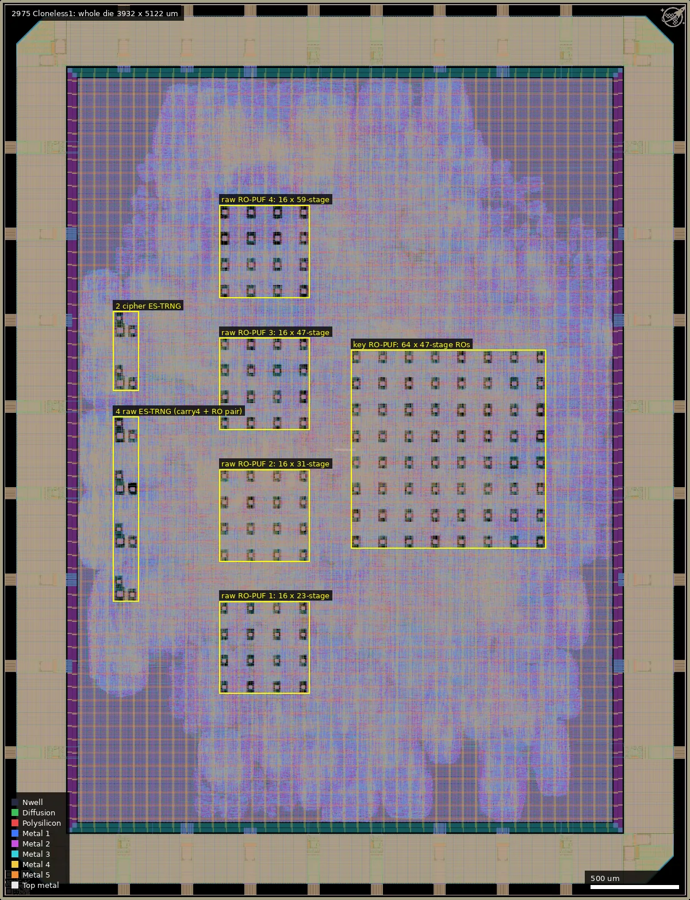
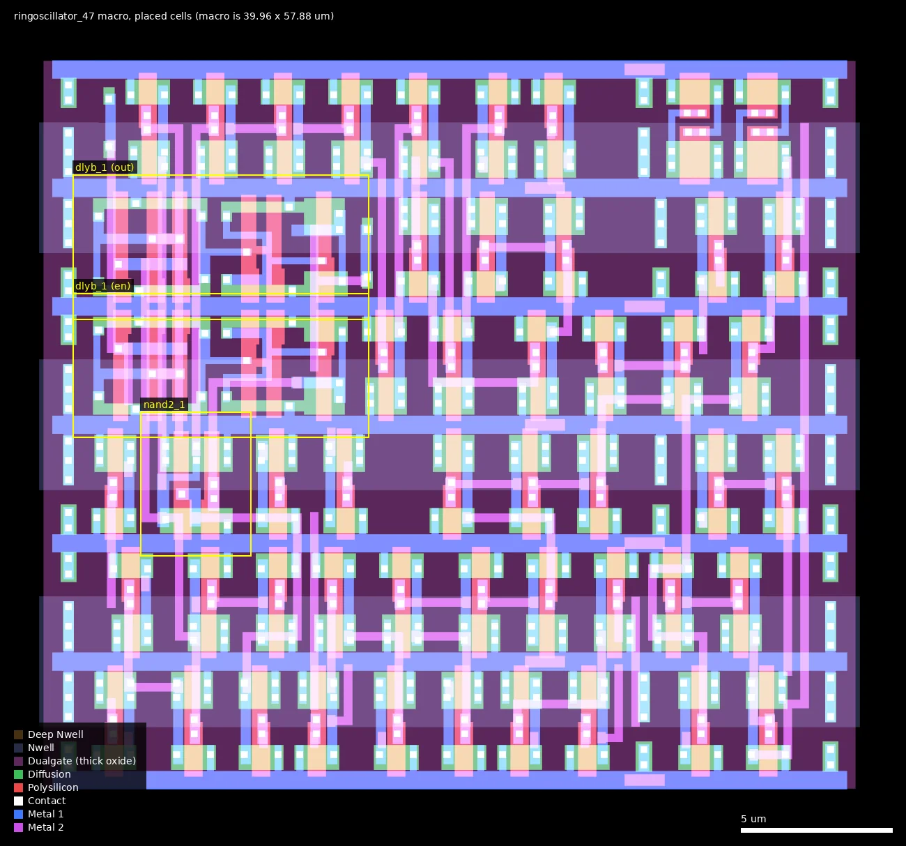
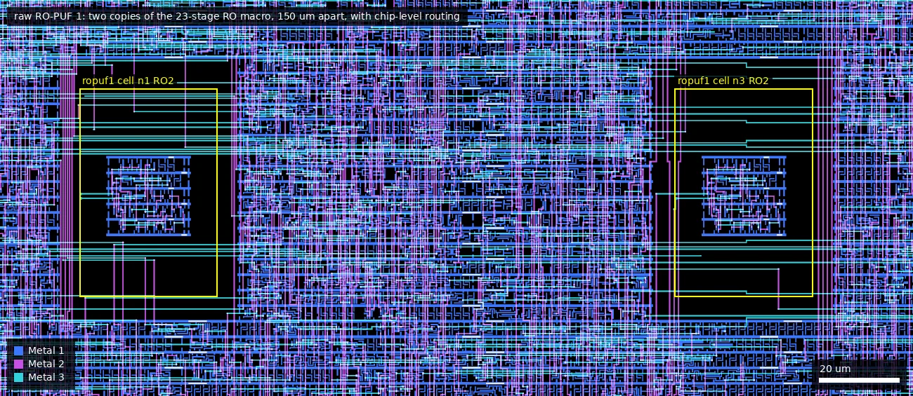
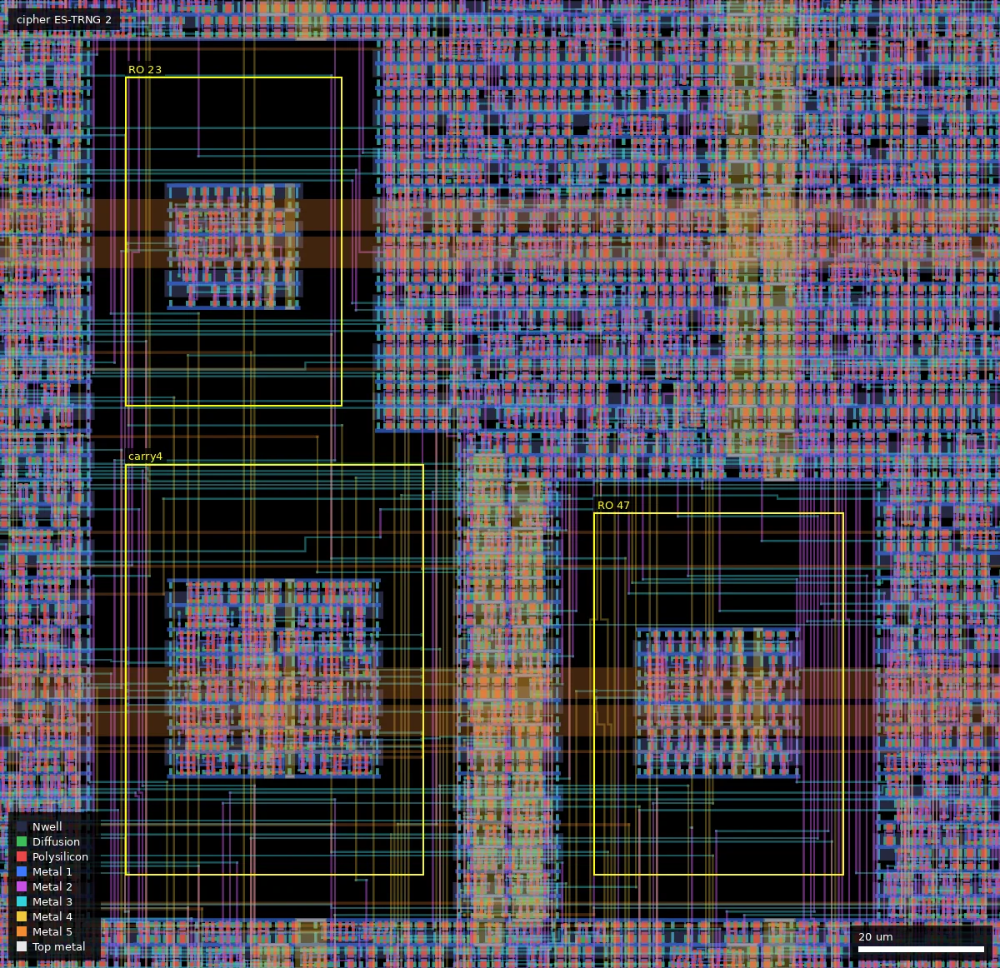
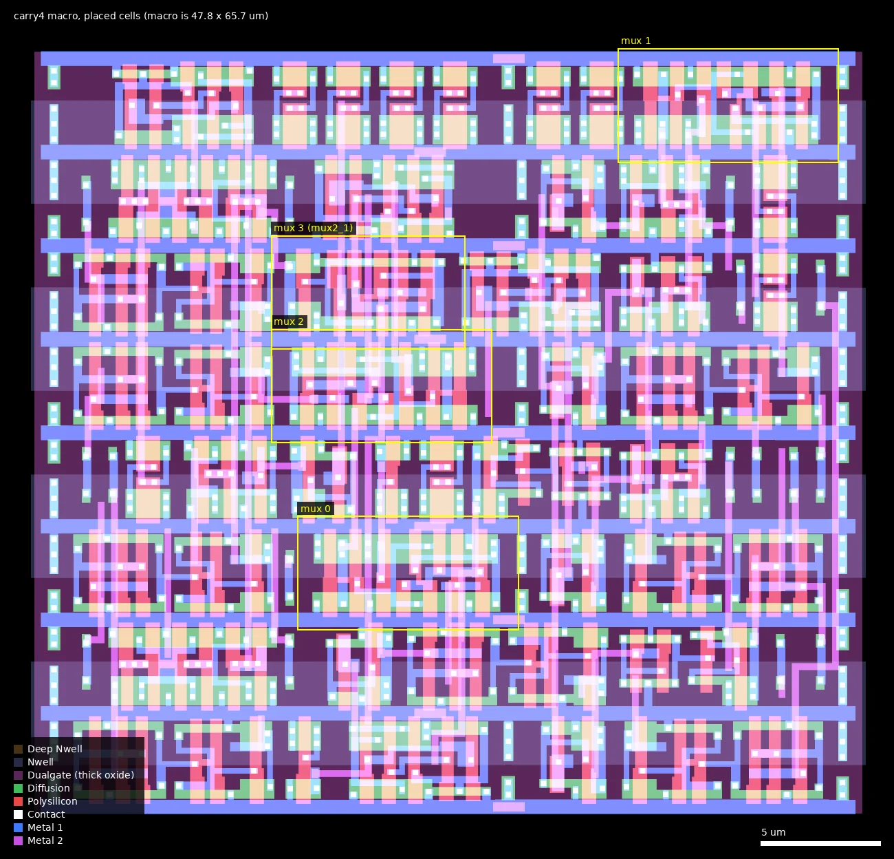

# 2975: Cloneless1 (ws-run1)

| | |
|---|---|
| Repository | https://github.com/ThorbenMoos/Cloneless1 @ fdc35dd (main, last commit 2026-07-30; releases v1 2026-01-08, v2 2026-01-24) |
| Slot | 1x1 (DIE_AREA 0 0 3932 5122 um) |
| Top cell | chip_top |
| Taped-out layout | 2975_chip_top_0_6, 3932 x 5122 um, 2 placements on the G801 reticle |
| Licence in repo | GPL-3.0 (LICENSE file; no SPDX headers) |
| README | OK (1474 words, own text) |

## What the repo actually contains

A side-channel-hardened cryptographic ASIC, written entirely in VHDL (`src/`, 40 files), converted to Verilog with `ghdl synth` and hardened with LibreLane (`chip_top.yaml`, `Makefile`). Standard-cell library is gf180mcu_fd_sc_mcu7t5v0 (7-track, 5 V; hold corners are all 4v50/5v00/5v50 corners, clock 4 MHz). IO is the wafer.space padring (gf180mcu_fd_io__in_c/in_s inputs, bi_24t outputs, gf180mcu_ws_io__dvdd/dvss power pads). No SRAM, no analog macros, no custom devices (confirmed on the layout, see below).

Functional blocks (`src/Cloneless.vhd`, memory-mapped through a 4-bit data / 3-bit address interface):
- mid-pSquare block cipher (prime-field Mersenne arithmetic, inner-product masking, 2 shares, 2 redundancy domains), `mid_pSquare_dSHARES_IPM_kRED.vhd` and the *ModMersenne files. One hard-coded (shared) key plus one key selected by config registers that mixes in error-corrected RO-PUF bits (`mps_ipm_controller.vhd`: 2x ro_puf, 16 bits, 4 parallel, RO length 47, 16383 cycles, 7-fold majority).
- 4x ES-TRNG (edge-sampling TRNG; `es_trng.vhd`, `trng.vhd`, `tappeddelaychain.vhd`, `bitextractor.vhd`) read raw through the interface (RO length pairs 23/31, 23/47, 31/47, 31/59).
- 4x raw-access RO-PUF (`ro_puf.vhd`, 8 bits each, RO lengths 23, 31, 47, 59, count windows 1023, 4095, 16383, 65535 cycles).
- Trivium stream cipher for concurrent pseudo-randomness.

Hardened sub-macros (`macros/`, each its own LibreLane "Classic" flow with DESIGN_NAME = module name, FP_CORE_UTIL 45 for the ROs): `ringoscillator_23/31/47/59` and `carry4`. Instance counts in chip_top.yaml MACROS: ringoscillator_23 x20, _31 x19, _47 x84, _59 x17 (140 ring oscillators in total), carry4 x6, plus wafer.space id and logo macros.

Verification: GHDL and iverilog testbenches (`src/Testbenches/`), post-layout gate-level sim step in the Makefile, wafer.space precheck (Makefile reports clean). No final GDS in the repo (a download link to thorbenmoos.de is given, 59 MB zip, not fetched; releases have no assets), so the comparison below is between the repository's configuration and the reticle layout. Silicon results are NOT in this repo; the README says the chips were manufactured, delivered and tested (cipher evaluated against 100 million power traces), and points to the separate Cloneless_artifacts repo (PCBs, FPGA controller, software) that was not in the clone set.

## Taped-out layout

Measured on `layout/2975.oas` (the die as placed on the G801 reticle).

| | |
|---|---|
| Die | 3932 x 5122 um (configured core area (442, 442) to (3490, 4680)). Five metal layers; Metal5 is the top metal, MetalTop is not used |
| Pads | 32 pad cells: 10 `gf180mcu_fd_io__in_c` (rst, read, write, data_in[3:0], address[2:0]), 1 `in_s` (clk, Schmitt), 4 `bi_24t` (data_out[3:0]), 8 `gf180mcu_ws_io__dvdd`, 9 `gf180mcu_ws_io__dvss`. No analog pad, no bare pad |
| Standard cells | gf180mcu_fd_sc_mcu7t5v0 only: 316,440 logic cells and 463,577 fill/tap/decap/antenna cells (hard macros included). Most used: nand2_1 54,830, xor2_1 51,533, nor2_1 28,820; 11,507 dffq_1 and 2,078 dffrnq_1 flip-flops; 18,471 dlyb_1/dlyc_1 delay cells |
| Transistors | All gates sampled (every hard macro, and a 600 x 600 um core window) lie inside Dualgate with V5_XTOR: 5 V thick-oxide devices only. The core window contains no resistor, SAB, MOS-capacitor or BJT marker (only antenna diodes); the die has no MIM or fuse layer at all |
| SRAM | none |
| Hard macros | 140 ring-oscillator macros (ringoscillator_23 x20, _31 x19, _47 x84, _59 x17) and 6 carry4 macros; plus wafer.space logo and ID |
| Custom cells | none. All 120 standard-cell types on the die have one geometry each, identical between the copies inside the hard macros and the copies in the core (compared layer by layer), so the oscillators use unmodified library cells |

### Does it match the repository?

Yes, as far as it can be checked without a GDS in the repository.

- All 146 hard-macro instances listed in `chip_top.yaml` (20 + 19 + 84 + 17 ring oscillators, 6 carry4) are on the die at exactly the listed coordinates, all in orientation N. No instance is missing or extra.
- IO cell types, counts and the pad labels (clk_PAD, rst_PAD, read_PAD, write_PAD, data_in_PAD[3:0], data_out_PAD[3:0], address_PAD[2:0], VDD, VSS) match `chip_top.sv` and the PAD_* lists.
- Standard-cell library is mcu7t5v0 only, as configured.
- Each ring-oscillator macro contains exactly N-1 `inv_1` and one `nand2_1` (N = 23, 31, 47, 59); tracing Metal1 to Metal3 inside the macro shows one closed loop through all of them, as `ringoscillator.vhd` describes.
- Differences from what the sources alone suggest (all introduced by the hardening flow, not by hand): each RO macro also holds two `dlyb_1` delay cells used as buffers (one on `ro_en`, one driving `ro_out`), and the carry4 macro is not only mux2_1/xor2_1 (see the table below).

### Where the test structures are

All macros are placed in orientation N on a 75 um grid (x, y = 510 + 75 n). Positions are lower-left corners in die coordinates.

| Structure | Cell (size) | Instances and position | Measured from the layout |
|---|---|---|---|
| Raw RO-PUF 1 (`ropuf1`) | ringoscillator_23 (34.74 x 52.66 um) | 16 at x = 1260, 1410, 1560, 1710; y = 1185, 1335, 1485, 1635 | 22 inv_1 + nand2_1; ring wiring 238 um in total, stage-to-stage wires 3.7 to 30 um |
| Raw RO-PUF 2 (`ropuf2`) | ringoscillator_31 (37.11 x 55.02 um) | 16 at same x; y = 1935 to 2385 | 30 inv_1 + nand2_1; ring wiring 268 um |
| Raw RO-PUF 3 (`ropuf3`) | ringoscillator_47 (39.96 x 57.88 um) | 16 at same x; y = 2685 to 3135 | 46 inv_1 + nand2_1; ring wiring 464 um |
| Raw RO-PUF 4 (`ropuf4`) | ringoscillator_59 (41.73 x 59.65 um) | 16 at same x; y = 3435 to 3885 | 58 inv_1 + nand2_1; ring wiring 493 um |
| Key RO-PUF (`mps_d2_ipm_r2_controller.ropuf1/2`) | ringoscillator_47 | 64 in an 8 x 8 array, x and y = 2010 to 3060 in steps of 150 | same macro as raw RO-PUF 3 |
| ES-TRNG 1 to 4 (raw) | carry4 (47.8 x 65.72 um) + two RO macros | carry4 at (660, 1710 / 2010 / 2310 / 2610); first RO at (660, y + 75), second RO at (735, y). RO lengths 23/31, 23/47, 31/47, 31/59 | see carry4 below |
| ES-TRNG in the cipher (2x) | carry4 + ringoscillator_23 + ringoscillator_47 | carry4 at (660, 2910) and (660, 3210) | not readable raw |

Details that matter for interpreting measurements:

- Devices in the ring: `inv_1` is one NMOS W/L = 0.82/0.60 um and one PMOS 1.22/0.50 um; `nand2_1` is two NMOS 0.82/0.60 in series and two PMOS 1.13/0.50. All 5 V thick oxide.
- The two oscillators compared in one PUF bit are not neighbours: in every RO-PUF cell the second RO is 150 um above the first (same x). A bit therefore contains any within-die gradient over 150 um as well as local mismatch.
- Inside a macro the ring is placed and routed automatically. The stages are not uniform: stage-to-stage wires range from 3.7 um (abutting cells, Metal2 only) to about 30 um (Metal2 + Metal3), and the node after the nand2_1 carries an extra load (the `dlyb_1` output buffer). All copies of one macro are identical, so this affects the absolute frequency, not the comparison.
- The active cells sit in the middle of the macro (for ringoscillator_47: a 24.9 x 24.4 um cluster in a 39.96 x 57.88 um outline), which with the 5 um macro halo keeps core logic about 12 um or more away.
- The power grid is the same for every copy of a macro: one horizontal Metal5 strap pair crosses each instance at the same relative position (checked for all 146 instances).
- The signal environment is not the same. The chip-level router ran wires over the macros in a different pattern for every instance: Metal2/Metal3 wires cross the empty macro margin, and Metal4 wires cross directly above the oscillator cells, covering between 0% and 18% of the active-cell box of a ringoscillator_47 depending on the instance (84 instances, 84 different patterns; Metal5 signal wires likewise, 0% to 14%). The ring itself uses Metal1 to Metal3, so this is a different coupling load per instance. Evidence level: geometry; no parasitic extraction was done. The consequence for analysis is that a PUF bit position can have a systematic, die-independent offset that is layout, not process variation.
- carry4: the four carry multiplexers are 3x `mux2_2` and 1x `mux2_1` (the flow upsized three of them), with 4 `xor2_1` and 2 `tiel` (carry-in tied low). The flow also inserted 8 `dlyb_1`, 2 `dlya_1`, 6 `buf_1`, 2 `buf_2`, 2 `buf_4` and 2 `clkbuf_2` on the di/se inputs and the o/co outputs. The carry wires between successive multiplexers are 55, 35 and 30 um long (traced on Metal1 to Metal3), so the four taps are not equally spaced in delay.

## Authors and affiliations

| Who | Role | Affiliation | Source |
|---|---|---|---|
| Thorben Moos (git "Thorben", GitHub ThorbenMoos) | sole author, 32 commits | GitHub bio: "Cryptography and Security Researcher", blog thorbenmoos.de; commit email is an @rub.de address (hint only, no institution stated in repo) | git shortlog, `gh api users/ThorbenMoos` |
| mid-pSquare / prime masking / ES-TRNG authors | cited prior art, not repo contributors | various (UCLouvain "uclcrypto" repos referenced) | README references |

No funding line in Cloneless1 README; the Cloneless2 README acknowledges the PBS Foundation (Project SOVereign).

## Value for GF180MCU characterisation and PDK development

### Verdict: Medium

Not built as a process-characterisation chip, but it contains 140 ring oscillators of 4 odd lengths (all found on the die at the configured positions) and four PUFs whose raw outputs are explicitly intended for "characterization of oscillator behavior in the technology" (README, Cloneless2). Measurable via digital pins only; the layout confirms there is no analog or frequency-output pad. The layout does not change the verdict.

### Test structures and measurable circuits

| Structure | What it exercises | Access | Where |
|---|---|---|---|
| RO-PUF cell = two ring oscillators of identical length, each with a 16-bit ripple counter (`ro_cnt.vhd`), compared after N clk cycles; bit = (count1 >= count2) | Intra-die frequency mismatch of identical inv_1 / nand2_1 rings (7T 5 V cells) = device Vth/L mismatch, local variation; bit flip probability versus window length gives mismatch relative to jitter | Config register selects "ROPUF" core; raw bits (8 bits x 4 PUFs) read over the 4-bit data bus. Only the comparison bit is exposed, not the counter values (`ro_puf_cell.vhd` has `raw_bit` as its only result output; the die has no pads beyond the bus) | 64 macros at x 1260..1710, y 1185..3885; pairs are 150 um apart vertically (table above) |
| Ring oscillators of 23/31/47/59 stages (inv_1 chain + nand2_1 enable, traced as one closed loop in each macro) | Absolute gate delay at 5 V per die. The length ratio does not cleanly split wire from gate delay, because the auto-routed ring wiring per stage differs between macros (10.3, 8.6, 9.9 and 8.4 um per stage for 23/31/47/59) | Only through counters/PUF windows, no frequency output pad | same macros |
| ES-TRNG ring pairs + tapped delay chain built from a "carry4" emulation (on the die: 3 mux2_2 + 1 mux2_1, 4 xor2_1, plus flow-inserted delay and buffer cells) | Timing jitter sampled at mux-delay resolution; taps are unevenly spaced (carry wires 55/35/30 um); raw TRNG bits | raw TRNG core readable | 6 carry4 macros at x = 660, y = 1710..3210 |

How the PUF is built: it is a ring-oscillator PUF (Suh/Devadas style, ref [10] in README), not arbiter, SRAM, or custom analog. Every cell is a stock GF180MCU 5 V standard cell (verified: cell geometry in the macros is identical to the library cells used in the core): the Makefile `cell_replacement` target seds the GHDL-generated netlist so that `inv`, `nand2`, `mux2`, `xor2` become `gf180mcu_fd_sc_mcu7t5v0__inv_1 / nand2_1 / mux2_1 / xor2_1` with `(* keep *)`, so synthesis cannot restructure the loops. On the die the rings are intact (N-1 inv_1 + nand2_1); the keep attribute did not stop the flow from adding buffers on macro pins or from upsizing three of the four carry4 multiplexers to mux2_2. There is no separate sensor or analog-like structure on the die: the only non-synthesised structures are the 146 hard macros.

Placement: placement is semi-manual. Each oscillator length is hardened once as a macro and the chip_top.yaml MACROS section pins every instance at explicit coordinates on a regular grid (`510+75*n`, pitch matching the 75 um PDN strap pitch). The layout confirms both points: every instance is at its listed position, and the Metal5 power strap crosses every copy of a macro at the same relative position. All instances of a given length are identical copies up to Metal3. Above that they differ: chip-level signal wires on Metal4/Metal5 cross over the oscillator cells in a different pattern per instance (see the layout section), so frequency differences between copies are process variation plus a fixed per-instance routing-load term, plus supply/IR-drop. Inside the macros, placement and routing is automatic (OpenROAD), not hand-drawn. No simulation results (SPICE or Monte Carlo) comparing to silicon are in the repo; per-corner liberty/SPEF are generated by the flow only.

Side-channel/tamper countermeasures that depend on layout: the design depends on the cipher's masking being glitch-robust (RTL/gate-level property, no layout shielding found; grep of the flow config shows no shield, dummy-wire, or symmetric-routing options). The tamper-evidence claim is the delay-based PUF: invasive modification changes RO delays, so the derived key changes (README states this as the hypothesis to be tested, "tamper-evident delay-based PUFs"). That depends on physical layout/parasitics but there is no explicit layout countermeasure: on the die there is no shield mesh, no top-metal cover (Metal5, the top metal, carries only power straps and some signal wires) and no matched or symmetric routing; the macros sit under ordinary signal routing.

### Candidate PDK additions

Nothing found as a PDK addition. A usable pattern: a `cell_replacement` flow that forces named stock cells and keeps hierarchy, with macro-per-oscillator-length hardening. Hold-time corner list in chip_top.yaml names nine 4v50/5v00/5v50 corners (these are the template corners).

### What would be needed to use it

Packaged chip on the authors' PCB with FPGA controller (in the Cloneless_artifacts repo, not cloned). Pin interface is 4-bit data, 3-bit address, read/write strobes at 4 MHz, so measurement is slow but simple. Data from ~many dies is needed for mismatch statistics; the authors say they are collecting this. Absolute RO frequency needs knowledge of the counter windows (documented in Cloneless.vhd generics).

## Notes and caveats

- The die GDS is not in the repo, only a link (not downloaded). The reticle layout was compared against the repository configuration instead (macro list and positions, IO cells, pad labels, cell library): all agree.
- Per-instance differences in over-the-macro routing were measured as metal area above the oscillator cells, not as extracted capacitance; a parasitic extraction of a few instances would say how large the frequency offset is.
- Which RO instance feeds which PUF bit is taken from the instance names in `chip_top.yaml`; the wiring from macro pins to the counters was not traced.
- PUF bits only expose a comparison, so extracting a mismatch distribution means inferring it from bit-error rates vs. window length and across dies.
- The README states the TRNGs "need more tuning" and PUFs "look decent for a first attempt", but no data is in this repo.
