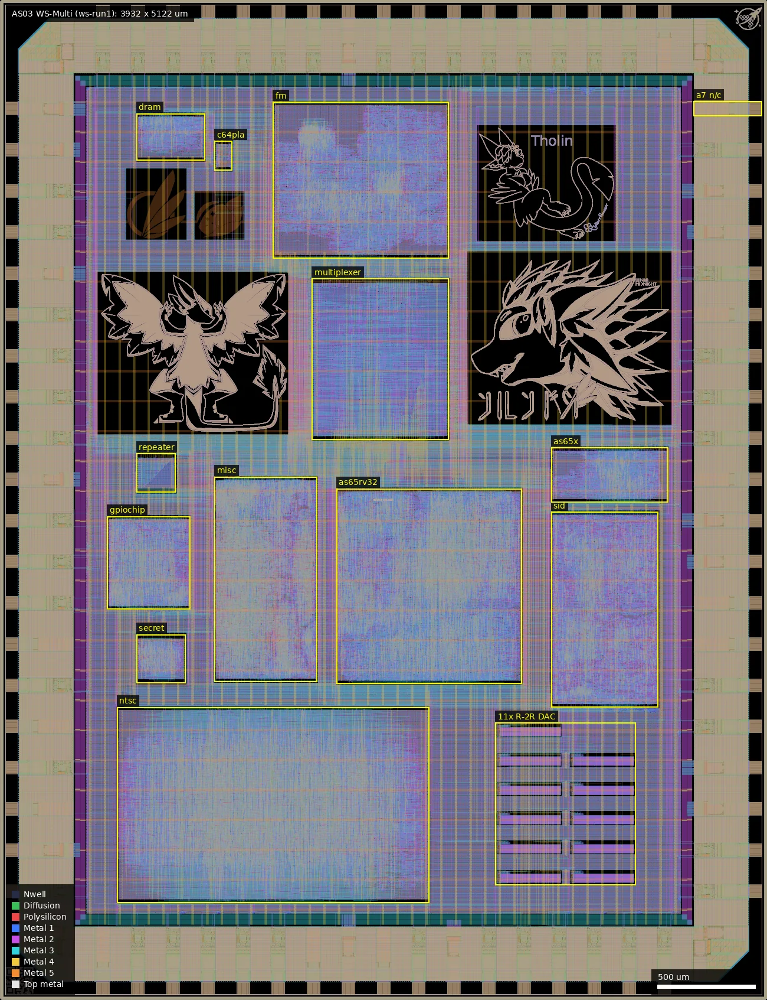
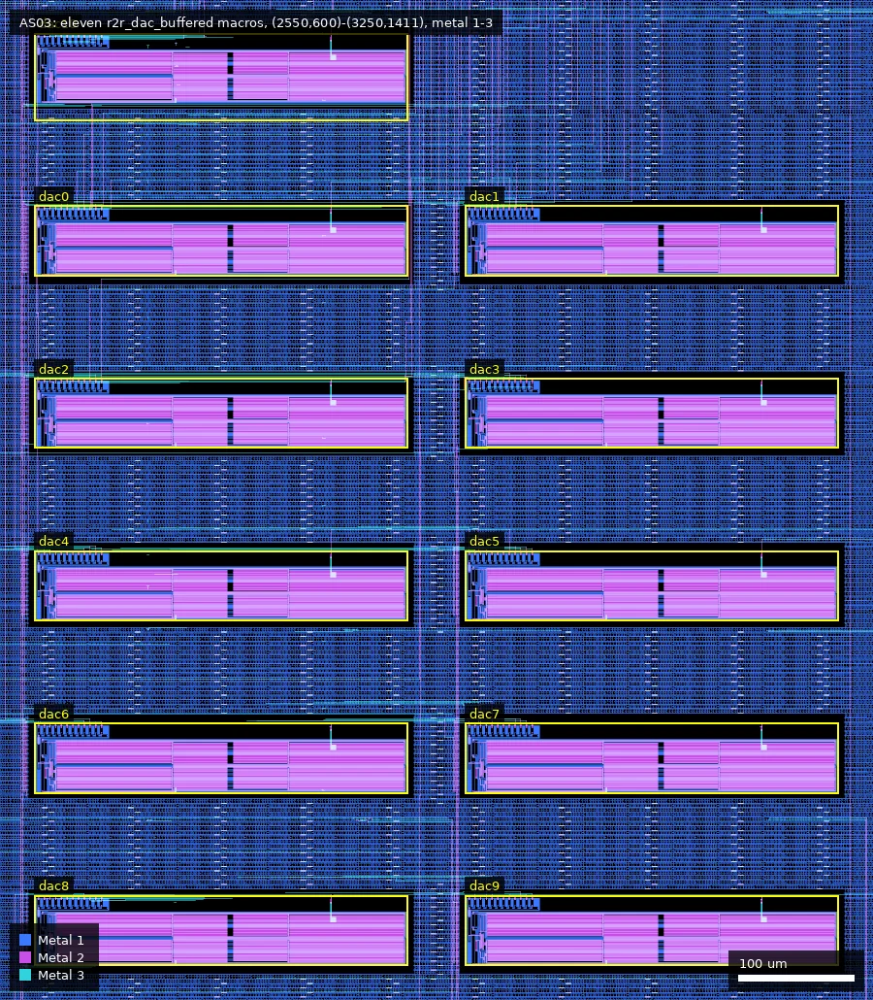
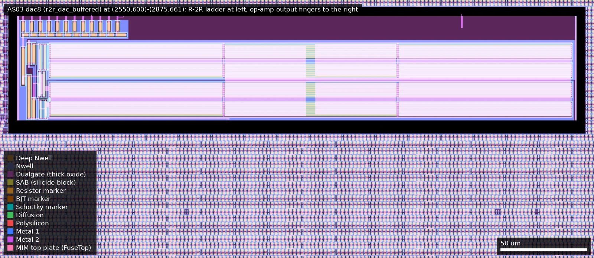
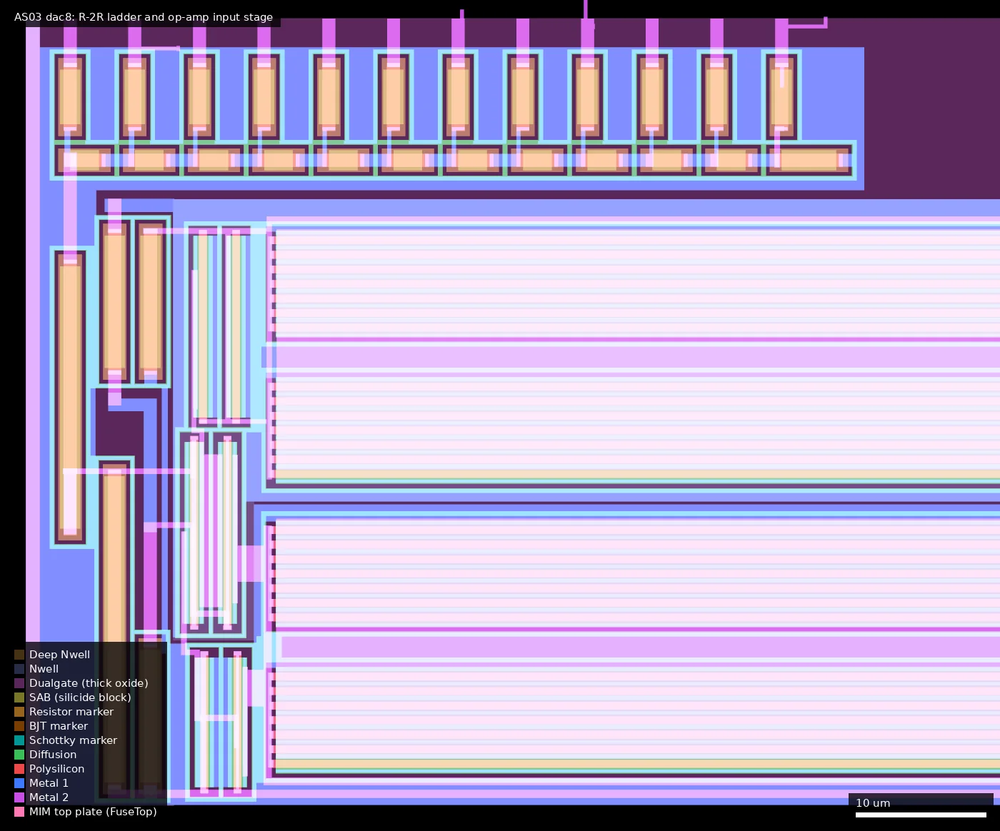
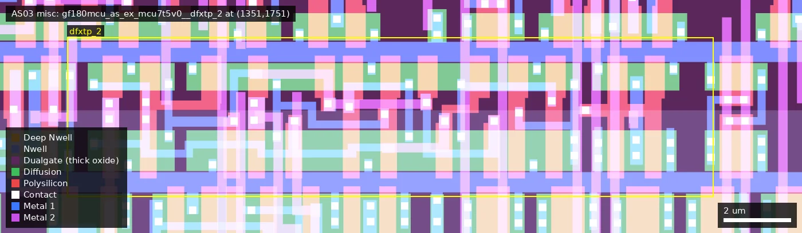

# AS03: WS-Multi (ws-run1)

| | |
|---|---|
| Repository | https://github.com/AvalonSemiconductors/ws-submission-2025 @ ef1e121 (main, last commit 2026-05-20; "Final, fabbed version" is ef13a2e, 2025-12-18; later commits are docs and one spice file) |
| Slot | 1x1 (DIE_AREA 3932 x 5122 um) |
| Top cell | chip_top |
| Licence in repo | Apache-2.0 (LICENSE file) |
| README | THIN (41 words; real docs are a Sphinx site, sources in docs/source/) |
| Taped-out layout | AS03_chip_top_6_0, 3932 x 5122 um, 1 placement on the G801 reticle |

## What the repo actually contains

Multi-project die. A 5-bit `design_sel` input (pull-ups, can be bonded) selects which sub-design owns the 42 bidir pads; the rest are held in reset. 12 analog pads. Each sub-design is a LibreLane macro in `macros/<name>/`, placed by `librelane/config.yaml`. Built on the wafer.space template with the stock 5 V library `gf180mcu_fd_sc_mcu7t5v0` (the Multiplexer, InputRepeater and SecretMessage macros use the 9-track `gf180mcu_fd_sc_mcu9t5v0` instead), `gf180mcu_fd_io` pads, 5 V supply, RT_MAX_LAYER Metal5, corners tt_025C_5v00 / ss_125C_4v50 / ff_n40C_5v50.

Sub-designs (ID = `design_sel`, from `docs/source/multiplexer.rst`):

- 00001 VGA demo, TinyTapeout animated logo (rejunity submodule), in MiscStuff.
- 00010 VGA demo, wafer.space screensaver (TinyTapeout submodule), in MiscStuff.
- 00011 Hellorld UART + Diceroll + LED blinker (GFMPW-1 replicas), in MiscStuff.
- 00100 HP Nanoprocessor replica; 00110 Simple 8-bit CPU; 00101 24-bit-colour VGA test (all MiscStuff/DACs).
- 01000/01001 RV32IMA (rv32ima_zicsr_smnmi) with 6510 or 6502 pinout, macro 65RV32 (uses the custom DFFs).
- 10000 SID 2 FM synth (3 voices x 2 operators), macro FMSynth.
- 10100 "Secret Message" (documented as "Nothing"), macro SecretMessage.
- 11000 NTSC/PAL test signal generator, macro NTSCTest (DAC composite out; custom DFFs).
- 11001 Retro DRAM controller; 11010 Retro GPIO chip (16 GPIO, 3 timers, 3x 12-bit DAC, PRNG, UART, SPI).
- 11011 SID replica (two SIDs, 8x clock, on-chip filters, POT inputs, two DACs for analog audio), macro SID.
- 11100/11101 AS65C10/AS65C02 6502 core (claims up to 33 MHz), macro AS65x.
- 11110 C64 PLA replica with selectable delays (CASDEL[1:0], DEL), macro C64PLA.
- 11111 all pads high-Z. Support macros: Multiplexer, InputRepeater.
- Art only: avali_logo, aef2, tholin, lunar_art_1/2, plus ws_ip id and logo.

Analog / mixed-signal (`macros/Analog/`):

- `R2R_DAC/` `r2r_dac_buffered`: 12-bit R-2R DAC with big op-amp buffer (`opamp_chonky`). Extracted spice uses `nfet_05v0`, `pfet_05v0` (W=100u L=0.6u output fingers; 14u/10u input stage) and `ppolyf_u_1k_6p0` resistors (r_width 1u, length 2/4/10/23.4u). Delivered as GDS/LEF, a stub .lib (pin caps 0) and a blackbox Verilog with an ifdef SIM model. xschem benches `r2r_dac_bench.sch` and `opamp_bench.sch` (.control tran). 11 instances dac0..dac10. `opamp_slim` is unused (the taped-out DAC cell is flat, and identical to the repo GDS).
- `AnalogPad/` `gf180mcu_fd_io__asig_5p0_fixed`: custom IO cell (GDS/LEF/mag/lib), a modified PDK `asig_5p0`; 12 instances analog_0..11. Commit message "Custom analog pad structure". Compared with the stock `gf180mcu_fd_io__asig_5p0` on another run-1 die, every mask layer is identical; only the pin/label layers differ (Metal2/3/4/5 label datatype 10 added), so "fixed" means fixed LEF pins, not a changed pad.
- `gf180_ntsc/`: xschem opamp (`pfet_06v0`/`nfet_06v0`) and sine generator (`cap_mim_2f0fF`, `ppolyf_u_1k_6p0`); not referenced by any flow config and not on the die (the layout has no MIM capacitor layers and no such cells).
- `R2R_DAC/test_counter`: digital 12-bit counter for DAC simulation (spice updated 2026-05-20, after tape-out); not on the die.

DAC consumers: GPIO (3), SID (2), NTSC luma, VGA R/G/B, and spares straight to pads. `analog_7` is wired to `vic_chroma`, which has no driver in `chip_top.sv`.

Avalon 5 V cell library: `macros/MiscStuff/gf180mcu_as_ex_mcu7t5v0` (submodule github.com/AvalonSemiconductors/gf180mcu_as_ex_mcu7t5v0, pinned 5d671a8). Cells: `dfxtp_2`, `dfxtn_2` (faster but larger DFFs per README), `dffm2_2`, `trans_1`/`trans_2` (transmission gates, blackboxed for STA). Liberty at 3 corners, LEF, CDL, Verilog. MiscStuff, NTSCTest and 65RV32 exclude stock `gf180mcu_fd_sc_mcu7t5v0__dff*`, so every flop in them maps to the Avalon DFFs (confirmed in the layout, see below); the other macros use stock cells. No RTL instantiates the trans cells and none is on the die.

Verification present: cocotb RTL and GL benches, AS65x FunctionalBench/IsaBench, SID/Verilator. Commits say "AS65x passing all tests", "Fix antenna violations inside macros". Not present: final GDS, DRC/LVS/STA reports, silicon data. The top flow nulls KLayout.DRC and Magic.DRC and their checkers (DRC presumably run separately; this cannot be checked from the layout).

## Taped-out layout

| | |
|---|---|
| Die | 3932 x 5122 um, 5 metal layers (Metal5 is the top metal), one placement on G801 |
| Pads | 74: 42 `gf180mcu_fd_io__bi_24t`, 12 `gf180mcu_fd_io__asig_5p0_fixed`, 5 `in_s` (design_sel), 1 `in_c` (clock), 7 `gf180mcu_ws_io__dvdd`, 6 `gf180mcu_ws_io__dvss`, 1 `gf180mcu_fd_io__dvss` |
| Standard cells | 86,629 logic cells: 80,672 `gf180mcu_fd_sc_mcu7t5v0`, 2,370 `gf180mcu_fd_sc_mcu9t5v0`, 3,587 `gf180mcu_as_ex_mcu7t5v0` |
| Flip-flops | 7,550: 2,436 Avalon `dfxtn_2`, 1,151 Avalon `dfxtp_2`, 3,776 stock `dffq`, 169 stock `dffnq` (all in as65x), 18 9-track `dffq_1` |
| SRAM | none |
| Custom blocks | 11 x `r2r_dac_buffered` (324.9 x 60.7 um each), 12 logic macros, 5 art macros |
| Transistors | every gate in the 12 logic macros and the DACs lies inside Dualgate with V5_XTOR (5 V devices); no thin-oxide gate found in any of them |

### Does it match the repository?

Yes. The repository has no chip-level GDS, so the comparison is against the flow configuration and the hard-macro GDS files that are checked in:

- All 12 logic macros, the 11 DAC instances, the 5 art macros and the ID/logo cells sit at the coordinates given in `librelane/config.yaml`.
- `r2r_dac_buffered`, `gf180mcu_fd_io__asig_5p0_fixed`, `gf180mcu_as_ex_mcu7t5v0__dfxtp_2` and `__dfxtn_2` were XORed layer by layer against the repo GDS: zero difference on every layer.
- Pad counts per side and the standard-cell library per macro agree with the configs (the three 9-track macros included).
- The summary's flop mapping holds: misc has 1,088 `dfxtp_2`, ntsc 61 `dfxtp_2`, as65rv32 2,436 `dfxtn_2` plus 2 `dfxtp_2`, and none of the three contains a stock flop. No `trans_1`, `trans_2` or `dffm2_2` cell is on the die.

Whole die (0,0)-(3932,5122): logic macros outlined, the eleven DACs at lower right, the unconnected pad `analog_7` ("a7 n/c") on the east edge; the dark blocks are artwork.

The eleven `r2r_dac_buffered` macros at (2550,600)-(3250,1411), metal 1 to 3; each sits in a cut-out of the standard-cell fill with its output leaving from the top edge.

dac8 at (2550,600)-(2875,661): the R-2R ladder is the small group at upper left, the rest of the macro is the op-amp's large transistors (twelve blocks of seven 100 um gate fingers, three columns by four rows), all inside Dualgate.

Left 77 um of dac8, (2548,598)-(2625,662): twelve vertical 2R legs over eleven horizontal R segments plus the termination, the bias resistors and input transistors below, and the start of the output fingers at right.

`gf180mcu_as_ex_mcu7t5v0__dfxtp_2` in the misc macro at (1351,1751): 26 transistors, cell 18.48 um wide (the stock `dffq_1` on the same die is 16.24 um).

### Structures located in the layout

DAC cell, measured from the layout (identical in all 11 instances): 90 transistors, all thick oxide: 42 NMOS and 42 PMOS gate fingers of W = 100 um, L = 0.6 um, 4 PMOS of W = 14 um, L = 0.6 um, 2 NMOS of W = 10 um, L = 0.6 um. 29 poly resistor bodies 1.0 um wide with SAB, inside Dualgate (`ppolyf_u_1k_6p0`): 13 of 4 um (the twelve 2R legs and the termination), 11 of 2 um (R), and 3 x 10 um, 1 x 20 um, 1 x 23.4 um in the op-amp. At a nominal 1 kohm/sq that makes R = 2 kohm and 2R = 4 kohm.

DAC-to-pad connections below come from connectivity extracted over the top-level metal and via shapes (each DAC `OUT` pin was followed to the pad it reaches). Signal and pad names are from `chip_top.sv` and agree with the pad order in the config. Route length is the extracted wire length; the wires are minimum width (0.28 um on Metal2 to Metal4, 0.44 um on Metal5).

| DAC | Position (lower left) | Signal | Pad | Pad centre | Route length |
|---|---|---|---|---|---|
| dac0 | (2550,1200) | sid_audio_0 | analog_0 | east (3731,1822) | 1.3 mm |
| dac1 | (2925,1200) | sid_audio_1 | analog_5 | north (3406,4921) | 3.8 mm |
| dac2 | (2550,1050) | spare_analog_0 | analog_10 | west (201,1822) | 3.2 mm |
| dac3 | (2925,1050) | vic_luma | analog_4 | south (1606,201) | 2.3 mm |
| dac4 | (2550,900) | vga_r | analog_8 | east (3731,2666) | 2.5 mm |
| dac5 | (2925,900) | vga_g | analog_9 | east (3731,2034) | 1.4 mm |
| dac6 | (2550,750) | vga_b | analog_6 | south (1966,201) | 1.3 mm |
| dac7 | (2925,750) | spare_analog_1 | analog_11 | west (201,978) | 3.6 mm |
| dac8 | (2550,600) | spare_analog_2 | analog_3 | south (526,201) | 2.6 mm |
| dac9 | (2925,600) | spare_analog_3 | analog_2 | west (201,1400) | 3.9 mm (2.7 mm of it on Metal5) |
| dac10 | (2550,1350) | spare_analog_4 | analog_1 | east (3731,3510) | 2.8 mm |
| none | | vic_chroma (undriven) | analog_7 | east (3731,4566) | no top-level metal touches the pad pin |

The DAC outputs were routed by the digital router as ordinary signal nets. With the tech-LEF sheet resistance of 0.104 ohm/sq (0.070 for Metal5), 1.3 to 3.9 mm of minimum-width wire is roughly 0.5 to 1.4 kohm in series with each output, before vias (an estimate from geometry, not an extraction with parasitics). That is the same order as the 1 kohm load the DAC is designed for, and a 1 kohm load at full scale would put several mA through a 0.28 um wire.

Other structures:

| Structure | Cell | Where | Measured |
|---|---|---|---|
| Avalon positive-edge flop | `gf180mcu_as_ex_mcu7t5v0__dfxtp_2` | 1,088 in misc (1100,1630)-(1625,2680), 61 in ntsc, 2 in as65rv32 | 18.48 x 3.92 um, 26 transistors (NMOS 0.82/0.6, PMOS 1.22/0.5), all in Dualgate |
| Avalon negative-edge flop | `gf180mcu_as_ex_mcu7t5v0__dfxtn_2` | 2,436 in as65rv32 (1725,1620)-(2675,2620) | same size and transistor count |
| C64 PLA delay chain | `c64pla` | (1100,4250)-(1190,4400) | 140 logic cells, no flops |
| AS65C02 core | `as65x` | (2825,2550)-(3425,2830) | 3,315 logic cells, 169 negative-edge `dffnq` |
| Unconnected analog pad | `gf180mcu_fd_io__asig_5p0_fixed` | analog_7, (3556,4528)-(3906,4603) | stock analog pad with ESD only, nothing attached on the core side |

## Authors and affiliations

| Person | Role | Affiliation | Source |
|---|---|---|---|
| Tholin (GitHub 89Mods, "Luca H.") | all sub-designs, analog, cell library, docs (15 commits) | Avalon Semiconductors (Germany) | SPDX "2025 Tholin" in docs; GitHub profile (Germany, tholin.dev); AvalonSemiconductors org page |
| Leo Moser | wafer.space template, flow (18 commits) | not stated (wafer.space inferred from template origin) | git log |
| TrevorPeyton, Tim Ansell | one template commit each | not stated | git log |
| rejunity (Renaldas Zioma); TinyTapeout | VGA demos (submodules) | GitHub profile company "Research"; TinyTapeout org | gh api, submodule URLs |

## Value for GF180MCU characterisation and PDK development

### Verdict: Medium

Not built as a characterisation chip, but it has eleven 5 V op-amp-buffered R-2R DACs, each confirmed in the layout to reach its own analog pad, and the first silicon use of the Avalon ex-cell DFFs (3,587 flops in three macros). The DAC outputs reach the pads through millimetres of minimum-width wire, which limits what load measurements can say about the op-amp. No test plan or silicon data, hence not High.

### Test structures and measurable circuits

| Structure | Exercises | Access | Where |
|---|---|---|---|
| 11x `r2r_dac_buffered` | `ppolyf_u_1k_6p0` matching (INL/DNL; 1 um wide, 2 and 4 um long segments), `nfet_05v0`/`pfet_05v0` opamp gain, slew, supply sensitivity; drive into a load is masked by 0.5 to 1.4 kohm of routing | one analog pad per DAC (table above; `analog_7` is unconnected); code from GPIO-chip DAC registers, NTSC (luma[11:0] also on bidir[11:0]) or VGA demos | `macros/Analog/R2R_DAC`, `AnalogPad`, `src/chip_top.sv` 454-780; layout (2550,600)-(3250,1411) |
| Avalon `dfxtn_2` (2,436, RV32) and `dfxtp_2` (1,151, misc/VGA and NTSC) | max clock vs liberty (3 corners); the other macros use stock `dffq_1`/`dffnq_1`, so both flop families are on one die | pass/fail versus clock on designs 01000/01001, 11000, VGA | `macros/MiscStuff/gf180mcu_as_ex_mcu7t5v0`, macro configs |
| C64 PLA delay settings | combinational propagation delay | CASDEL, DEL pads | `macros/C64PLA`; layout (1100,4250) |
| AS65C02 core | max clock (claimed 33 MHz) on stock 5 V cells | pads | `macros/AS65x`; layout (2825,2550) |
| IO pads | `gf180mcu_fd_io` bi_24t drive at 5 V | e.g. 28 UART TX copies in design 00011 | `docs/source/misc.rst` |

Simulation to compare: post-layout extracted spice for the DAC and bench schematics, no stored waveforms; liberty tables for the DFFs. No silicon data in the repo.

### Candidate PDK additions

- The `r2r_dac_buffered` macro (5 V, 12 bit). The IO cell `asig_5p0_fixed` is the stock `asig_5p0` with pin shapes added on the label layers; the useful PDK change is that pin fix to the stock cell's LEF/GDS, not a new pad.
- A routing rule or wide-wire option for analog nets in the chip-top flow: here the router treated the DAC outputs as minimum-width signals.
- `gf180mcu_as_ex_mcu7t5v0` cells with lef/lib (3 corners)/cdl/verilog; its README says the trans cells cannot be characterised.
- Documented workarounds: a MAGIC_GDS_FLATGLOB list "to get rid of 3.3V devices (DUALGATE drawn into high-level cells)" (on the taped-out die every macro gate is inside Dualgate); KLAYOUT_FILLER_OPTIONS Metal2_ignore_active because minimum Metal2 density could not be met; OpenROAD issue 8229; the cell library commit "Oops, forgot dualgate!".

### What would be needed to use it

Bare-die or bonded probing of the analog pads; 5 V supply; an 8-bit-bus controller for the GPIO chip DAC registers, or a VGA/NTSC clock source; scope or ADC with a high-impedance input, because each DAC output has roughly 0.5 to 1.4 kohm of routing in series (use the pad table above to pick the short routes: dac0, dac5, dac6). No test plan in the repo; DAC load/swing only in the docs.

## Notes and caveats

- No final GDS, reports or silicon data in the repo; the taped-out layout agrees with the configs and with every hard-macro GDS that is checked in.
- The cell-library submodule is pinned older than the copy in WSLG (which adds a dynamic DFF).
- No `trans_*` or `dffm2_2` cell was placed; only `dfxtp_2` and `dfxtn_2` of the Avalon library are on silicon.
- The series resistance quoted for the DAC routes is an estimate from wire length, width and the tech-LEF sheet resistance; a parasitic extraction of the top level would settle it.
- Artwork on the die carries the text "Tholin" and an artist signature ("Lunar Midnight").
- Commits after the fabbed version are docs and a spice file only.
