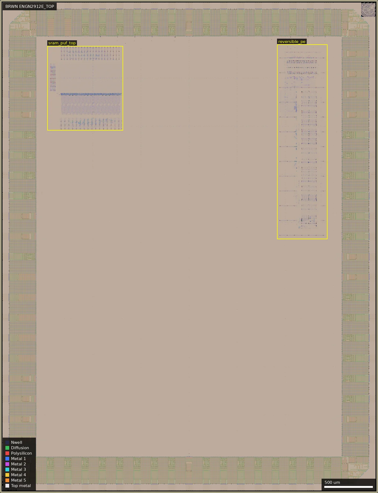
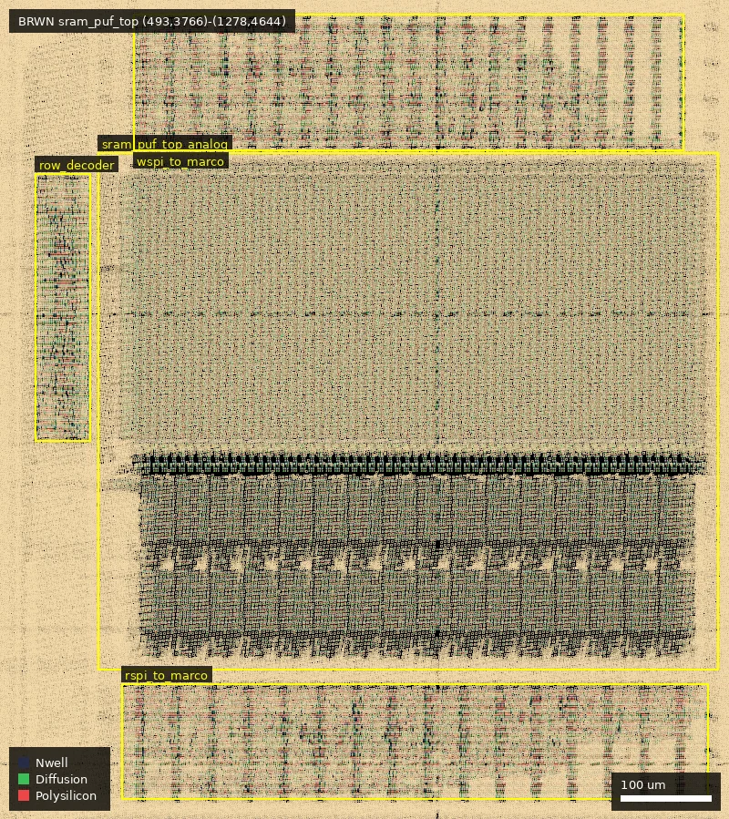
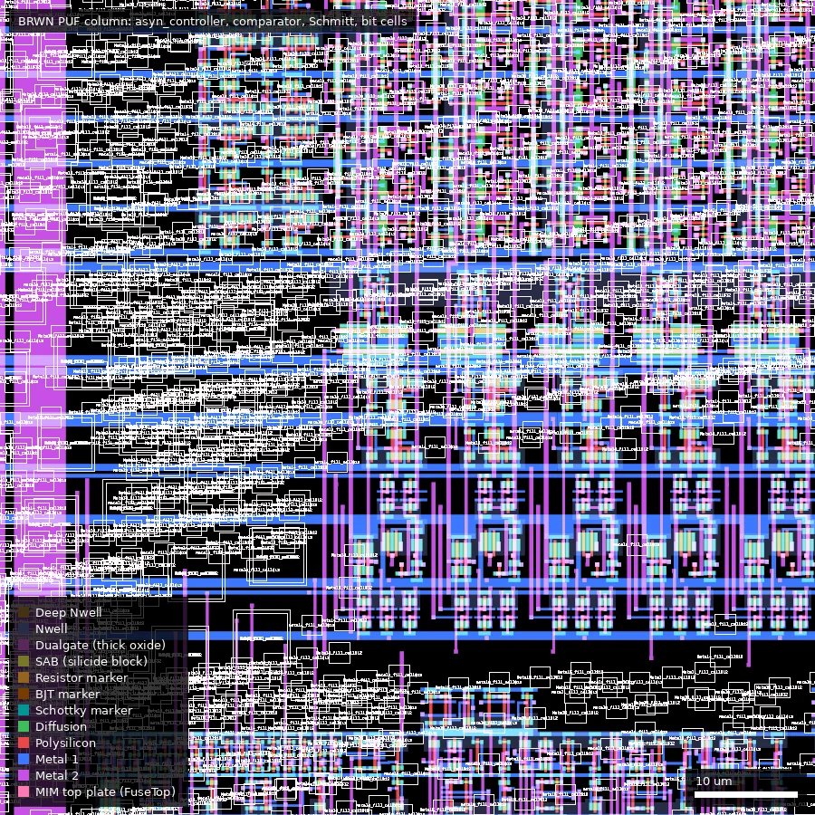
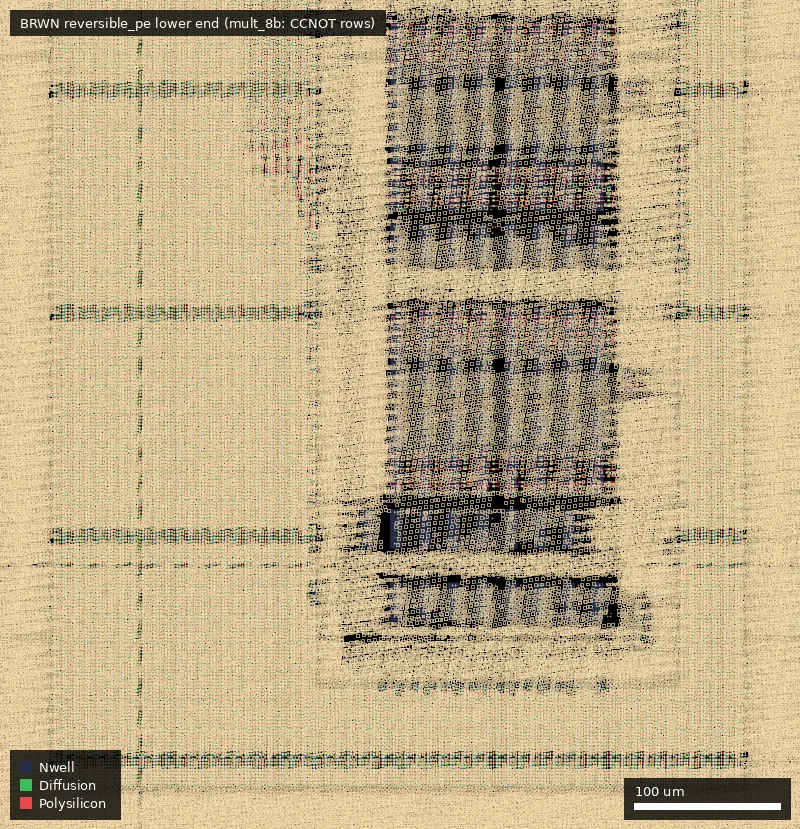

# BRWN: FA25_Engn2912e_Saligane_Brown (ws-run1)

| | |
|---|---|
| Repository | none listed on platform.wafer.space |
| Slot | 1x1 |
| Taped-out layout | BRWN_ENGN2912E_TOP_8_2, 3932 x 5122 um, 1 placement on the G801 reticle (run 1) |
| Top cell | ENGN2912E_TOP |
| Licence in repo | n/a |
| README | n/a |

## What the repo actually contains

No repository was listed for this project, so nothing was cloned and there is nothing to audit. The only first-hand information is the platform record in `project.json`. Platform description: "FA25 ENGN2912e@Brown Course Project".

The manufactured layout is in the public reticle (`ws-run1`, layout `BRWN/ENGN2912E_TOP.gds`, SHA256 `dcbf5b02fe7e5cd36f78012eebb2b6fd5f4db740c3f56357123b9a304018b1ac`). Everything below is taken from that layout.

In short: a mostly empty 3.9 x 5.1 mm die with a 56-pad ring and two small blocks. One is an SRAM-based physically unclonable function (PUF) array with its own comparators, Schmitt triggers, delay chain and SPI-style read and write interfaces. The other is an 8-bit multiplier and 16-bit adder built from transistor-level Toffoli ("CCNOT") and full-adder cells, with standard-cell registers around them. The block purposes are inferred from cell names (`sram_puf`, `puf_readout`, `reversible_pe`, `CCNOT`); connectivity and device counts are measured.

## Taped-out layout

| Item | Measured |
|---|---|
| Die size | 3932 x 5122 um (slot 1x1, includes seal ring, wafer.space ID and logo) |
| Pad ring | 56 signal pads: 13 `gf180mcu_fd_io__bi_24t` (bidirectional), 29 `in_c` (CMOS input), 7 `in_s` (Schmitt input), 7 `asig_5p0` (analog, 5 V); 8 `gf180mcu_ws_io__dvdd` and 10 `dvss` power cells; 4 corner cells |
| Pad names (Metal5 labels) | `analog_PAD[0..6]`, `bidir_PAD[0..12]`, `input_PAD[0..6]`, `clk1/2/3/3_b_PAD`, `rst_n2/3_PAD`, `rrst_n1/wrst_n1_PAD`, `spi_clk0/1/2_PAD`, `unused_PAD[0..17]` |
| Digital standard cells | `gf180mcu_fd_sc_mcu7t5v0` (GF 5 V, 7-track): about 4.4 to 4.7 thousand logic cells (layout.json counts 4379) plus fill, tap and endcap cells; `mcu9t5v0` appears only as about 45 k fill placements |
| Custom (non-library) circuits | transistor-level cells with Cadence-style names (`CDNS_...`): PUF bit cell, comparator, Schmitt trigger, driver, delay chain, CCNOT, 8-bit full adder |
| SRAM macros | none (the PUF array is custom-drawn, not a PDK SRAM macro) |
| Dualgate / V5_XTOR | present only in the standard cells and IO cells; none of the custom cells is in Dualgate, so they are 3.3 V thin-oxide devices |
| Die usage | two blocks of about 0.69 mm2 and 1.05 mm2 on a 20 mm2 die; the rest of the core is empty |

### Does it match the repository?

Not applicable: there is no repository. The unverified lead `Evansika959/FA25_engn2912e_class_tapeout_top` (see caveats) has not been cloned or compared; the block list above is what it would have to be checked against.

*Whole die. The 56-pad ring is at the edge; the only core content is `sram_puf_top` (upper left, 493,3766 to 1278,4644 um) and `reversible_pe` (right, 2884,2639 to 3404,4659 um, placed rotated by 90 degrees).*

*`sram_puf_top` (493,3766 to 1278,4644 um): PUF array `sram_puf_top_analog` (589,3915 to 1278,4490), write-side SPI block `wspi_to_marco` (628,4492 to 1240,4644), read-side block `rspi_to_marco` (615,3772 to 1267,3900) and `row_decoder` (519,4169 to 581,4467).*

*Bottom of one PUF column (596,4118 to 676,4198 um): `asyn_controller` with `delay_chain` (605,4117), the column comparator and Schmitt trigger, and the first bit cells above. The thin white boxes are dummy-fill cell outlines drawn by the renderer.*

*Lower end of `reversible_pe` (2870,2630 to 3420,3200 um): rows of `CCNOT` cells in the multiplier `mult_8b`.*

### Blocks

| Block | Cell, position, size | What it is (from layout) | Pads reached |
|---|---|---|---|
| SRAM PUF array | `sram_puf_top_analog`, (589,3915), 688.5 x 575 um | 66 columns (`sram_col_64_with_periph` x65 plus one `..._with_wl_drivers`) of 66 `bit_cell`s each (4290 `bit_cell` + 66 `bit_cell_with_wl_drivers`, 9.6 x 5.15 um); per column a `comparator`, `schm_trigger`, 4 `driver`, 3 `trans_gate`, `inv`; 32 `puf_readout_v2` (38.4 x 97.8 um: 2 `rc_counter`, `xor2`, 2 `mux_81`); one `asyn_controller` with a 24.9 x 4.6 um `delay_chain` (32 n + 16 p minimum-size gates) | `analog_PAD[1]` = net `DELAY_VCTRL`, `analog_PAD[0]` = `COMP_VREF`, `clk1_PAD` = `CLK` |
| Write SPI | `wspi_to_marco`, (628,4492), 612 x 152 um, 1221 logic cells (240 `dffrnq_1`) | SPI-style write interface, nets `WSPI_CLK/CSN/MOSI/MISO/TO_MARCO_RST_N` | `spi_clk0_PAD` (CLK), `input_PAD[3]` (CSN), `input_PAD[4]` (MOSI), `bidir_PAD[11]` (MISO), `rrst_n1_PAD` (reset) |
| Read SPI | `rspi_to_marco`, (615,3772), 652 x 128 um, 953 logic cells (250 `dffrnq_1`, 141 `dlyb_1`) | SPI-style read interface, nets `RSPI_*` | `spi_clk1_PAD` (CLK), `input_PAD[6]` (CSN), `input_PAD[5]` (MOSI), `bidir_PAD[12]` (MISO), `wrst_n1_PAD` (reset) |
| Row decoder | `row_decoder`, (519,4169), 62 x 298 um, 416 logic cells | word-line decode | internal |
| Reversible PE | `reversible_pe_antenna_fixed` / `reversible_pe`, 2020 x 520 um (placed rotated, occupying 520 x 2020 um at (2884,2639)) | `mult_8b` (7 `8b_FA`, 64 `CCNOT` of 50 x 16 um, each 8 n + 8 p thin-oxide gates), `fa_16b` (2 `8b_FA`), about 2060 standard cells (flip-flops, muxes, tie cells) around them, 35 antenna diodes | `clk3_PAD`, `clk3_b_PAD`, `rst_n3_PAD`, `spi_clk2_PAD`, `input_PAD[1]`, `input_PAD[2]`, `bidir_PAD[8]`, `bidir_PAD[9]`, `bidir_PAD[10]` |

How the pads were established: extracted connectivity (KLayout `LayoutToNetlist` on Metal1-5 and Via1-4, dummy fill excluded) from the block-boundary labels (`CLK`, `WSPI_*`, `RSPI_*`, `DELAY_VCTRL`, `COMP_VREF`) and from the nine top-level routes that feed the PE block. Each net was intersected with the placement boxes of the pad cells and the pad was named from the nearest Metal5 pad label; each net touched exactly one pad cell. The pad-to-core path inside the IO cells is through active devices and was not traced.

Two oddities, reported as found. (1) The reset of the write block reaches the pad labelled `rrst_n1_PAD` and the reset of the read block reaches `wrst_n1_PAD`: the names are crossed relative to the block names, and the layout cannot say which side is mislabelled. (2) `clk2_PAD`, `rst_n2_PAD`, `bidir_PAD[0..7]`, `input_PAD[0]`, the five analog pads `analog_PAD[2..6]` and all 18 `unused_PAD` have no route to any block. The names suggest a third block (clock 2, reset 2, eight bidirectional pads, one input) that is not on the die.

### Devices

- Custom cells are all thin-oxide (3.3 V) and at or near minimum size. The bit cell has 9 gate crossings (7 n, 2 p; more than a plain 6T cell) and a read bit line (`RBL` net names); the comparator has 5 n + 4 p (one 0.5 x 6 um device); the Schmitt trigger 7 n + 8 p; CCNOT 8 n + 8 p at 0.28 um gate length.
- The standard cells and pad cells are the GF 5 V libraries (Dualgate + V5_XTOR). No MIM capacitors, high-resistance poly, BJTs or eFuses were found in the two blocks, and there are no explicit analog test devices.
- Which supply the 3.3 V custom cells share with the 5 V standard cells in the two blocks is not determined; `VDD`/`VSS` labels exist only at the PUF block.

## Authors and affiliations

Not stated in the manifest and not on the die (the layout carries only the wafer.space ID and logo). The submitter's identity is held on platform.wafer.space. The project name and cell names point to a Brown University course (ENGN 2912E, fall 2025); the individual authors are not named.

## Value for GF180MCU characterisation and PDK development

### Verdict: Medium

No sources or documentation, but the layout holds two circuits that can be measured through ordinary digital pads: a 4,356-cell custom SRAM PUF array (cell-to-cell mismatch of minimum-size 3.3 V devices, with per-column comparators, an analog delay control `DELAY_VCTRL` and a comparator reference `COMP_VREF`), and a transistor-level reversible-logic multiplier and adder. It is limited by the missing source, the unknown supply of the custom cells and the pad-naming oddities above.

### Test structures and measurable circuits

| Structure | What it exercises | Access | Where |
|---|---|---|---|
| SRAM PUF array, 66 x 66 custom bit cells | start-up and mismatch of minimum-size n and p devices; read-bit-line behaviour; comparator offsets | SPI-style read (`spi_clk1_PAD`, `input_PAD[5,6]`, `bidir_PAD[12]`) and write (`spi_clk0_PAD`, `input_PAD[3,4]`, `bidir_PAD[11]`), `clk1_PAD`; analog `analog_PAD[1]` (delay control voltage) and `analog_PAD[0]` (comparator reference) | `sram_puf_top_analog`, (589,3915) |
| 32 `puf_readout_v2`, `asyn_controller` + `delay_chain` | delay-line and counter based read-out; delay versus control voltage | as above | inside the array |
| `mult_8b`, `fa_16b` with CCNOT cells | functional and power behaviour of a transistor-level 8-bit multiplier and 16-bit adder | `clk3_PAD` / `clk3_b_PAD` (complementary clock pair), `rst_n3_PAD`, `spi_clk2_PAD`, `input_PAD[1,2]`, `bidir_PAD[8..10]` | `reversible_pe`, (2884,2639) |
| 5 `asig_5p0` pads `analog_PAD[2..6]` | analog 5 V pad cells with nothing behind them | pad only, no core connection | left edge, y = 1400 to 2245 um |

### Candidate PDK additions

Nothing library-like is on this die: the PUF bit cell, comparator, Schmitt trigger and CCNOT are one-off layouts of minimum-size thin-oxide devices. The die could serve as a mismatch data point for minimum-size 3.3 V devices if the PUF read-out is characterised.

### What would be needed to use it

The source repository (not confirmed), the SPI protocol and register map for `wspi_to_marco` / `rspi_to_marco`, the intended supply for the custom cells, and the pad bond-out. Without them one can still probe `DELAY_VCTRL`, `COMP_VREF` and the clock and reset pads, but driving the SPI blocks would be guesswork.

## Notes and caveats

- A GitHub search for the course code finds `Evansika959/FA25_engn2912e_class_tapeout_top` (last updated 2025-12-18, no description). The name matches the project name closely, but it is not confirmed to be the source of this die and has not been cloned or analysed.
- Pad-to-block assignments come from extracted metal connectivity; the two reset nets look crossed (see above) and would need the source to settle.
- The functional descriptions (PUF, reversible computing, SPI) are inferred from cell and net names; the block contents, counts and connectivity are measured.
