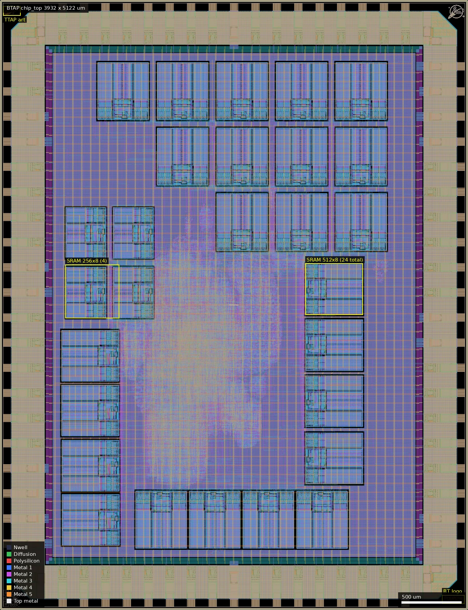
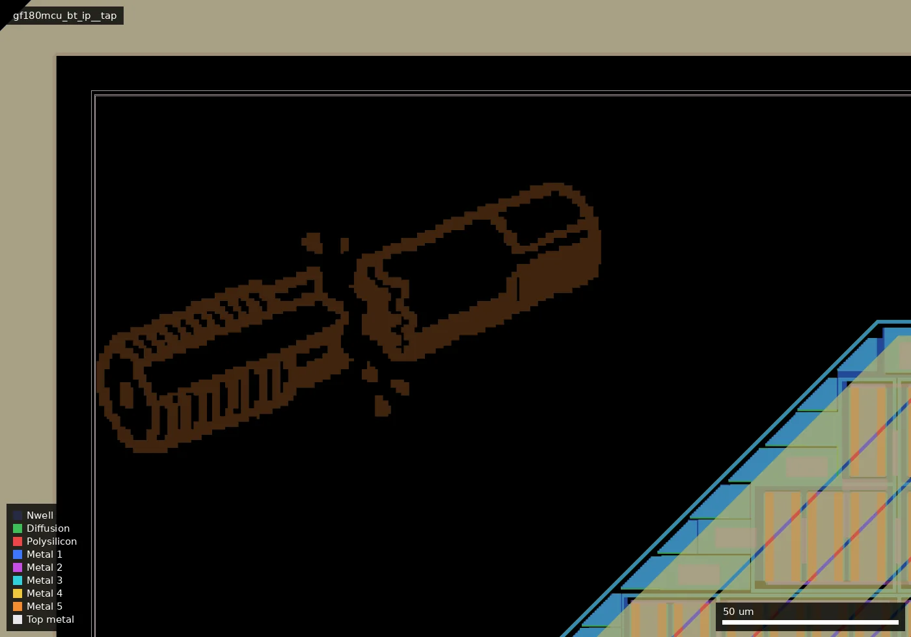

# BTAP: BreakingTTAPs (ws-run1)

| | |
|---|---|
| Repository | https://github.com/polyfractal/BreakingTTAPs @ 8f357d6 (main, last commit 2025-12-22) |
| Slot | 1x1 |
| Taped-out layout | BTAP_chip_top_0_0, 3932 x 5122 um, 2 placement(s) on the G801 reticle |
| Top cell | chip_top |
| Licence in repo | Apache-2.0 at the root; `src/LICENSE` is CERN-OHL-S v2 |
| README | TEMPLATE (99% the project-template README; only a one-line title is the author's) |

## What the repo actually contains

A transport-triggered-architecture processor. `src/chip_core.sv` is about 19,300 lines of generated Verilog with modules `tta::alu`, `cmp`, `lsu`, `uart`, `spi`, `gpo16`/`gpi16`, `modadd` and `pc`.

Built with the wafer.space template on `gf180mcu_fd_sc_mcu9t5v0` cells with 28 foundry SRAM macros (24 x `sram512x8m8wm1` and 4 x `sram256x8m8wm1`) (placed by `sram_generated.tcl` and `scripts/macro_floorplan.toml`) at a 55 ns clock.

The final GDS is in the repo as a zip (`final/gds/chip_top.zip`, 175 MB unpacked) with checksums; it differs slightly from the taped-out layout (see below). `gf180mcu_bt_ip__tap` (a broken threading tap, the pun in the name) and a logo are Metal5 artwork only. Late-December commits show ALU shift bug fixes and DRC fixes.

## Taped-out layout

| Measured | Value |
|---|---|
| Die (reticle cell `BTAP_chip_top_0_0`) | 3932 x 5122 um, 2 placements on the G801 reticle (at 0.060, 0.060 mm and 4.052, 0.060 mm) |
| Pads / IO cells | 41 `gf180mcu_fd_io__bi_24t`, 14 `in_c`, 1 `in_s`, 4 `cor`, 8 `gf180mcu_ws_io__dvdd`, 10 `gf180mcu_ws_io__dvss`; 82 shapes on the Pad layer; labels `clk_PAD`, `rst_n_PAD`, `input_PAD[0..12]`, `bidir_PAD[0..40]`, VDD, VSS |
| Standard cells | `gf180mcu_fd_sc_mcu9t5v0`: 43,225 logic cells (about 1,750 flops: 1,638 `dffq_1`, 84 `dffq_2`, 29 `dffq_4`) and 156,483 fill/tap/endcap/antenna cells |
| SRAM macros | 28 foundry macros: 24 x `sram512x8m8wm1` (432 x 485 um) and 4 x `sram256x8m8wm1` (432 x 341 um) |
| Oxide, passives | Dualgate and V5_XTOR are present everywhere (the 5 V cell library, the IO cells and the SRAM use them); no MIM, no high-resistance poly, no DNWELL layer shapes; RES_MK/DIODE_MK marker shapes (about 1.1k and 1.0k) come from the IO cells |
| Custom content | Two Metal5 artwork cells only: `gf180mcu_bt_ip__tap` (147.0 x 80.25 um at 26, 4991) and `gf180mcu_bt_ip__logo` (187.5 x 75.0 um at 3714.5, 50). No custom transistors |

The overview is the whole die (style `full`). The logic is one blob in the centre of the die (the lighter, denser-routed area); the 24 large 512 x 8 SRAMs sit as a stepped block of 12 at the top right, a column of 4 on the left, a column of 4 on the right and a row of 4 at the bottom, and the four 256 x 8 SRAMs form a 2 x 2 group at about (550..1400, 2450..3300) um.

Close-up of `gf180mcu_bt_ip__tap`, box (0, 4940) to (260, 5122) um. It is a single-layer Metal5 drawing and is not connected to anything.

### What "TTAPs" are

The repo and the layout together say that the name is a pun: TTA is "transport triggered architecture" (the processor), and the die artwork is a tap (the threading tool) snapped in two, hence "Breaking TTAPs". It is decoration, not a test structure. The chip itself is the TTA processor plus 28 SRAMs.

### Does it match the repository?

The repo carries a GDS (`final/gds/chip_top.zip`, 175,716,186 bytes unpacked, listed with a SHA-256 in `final/gds/checksums.txt`). I unpacked it and compared flattened cell counts with the taped-out cell. Same die size (3932 x 5122 um), same IO ring (41 bi_24t, 14 in_c, 1 in_s, 8 dvdd, 10 dvss, 4 corners), same 28 SRAM macros (24 x 512x8, 4 x 256x8) and same standard cell library. Differences: the taped-out layout has 43,225 logic cells against 39,987 in the repo GDS (about 8% more), and 156,483 fill/tap cells against 151,989. Per-type counts move in both directions (for example `aoi21_1` 1,684 vs 1,969, `aoi221_1` 465 vs 290, `buf_2` 3,661 vs 4,001), and a few types appear on one side only (`clkinv_16`, `clkinv_20`, `or3_2`, `or3_4`, `xor3_2` in the repo GDS; `xor2_2`, `or2_4`, `dlyb_2`, `or4_4` in the taped-out one). So the submitted layout is a different implementation run of the same design (same floorplan, ring and macros), not the GDS committed at 8f357d6. The platform's file hash (`d0b1e6f2...`) does not equal the repo's checksum (`4b91cbff...`), which fits. I did not compare the netlists, so I cannot say whether RTL changed between the two builds. The repo's `config.yaml` has `CLOCK_PERIOD: 55` (ns) and `PL_TARGET_DENSITY_PCT: 45`.

## Authors and affiliations

| Person | Role | Affiliation | Source |
|---|---|---|---|
| Zachary Tong (GitHub polyfractal) | designer | not stated (GitHub location: Vermont; a breakingtaps.com email domain is a hint only) | git log, GitHub profile |
| Leo Moser (mole99) | project template | not stated | git log |

## Value for GF180MCU characterisation and PDK development

### Verdict: Low

Ordinary synthesised digital on stock cells with foundry SRAM; a functional and yield data point. Layout check: 43,225 logic cells on `mcu9t5v0`, 28 SRAM macros, no MIM, high-resistance poly, DNWELL or custom devices.

### Test structures and measurable circuits

Nothing purpose-built; confirmed from the layout (the only non-library cells are the two Metal5 artwork cells). 28 foundry SRAM macros (24 x 512x8, 4 x 256x8) are exercised functionally.

### Candidate PDK additions

None from the layout. The author's notes cover PVT, slew and antenna fixes (resizer margins, an ECO diode, a reference to OpenROAD bug 8229).

### What would be needed to use it

Packaged die and a host for UART/SPI. No test plan in the repo.

## Notes and caveats

- The repo carries two licences: Apache-2.0 at the root (from the template) and CERN-OHL-S v2 for `src/`. The platform lists Apache-2.0; the layout cannot settle which applies to the design.
- The GDS committed in the repo is not the taped-out layout (logic cell count 39,987 vs 43,225); only the taped-out file reflects what was made.
- The README does not describe the design at all.
