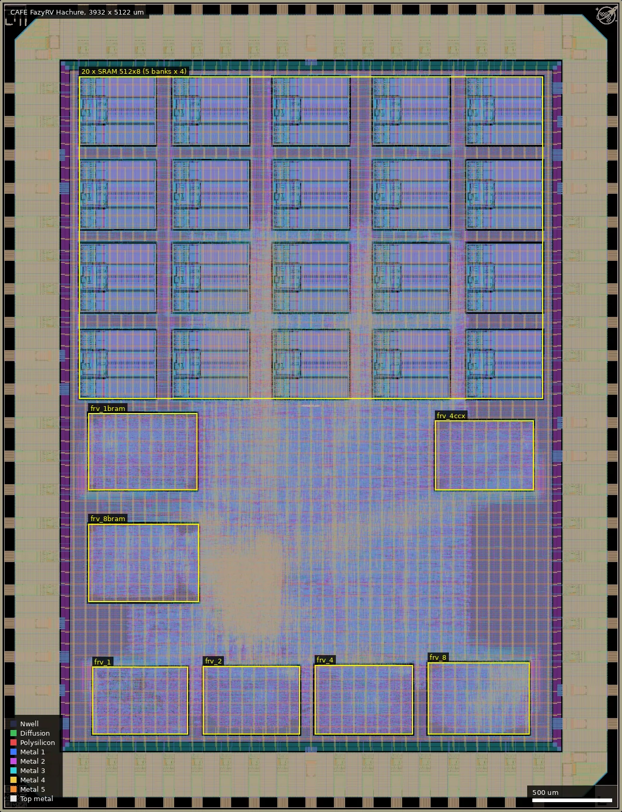
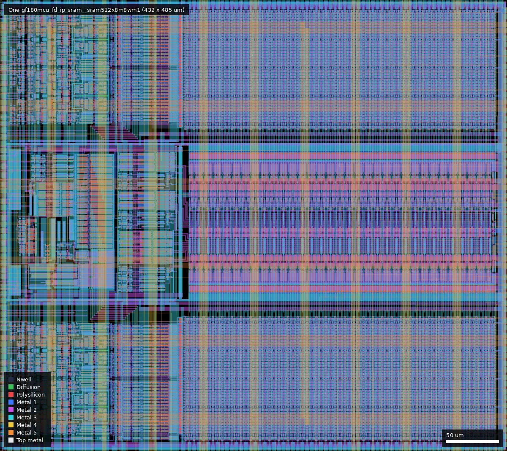
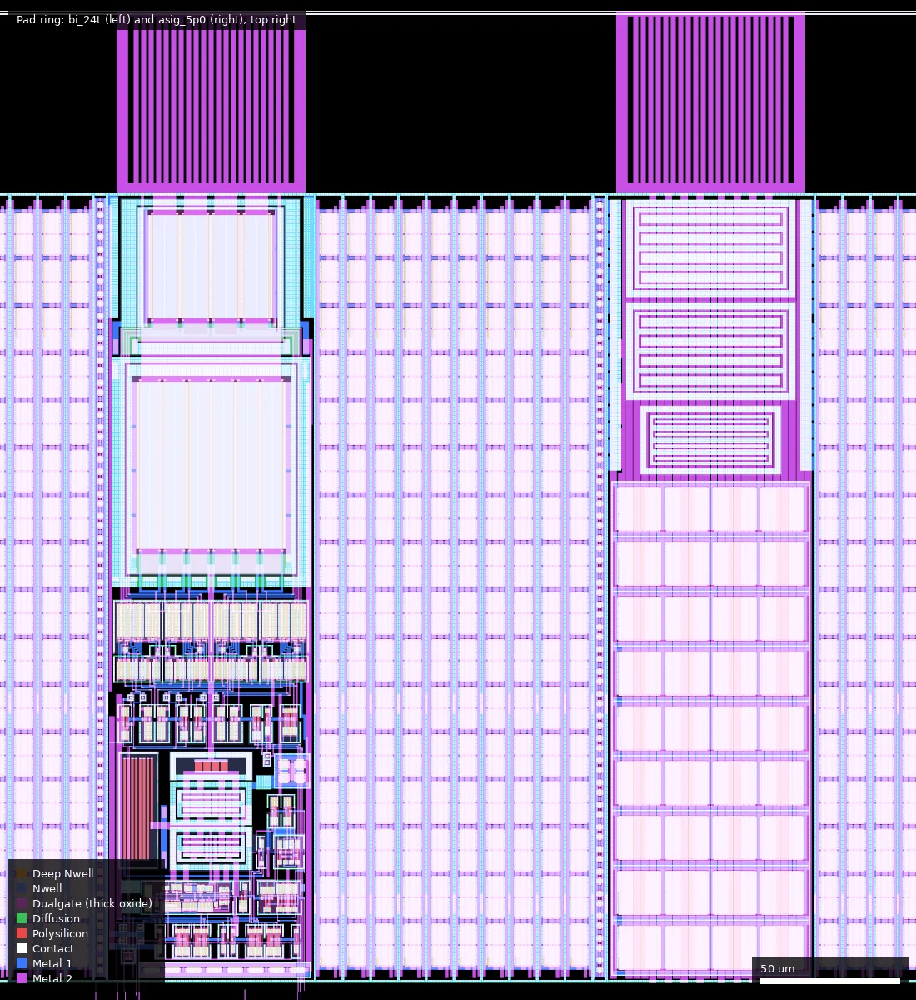

# CAFE: FazyRV Hachure (ws-run1)

| | |
|---|---|
| Repository | https://github.com/meiniKi/gf180mcu-fazyrv-hachure @ 51047e6 (main, last commit 2025-12-15; tags v1, v1_1; branches tapeout_v1_1/v1_2/v1_3) |
| Slot | 1x1 (die 3932 x 5122 um) |
| Top cell | chip_top |
| Licence in repo | Apache-2.0 (top-level LICENSE); FazyRV sources carry MIT headers |
| README | OK (1,533 words) |
| Taped-out layout | CAFE_chip_top_12_0, 3932 x 5122 um, 1 placement on the G801 reticle |

(Note: "CAFE" in run 2 is an unrelated project.)

## What the repo actually contains

A system-on-chip that puts **seven FazyRV cores** on one die, "for testing and research purposes" (README). FazyRV is a bit-serial RV32 core with a scalable datapath (CHUNKSIZE 1, 2, 4 or 8 bits); the Hachure instances are:

| Core | Instance | Boot addr | Macro |
|---|---|---|---|
| 1-bit, LOGIC register file | i_frv_1 | 0x10 | `macros/frv_1` |
| 2-bit LOGIC | i_frv_2 | 0x20 | `macros/frv_2` |
| 4-bit LOGIC | i_frv_4 | 0x30 | `macros/frv_4` |
| 8-bit LOGIC | i_frv_8 | 0x40 | `macros/frv_8` |
| 4-bit LOGIC with CCX custom-instruction interface (from HeiChips 2025 hackathon, README says "Not verified") | i_frv_4ccx | 0x60 | `macros/frv_4ccx` |
| 1-bit BRAM register file | i_frv_1bram | 0x70 | `macros/frv_1bram` |
| 8-bit BRAM register file | i_frv_8bram | 0x80 | `macros/frv_8bram` |

- Every core is hardened as its own macro (Yosys prep script `prep.ys` plus per-macro `config.yaml`: die 602 x 425 um for frv_1 up to 699 x 492 um for frv_8bram; macro clock targets 40 to 66 ns), then placed by hand in the top-level `librelane/config.yaml`. The macro builds (`make librelane-macro-fast`, `make copy-macro`) produce `macros/*/final/`, which is **not committed** (macros/ has only configs, so the top-level cannot be rebuilt without running the macro flow first).
- The BRAM variants are named for a block-RAM style register file (`fazyrv_ram_dp.sv`, a behavioural `logic [31:0] ram_r[0:DEPTH-1]` array). The layout shows that it was synthesised to flip-flops: neither `frv_1bram` nor `frv_8bram` contains an SRAM macro (all 20 foundry SRAMs sit at top level). The foundry SRAM `gf180mcu_fd_ip_sram__sram512x8m8wm1` is used only for the top-level on-chip RAM: five banks (`gen_ram_bank[0..4]`) of `ram512x32` (four 512x8 macros each, `src/ram512x32.sv`, `wb_ram.sv`), 20 macros, 10 KiB.
- Shared Wishbone bus with arbiter (wb_intercon, verilog-arbiter), rggen CSR block (GPIO with per-pin CMOS/Schmitt, slew and pull controls, SPI/OLED/IRQ/guard/slew/pull registers), QSPI XIP cache (`MS_QSPI_XIP_CACHE`), QSPI memory controller for external ROM/PSRAM, UART and SPI (Efabless EF_UART/EF_SPI forks), an OLED DMA/SPI engine (`tiny_wb_dma_oled_spi.sv`), a Wishbone-to-AHB3-lite bridge. Pin map in README (config: 37 bidir, 16 input pads, 1 reserved analog pad, no analog circuits; the layout has exactly this, see below).
- **Per-block enables and clock gating** (the research hook): dedicated input pads `en_wb`, `en_p`, `en_p2`, `en_frv1`, `en_frv2`, `en_frv4`, `en_frv8`, `en_frv4ccx` (and two shared with CCX result pads for the BRAM cores) drive one `gf180mcu_fd_sc_mcu7t5v0__icgtp_4` clock gate per block (`src/hachure_soc.sv`, 10 gates; `-DNO_CLOCK_GATES` variant for simulation). So any core can be run alone or concurrently while the others' clocks are stopped.
- Flow: LibreLane Chip flow, 5 V 7-track cells (`gf180mcu_fd_sc_mcu7t5v0`, icgtp_4 instantiated explicitly), `CLOCK_PERIOD: 100` (25 MHz stated in comment is inconsistent: 100 ns is 10 MHz), IO cells `bi_24t`, `in_s`/`in_c`, ws dvdd/dvss; three logos (ws, hachure, fazyrv), `MAGIC_GDS_FLATGLOB` list for SRAM/IO cells and Metal2 filler workaround as in the template.
- Test: cocotb benches for toggle, sram, uart, spi, efspi and xip tests across all seven cores (`cocotb/`, RTL and gate-level targets, `@cocotb.parametrize(core=[...])`); firmware in `firmware/` (test_toggle writes GPO 0xff/0x00 in a loop for per-core throughput; test_sram etc.).
- No releases, no metrics or reports in the repo; layout images only (`doc/chip.png`, updated "to submitted gds" at HEAD).

## Taped-out layout

| Item | Measured from the layout |
|---|---|
| Die / reticle cell | 3932 x 5122 um, `CAFE_chip_top_12_0`, one placement at (24.012 mm, 0.060 mm) on G801, top cell `chip_top` inside |
| Pads | 37 `gf180mcu_fd_io__bi_24t`, 17 `in_c` (16 inputs plus `rst_n`), 1 `in_s` (clock), 1 `asig_5p0` (analog pad), 8 ws `dvdd`, 10 ws `dvss`, 4 corner cells, io fill cells; 82 Pad-layer openings |
| Standard cells | `gf180mcu_fd_sc_mcu7t5v0` (5 V, 7-track) only: 100,546 logic cells and 266,996 fill/tap/endcap/decap cells; 18,190 `dffq_1` plus 481 `dffrnq_1`, 16,598 `mux2_2`, 8,991 `dlyb_1` delay cells (hold repair, inferred from use), 12 `icgtp_4` clock gates; no latches in the cores |
| SRAM | 20 x `gf180mcu_fd_ip_sram__sram512x8m8wm1` (5 columns x 4 rows, x 500 to 3432 um, y 2607 to 4639 um; 485 x 432 um as placed) |
| Core macros | 7 hardened macros placed at top level, boxes below |
| Oxide | all logic and SRAM poly inside Dualgate and V5_XTOR (checked in `frv_1` and one SRAM: 45,522 and 11,184 gate-poly polygons, none outside Dualgate). Everything is 5 V / 6 V thick-oxide devices; no 3.3 V-only cells |
| Passives and special layers | no MIM, no DNWELL, no high-resistance poly layers drawn. RES_MK (1,082 shapes), DIODE_MK (1,612), ESD_MK (110), SAB (2,428) are inside the IO cells; MOS_CAP_MK (35,708) marks the decap cells. No BJT, eFuse or custom analog cells |
| Logos / IDs | ws logo, hachure logo (top left, 26,4953), fazyrv logo (3763,26), ws id and SLOTS cell |

Core macro placement (taped-out cells, um):

| Macro | Placed box (x0,y0,x1,y1) | Size | Logic cells | Flip-flops |
|---|---|---|---|---|
| frv_1 | 584,490 to 1187,915 | 603 x 425 | 3,906 | 1,169 |
| frv_2 | 1283,490 to 1895,921 | 612 x 431 | 4,203 | 1,167 |
| frv_4 | 1989,490 to 2609,927 | 620 x 437 | 4,680 | 1,167 |
| frv_8 | 2704,490 to 3347,944 | 644 x 454 | 6,141 | 1,169 |
| frv_4ccx | 2750,2030 to 3373,2469 | 623 x 439 | 4,615 | 1,167 |
| frv_1bram | 559,2030 to 1247,2515 | 688 x 485 | 6,473 | 1,332 |
| frv_8bram | 559,1327 to 1258,1819 | 699 x 492 | 7,127 | 1,332 |

The seven cores account for 37,145 of the 100,546 logic cells; the rest is the SoC glue (Wishbone, caches, QSPI, UART/SPI, OLED DMA, CSR) and the SRAM wrappers at top level. There is no hand-drawn or "hachure" structure other than the logo: the name refers to the artwork, and the layout is macros placed by script plus the SRAM array.

Overview of the whole die. The four LOGIC cores `frv_1/2/4/8` sit along the bottom (y 490 to 944), `frv_8bram` and `frv_1bram` on the left (y 1327 to 2515), `frv_4ccx` on the right (y 2030 to 2469), and the 20 SRAM macros fill the upper 40 % (y 2607 to 4639).

One foundry `sram512x8m8wm1` macro at (1723.5, 2607): bitcell array on the right, row decoder and control on the left (box 485 x 432 um as placed, i.e. rotated).

Two pad cells in the top ring near (3188 to 3444, 4746 to 5096): a `bi_24t` bidirectional cell (left) with its ESD diodes and drivers, and the `asig_5p0` analog pad cell (right), a pad with protection structures only; the README reserves it and no circuit is attached by design (connectivity not traced).

### Does it match the repository?

The repository's `main` (51047e6) has no GDS and no releases. The branches `tapeout_v1_1`, `tapeout_v1_2` and `tapeout_v1_3` each carry `tapeout/chip_top.gds.gz`. `tapeout_v1_3` (commit 010bdfe, 2025-12-11) has no differences in `src/` or `librelane/` from `main`, so it is the matching submission. Compared with the `chip_top` cell of its GDS: die size 3932 x 5122, the same 367,542 standard-cell placements with identical per-type counts, the same 20 SRAM macros, the same seven macro instances and the same IO cell counts. The only cells in the reticle file that are not in the repository GDS are wafer.space's slot cells (`SLOTS`, `Metal*_Slot`). The layout therefore is the repository design. (`tapeout_v1_2` and `v1_1` were not compared.) Corrections to what was written from the repository alone: the BRAM cores have no SRAM macro, on-chip RAM is 20 macros (not four), and the config has 37 bidir pads. The 12 `icgtp_4` cells in the layout are two more than the 10 clock gates of `hachure_soc.sv` (`N_CLOCKS = 10`); I did not find where the extra two come from.

## Authors and affiliations

| Person | Role | Affiliation | Source |
|---|---|---|---|
| Meinhard Kissich | SoC and FazyRV author (103 commits) | Graz University of Technology, Embedded Architectures & Systems group, per the FazyRV submodule README acknowledgement (GitHub location Graz, Austria) | `ip/FazyRV/README.md`, `gh api users/meiniKi`, git shortlog |
| Marcel Baunach | co-author of the FazyRV paper | TU Graz EAS group (inferred from the acknowledgement; not stated as his affiliation) | `ip/FazyRV/README.md` citation |
| Leo Moser | template author (78 commits) | not stated in repo | AUTHORS.md |
| Tim Ansell, TrevorPeyton | 1 commit each | not stated | git shortlog |

Reference: Kissich and Baunach, "FazyRV: Closing the Gap between 32-Bit and Bit-Serial RISC-V Cores with a Scalable Implementation", ACM Computing Frontiers 2024, doi 10.1145/3649153.3649195 (cited in the FazyRV README).

## Value for GF180MCU characterisation and PDK development

### Verdict: Medium
It is a deliberate research vehicle: seven variants of the same ISA at different datapath widths and register-file styles, individually clock-gated and enabled from pads, on one die with pad-accessible GPIO. That makes it the best digital candidate in this set for measuring standard-cell area/speed/energy trade-offs in silicon. It is not High because the layout confirms there are no analog, device-level or oscillator structures (no MIM, DNWELL, resistors or custom cells outside the stock IO and SRAM cells) and no purpose-built measurement circuitry (no on-chip counters, no sense resistors). The 20 foundry SRAM macros are a secondary point of interest.

### Test structures and measurable circuits
Designed measurements (from the README, enable pins and firmware, all confirmed present in the layout as the seven macros and clock gates; the energy aspect is inferred from the enable/clock-gate design):

| Structure | What it measures | Access | Where |
|---|---|---|---|
| 7 core macros, each alone | per-core dynamic power and supply current (enable one core, others gated), performance (cycles per instruction by chunk size 1/2/4/8, e.g. toggle rate of GPIO[0] under `test_toggle`), maximum clock frequency per core | `en_*` pads, `clk_PAD`, GPIO and UART pads, supply current at DVDD | `src/hachure_soc.sv`, `firmware/test_toggle` |
| LOGIC vs "BRAM" register file (frv_1 vs frv_1bram, frv_8 vs frv_8bram) | two flip-flop register-file styles (the layout shows no SRAM and no latches in either): area (frv_1 603 x 425 um vs frv_1bram 688 x 485 um; frv_8 644 x 454 vs frv_8bram 699 x 492), speed, power. Not a flop-versus-SRAM comparison | enable pads (en_frv1bram/en_frv8bram share the CCX result pads) | `macros/*bram`, placements in the table above |
| 4-bit CCX core with off-chip custom-instruction interface | chunked custom-instruction handshaking through pads | ccx4_* pads | `ip/FazyRV-ccx` |
| Per-pad slew/pull/CMOS-vs-Schmitt CSRs (`GPSL`, `GPCS`, `Misc_Slew_Rate`, `Misc_Pull`) | IO cell `bi_24t` slew-rate and pull options (SL, CS, PU, PD pins) | bidir pads via CSR writes | README CSR map, `src/chip_core.sv` |
| 10 icgtp_4 clock gates in RTL (12 `icgtp_4` placed in the layout) | clock-gate cell function and leakage with gated blocks | enable pads | `src/hachure_soc.sv` |
| 20 x sram512x8 on-chip RAM (5 banks x 4, 10 KiB) | foundry SRAM function and leakage at 5 V, the only SRAM use on the die | CPU access (all cores share the Wishbone RAM) | `src/ram512x32.sv`, `wb_ram.sv`; placements at x 500 to 3432, y 2607 to 4639 |

Pre-silicon STA exists only as macro-level LibreLane runs (not committed); no results are in the repo to compare against.

### Candidate PDK additions
Nothing found for the PDK itself; the layout is all stock 5 V 7-track cells, foundry IO cells and foundry SRAM, so there is nothing custom to add. Contribution is hierarchical macro flow for several cores plus comparison data; the repo carries the same template-level DRC/filler workarounds (`MAGIC_GDS_FLATGLOB`, `KLAYOUT_FILLER_OPTIONS: Metal2_ignore_active`).

### What would be needed to use it
Packaged or COB part, a 5 V supply with a current meter (or Kelvin sense) on VDD, a clock source for 10 MHz and beyond, a QSPI flash image per core (boot addresses in README) or XIP stub, a logic analyser/MCU on GPIO to count toggles. Firmware sources for the tests exist; a benchmark set (Embench submodule, CoreMark or similar) is not wired up in this repo. The `final/` macro outputs are absent, so STA numbers need a rebuild.

## Notes and caveats

- Run-2 "CAFE" is a different project (Expresso Ethernet chip) and is not covered here.
- `ip/FazyRV` and `ip/FazyRV-ccx` are two different commits of the same FazyRV repository (`78f30d7a`, `271205fc`; the second is the heichips25_ccx branch); embench-iot submodules use an SSH URL but cloned from mirrors.
- The README says 25 MHz in config comments, but `CLOCK_PERIOD` is 100 ns; macro periods differ (40 to 66 ns), so intended Fmax per core is not clearly stated.
- The author's affiliation comes from the FazyRV README, not from this repo's own README.
- The layout matches the GDS on branch `tapeout_v1_3` (not on `main`, which has no GDS); the platform sha (fa626134...) was not recomputed, since the comparison was made on cell content.
- 8,991 `dlyb_1` delay cells (about 9 % of logic cells) show heavy hold fixing in the macros and top level; timing-closure effects are a separate question from function.
