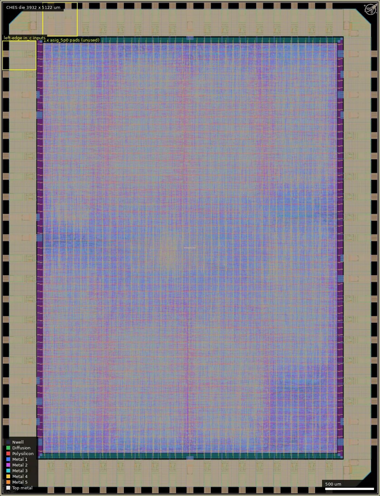
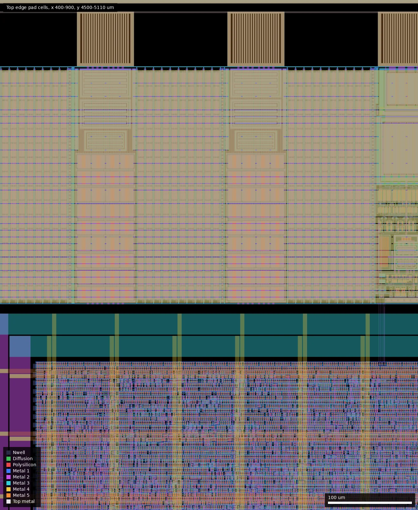
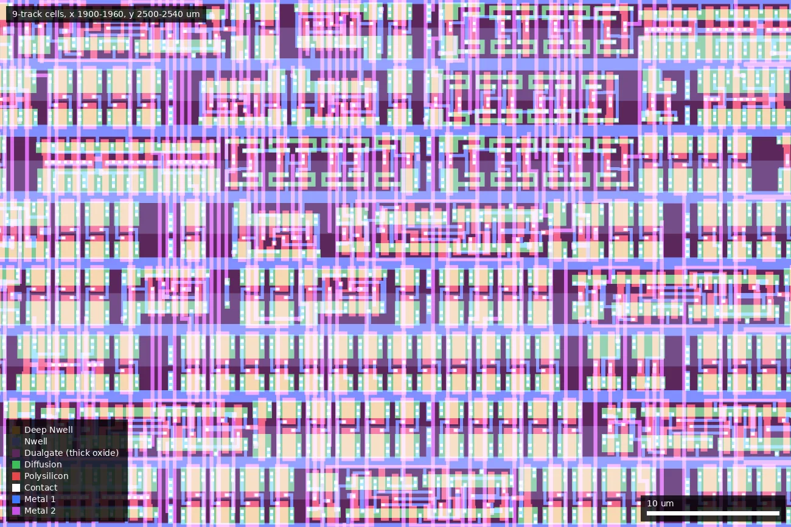

# CHES: chess-move-generator (ws-run1)

| | |
|---|---|
| Repository | https://github.com/Ravenslofty/gf180mcu-chess @ b730465 (main, last commit 2025-12-11). **The design is not on main**: it is on branch `origin/chess` @ 728fecb ("first tapeout", 2025-11-15) |
| Slot | 1x1 |
| Top cell | chip_top |
| Licence in repo | Apache-2.0 |
| README | TEMPLATE (100% the project-template README, no own text) |
| Taped-out layout | CHES_chip_top_10_4, 3932 x 5122 um, 1 placement on the G801 reticle |

## What the repo actually contains

The default branch `main` is the unmodified wafer.space project template. The chess design lives only on the `chess` branch, which is present in this clone as `origin/chess` but is not checked out (`git -C repo checkout chess` to see it).

On that branch: a chess move generator made of 64 square modules (`board.sv`, `square.sv`, `arb.sv`) in a combinational network, with JTAG boundary-scan-style register chains and a USB 2 device using an external ULPI PHY (`usb.v`, generated with Torii). Clock target is 60 MHz (16.6 ns) on `gf180mcu_fd_sc_mcu9t5v0` cells with `SYNTH_STRATEGY: DELAY 4` and one hold-fix ECO buffer (`dlyc_1`). The two SRAM macros of the template are not in the chess branch configuration.

The only final layout is the release asset `chip_top.gds.gz` (50 MB); its cell names confirm the 9t5v0 library, and it is identical to the taped-out layout (see below). There are no reports.

## Taped-out layout

| Measured | Value |
|---|---|
| Die | 3932 x 5122 um, one placement on reticle G801 (cell `CHES_chip_top_10_4` at 20.020 mm, 10.424 mm) |
| Pad ring | 70 IO cells: 40 `gf180mcu_fd_io__bi_24t`, 13 `in_c` (12 left edge + rst_n), 1 `in_s` (clock, bottom edge at x 526), 2 `asig_5p0` analog pads (top edge, x 526 and 706), 8 `gf180mcu_ws_io__dvdd`, 10 `gf180mcu_ws_io__dvss`. Pad labels are the template names (`bidir_PAD[0..39]`, `input_PAD[0..11]`, `analog_PAD[0..1]`, `rst_n_PAD`) |
| Standard cells | `gf180mcu_fd_sc_mcu9t5v0` only: 145,076 logic cells and 406,519 filler/decap cells. Mostly minimum-drive (`_1`) cells: nand2_1 20,053; nor2_1 11,610; mux2_1 11,415; oai21_1 7,132; aoi21_1 6,916; flops `dffrnq_1` 4,095 + `dffsnq_1` 2,061 + `dffq_1` 1,256 (7,412 in these three types); delay cells `dlyc_1` 3,823 + `dlyd_1` 1,682 + `dlya_1` 364 (5,869 hold-fix buffers) |
| SRAM macros | None |
| Custom / hand-drawn / analog | None. Non-library top-level cells are only the wafer.space ID (26,26) and logo (3763,4953); the die is one flat sea of standard cells with no macro or sub-block boundary |
| Oxide, passives | Dualgate (55/0) and V5_XTOR (112/1) over all gates of the cells (sampled in a 600 x 600 um box: 100 % of gate area); no MIM, high-resistance poly, DNWELL or eFuse layers. Resistor / diode / SAB markers (1,068 / 1,353 / 2,390 shapes) belong to the pad cells (bounding boxes in the ring bands; not checked shape by shape) |

Pads per edge: bottom 14 bi_24t + clk in_s + rst_n in_c + 1 dvss; top 14 bi_24t + 2 asig_5p0 + 1 dvss; right 12 bi_24t + 4 dvdd + 4 dvss; left 12 in_c + 4 dvdd + 4 dvss.

### Does it match the repository?

Partly, and only against the `chess` branch. The default branch `main` (b730465, the commit in the listing) is the bare template and does not describe this die; the design sources are on `origin/chess` (728fecb, "first tapeout"). Neither branch carries a GDS, so there is no repository layout to compare against. The only layout file is the release asset (`chip_top.gds.gz`), and the taped-out layout is identical to it: both have 178 distinct cell names, 1,885,461 instances in the top cell and zero per-cell count differences (so that file already contains the fill and seal ring). Against the `chess` branch sources and config:

- Pad ring agrees with `src/chip_top.sv`: 40 bi_24t, 12 plus reset `in_c`, one `in_s` clock, 2 `asig_5p0` analog pads, 8 + 10 power pads. The analog pads are template leftovers: `chip_core` only declares the `analog` port and does not use it, so they are unconnected pads (confirmed from the source; the close-up shows no routing into the cells from the core).
- Standard cell library `mcu9t5v0` (9-track 5 V), as in `librelane/config.yaml`; no SRAM macros, as the config on that branch has none.
- The config says one `INSERT_ECO_BUFFERS` hold-fix buffer was planned; the layout actually holds 5,869 delay cells (`dlya/dlyc/dlyd_1`), about 4 % of the logic, so the flow inserted hold buffers in bulk (60 MHz target, hold margin 0.42 ns).
- 64 square modules and the "eight-core" description: the layout is flat and the placement shows no repeated blocks, so neither the 64 squares nor eight cores can be seen. Only the cell count (145k logic cells, 7.4k flops) is consistent with a large combinational network plus the USB, JTAG and bscan registers; layout evidence cannot count the units.

*Whole die in `full` style: a flat sea of standard cells inside the pad ring with no macros or visible sub-blocks; the analog pad pair (top, x 440-800) and the left-edge inputs are marked.*

*x 400-900, y 4500-5110 um: two `asig_5p0` analog pad cells on the top edge (centres x 526 and 706), with pad openings above, ESD structures in the cells and the core cell array below; no routing from the core reaches them.*

*x 1900-1960, y 2500-2540 um, `detail` style: minimum-drive `_1` logic and filler cells under the Dualgate (thick-oxide) mask.*

## Authors and affiliations

| Person | Role | Affiliation | Source |
|---|---|---|---|
| Hannah Ravensloft ("Lofty", GitHub Ravenslofty) | sole designer | not stated | source headers, git log |
| Leo Moser (mole99) | project template | not stated | git log |

## Value for GF180MCU characterisation and PDK development

### Verdict: Low

Ordinary synthesised digital on stock cells (145k logic cells, 7.4k flops, no macros, no custom or analog content; confirmed in the layout). Its 60 MHz target is the tightest of the comparable run 1 digital designs and the logic is a large combinational network, so it may be a delay-sensitive data point, but nothing is built for measurement.

### Test structures and measurable circuits

Nothing found; the layout has no test structures, and the two analog pads are unconnected template leftovers.

### Candidate PDK additions

Nothing found.

### What would be needed to use it

A board with a ULPI USB PHY and a host driver. No test plan in the repo.

## Notes and caveats

- The platform description says "eight-core chess move generator"; the sources on the `chess` branch show 64 square modules and nothing that corresponds to eight cores. The flat layout cannot confirm or refute either number; only a netlist or the author could.
- The flow inserted 5,869 hold-fix delay cells, not the single one the config suggests; a design with this many (about 4 % of logic) is a data point for hold-time modelling at 60 MHz.
- Anyone looking at the repository's default branch sees only the template, with no indication the design is elsewhere.
