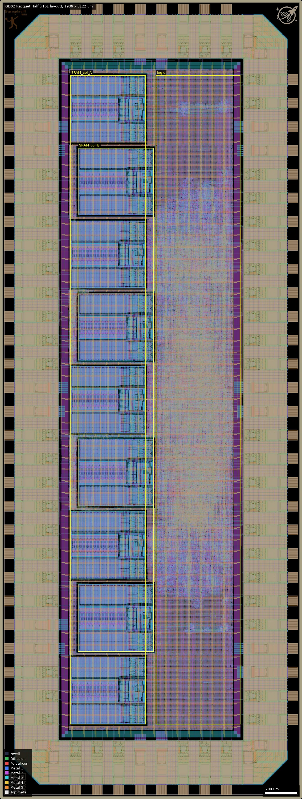
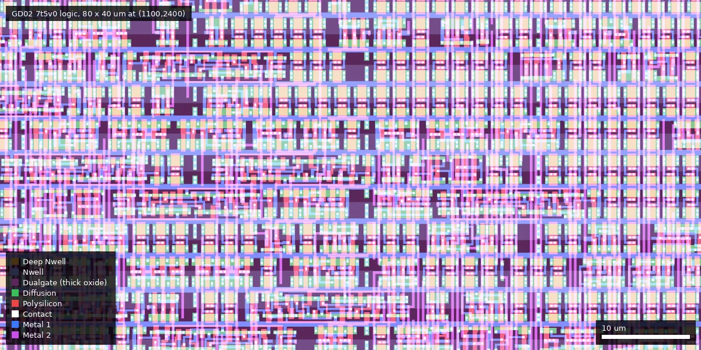

# GD02: Racquet Half r1p0 (ws-run1)

| | |
|---|---|
| Repository | https://github.com/gregdavill/gf180mcu-racquet-0.5x1 @ 8c1de9c (develop, last commit 2025-12-17) |
| Slot | 0p5x1 (half slot, die 1936 x 5122 um) |
| Top cell | chip_top |
| Licence in repo | Apache-2.0 (LICENSE file; no SPDX claim in the sources checked) |
| Taped-out layout | `GD02_chip_top_14_4`, 1936 x 5122 um, 1 placement on the G801 reticle |
| README | TEMPLATE: 100% identical to the wafer-space project-template README, 0 words of own text |

## What the repo actually contains

A multi-core SoC built around SERV (the bit-serial RISC-V core) via Olof Kindgren's `servile`/`subservient` wrappers (submodules `ip/serv` and `ip/subservient`). The platform description says "9 cores connected to local SRAM"; the sources agree (`localparam NUM_PROC_CORES = 9` in `src/chip_core.sv`).

- Each core has its own `gf180mcu_fd_ip_sram__sram512x8m8wm1` (512 x 8 bit, foundry 5 V macro) used as RAM + register file + CSR store (`src/proc_wrapper.sv`). Nine SRAM instances in the release netlist.
- Cores are loaded at boot from SPI flash through a loader chain (`src/spi.sv`, loader_wdata/valid/ready arrays in `chip_core.sv`).
- Shared Wishbone crossbar (`src/wb_xbar.sv`) to six responders: GPIO (`wb_gpio.sv`), UART (`wb_uart.sv`), timer (`wb_timer.sv`), a queue peripheral for synchronisation and core-to-core messages (`wb_queue.sv`), etc. All hand-written SystemVerilog by the authors (about 2700 lines in `src/`).
- Flow: LibreLane "Chip" flow (`librelane/config.yaml`, slot file `librelane/slots/slot_0p5x1.yaml`), Yosys with the slang plugin, 5 V 7-track standard cells `gf180mcu_fd_sc_mcu7t5v0` (confirmed from the release netlist: 112,820 cells, all 7t5v0), IO cells `gf180mcu_fd_io__bi_24t` x54 (all pads bidirectional), 1 in_c, 1 in_s, wafer.space `gf180mcu_ws_io__dvdd/dvss` x8 each. No analog macros. Chip ID and logo macros as in the template, plus a `gf180mcu_gsd__logo`.
- Clock: single `clk_PAD`, `CLOCK_PERIOD: 100` (10 MHz). No PLL/oscillator.
- `cocotb/` has a single testbench (`chip_top_tb.py`) that assembles small RISC-V programs; no silicon bring-up data.
- Two releases: `release-r1p0` (commit d35af25, 2025-12-03, "Bump GPIOB_NUM to 22") and `release-r1p1` (HEAD 8c1de9c, 2025-12-17, "Increase halos"). `releases/` holds gds.gz plus a tar with lib/sdf/spef/def/odb/netlists; r1p1 tar also has `metrics.json` and SPICE. The project.json hash (5d08605b...) matches neither release GDS file byte for byte (sha256 of the decompressed files 271f7a7d... and 25a55fba...), but the taped-out layout matches r1p1 cell for cell (see Taped-out layout).
- Release r1p1 metrics (from `metrics.json`): 113,682 instances, die 1936 x 5122, stdcell utilisation 61%, setup WNS +16.6 ns (max_ss_125C_4v50), +56.8 ns nom_tt, hold WNS +0.14 ns worst (min_ff), 0 setup/hold violations in all nine corners, Magic DRC 0, KLayout DRC 0, LVS 0, antenna 0, XOR 0.

## Taped-out layout

| Fact | Measured from the reticle layout |
|---|---|
| Die | 1936 x 5122 um (top cell `chip_top` inside `GD02_chip_top_14_4`), 1 placement on the G801 reticle at (28.004, 10.424) mm |
| Pads and IO cells | 80 pad shapes (Pad 37/0): 54 `gf180mcu_fd_io__bi_24t`, 1 `in_s`, 1 `in_c`, 8 `gf180mcu_ws_io__dvdd`, 8 `dvss`, 4 corner cells, 774 IO fill cells. Same counts as the repo netlist. Labels: `clk_PAD` (485, 58.5), `rst_n_PAD` (623, 58.5), `bidir_PAD[0..53]` |
| Standard cells | `gf180mcu_fd_sc_mcu7t5v0` only. 34,564 logic cells plus 78,256 fill/tap/antenna cells = 112,820 placements (the repo's "112,820 cells" includes fill and taps). Top logic types: nand2_1 4,263; nor2_1 2,406; oai21_1 2,174; mux2_2 2,111; aoi21_1 2,056 |
| Flip-flops | 4,241 plain (non-scan) flops: dffq_1 2,055, dffrnq_1 2,050, dffsnq_1 136. No `sdff*` scan cell |
| SRAM | 9 x `gf180mcu_fd_ip_sram__sram512x8m8wm1`, each 431.86 x 484.88 um (placed rotated 90 degrees), in two staggered columns: 5 at x = 450 to 935 um, y = 480, 1412, 2344, 3276, 4208 um, and 4 at x = 500 to 985 um, y = 946, 1878, 2810, 3742 um (lower-left corners of the placed boxes) |
| Oxide | Dualgate (55/0) and V5_XTOR (112/1) cover the core: in a 200 x 200 um logic window at (1100, 2400) and in the SRAM window (500..985, 946..1378) all Poly2 (6,463 and 11,184 merged shapes) lies inside both layers. All transistors in the core are 5 V thick oxide |
| Not present | No MIM capacitor, no DNWELL, no high-resistance-poly layer, no BJT, no custom analog cell. RES_MK (110/5, 1,072 shapes) and DIODE_MK (115/5) are ESD structures inside the IO cells and library diode/antenna cells, not test structures |
| Other cells | `gf180mcu_gsd__logo` 190.5 x 162 um at (26, 4934), wafer.space logo 143 x 143 um at (1767, 4953), ID block `gf180mcu_ws_ip__id` 143 x 143 um at (26, 26), seal ring |

Overview of the die (0,0 to 1936,5122 um): the nine SRAM macros fill the west half of the core in two staggered columns (x = 450 to 985 um), the synthesised logic is a single strip on the east side (x about 1000 to 1540 um), and the pad ring surrounds the core. The cores are not separate blocks: only the SRAMs are distinguishable.

Close-up of the 7-track 5 V logic (80 x 40 um at (1100, 2400)): standard-cell rows with the Dualgate thick-oxide layer (dark purple) under the transistors.

### Does it match the repository?

The repo holds no GDS, so I compared the taped-out layout with the two release GDS files (gds.gz in the release assets). Top-cell children (every distinct cell, counted with `$n` suffixes removed) are identical with `release-r1p1` (tag at HEAD 8c1de9c, "Increase halos"): all 459,663 top-level instances agree cell for cell, including 34,564 logic cells, 9 SRAMs, 54 `bi_24t` and the die size 1936 x 5122 um. `release-r1p0` (d35af25) differs (for example buf_4 1,796 against 1,420 in the taped-out layout, different via and fill counts), so it is not what was manufactured. This settles the earlier uncertainty: the layout is the r1p1 release, not r1p0 as project.json says. An XOR of the flattened layers (taped-out layout against the r1p1 release GDS) gives zero area on Contact, Via1, Via2, Via3, Via4, Nwell, Pad, Dualgate and V5_XTOR. COMP, Poly2 and Metal1 to Metal5 differ on about 0.1 to 0.6 mm2 each (outside the ID block), which is the expected wafer.space dummy fill added to the reticle copy (the r1p1 GDS has fewer Metal5 shapes, 80k against 243k); I did not separate fill polygons from signal polygons. The ID block at (26, 26) to (168.8, 168.8) um differs as expected. The sha256 mismatch noted before comes from this reticle processing.

## Authors and affiliations

| Person | Role | Affiliation | Source |
|---|---|---|---|
| Greg Davill | Racquet design (77 of 157 commits, SoC RTL and flow config) | not stated (GitHub profile gives name, location Australia, blog gregdavill.com; no company) | git shortlog, `gh api users/gregdavill` |
| Leo Moser | Project-template author (78 commits are template/flow updates) | not stated in the repo (AUTHORS.md lists name only) | AUTHORS.md, git shortlog |
| Tim Ansell, TrevorPeyton | one commit each (template) | not stated | git shortlog |
| Olof Kindgren | SERV / subservient / servile (submodules) | not stated here | submodule URLs |

## Value for GF180MCU characterisation and PDK development

### Verdict: Low
Ordinary synthesised digital on stock 7t 5 V cells and the foundry SRAM macro; no test structures, no scan, no oscillator. Useful as a yield/functional data point and as a timing-closure reference (clean in all nine corners).

### Test structures and measurable circuits
| Structure | Exercises | Access | Where |
|---|---|---|---|
| 9 x sram512x8m8wm1 | foundry SRAM function/speed at 5 V (functional only) | via SERV cores, SPI loader, GPIO/UART; macros 431.9 x 484.9 um, 5 at x = 450 um (y = 480, 1412, 2344, 3276, 4208) and 4 at x = 500 um (y = 946, 1878, 2810, 3742) | `src/proc_wrapper.sv`, `librelane/config.yaml` |
| 10 MHz synchronous digital (34,564 logic cells, 4,241 plain flops, ~113k placements with fill) | functional yield; STA numbers in release `metrics.json` and `sdf/` for 9 corners | pads | release r1p1 (confirmed as the taped-out layout) |

Pre-silicon STA/SDF data exist (nine corners, SPEF min/nom/max) so silicon Fmax could be compared, but nothing is built to measure Fmax directly (clock only from pad).

### Candidate PDK additions
Nothing found. Config carries template workarounds (Metal2 filler ignoring active metal, `MAGIC_GDS_FLATGLOB` for SRAM/IO cells, halo workaround for OpenROAD issue 8868 in the GD04 sibling).

### What would be needed to use it
Packaged or COB part with 10 MHz clock, reset, SPI flash with firmware (or a fake flash driven by a probe). No test plan or firmware in the repo.

## Notes and caveats

- Relation to siblings: GD02, GD03 (gf180mcu-racquet) and GD04 (gf180mcu-racquet-1x0.5) are three forks of the same Racquet code base with identical `src/` apart from core count, slot defines and small RTL fixes. GD02 differs from GD03 by: 9 cores vs 23; 0p5x1 slot pad counts (54 bidir, no analog); async-reset synchroniser in `chip_top.sv`; an extra registered SRAM-read enable (`sram_ren_reg`) and `sram_cen = ~(wen | ren | ren_reg)` in `proc_wrapper.sv` (GD03 uses `sram_cen = proc_rst`); `ERROR_ON_MAGIC_DRC: False` removed; larger macro halos. GD02 is the only one with the 0p5x1 slot defines changed to 54 bidir pads.
- project.json says "r1p0", but the taped-out layout is the r1p1 release (HEAD 8c1de9c, 2025-12-17): all top-level cell counts agree with the r1p1 GDS and not with the r1p0 GDS. The project name is therefore stale, and the r1p1 metrics (clean timing in all nine corners, DRC/LVS 0) apply to the manufactured design.
- Hierarchy: the layout has no hierarchy below the pad ring, the nine SRAMs and flat standard cells, so the nine SERV cores, the crossbar and peripherals cannot be told apart; only the SRAM positions and the logic strip are visible.
- XOR against the r1p1 GDS was run on 16 layers and shows only dummy fill differences (see above); Via5 and MetalTop were not XORed.
- README is the untouched template, so the only description is project.json and the sources.
