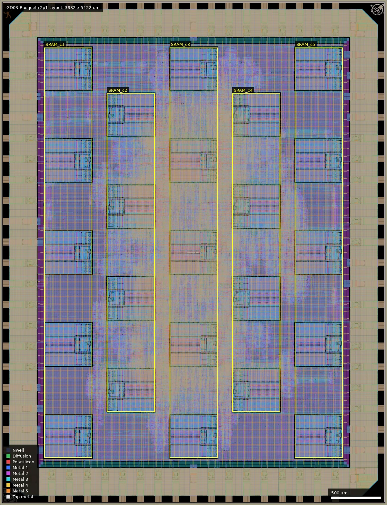
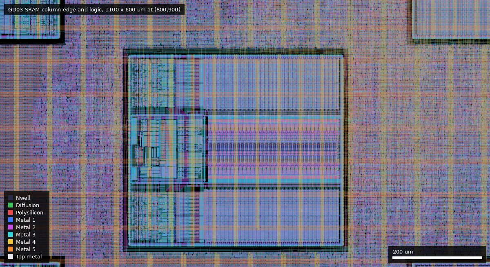
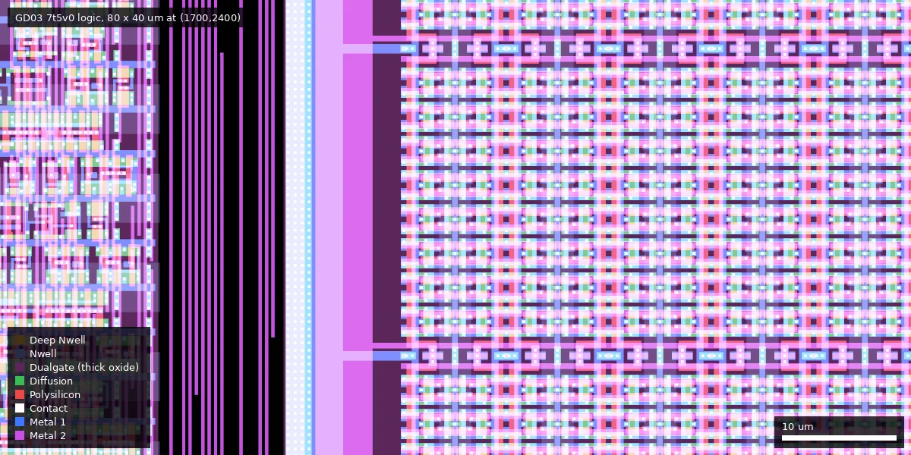

# GD03: Racquet r2p0 - 23 core SoC (ws-run1)

| | |
|---|---|
| Repository | https://github.com/gregdavill/gf180mcu-racquet @ 5ef4901 (develop, last commit 2025-12-10) |
| Slot | 1x1 (full slot, die 3932 x 5122 um) |
| Top cell | chip_top |
| Licence in repo | Apache-2.0 (LICENSE file) |
| Taped-out layout | `GD03_chip_top_6_6`, 3932 x 5122 um, 1 placement on the G801 reticle |
| README | TEMPLATE: 100% identical to the wafer-space project-template README, 0 words of own text |

## What the repo actually contains

The largest Racquet configuration: `NUM_PROC_CORES = 23` SERV cores (`src/chip_core.sv`), each with its own `gf180mcu_fd_ip_sram__sram512x8m8wm1` (23 instances in the release netlist, placed in a 5-column grid by `librelane/config.yaml`), loaded from SPI flash at boot, sharing a Wishbone crossbar with GPIO, UARTs, timers and a queue peripheral for core-to-core synchronisation/messages. The platform text says "a slew of peripherals: uarts, timers and more uarts"; sources agree (`wb_uart.sv`, `wb_timer.sv`, `wb_gpio.sv`, `wb_queue.sv`, `wb_xbar.sv`, `spi.sv`, `racquet.sv`, `proc_wrapper.sv`).

- Flow: LibreLane Chip flow, slang, 5 V 7-track cells `gf180mcu_fd_sc_mcu7t5v0` (319,940 cells in the r2p1 netlist), IO: 54 `gf180mcu_fd_io__bi_24t`, 1 `in_c`, 1 `in_s`, `gf180mcu_ws_io__dvdd` x8 / `dvss` x10, plus ID/logo/GsD logo macros. No analog. Clock `clk_PAD`, 100 ns period (10 MHz).
- Tags/releases: `release-r1p0` (d5ca5da, 2025-12-03), `release-r2p0` (2bd1e60, 2025-12-04, "Spread out srams"), `release-r2p1` (= HEAD 5ef4901, 2025-12-10), `release-r1p1` (300f95d, on branch `rev1`, 2025-12-18, merged tag 1.3.5). `releases/` has gds.gz for each; r1p1 and r2p1 tars contain lib/sdf/spef/odb/netlists and `metrics.json`; r1p0/r2p0 are 7z archives.
- Release r2p1 metrics: 321,106 instances, instance area 18.3 mm2, stdcell utilisation 36.5%, DRC (Magic and KLayout) 0, LVS 0, antenna 0, XOR 0. Timing: nominal tt 25C 5.0 V setup WNS +41.8 ns, ff +63 ns, hold clean everywhere, but **setup is violated at the slow corner**: nom_ss_125C_4v50 WNS -5.75 ns (130 endpoints), max_ss_125C_4v50 WNS -11.3 ns (413 endpoints), overall 548 violating endpoints against a 100 ns clock. `ERROR_ON_MAGIC_DRC: False` is set in config.
- Compared with GD02, config raises resizer slack margins (0.3 setup, 0.35/0.3 hold) and the core-ring width to 25 um.

## Taped-out layout

| Fact | Measured from the reticle layout |
|---|---|
| Die | 3932 x 5122 um (top cell `chip_top` inside `GD03_chip_top_6_6`), 1 placement on the G801 reticle at (12.036, 15.606) mm |
| Pads and IO cells | 82 pad shapes (Pad 37/0): 54 `gf180mcu_fd_io__bi_24t`, 1 `in_s`, 1 `in_c`, 8 `gf180mcu_ws_io__dvdd`, 10 `dvss`, 4 corner cells, 1,062 IO fill cells. Same counts as the repo netlist. Labels: `clk_PAD` (526, 58.5), `rst_n_PAD` (706, 58.5), `bidir_PAD[0..53]` |
| Standard cells | `gf180mcu_fd_sc_mcu7t5v0` only. 78,208 logic cells plus 241,732 fill/tap/antenna cells = 319,940 placements (the repo's "319,940 cells" includes fill and taps). Top logic types: nand2_1 9,575; aoi21_1 4,951; oai21_1 4,909; nor2_1 4,822; buf_4 3,797; dlyb_1 3,712 and dlyc_1 3,343 (hold-fix delay cells) |
| Flip-flops | 7,640 plain (non-scan) flops: dffq_1 5,201, dffrnq_1 2,299, dffsnq_1 140. No `sdff*` scan cell |
| SRAM | 23 x `gf180mcu_fd_ip_sram__sram512x8m8wm1`, each 431.86 x 484.88 um (placed rotated 90 or 270 degrees), in five columns of 5, 4, 5, 4, 5 macros. Column left edges x = 450, 1087, 1724, 2361, 2997 um; the 5-macro columns have y = 480, 1412, 2344, 3276, 4208 um and the 4-macro columns y = 946, 1878, 2810, 3742 um (lower-left corners of the placed boxes). Total 11.5 KiB |
| Oxide | Dualgate (55/0) and V5_XTOR (112/1) cover the core: in a 200 x 200 um logic window at (1700, 2400) and in an SRAM window (2361..2846, 946..1378) all Poly2 (2,198 and 11,184 merged shapes) lies inside both layers. All transistors in the core are 5 V thick oxide |
| Not present | No MIM capacitor, no DNWELL, no high-resistance-poly layer, no BJT, no custom analog cell. RES_MK (110/5, 1,096 shapes) and DIODE_MK (115/5) are ESD structures in the IO cells and library diode/antenna cells |
| Other cells | `gf180mcu_gsd__logo` 190.5 x 162 um at (26, 4934), wafer.space logo 143 x 143 um at (3763, 4953), ID block `gf180mcu_ws_ip__id` 143 x 143 um at (26, 26), seal ring |

Overview of the die (0,0 to 3932,5122 um): 23 SRAM macros in five columns (alternately 5 and 4 macros, staggered by one macro pitch), with the synthesised logic filling the channels and the space between the columns; the pad ring is bidirectional cells with 18 power pads.

Region 800..1900 x 900..1500 um: the macro at (1087, 946) to (1572, 1378) um with the surrounding logic and the vertical Metal4/Metal5 power stripes; the flat logic carries no visible boundary between the cores.

Close-up of the 7-track 5 V logic (80 x 40 um at (1700, 2400)): standard-cell rows with Dualgate thick oxide under every transistor.

### Are the 23 cores visible?

No. The taped-out layout is flat apart from the pad ring, the 23 SRAM macros, router via cells and standard cells; the top cell has no sub-block for a SERV core, the crossbar or the peripherals. The only per-core feature is the SRAM: 23 macros for 23 cores, but which logic belongs to which core cannot be read from the placement (the logic is spread through the channels between the columns). The cores could be separated only by tracing connectivity or from the release netlist.

### Does it match the repository?

The repo holds no GDS. I compared the taped-out layout with all four release GDS files. Top-cell children (cell by cell, `$n` suffixes removed) are identical with `release-r2p1` (tag = HEAD 5ef4901): all 1,100,550 top-level instances agree, including 78,208 logic cells, 23 SRAMs, 54 `bi_24t`, 18 power pads and the die size 3932 x 5122 um. `release-r2p0` is close but not identical (for example antenna cells 803 against 630, via counts differing by up to 0.3 %), and `r1p0` and `r1p1` are different designs (r1p1 has 2,250 dffq_1 against 5,201, for example). So the manufactured design is r2p1, not the r2p0 named in project.json, and the r2p1 metrics (including the slow-corner setup violations) apply. I did not run a full-die XOR against the release GDS for this die (the die is too large for the time budget); the one on GD02 showed only dummy-fill differences and the same is expected here. The sha256 mismatch noted before comes from the wafer.space reticle processing.

## Authors and affiliations

| Person | Role | Affiliation | Source |
|---|---|---|---|
| Greg Davill | Racquet RTL and config (68 commits) | not stated (GitHub: Australia, blog gregdavill.com) | git shortlog, `gh api users/gregdavill` |
| Leo Moser | template author (78 commits) | not stated in repo | AUTHORS.md, git shortlog |
| Tim Ansell, TrevorPeyton | 1 commit each | not stated | git shortlog |
| Olof Kindgren | SERV/subservient (submodules) | not stated | submodule URLs |

## Value for GF180MCU characterisation and PDK development

### Verdict: Low
Big synthesised 7t 5 V digital design plus 23 foundry SRAM macros; no test structures. Its use is as a large yield/functional sample (321k cells, 23 SRAMs) and a slow-corner timing data point (the design is expected to run at 10 MHz at tt but does not close at ss/125C/4.5 V by 5 to 11 ns, so silicon Fmax at temperature/voltage would test that slow-corner margin).

### Test structures and measurable circuits
| Structure | Exercises | Access | Where |
|---|---|---|---|
| 23 x sram512x8m8wm1 | foundry SRAM at 5 V, functional yield across 23 instances | per-core SERV firmware via SPI flash load, UART/GPIO; macros 431.9 x 484.9 um in five columns at x = 450, 1087, 1724, 2361, 2997 um (5/4/5/4/5 macros) | `src/proc_wrapper.sv`, `librelane/config.yaml` |
| 78,208 logic cells (7,640 plain flops; ~320k placements with fill) at 10 MHz | Fmax vs. STA (9-corner SDF/SPEF in release) | pads only; clock from `clk_PAD` | release r2p1, confirmed as the taped-out layout |

STA predictions exist for comparison. No on-chip delay monitor.

### Candidate PDK additions
Nothing found.

### What would be needed to use it
Packaged part, adjustable clock and supply (4.5 to 5.5 V, temperature) to find where it fails; flash image or probe emulating SPI flash; a program per core. No firmware or test plan in repo.

## Notes and caveats

- Which commit was submitted: project.json says "r2p0", but the layout matches the r2p1 release (HEAD 5ef4901, 2025-12-10) cell for cell; r2p0 differs slightly and r1p0/r1p1 are different designs (checked against all four release GDS files). The platform hash (1c7d0b7d...) matches none of the four files byte for byte, which is expected because the reticle copy is reprocessed.
- Since the layout is r2p1, the metrics below apply to the manufactured die. The r2p1 metrics show real slow-corner setup violations; a submission with those would still be fine functionally at tt but is not signed off at ss.
- Relation to GD02/GD04: see GD02 summary. Same code base; GD03 is the 23-core 1x1 build with no scan chain (7,640 plain flops in the layout, no `sdff*` cells).
- The layout is flat below the pad ring and SRAMs, so the 23 cores cannot be told apart in the layout (see "Are the 23 cores visible?").

### Racquet variants compared

| | GD02 Racquet Half (0.5x1) | GD03 Racquet (1x1) | GD04 Racquet Wide (1x0.5) |
|---|---|---|---|
| Die | 1936 x 5122 um | 3932 x 5122 um | 3932 x 2531 um |
| Cores / SRAM macros | 9 | 23 | 6 |
| Std-cell library | 7t5v0 | 7t5v0 | 9t5v0 |
| Logic cells / flops | 34,564 / 4,241 | 78,208 / 7,640 | 35,525 / 3,555 (all scan) |
| Power pads | 8 + 8 | 8 + 10 | 8 + 8 |
| Scan chain | no | no | yes (Difetto) |

The slot size changes the number of cores that fit (SRAM macros are 432 x 485 um, so the slot area sets the count: 9, 23, 6) and the pad count (54 bidirectional pads in both tall slots, 51 in the wide one); the logic per core is similar (about 3.4 to 3.8k cells per core in GD02/GD03).
