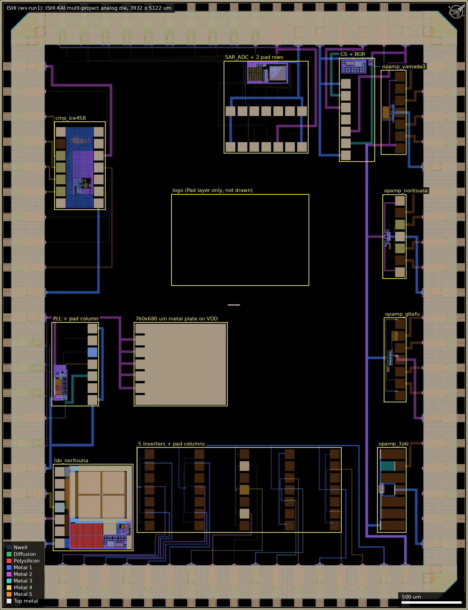
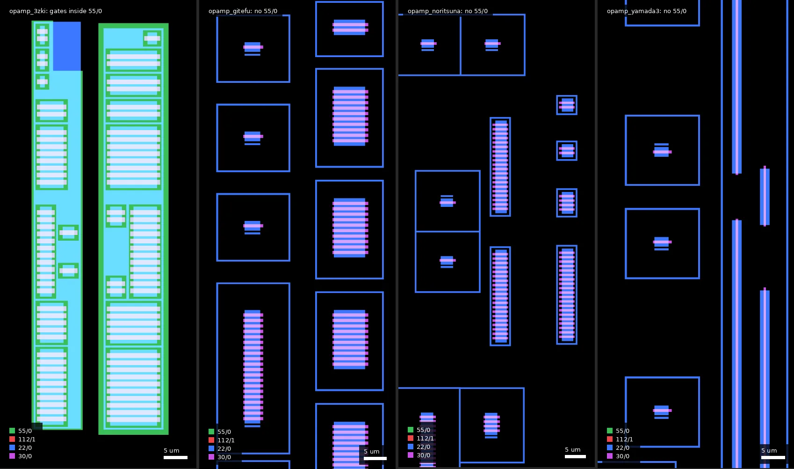
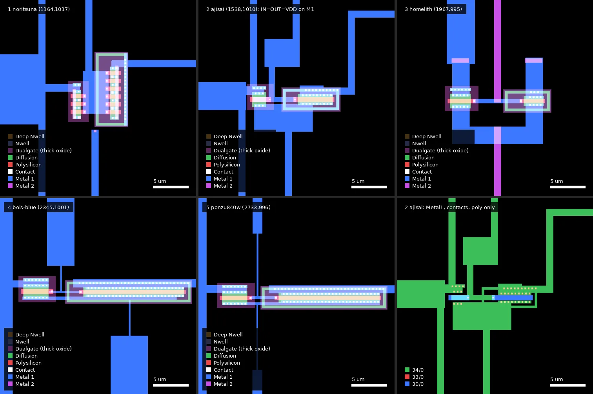
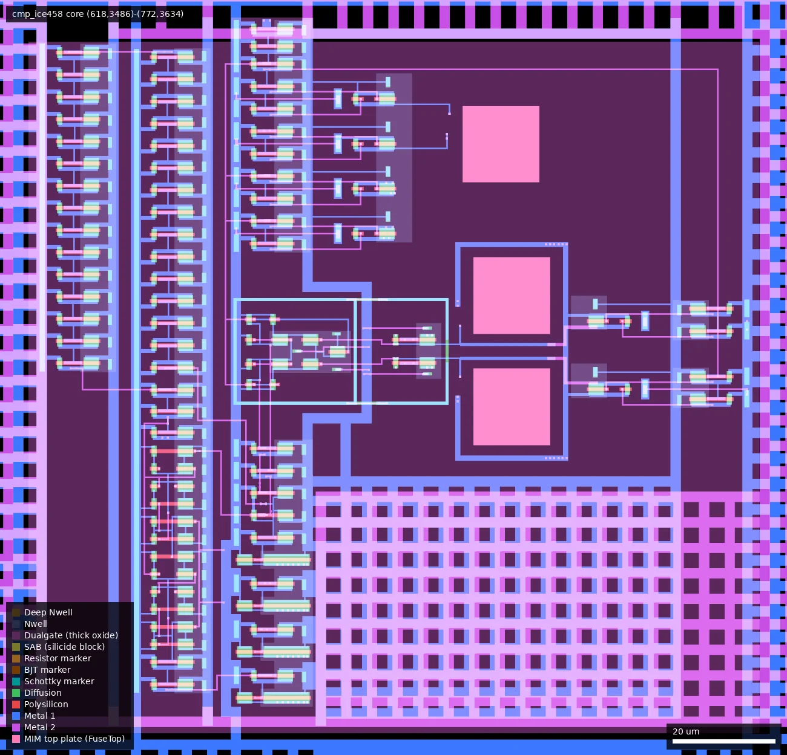
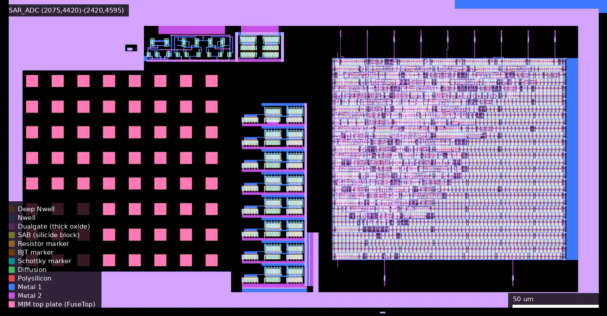
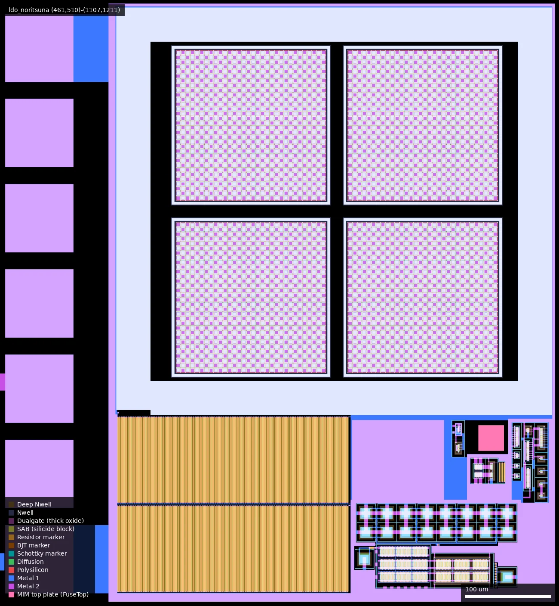
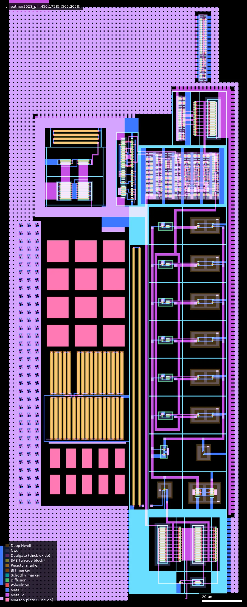
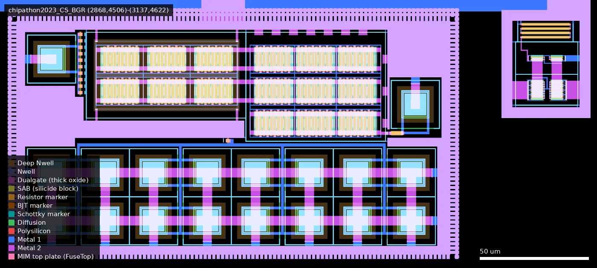
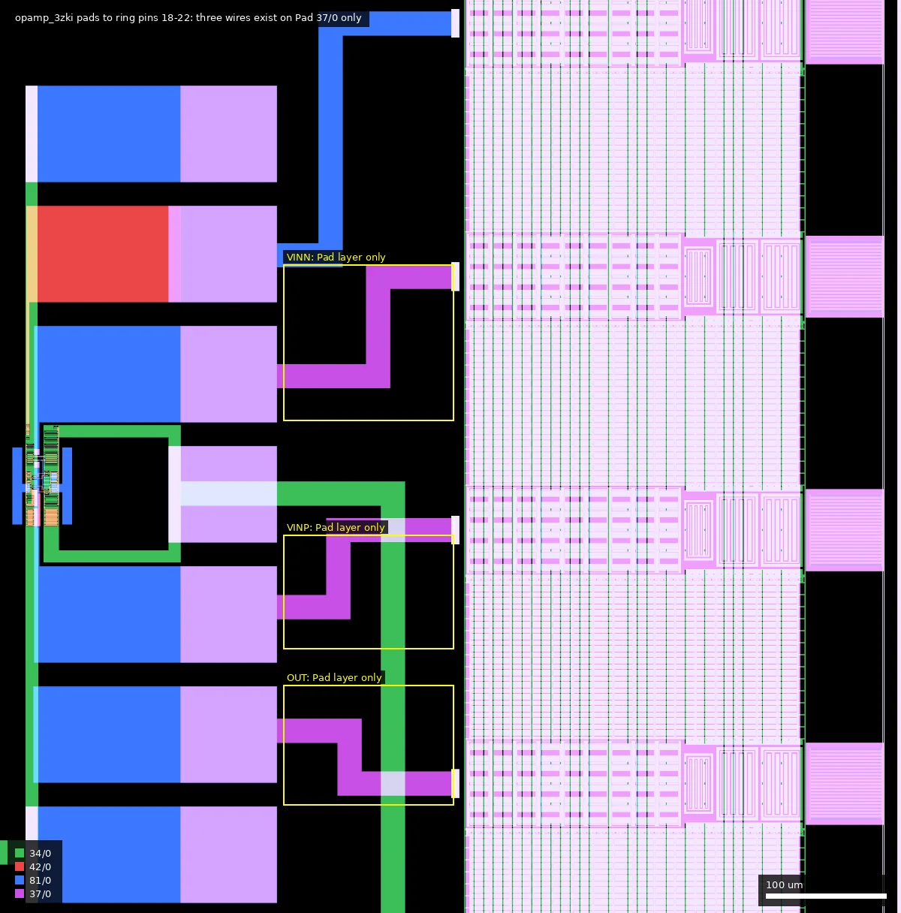

# ISHI: ISHI-KAI's Multiple Users Project (ws-run1)

| | |
|---|---|
| Repository | https://github.com/ishi-kai/ISHI-KAI_Multiple_Projects_WaferSapce-GF180-1 @ ae2164f (main, last commit 2026-05-08) |
| Slot | 1x1 (die 3932 x 5122 um measured from the GDS) |
| Top cell | ISHI-KAI_WS_RUN1 |
| Licence in repo | Apache-2.0 (`LICENSE`, "Copyright (c) 2025 Inter-linked Society on Homemade IC Kai"); no SPDX headers |
| README | OK, 2089 words, original (English), but most of it describes files that live in other repositories |
| Taped-out layout | ISHI_ISHI-KAI_WS_RUN1_12_4, 3932 x 5122 um, 1 placement(s) on the G801 reticle |

## What the repo actually contains

A hand-assembled, full-custom analog multi-project die from the Japanese
ISHI-KAI community: 15 separate circuits from 14 named members, each with its
own row of on-die probe pads and (with the exceptions listed under "Taped-out
layout") a connection to the outer GF180MCU IO ring. There is
no digital flow, no RTL and no LibreLane run; the only automated block is the
SAR logic inside the ADC, which was synthesised earlier with OpenLane on
`gf180mcu_fd_sc_mcu7t5v0`. Everything was drawn in xschem and KLayout (PCells),
then flattened.

**This repo is a layout-and-logs repo only.** It holds no schematics, no
netlists, no testbenches and no simulation output. `schematic/README.md` is
seven links to three other repositories. What is here:

| Path | Content |
|---|---|
| `gds/ISHI-KAI_WS_RUN1.zip` | Final top GDS (283 MB unzipped, 997 cells) including fill |
| `gds/ISHI-KAI_WS_RUN1_nofiller.zip`, `..._nofiller_delContext.zip` | Same without dummy fill (the two unzip to the same size) |
| `gds/frame_ISHI-KAI.gds`, `frame_ISHI-KAI_noIO.gds` | Pad ring / frame only |
| `gds/member_project/*.gds` | One flattened GDS per block as received from members (11 files, `ldo_noritsuna` zipped), plus `probe_pads.gds` |
| `gds/chip_arts/logo_ISHI-KAI.gds` | Logo, drawn as 325,554 polygons on the Pad (37/0) layer |
| `docs/pin_list.xlsx`, `pin_list.pdf` | 74-row pad list: pin number, block, signal, IO cell type |
| `precheck_log/RUN_*` | Ten wafer.space precheck runs, 2025-11-12 to 2025-12-16 |
| `images/` | Annotated layout picture, precheck screenshots, KLayout crash screenshots |
| `chip_photo/` | 29 microscope photos of fabricated dies, 2 photos of the bare-die tray, 2 of chip-on-board assemblies |

The linked source repositories (not cloned here; I fetched them read-only to
identify devices) are:

- `ishi-kai/ISHI-KAI_Multiple_Projects_OpenGFMPW-1`: inverters, op-amps, comparator (originally prepared for GFMPW-1, which did not accept the design)
- `ishi-kai/Chipathon2023_ADC`: SAR ADC and LDO (SSCS Chipathon 2023, Japan team)
- `atuchiya/DC23-LTC2` branch `japan-test`: PLL, bandgap, current source (fork of `sscs-ose/DC23-LTC2`)

### Sub-designs

"Devices" is taken from the upstream xschem schematics. What was actually drawn
on the die (flavour, W/L, counts) is measured in the "Taped-out layout" section
below; it differs from this table for three op-amps and the comparator.

| # | Cell in top GDS | Designer | Circuit | Devices (schematic) | Sch | Layout | Sim |
|---|---|---|---|---|---|---|---|
| 1 | `inverter_all` | noritsuna | CMOS inverter | nfet_05v0 3.6/0.6, pfet_05v0 7.2/0.6 | upstream | here | upstream testbenches incl. PEX; no stored results |
| 2 | `inverter_all` | ajisai | CMOS inverter | nfet_06v0 2.0/0.7, pfet_06v0 5.0/0.7 | upstream | here | none |
| 3 | `inverter_all` | homelith | CMOS inverter, deliberately weak PMOS | nfet_06v0 3.0/0.6, pfet_05v0 2.8/0.56 | upstream | here | upstream `inv_with_sim.sch` (5 V) |
| 4 | `inverter_all` | bols-blue | CMOS inverter | nfet_05v0 3.6/0.7, pfet_05v0 14.4/0.6 | upstream | here | none |
| 5 | `inverter_all` | ponzu840w | CMOS inverter | nfet_05v0 3.6/0.6, pfet_05v0 14.4/0.6 | upstream | here | upstream `inv_tb.sch` |
| 6 | `opamp_3zki` | 3zki (Mizuki Mori) | Rail-to-rail op-amp after Baker fig. 24.48, VDD 5 V, VB 2.5 V | 25 nfet_06v0 (L=1 um, W 1 to 50 um), 25 pfet_06v0 (L=1 um, W 2 to 100 um), 2 cap_mim 64x8 um | upstream | here | none ("no documents or measurements were created") |
| 7 | `opamp_gitefu` | gitefu | Two-stage op-amp, PMOS input, 5 V | nfet_06v0_dn / pfet_06v0_dn L=0.7 um, cap_mim 39x19.23 um | upstream | here | upstream `op_tb.sch`, PEX netlist, netgen log |
| 8 | `opamp_noritsuna` | noritsuna | Two-stage op-amp, 5 V, IB 20 uA | nfet_05v0_dn L=0.6, pfet_05v0 L=0.56, cap_mim 50x10 um | upstream | here | upstream `opamp_ac.sch`, `opamp_PEX.sch`, 3.2 MB PEX netlist |
| 9 | `opamp_yamada3` | yamada3 (Miho Yamada) | Two-stage op-amp "2L_5V" | 6 nfet_05v0_dn L=0.6, 6 pfet_06v0 L=0.5, cap_mim 100x50 um | upstream | here | none |
| 10 | `cmp_ice458` | ice458 | Clocked dynamic comparator with RS latch, 30-inverter delay line, output buffers | nfet_06v0 1/0.7, pfet_05v0 3/0.7, 3 cap_mim 15x15 um, 66 sc7 5 V standard cells | upstream | here | upstream `cmp_only_tb_5v.sch` (run at 3.3 V) |
| 11 | `SAR_ADC` | Maple0705 (SAR logic, integration), Gitefu (comparator), Tseng (CDAC), Kinako (latch, switches) | 6-bit SAR ADC, 8 MHz clock, 3.3 V | nfet_03v3 / pfet_03v3 L=0.28 (comparator, switches, latch), 64 cap_mim_2f0_m4m5_noshield 7x7 um (8x8 array), 798 `gf180mcu_fd_sc_mcu7t5v0` cells | upstream | here | upstream transient CSVs and PEX netlist |
| 12 | `ldo_noritsuna` | noritsuna, with bandgap by A. Tsuchiya, current source by M. Yamada, waffle PFET by Akiles Esta Usado | LDO, 3.3 V in, 3.2 V / 4 mA out, 700 x 650 um | pass device pfet_03v3 4.38/0.5 m=7936 (waffle layout), nfet_03v3, 2 ppolyf_u 0.8 um x 10 mm, error amp in nfet/pfet_03v3 L=0.56 with cap_mim 30x30, npn_10p00x10p00 bandgap | upstream | here | upstream `ldo_pex_tb.sch`, 49 MB PEX netlist |
| 13 | `chipathon2023_pll` | A. Tsuchiya | Analog PLL, 8 MHz in, 48/40 MHz out, 3.3 V | VCO ring and charge pump in nfet_03v3/pfet_03v3 L=0.33 (one 0.28), transmission gates and bias inverters in nfet_06v0/pfet_06v0, sc7 5 V cells for PFD and dividers, loop filter in high-res poly (Resistor layer present, 33 shapes) and 22 MIM caps | upstream | here | upstream `pll_bench.sch`; no stored results |
| 14 | `chipathon2023_CS_BGR` (BGR) | A. Tsuchiya | Bandgap, 1.2 V target, 108 x 200 um | 18 npn_10p00x10p00 (1+1+16), nfet_03v3/pfet_03v3 11.2/1.12, 12 ppolyf_u | upstream | here | README figures: 43 mV over VDD 3.0 to 3.3 V, 1.2 mV over -50 to 125 C |
| 15 | `chipathon2023_CS_BGR` (CS) | yamada3 (Miho Yamada), from A. Tsuchiya's `cs_vthref` | Vth-referenced current source, 20 uA | nfet_03v3_dn, pfet_03v3 5.6/0.56, 4 ppolyf_u 0.8x22 um | upstream | here | README figures: 0.38 uA over VDD 3.0 to 3.3 V, 3.2 uA over -50 to 125 C |

Also on the die: `logo_ishikai` (1157 x 771 um at (1439, 2722), drawn on the Pad
layer only, with no metal under it), 12 instances of the plain 7-pad probe row
`pads_ishikai`, and one 760 x 680 um passivation opening at (1137, 1723) to
(1897, 2403) over nine abutted pad rows that form a solid Metal1-to-Metal5
plate. Extracted connectivity puts that plate on the die-wide VDD net; its
purpose is not documented.

### Frame and verification

Pad ring: 74 pads from `gf180mcu_fd_io` (39 `asig_5p0`, 9 `bi_24t`, 5 `in_c`)
plus 15 `gf180mcu_ws_io__dvdd` and 6 `gf180mcu_ws_io__dvss`, on 5 metal layers.
Small glue cells `ANALOG_CON`, `D_BI_T_CON`, `D_IN_C_CON`, `VDD_VSS_CON` connect
pads to the core; the digital ones strap pad control pins with `tieh`/`tiel`
cells from the 7-track 5 V library.

The last precheck (`RUN_2025-12-16_22-51-46`, PDK 1.6.6, precheck 1.5.4 per
commit message) reports zero density, zero-area, antenna, Magic DRC and KLayout
DRC errors. Earlier runs record a KLayout 0.30.4 crash in the deep-mode DRC
(`RUN_2025-11-21`, stack trace in `error.log`) and two SIGKILLs (screenshots).

There is no LVS of the assembled die, and no top-level schematic or netlist
anywhere. Per-block LVS exists only upstream and only for some blocks.

Silicon: the tray photo shows a "G801 ISHI 1x1" label with 308 bare dies, and a
panel of ten chip-on-board assemblies on wafer.space "70 pin mezzanine, 74 pin
padring" boards. **No electrical measurement data has been published in this
repo.**

## Taped-out layout

Measured from `layout/ISHI.oas` (the die as placed on the G801 reticle). Device
sizes come from Poly2-over-COMP gate regions and marker layers. "Extracted
connectivity" below means a KLayout `LayoutToNetlist` run over the whole die
(Metal1 to Metal5, all vias, contacts, poly outside resistor bodies, N+ and P+
diffusion split at the gates, MIM top-plate vias kept apart from Metal4, dummy
fill excluded). It traces conductors only; it is not an LVS, because there is no
schematic of the assembled die to compare with.

| | |
|---|---|
| Die | 3932 x 5122 um, core cell `TOP_ISHI-KAI` 3180 x 4370 um at (376, 376) |
| Metal stack | 5 metals; Metal5 is the top metal (no MetalTop 53/0 shapes) |
| Pad ring | 74 pads: 39 `gf180mcu_fd_io__asig_5p0`, 9 `bi_24t`, 5 `in_c`, 15 `gf180mcu_ws_io__dvdd`, 6 `gf180mcu_ws_io__dvss`, 4 corners |
| Standard cells | none as cells; the member blocks are flattened. Text stamps of `gf180mcu_fd_sc_mcu7t5v0` cells remain inside `SAR_ADC` (697), `cmp_ice458` (66) and the PLL (6); 63 `tieh`/`tiel`/`filltie` cells sit in the pad glue |
| SRAM | none |
| Custom blocks | 10 member cells holding the 15 circuits, 13 separate probe-pad row cells (12 `pads_ishikai`, 1 `pads_ishikai_PLL`; the other rows are drawn inside the member cells), `logo_ishikai`, 74 pad glue cells (39 `ANALOG_CON`, 22 `VDD_VSS_CON`, 8 `D_BI_T_CON`, 5 `D_IN_C_CON`) |
| Probe pads | 112 pads of 80 x 80 um on 100 um pitch (5 x 7 inverters, 4 x 7 op-amps, 14 comparator, 14 ADC, 7 each for CS+BGR, PLL, LDO), plus the 760 x 680 um plate |
| Devices | 3.3 V thin-oxide MOS, 5 V MOS (Dualgate + V5_XTOR), 6 V MOS (Dualgate only), NMOS in DNWELL, 36 vertical NPN 10 x 10 um, P+ unsalicided poly resistors, high-res poly (Resistor 62/0), MIM capacitors (95 top plates). No native, LDMOS, MOS capacitor, Schottky or eFuse devices |

### Does it match the repository?

Yes. `gds/ISHI-KAI_WS_RUN1.zip` and the reticle cell have the same 3932 x 5122 um
extent and the same 997 cells (991 distinct base names; only the top cell name
differs). A geometric XOR over the whole die gives zero difference on Poly2,
Dualgate, V5_XTOR, DNWELL, Nwell, Nplus, Pplus, SAB, Resistor, FuseTop, RES_MK,
Metal1 and Metal2, and an XOR of the core cell `TOP_ISHI-KAI` gives zero on
Metal3, Metal4, Metal5, Pad, Contact and Via1 to Via4 (the upper metals and
vias of the pad ring itself were not compared). COMP differs only because
the repository keeps dummy diffusion on 22/4 (206,713 shapes) and the reticle
file has it merged into 22/0. So the repository GDS is the taped-out design,
and everything found below is also in the repository GDS. Pad cell types and
counts agree with the summary above.

The member files in `gds/member_project/` are not what was taped out for three
op-amps; see "Thick oxide" below.

### Thick oxide: which circuits really are 5 V / 6 V

Checked per circuit with `layout_query.py overlap` (Poly2 30/0 against Dualgate
55/0 and V5_XTOR 112/1) and with a per-gate test (Poly2 and COMP, outside
RES_MK).

| Circuit | Gate regions | Inside Dualgate 55/0 | Inside V5_XTOR 112/1 | As fabricated |
|---|---|---|---|---|
| 5 inverters | 9, 2, 2, 2, 2 | all | all | 5 V thick oxide (all five, including the two drawn as `_06v0` upstream) |
| `opamp_3zki` | 90 | 90 | 0 | 6 V thick oxide, as the schematic |
| `opamp_gitefu` | 71 | 0 | 0 | **3.3 V thin oxide**; no Dualgate shape in the block |
| `opamp_noritsuna` | 96 | 0 | 0 | **3.3 V thin oxide**; no Dualgate shape in the block |
| `opamp_yamada3` | 12 | 0 | 0 | **3.3 V thin oxide**; no Dualgate shape in the block |
| `cmp_ice458` | 175 | 175 | 175 | 5 V thick oxide |
| `SAR_ADC` | 4783 | 4308 | 4308 | SAR logic 5 V; comparator, switches and latch (475 gates, L = 0.28 um) thin oxide, as designed |
| `chipathon2023_pll` | 513 | 281 | 281 | logic and transmission gates 5 V; VCO, charge pump and bias (232 gates) thin oxide, as designed |
| `ldo_noritsuna`, BGR, CS | 8212, 150, 20 | 0 | 0 | 3.3 V thin oxide, as designed |

The loss happened between the member files and the assembled die. In
`gds/member_project/opamp_gitefu.gds` all 71 gates lie inside Dualgate (12
shapes, no V5_XTOR, i.e. 6 V); in `opamp_noritsuna.gds` all 96 and in
`opamp_yamada3.gds` all 12 lie inside Dualgate and V5_XTOR (5 V). In the die
the same gate regions (same count, same total gate area) have neither layer.
Among the four op-amps, the three affected blocks are exactly the three whose
NMOS sit in DNWELL islands (6 DNWELL shapes each; opamp_3zki has none). DNWELL
alone does not explain it: the LDO, PLL and CS_BGR blocks also have DNWELL
(27, 9 and 19 shapes) and kept their oxide. The reason for the edit is not
recorded. The inverter member file has
15 of 17 gates in V5_XTOR and the die has 17 of 17, which is a marker change
only.

### Circuits located and measured

W/L are drawn gate dimensions; "x n" is the number of gate fingers of that
size in the block, not the number of schematic instances. NMOS marked "dn" sit
inside a DNWELL island.

| # | Circuit | Cell, box (um) | Devices measured from the layout |
|---|---|---|---|
| 1 | Inverter, noritsuna | `inverter_all`, device at (1174, 1029) | 5 V: NMOS 1.2/0.6 x 3 (= 3.6/0.6), PMOS 1.2/0.6 x 6 (= 7.2/0.6) |
| 2 | Inverter, ajisai | `inverter_all`, (1546, 1023) | 5 V: NMOS 2.0/0.7, PMOS 5.0/0.7. **Shorted, see below** |
| 3 | Inverter, homelith | `inverter_all`, (1975, 1008) | 5 V: NMOS 3.0/0.6, PMOS 2.8/0.56 |
| 4 | Inverter, bols-blue | `inverter_all`, (2348, 1015) | 5 V: NMOS 3.6/0.7, PMOS 14.4/0.6 |
| 5 | Inverter, ponzu840w | `inverter_all`, (2736, 1009) | 5 V: NMOS 3.6/0.6, PMOS 14.4/0.6 |
| 6 | `opamp_3zki` | (3180, 669)-(3400, 1349); devices (3190, 980)-(3220, 1067) | 6 V, all L = 1.0: NMOS 5.0 x 25, 2.5 x 14, 1.0 x 5; PMOS 10.0 x 29, 5.0 x 12, 2.5 x 4, 2.0 x 1; 2 MIM 8 x 64 um |
| 7 | `opamp_gitefu` | (3240, 1761)-(3400, 2441); devices (3250, 2000)-(3284, 2175) | thin oxide: NMOS dn 3.5/0.7 x 28, PMOS 7.0/0.7 x 43; MIM 19.23 x 39 um |
| 8 | `opamp_noritsuna` | (3227, 2796)-(3400, 3476); devices (3234, 3030)-(3281, 3186) | thin oxide: NMOS dn 3.0/0.6 x 28, PMOS 2.8/0.56 x 68; MIM 10 x 50 um |
| 9 | `opamp_yamada3` | (3214, 3838)-(3400, 4518); devices (3214, 4095)-(3311, 4247) | thin oxide: NMOS dn 60/0.6 x 1 and 3.0/0.6 x 5; PMOS 60/0.5 x 3, 12/0.5 x 1, 3.0/0.5 x 2; MIM 50 x 100 um |
| 10 | `cmp_ice458` | (470, 3375)-(869, 4086); core (624, 3490)-(767, 3631) | 5 V, all L = 0.7: NMOS 1.0 x 84, 3.0 x 4; PMOS 3.0 x 83, 9.0 x 4; 3 MIM 15 x 15 um. There is no L = 0.5/0.6 gate in the block, so the delay line and buffers are built from these custom devices and not from library transistors |
| 11 | `SAR_ADC` | (2075, 4420)-(2420, 4595) | thin oxide NMOS 2.8/0.28 x 289 and PMOS 2.8/0.28 x 186 (comparator, switches, latch) at (2156, 4435)-(2246, 4578); 64 MIM 7 x 7 um on 15 um pitch at (2085, 4444)-(2197, 4556); SAR logic 150 x 150 um at (2258, 4432), 4308 5 V gates; 62 DIODE_MK shapes (antenna diodes) |
| 12 | `ldo_noritsuna` | (461, 510)-(1107, 1211) | thin oxide. Pass device: PMOS 4.38/0.5 x 7936 in four waffle quadrants at (662, 779)-(1039, 1156). Divider: 400 P+ unsalicided poly segments 0.8 x 100 um (40 mm drawn) at (593, 522)-(864, 726). Error amplifier: NMOS dn 2.8/0.56 x 28, PMOS 2.8/0.56 x 68, MIM 30 x 30 um. Also contains its own copy of the bandgap (18 NPN) and of the current source |
| 13 | `chipathon2023_pll` | (450, 1758)-(566, 2058) | thin oxide: NMOS 1.0/0.33 x 88, PMOS 3.0/0.33 x 60, smaller dn NMOS and PMOS at L = 0.33 in the VCO column (544, 1830)-(555, 1948), one 1.0/0.28 and 3.0/0.28 pair; 281 5 V gates (PFD, dividers, transmission gates). Loop filter: 33 high-res poly segments 1.0 x 20 um (Resistor 62/0, no implant), 2 P+ poly 0.8 x 130 um, MIM 12 of 11 x 11 um and 10 of 5 x 10 um. Contains its own copy of the current source (5.6/0.56 devices, 4 poly 0.8 x 22 um) |
| 14 | Bandgap | `chipathon2023_CS_BGR`, (2868, 4506)-(3080, 4622) | 18 NPN, each a 16.8 um DNWELL island with a 10 x 10 um emitter (1 + 1 + 16); NMOS dn 11.2/1.12 x 60, PMOS 11.2/1.12 x 90; 11 P+ poly segments 0.8 x 1.6 um and one 1.6 x 5.4 um under RES_MK |
| 15 | Current source | `chipathon2023_CS_BGR`, (3080, 4506)-(3137, 4622) | thin oxide NMOS 5.6/0.56 x 4 (not in DNWELL), PMOS 5.6/0.56 x 16, 4 P+ poly 0.8 x 22 um |

### Integration errors found by extracted connectivity

None of these is visible from the repository, and all are in the repository
GDS as well as on the reticle.

1. **All 15 `dvdd` pads are one net, and all 6 `dvss` pads are one net.** Every
   circuit's "VDD" pin in `docs/pin_list` is the same node, so no block can be
   powered on its own or at its own voltage. Since the LDO, bandgap, current
   source, PLL analog part, ADC front end and three op-amps are thin oxide,
   the common supply is limited to 3.3 V.
2. **The common VDD net has P+ substrate contacts.** P+ diffusion outside any
   Nwell or DNWELL, contacted to the VDD net, exists in two places: 195 tap
   shapes (132 um2) in `SAR_ADC`, because the ADC ground rail is wired to a
   `dvdd` pad (item 4), and six guard rings (182 um2) around the DNWELL islands
   of `opamp_yamada3`, e.g. (3275.8, 4160.4)-(3291.9, 4175.5), which share
   Metal1 with that op-amp's VDD pad. The VSS net contacts the same substrate
   everywhere else, so there is a resistive VDD-to-VSS path through the
   substrate. Its resistance cannot be read from the layout; measuring it on a
   bare die is the first thing to do.
3. **Inverter 2 (ajisai) is shorted.** The PMOS guard ring is a closed Metal1
   ring tied to VDD; the Metal1 gate strap crosses its left side at about
   (1550.2, 1023.7) and the Metal1 output plate overlaps its bottom side. IN,
   OUT and VDD are one net, so ring pins 5 and 6 and three probe pads are
   connected directly to the common VDD.
4. **Three consecutive pad cells on the top edge are of the wrong type.** The
   core wiring follows `docs/pin_list` (43 ADC VSS, 44 ADC VDD, 45 ADC VIN),
   and the glue cells placed there are `VDD_VSS_CON`, `VDD_VSS_CON`,
   `ANALOG_CON`, but the ring cells are `dvdd`, `asig_5p0`, `bi_24t` where
   `dvss`, `dvdd`, `asig_5p0` were needed. Result: the ADC ground rail is on the
   common VDD net; the ADC supply rail (and the tie cells of the nine digital
   pad glue cells on that edge) hangs on analog pad 44; VIN lands on the
   core-side pins of a digital `bi_24t` cell and does not reach bond pad 45.
5. **ADC VIN and OUT[1] are shorted to the ADC supply rail.** The Metal2 riser
   from VIN to pad 45, (2144.36-2147.36, 4619.89-4735.60), crosses the Metal2
   bus that feeds the tie cells, (503.23-2323.33, 4719.90-4723.90). The
   `VIA_FULL_STACK` on the OUT[1] pin at (2315.78-2316.53, 4575.39-4578.39)
   overlaps a Metal4 supply stripe of the SAR logic at x = 2314.59-2316.19.
6. **`opamp_3zki` OUT, VINP and VINN do not reach the ring.** The three wires
   from those probe pads to ring pins 19, 20 and 21 are drawn on the Pad layer
   (37/0) only, with no metal; pins 19 to 21 end at their `ANALOG_CON` cell. VB
   (pin 22, Metal5) and VDD (Metal1) are connected.
7. Two probe pads have a Pad opening but no usable top metal: the LDO VDD pad at
   (501.2, 859.8) has Metal1 to Metal4 and no Metal5, and the PLL REF_CLK pad at
   (777.2, 2163.4) has only a 5 x 5 array of 2 um Metal5 dots.

With items 2, 4 and 5 the SAR ADC cannot be operated as designed.

![SAR_ADC and top-edge ring pins 43 to 45 in Metal1 to Metal3: the three pad cells whose type does not match the core wiring, the VIN riser crossing the Metal2 tie-cell bus at (2146, 4722) and the OUT[1] via stack at (2316, 4577)](images/adc_ring.webp)

### Ring pins as wired

Pin 1 is the bottom-left pad; numbering runs counter-clockwise (bottom edge
left to right, right edge upward, top edge right to left, left edge downward).
Established by extracted connectivity from each bond pad.

| Pins | Cell types | Reaches |
|---|---|---|
| 1, 4, 7, 10, 13, 18, 23, 28, 33, 38, 40, 43, 55, 65, 72 | `dvdd` | one common VDD net (plus pins 5 and 6, the ADC ground rail and the 760 x 680 um plate) |
| 16, 17, 42, 64, 71, 74 | `dvss` | one common VSS net |
| 2, 3 / 8, 9 / 11, 12 / 14, 15 | `asig_5p0` | OUT, IN of inverters 1, 3, 4, 5 |
| 5, 6 | `asig_5p0` | common VDD (shorted inverter 2) |
| 19, 20, 21 | `asig_5p0` | nothing |
| 22 | `asig_5p0` | `opamp_3zki` VB |
| 24-27, 29-32, 34-37 | `asig_5p0` | OUT, VINP, VINN, IB of `opamp_gitefu`, `opamp_noritsuna`, `opamp_yamada3` |
| 39, 41 | `asig_5p0` | current source output (`vb`), bandgap output (`vout`) |
| 44 | `asig_5p0` | ADC supply rail, with VIN and OUT[1] shorted to it |
| 45 | `bi_24t` | pad not connected to the core; VIN is on its core-side pins |
| 46-52 | `bi_24t` | ADC EOC, OUT[5], OUT[4], OUT[3], OUT[2], OUT[1], OUT[0] through `D_BI_T_CON` (pad output buffers, not traced through the IO cell) |
| 53, 54 | `in_c` | ADC XRST, CLK |
| 56-63 | `asig_5p0` | comparator clk, done, outp, outn, out, inp, inm, vcm |
| 66, 68, 70 | `in_c` | PLL DISABLE, REF_CLK, FREERUN |
| 67 | `bi_24t` | PLL CLK_OUT |
| 69 | `asig_5p0` | PLL VCTRL |
| 73 | `asig_5p0` | LDO VOUT |

## Authors and affiliations

| Person or organisation | Role | Affiliation | Source |
|---|---|---|---|
| ISHI-KAI (Inter-linked Society on Homemade IC Kai) | Organiser, copyright holder | Community, https://ishi-kai.org/ | `LICENSE`, `gh api orgs/ishi-kai` |
| Noritsuna Imamura (`noritsuna`) | Sole committer (33 commits), die integration, frame, fill, precheck; inverter, op-amp, LDO | SIProp.org | git log; GitHub profile company field |
| Akira Tsuchiya (`atuchiya`) | PLL, bandgap, original current source; author of the op-amp tutorial others followed | Not stated (README calls him "Prof. Tsuchiya") | README, upstream READMEs |
| Mizuki Mori (`3zki`) | Rail-to-rail op-amp; supporter on the ADC | Not stated ("hobbyist interested in LSI") | README, upstream ADC README, GitHub bio |
| Miho Yamada (`keropiyo`, "yamada3") | Op-amp, current source | Not stated | README, upstream LDO README |
| `Gitefu` | Op-amp, ADC comparator | Not stated; self-described graduate student in processor research, member of "tofunology" | README |
| `ice458` | Dynamic comparator | Not stated | README |
| `maple0705` | SAR logic, ADC integration | Not stated ("semiconductor engineer") | upstream ADC README |
| `kinako71` (Kinako) | ADC latch and switches | Not stated (graduate student) | upstream ADC README |
| `tsengs0` (Tseng) | ADC MIM capacitor array | JAIST | GitHub profile company field |
| `homelith`, `bols-blue` (h.suehiro), `ponzu840w`, ajisai | One inverter each | Not stated (ponzu840w: electronics undergraduate) | README, GitHub profiles |
| Takeshi Kuboki | Supporter on the ADC | Not stated | upstream ADC README |
| Akiles Esta Usado | Waffle PFET array reused in the LDO | Chipathon 2023 Chile team | README |

The README link for ponzu840w points at `github.com/mulwak`, which returns 404.

## Value for GF180MCU characterisation and PDK development

### Verdict: High

Fourteen of the fifteen circuits are device-level analog blocks with dedicated
probe pads, covering 3.3 V, 5 V and 6 V MOS, vertical NPN, unsalicided and
high-res poly resistors and MIM capacitors, and upstream simulations exist for
most of them. The layout was traced pad by pad, so the probe-pad and ring-pin
maps below are complete. The value is reduced by the absence of any
device-level test structure (no single transistors, no resistor or capacitor on
its own) and by integration errors that the layout shows and the repository
does not: one supply net for everything with substrate contacts on it, a
shorted inverter, an ADC that cannot work as wired, three op-amps built in a
different oxide from their schematics, and one op-amp reachable by probe only.
If the substrate path on the supply turns out to be low-resistance on silicon,
the verdict drops; that cannot be decided from the layout.

### Test structures and measurable circuits

Probe pads are 80 x 80 um openings on 100 um pitch in rows of seven. Coordinates
are pad centres in um from the lower-left die corner. Pad functions and ring
pins are from extracted connectivity (see "Taped-out layout"); where a block
carries text labels they agree with it. "VDD" and "VSS" are the two die-wide
supply nets in every row. Pads described as floating are isolated metal stacks.

| Structure | Exercises | Probe pads | Ring pins | Reference simulation |
|---|---|---|---|---|
| Inverters 1, 3, 4, 5 | VTC, switching threshold and drive of 5 V thick-oxide NMOS/PMOS at L 0.56 to 0.7 um; homelith's (3) is intentionally skewed | Columns at x = 1255.4, 2053.3, 2432.9, 2812.8; y = 708.5 VSS, 808.5 OUT, 908.5 floating, 1008.5 VDD, 1108.5 floating, 1208.5 IN, 1308.5 VSS (column 4: OUT at 908.5 and IN at 1108.5, 808.5 and 1208.5 floating) | OUT, IN on 2, 3 / 8, 9 / 11, 12 / 14, 15 | Testbenches upstream; no numbers |
| Inverter 2 (ajisai) | Nothing: IN, OUT and VDD are shorted in Metal1 | Column x = 1673.7; 808.5, 1008.5 and 1208.5 are all VDD | 5 and 6 are on VDD; do not drive them | None |
| `opamp_3zki` | 6 V MOS matching, gain, rail-to-rail input range, MIM compensation | x = 3360.4; y = 708.5 VSS, 808.5 OUT, 908.5 VINP, 1008.5 VDD, 1108.5 VINN, 1208.5 VB, 1308.5 VSS | VB on 22 only; OUT, VINP, VINN are probe-only (19 to 21 unconnected) | None |
| `opamp_gitefu` | Two-stage op-amp DC gain, offset, GBW, in thin-oxide devices at L = 0.7 um | x = 3360.1; y = 1800.8 VSS, 1900.8 OUT, 2000.8 VINP, 2100.8 VDD, 2200.8 VINN, 2300.8 IB, 2400.8 VSS | 24 OUT, 25 VINP, 26 VINN, 27 IB | Upstream testbench and PEX netlist are for 6 V devices at 5 V and do not describe the silicon |
| `opamp_noritsuna` | Same, L = 0.56/0.6 um | x = 3360.1; y = 2836.2 VSS, 2936.2 OUT, 3036.2 VINP, 3136.2 VDD, 3236.2 VINN, 3336.2 IB, 3436.2 VSS | 29 OUT, 30 VINP, 31 VINN, 32 IB | Upstream AC testbench and PEX netlist are for 5 V devices and do not describe the silicon |
| `opamp_yamada3` | Same, L = 0.5/0.6 um; its guard rings tie VDD to the substrate | x = 3360.2; y = 3877.9 VSS, 3977.9 OUT, 4077.9 VINP, 4177.9 VDD, 4277.9 VINN, 4377.9 IB, 4477.9 VSS | 34 OUT, 35 VINP, 36 VINN, 37 IB | None |
| Current source | Thin-oxide NMOS Vth, P+ poly sheet resistance and tempco, PMOS mirror | Column x = 2905.8 shared with the bandgap; y = 3818.3 VSS, 3918.3 output `vb`, 4018.3 VDD, 4118.3 floating, 4218.3 VDD, 4318.3 bandgap `vout`, 4418.3 VSS | 39 | 20 uA; supply and temperature sweeps in upstream README |
| Bandgap | NPN 10 x 10 um Vbe and 16:1 area ratio, P+ poly ratio | Same column, `vout` at y = 4318.3 | 41 | 1.2 V; supply and temperature sweeps in upstream README |
| SAR ADC | Not operable as wired (ground rail on VDD, VIN and OUT[1] shorted to its supply rail). The 8 x 8 MIM array and comparator are not separately accessible | Row y = 3889.2: x = 1936.6 ADC ground rail (= VDD net), 2036.6 VIN (= ADC supply), 2136.6 XRST, 2236.6 CLK, 2336.6 ADC supply, 2436.6 EOC, 2536.6 ADC ground rail. Row y = 4189.2: 1936.6 ground rail, 2036.6 OUT[0], 2136.6 OUT[1] (= ADC supply), 2236.6 OUT[3], 2336.6 OUT[4], 2436.6 OUT[5], 2536.6 ground rail. OUT[2] has no probe pad | 44 ADC supply, 46 to 52 EOC and OUT[5..0], 53 XRST, 54 CLK | Upstream transient CSVs (`submit_version/xschem/sim_result/`), PEX netlist |
| Dynamic comparator | Offset and regeneration time, delay line, in 5 V devices at L = 0.7 um | x = 828.5: y = 3415.1 VSS, 3515.1 inp, 3615.1 inm, 3715.1 vcm, 3815.1 VDD, 3915.1 clk, 4015.1 VSS; x = 510.3: y = 3415.1 VSS, 3515.1 out, 3615.1 outn, 3715.1 outp, 3815.1 done, 3915.1 floating, 4015.1 VSS | 56 clk, 57 done, 58 outp, 59 outn, 60 out, 61 inp, 62 inm, 63 vcm | Upstream 5 V testbench |
| PLL | Ring-VCO frequency versus control voltage (`VCTRL`, `FREERUN` mode), i.e. 3.3 V inverter delay at L = 0.33 um; high-res poly and MIM in the loop filter; lock at 48/40 MHz | Column x = 777.2; y = 1763.4 VSS, 1863.4 floating, 1963.4 VCTRL, 2063.4 CLK_OUT, 2163.4 REF_CLK (Metal5 dots only), 2263.4 DISABLE, 2363.4 VSS. REF_CLK and DISABLE pads sit on the outputs of the `in_c` pad buffers, so they are for observing, not driving. FREERUN has no probe pad | 66 DISABLE, 67 CLK_OUT, 68 REF_CLK, 69 VCTRL, 70 FREERUN | Testbench upstream; no numbers |
| LDO | Thin-oxide PMOS waffle array on-resistance, P+ poly divider, loop regulation. Its input is the common VDD | Column x = 501.2; y = 559.8 VSS, 659.8 VOUT, 759.8 VOUT, 859.8 VDD (no Metal5 under the opening), 959.8 VOUT, 1059.8 VOUT, 1159.8 VSS | 73 VOUT | Upstream PEX testbench |

The VCO in free-run mode is the nearest thing on the die to a ring-oscillator
process monitor. The bandgap and the Vth-referenced source are the most direct
checks of the BJT and resistor models, since upstream gives predicted numbers;
a second copy of each sits inside the LDO, and a third current source inside
the PLL, without pads of their own.

Supply domains: there is one. The Chipathon blocks (ADC, LDO, PLL, bandgap,
current source) and three op-amps are 3.3 V devices; the inverters, comparator
and `opamp_3zki` were designed for 5 V but share the same VDD net, so they can
only be measured at 3.3 V unless everything else is accepted as overstressed.
All analog signals go through `asig_5p0` pads.

### Candidate PDK additions

- `pads_ishikai`: a 7 x (80 um on 100 um pitch) full-metal-stack probe-pad row, placed 12 times as a cell and redrawn inside the member cells. A natural seed for a standard probe-pad PCell.
- Waffle-layout PFET array (7936 units of thin-oxide PMOS 4.38/0.5 in four quadrants of 377 x 377 um overall) and the 8x8 MIM array of 7 x 7 um plates, both upstream.
- Pad glue cells that strap `bi_24t` and `in_c` control pins with tie cells so digital pads can be used from a hand-drawn analog core.
- Checks this die shows are missing from a hand-assembly flow, all of which DRC passed: same-layer crossings of different nets at top level, pad cell type against the glue cell and net it serves, routing drawn on a non-conducting layer (Pad 37/0), P+ substrate contacts on a supply net, and loss of Dualgate between a block and the assembled die. A connectivity-only extraction of the top level found all of them in about half a minute.
- The DNWELL NMOS in the op-amps are drawn with a P+ diffusion ring outside the DNWELL island. In `opamp_yamada3` that ring is tied to VDD and in `opamp_gitefu` it is left unconnected, which suggests it was taken for a well contact. A PCell note or an ERC rule for that ring would help.
- PDK and tool problems the authors recorded:
  - No SPICE model for the 5 V PFET; ice458 substituted the 6 V model for simulation (upstream comparator README, Japanese and English).
  - Schematic and extracted MIM names differ (`cap_mim_2f0fF` against `cap_mim_2f0_m4m5_noshield`), which makes netgen report a mismatch; members wrote private `cap_mim_2p0fF_lvs.sym` and `ppolyf_u_lvs.sym` symbols to work around LVS naming.
  - Text labels made the older precheck fail, so label-free GDS copies were submitted.
  - KLayout 0.30.4 crash in deep-mode DRC and SIGKILLs on this 280 MB layout.
  - Commit messages track fixes forced by PDK updates 1.1.0 to 1.6.6: filler script rewrite, seal ring, zero-area polygons, wide-metal slots, top-cell naming.

### What would be needed to use it

- First, a VDD-to-VSS resistance and leakage measurement on a bare die, with pins 5, 6 and 44 left open, to find out how much the substrate contacts on VDD cost.
- Bare-die probing with a 7-pin 100 um pitch probe or individual needles, or the wafer.space chip-on-board assemblies using the ring pins. Ring access adds `asig_5p0` ESD and series resistance to every analog node. `opamp_3zki` needs probes for OUT, VINP and VINN.
- A supply of at most 3.3 V on the common VDD.
- The ring-pin and probe-pad maps in this summary in place of `docs/pin_list` for pins 5, 6, 19 to 21 and 43 to 45.
- Source-measure units and a scope; an 8 MHz clock for the PLL; a 20 uA bias source for three of the op-amps.
- A test plan. None exists.
- Re-simulation of `opamp_gitefu`, `opamp_noritsuna` and `opamp_yamada3` with 3.3 V device models at the drawn W/L before comparing anything, and of the inverters with the 5 V models for all five.

## Notes and caveats

- **Three op-amps are thin-oxide devices on the die while their schematics are 5 V / 6 V.** Confirmed gate by gate: `opamp_gitefu` (71 gates), `opamp_noritsuna` (96) and `opamp_yamada3` (12) have no Dualgate or V5_XTOR anywhere in the block, while the member GDS files have every one of those gates inside Dualgate. They are 3.3 V-oxide transistors at L = 0.5 to 0.7 um; the upstream schematics and testbenches use `nfet_05v0_dn`/`nfet_06v0_dn`/`pfet_05v0`/`pfet_06v0` at VDD = 5 V. Applying 5 V would overstress them, and the existing simulations do not describe the silicon. `opamp_3zki`, the inverters, the comparator and the 5 V parts of the ADC and PLL keep their Dualgate.
- Gate count and total gate area are identical between each member GDS and the die for all ten blocks, so the other integration edits (tap cells `TAP_PCONT_*`, `TAP_NCONT_*`, and PFET groups in the ADC and PLL re-drawn as `P-FET_W2_8_*` and `PFET_SET` cells) did not change any transistor. Their reason is not stated.
- `docs/pin_list` against the layout, settled: the list matches the core wiring on all four edges. The disagreement on the top edge is in the pad ring, where pins 43, 44 and 45 are `dvdd`, `asig_5p0`, `bi_24t` cells and the list (and the glue cells and wiring under them) expects `dvss`, `dvdd`, `asig_5p0`. That is why the layout shows one `dvss` fewer and one `bi_24t` more than the list. Pins 46 to 54 are as listed.
- All 15 `dvdd` pads are one net and all 6 `dvss` pads are one net (extracted connectivity). The per-circuit "VDD" pins of the pin list are a single supply.
- The connectivity results are from geometry (overlapping shapes on conducting layers and vias), without device recognition. Signals were not traced through the `bi_24t` and `in_c` cells, and the resistance of the substrate path between VDD and VSS was not estimated.
- The layout hash on the platform (270e32b2...) matches neither `gds/ISHI-KAI_WS_RUN1.zip` (436966...; re-committed 2026-01-04, after the last precheck) nor the precheck output GDS (70493e...). Geometrically the zip and the reticle cell agree on every layer compared (see "Does it match the repository?"), so the difference is in file encoding or non-geometric content.
- The project description says 14 designers; the member list has 14 entries but Gitefu appears twice, so 13 distinct people are named there, and the upstream ADC README adds supporters.
- Schematic links point at mutable branches of other repositories, one of them a personal fork. Nothing pins the versions that were taped out.
- The ADC schematic upstream (`SAR_TOP_LVS.sch`) instantiates the LDO; on this die the ADC and LDO are separate cells with separate pads.
- Affiliations for most members are not stated anywhere; several are known only by handle.
