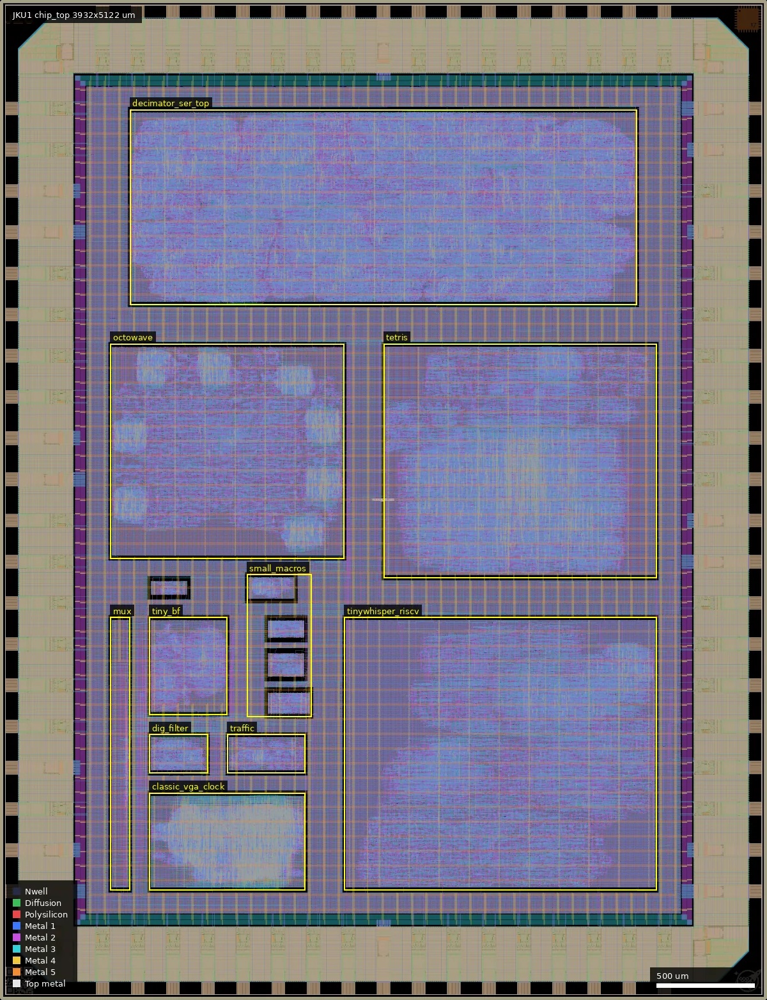
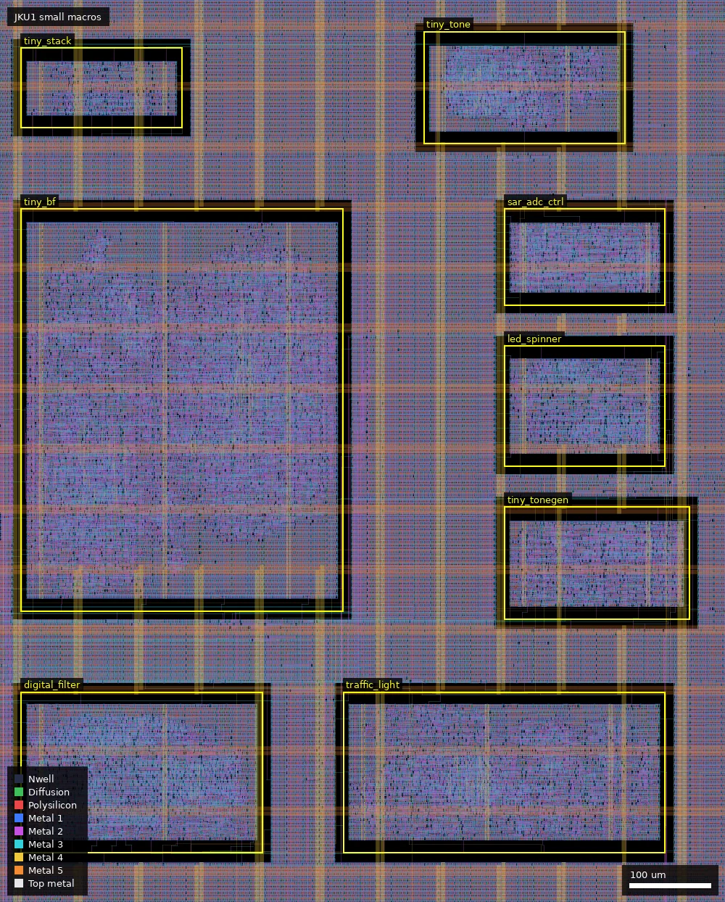
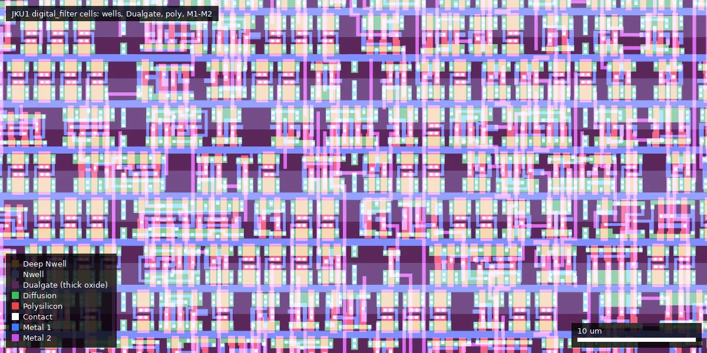
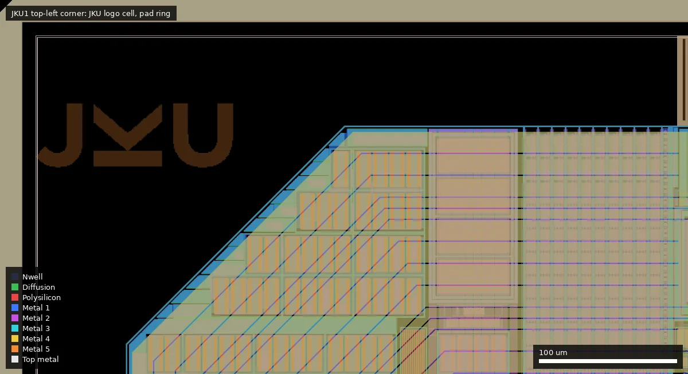

# JKU1: gf180mcu-jku-projects (ws-run1)

| | |
|---|---|
| Repository | https://github.com/iic-jku/gf180mcu-jku-projects @ ebfc69d (main, last commit 2026-07-03) |
| Slot | 1x1 (DIE_AREA 3932 um x 5122 um, core 3048 um x 4238 um) |
| Top cell | chip_top |
| Licence in repo | `LICENSE` is the Solderpad Hardware License v2.1 text with the notice "SPDX-License-Identifier: Apache-2.0 WITH SHL-2.1" (audit: SHL-2.1; GitHub: NOASSERTION). File headers still say Apache-2.0. Details below. |
| README | OK (1086 words): die photos, bring-up note, project list, template build instructions |
| Taped-out layout | JKU1_chip_top_10_0, 3932 x 5122 um, 1 placement on the G801 reticle |

## What the repo actually contains

A multi-project digital chip: 14 independently hardened macros from students and staff around the Institute for Integrated Circuits and Quantum Computing (IICQC) at JKU Linz, one guest design from JMU Würzburg and two school designs, placed in one core and sharing the pad ring. All of it is synthesised RTL on stock cells; there is no analog or custom layout (confirmed in the taped-out layout, see below).

Flow: LibreLane (`leo/gf180mcu` branch, Nix shell) with the wafer.space fork of the PDK (`gf180mcuD`, tag 1.6.6). Each macro is hardened with the Classic flow, then `librelane/config.yaml` (Chip flow) places the 14 macros plus four logo/ID cells. Standard cells are `gf180mcu_fd_sc_mcu7t5v0` (the only library named anywhere in configs and reports); signoff corners are tt_025C_5v00, ss_125C_4v50 and ff_n40C_5v50. Pads (`src/chip_top.sv`): `gf180mcu_fd_io__bi_24t` (41 bidirs, all but one hard-wired as outputs), `gf180mcu_fd_io__in_c` (inputs and reset), `gf180mcu_fd_io__in_s` (clock), `gf180mcu_ws_io__dvdd` / `gf180mcu_ws_io__dvss` (the wafer.space supply pads). No SRAM or other hard macros; memories are flip-flops, and TinyWhisper uses an external SPI SRAM.

Sharing scheme (`src/chip_core.sv`, `doc/pinout.md`): one clock and one reset feed every macro at once. The four large designs (Decimation Filter, Octowave, TinyWhisper, TinyTone) have dedicated pads. Ten small designs share inputs and are selected onto 11 output pads by the `multiplexer` macro through a 3-bit select (`input_in[14:12]`).

Sub-designs (sizes from `doc/projects.txt`, cell counts and timing from each macro's `reports/`):

| Macro (`macros/…`) | Module | What it is | Author as stated | Area, cells | Clock target; signoff |
|---|---|---|---|---|---|
| `tiny_tone` | `tiny_tone` | PWM melody player (Super Mario theme), used as the sanity bring-up test | Jakob Schaumberger (JKU) | 250x140 um, 584 | 84 ns; clean |
| `decimation_filter_256_ser` | `decimator_ser_top` | 8-stage half-band (Saramäki) decimate-by-256 filter with 22-bit serial output, for a 1-bit modulator stream | Michael Köfinger (JKU) | 2600x1000 um, 81337 | 10 us; clean |
| `octowave` | `octowave` | 8-channel DDS waveform generator, 1-bit outputs, UART control (VHDL; master's thesis digital core) | Max Golser (JKU) | 1200x1100 um, 12819 | 31.25 ns; SS setup -3.2 ns |
| `tinywhisper_riscv` | `tinywhisper_riscv` | RISC-V MCU with UART, I2C, SPI (external SRAM), GPIO, and a WSPR transmitter back end (CORDIC, delta-sigma sin/cos outputs, LO I/Q generator) | Jonathan Hager (JMU) | 1600x1400 um, 19370 | 35 ns; SS setup -2.1 ns |
| `tetris` | `tetris` | Tetris with VGA output and game-pad inputs (single generated Verilog file) | Dominik Brandstetter (JKU) and HTL Leonding | 1400x1200 um, 17484 | 25 ns; SS setup -16.8 ns |
| `tiny_stack` | `tiny_stack` | Small Wokwi-generated gate-level design | Linzer Technikum (LiTec) | 200x100 um, 207 | 20 ns; clean |
| `multiplexer` | `multiplexer` | Output multiplexer for the ten shared designs (combinational) | Simon Dorrer (JKU) | 100x1400 um, 145 | no reg-to-reg paths |
| `tiny_bf` | `rh_bf_top` | Brainfuck CPU with UART programmer, 32x8 program RAM, 16x8 tape (flip-flops) | Rene Hahn (JKU) | 400x500 um, 2708 | 40 ns; clean |
| `adc_sar_controller` | `sar_adc_spi_oversampling` | 8-bit SAR ADC control logic with SPI output and oversampling; needs external DAC, comparator and S&H (master's thesis digital core) | Ilir Shala (JKU) | 200x120 um, 396 | 40 ns; clean |
| `led_spinner` | `led_spinner` | LED wheel guessing game with 7-segment output | Tim Tremetsberger (JKU) | 200x150 um, 465 | 40 ns; clean |
| `tiny_tonegen` | `tiny_tonegen` | Tone generator with LFSR noise, ADSR envelope, mixer and 8-bit PWM | Felix Feierabend (JKU) | 230x140 um, 503 | 40 ns; clean |
| `digital_filter` | `df_digital_filter` | Small configurable digital filter built from hand-written adders and multipliers | Gregor Flachs (JKU) | 300x200 um, 754 | 40 ns; clean |
| `traffic_light_controller` | `traffic_light` | Traffic-light FSM with MAX7219 SPI LED-matrix driver | Maximilian Kernmaier (JKU) | 400x200 um, 1578 | 1 us; clean |
| `classic_vga_clock` | `classic_vga_clock` | Analog-style clock rendered on VGA (CORDIC sin/cos) | Timo Laimer (JKU) | 800x500 um, 20434 | 40 ns; SS setup -11.7 ns |

Other directories: `src/` top RTL; `librelane/` top config, SDC, PDN script and slot definitions; `cocotb/` top-level testbench (836 lines; RISC-V fibonacci, UART, I2C, GPIO and WSPR tests plus mux tests for the small designs); `ip/` wafer.space ID and logo plus JKU and "ce" logo cells; `reports/` and `macros/*/reports/` copied timing, antenna, yosys and DRC/LVS summaries; `gds/chip_top.gds.gz` final GDS; `release/v.1.0.0/` precheck-output GDS and die/CoB micrographs; `pcb/` KiCad DIP adapter board with production files and a KiCad board for the SAR ADC controller; `testing/` photos and a video of TinyTone and TinyWhisper bring-up and a thermal image; `doc/` floorplan, pin planning and pinout tables.

Completeness: RTL for every macro is present. The hardened macro views (`macros/*/final/`, referenced by the top config) are git-ignored and absent, so the per-macro GDS/LEF/netlists exist only inside the top GDS. Top-level `reports/manufacturability.rpt` and all 14 macro reports show antenna, LVS and DRC passed. Top-level STA (`reports/hold_setup_timing.rpt`) has no hold violations but large setup violations in every corner (worst -86 ns at ss_125C_4v50, -33.6 ns at tt_025C_5v00) because one 25 ns clock is applied to all macros; `Checker.SetupViolations` is disabled in the top config. Silicon bring-up is reported in the README: on a breadboard at 3.3 V or 5 V the TinyTone macro plays its melody. No quantitative measurements are in the repo.

### Licence detail

- Root `LICENSE`: Solderpad Hardware License v2.1, a wrapper around Apache-2.0 that extends it to hardware rights (mask works, design rights). Its appendix reads "Copyright 2025-2026 Simon Dorrer (JKU), Jonathan Hager (JMU), Dominik Brandstetter (JKU) and co-designers; Johannes Kepler University, Department for Integrated Circuits; Julius-Maximilians-Universität, Department for Computer Engineering; SPDX-License-Identifier: Apache-2.0 WITH SHL-2.1". SHL-2.1 lets a recipient treat the work as plain Apache-2.0.
- The repo was plain Apache-2.0 until commit f2b9ef2 (2026-05-16, "upgraded from Apache-2.0 to Apache-2.0 WITH SHL-2.1"), five months after tapeout.
- File-level notices were not updated: the 13 files with SPDX tags (top RTL, scripts, docs, `ip/` scripts) say `Apache-2.0`; several student macros carry the Apache-2.0 boilerplate with personal copyright (Gregor Flachs, Tim Tremetsberger, Maximilian Kernmaier, "TL", Simon Dorrer, Dominik Brandstetter); `macros/tinywhisper_riscv/verilog/src/dsmod.v` and `lo_gen.v` are "SPDX-FileCopyrightText: Harald Pretl", Apache-2.0; most other macro sources have only an author line or nothing. `ip/gf180mcu_ws_ip__*` scripts are "2024 Leo Moser, 2025-2026 Simon Dorrer, Jonathan Hager", Apache-2.0.
- In practice everything is usable under Apache-2.0; SHL-2.1 is the stated licence for the repository as a whole.

## Taped-out layout

| Measured fact | Value |
|---|---|
| Die (reticle cell `JKU1_chip_top_10_0`) | 3932 x 5122 um, one placement at (20.02 mm, 0.06 mm) on the reticle |
| Pads | 74 labelled pads (Metal5 labels): 41 `gf180mcu_fd_io__bi_24t` (`bidir_PAD[0..40]`), 16 `in_c` (15 `input_PAD[0..14]` plus `rst_n_PAD`), 1 `in_s` (`clk_PAD`), 6 `gf180mcu_ws_io__dvdd`, 10 `gf180mcu_ws_io__dvss`; 4 `fd_io__cor` corner cells |
| Standard cells | only `gf180mcu_fd_sc_mcu7t5v0`: 174,469 logic cells (top types nand2_1 43,602; clkinv_1 13,598; nand3_1 13,041; dffq_1 8,884; dffrnq_1 4,367; dlyb_1 8,691) and 395,678 fill/tap/endcap cells |
| SRAM / hard macros | none |
| Macros | the 14 hardened blocks below, plus four artwork cells (`ws_ip__id`, `ws_ip__logo`, `ws_ip__jku`, `ws_ip__ce`, each about 143 um square, at the die corners) |
| Devices | every standard cell is thick-oxide: Dualgate (55/0) and V5_XTOR (112/1) each have one shape per well (200,464 in `decimator_ser_top`; 620,713 and 570,147 on the die). In a 200 x 200 um sample of `tetris` all 7,306 merged poly polygons lie inside Dualgate. No 3.3 V thin-oxide devices were found by the layer counts. |
| Not present | no MIM (no capacitor layer), no DNWELL, no BJT or Schottky markers, no analog or custom device layout. `RES_MK` (1,100), `MOS_CAP_MK` (35,684), `ESD_MK`, `Pad` shapes occur only in the IO ring (none inside the macros). `DIODE_MK` appears inside macros only as antenna diodes (31 in `decimator_ser_top`). |
| ADC content | `adc_sar_controller` (`sar_adc_spi_oversampling`, 200 x 120 um at (1366,1841)) is purely synthesised control logic. There is no comparator, DAC, S&H or analog pad on the die; the 16 `in_c` and 41 `bi_24t` pads are all digital. |

### Does it match the repository?

Yes. I extracted both GDS files committed at `ebfc69d` (`gds/chip_top.gds.gz`, SHA-256 `467531b9...`, and the release precheck output `b38aac69...`) and compared them with the taped-out OASIS. Top cell bounding box is identical (3932 x 5122 um), the cell count is the same (2,106 each), and the non-fill instances of the top cell (macro, IO and artwork cells, names normalised for the `$n` suffix) are the same 50 cell types with the same counts in both repo files. A geometric XOR of the whole die against the release precheck GDS (23 layers: wells, COMP, poly, contact, M1-M5, vias, Dualgate, V5_XTOR, Pad, ...) gave zero area on every layer except COMP (22/0): 29,842 squares of 5 x 5 um (746,050 um2 over the die), present only in the taped-out file. These are wafer.space's active-area dummy fill. The two repo files are therefore the design as submitted; the file hash in `project.json` (`774a0d2e...`) differs from both file hashes, but the cell lists, instance counts and geometry agree (the reticle file is wafer.space's re-export of the design plus fill; the exact byte-level difference was not investigated). I did not XOR the other repo GDS (`chip_top.gds.gz`): it has identical cell and instance counts to the release GDS and differs from it by only 2,880 bytes.

Block placement (core 3048 x 4238 um; boxes are lower-left to upper-right in um):

| Macro | Placement box | Size |
|---|---|---|
| `decimator_ser_top` | (666,3561)-(3266,4561) | 2600 x 1000 |
| `octowave` | (566,2261)-(1766,3361) | 1200 x 1100 |
| `tetris` | (1966,2161)-(3366,3361) | 1400 x 1200 |
| `tinywhisper_riscv` | (1766,561)-(3366,1961) | 1600 x 1400 |
| `classic_vga_clock` | (766,561)-(1566,1061) | 800 x 500 |
| `tiny_bf` (`rh_bf_top`) | (766,1461)-(1166,1961) | 400 x 500 |
| `multiplexer` | (566,561)-(666,1961) | 100 x 1400 |
| `traffic_light` | (1166,1161)-(1566,1361) | 400 x 200 |
| `df_digital_filter` | (766,1161)-(1066,1361) | 300 x 200 |
| `tiny_tonegen` | (1366,1451)-(1596,1591) | 230 x 140 |
| `led_spinner` | (1366,1641)-(1566,1791) | 200 x 150 |
| `adc_sar_controller` | (1366,1841)-(1566,1961) | 200 x 120 |
| `tiny_tone` | (1266,2041)-(1516,2181) | 250 x 140 |
| `tiny_stack` | (766,2061)-(966,2161) | 200 x 100 |

All 14 sizes equal those in the table above and in the placed layout; none is missing.

Whole die: pad ring around a 3048 x 4238 um core; `decimator_ser_top` fills the top, `octowave` and `tetris` the middle, `tinywhisper_riscv` and the small blocks the bottom.

The small macros in the box x = 740 to 1640 um, y = 1100 to 2220 um, each outlined and named (`tiny_tone`, `tiny_stack`, `sar_adc_ctrl`, `led_spinner`, `tiny_tonegen`, `traffic_light`, `digital_filter`, `tiny_bf`).

60 x 30 um inside `df_digital_filter` at (900,1230): 7-track cells on stock layout with Dualgate (dark purple) covering every row, i.e. all transistors are the 5 V thick-oxide flavour.

The top-left corner (0-500 um, 4850-5122 um): the `gf180mcu_ws_ip__jku` logo cell at (26,4952) and the chamfered pad-ring corner.

## Authors and affiliations

| Person / organisation | Role | Affiliation | Source |
|---|---|---|---|
| Simon Dorrer (GitHub `simi1505`) | Lead: multiplexer, floorplan, pin plan, top-level hardening, repo owner (206 of 241 commits) | JKU Linz, IICQC | `AUTHORS.md`, `gh api users/simi1505` (company "Johannes Kepler University", blog on jku.at) |
| Jonathan Hager | TinyWhisper RISC-V, cocotb simulation, top-level hardening (34 commits) | JMU: Julius-Maximilians-Universität (Würzburg), Department for Computer Engineering | `AUTHORS.md`, `LICENSE` appendix, `CITATION.cff` |
| Dominik Brandstetter | Tetris; PCB | JKU; with HTL Leonding (school) | `AUTHORS.md`, `pcb/README.md` |
| Jakob Schaumberger | TinyTone; PCB | JKU | `AUTHORS.md` |
| Michael Köfinger | Decimation Filter | JKU | `AUTHORS.md`, source header |
| Max Golser | Octowave; PCB | JKU | `AUTHORS.md` |
| Rene Hahn | TinyBF; PCB | JKU | `AUTHORS.md`, source headers |
| Ilir Shala | SAR ADC Controller | JKU | `AUTHORS.md`, source header |
| Tim Tremetsberger | LED Spinner | JKU | `AUTHORS.md` |
| Felix Feierabend | TinyToneGen | JKU | `AUTHORS.md` |
| Gregor Flachs | Digital Filter | JKU | `AUTHORS.md` |
| Maximilian Kernmaier | Traffic Light Controller | JKU | `AUTHORS.md` |
| Timo Laimer | VGA Clock | JKU | `AUTHORS.md` |
| Linzer Technikum (LiTec) | TinyStack | school, Linz | `AUTHORS.md` |
| HTL Leonding | Tetris (with D. Brandstetter) | school | `AUTHORS.md` |
| Max Zaglmayr (commit author "max", PR from `MaxZGit`) | Pinout and floorplan drawing for the motherboard adapter; PCB | not stated | `pcb/README.md`, commit 5a16fe5 |
| Harald Pretl | Copyright holder of two reused modules in TinyWhisper (`dsmod.v`, `lo_gen.v`) | not stated in repo | file headers |
| IICQC, JKU Linz (`iic-jku`) | Hosting organisation, sponsor | Johannes Kepler University Linz | `gh api orgs/iic-jku`, README acknowledgements |

Citation: Dorrer and Hager, DOI 10.5281/zenodo.19654471 (`CITATION.cff`).

## Value for GF180MCU characterisation and PDK development

### Verdict: Low

Ordinary synthesised digital on the stock 7-track 5 V library with stock IO cells; nothing was built for characterisation, and the layout confirms there are no MIM capacitors, resistors, DNWELL or other non-logic devices outside the IO ring. Its value is as a functional and yield data point, helped by the fact that the chip is confirmed alive at 3.3 V and 5 V and an adapter board exists.

### Test structures and measurable circuits

Nothing purpose-built. What could be measured if someone wanted digital data points:

| Structure | Exercises | Access | Where |
|---|---|---|---|
| Any macro with STA slack figures, for example `tetris` (TT setup slack +2.8 ns at 25 ns, SS -16.8 ns) or `tinywhisper_riscv` (TT +5.3 ns at 35 ns, SS -2.1 ns) | `gf180mcu_fd_sc_mcu7t5v0` path delay versus the Liberty corners: sweep clock frequency and supply until the design fails | Shared `clk_PAD`, design outputs on pads | `macros/*/reports/hold_setup_timing.rpt` |
| `bi_24t` outputs driven by PWM/1-bit streams (TinyTone, Octowave, TinyWhisper delta-sigma outputs) | IO cell edge rate and drive strength, fast slew setting | Bidir pads | `src/chip_core.sv` |
| Whole chip at 3.3 V | Function of 5 V cells at 3.3 V supply (reported working) | Supply pads | README "Sanity Bring-Up Test" |

Voltage domain: single 5 V domain, 5 V cells and IO. Simulation results in the repo are STA reports and cocotb tests only; no SPICE-level data.

### Candidate PDK additions

- Nothing new in cells or devices.
- Flow notes: uses `gf180mcu_ws_io__dvdd/dvss`; the top config inserts ECO buffers (`gf180mcu_fd_sc_mcu7t5v0__buf_20`) after three input pads through a custom `Odb.InsertECOBuffers` step, sets `KLAYOUT_FILLER_OPTIONS: Metal2_ignore_active`, and waives setup checking at top level. These are workarounds worth knowing about, not PDK changes.

### What would be needed to use it

Packaged or chip-on-board test. The repo has a DIP adapter board (`pcb/dip_adapter_board`, KiCad plus production files) and pinout tables (`doc/pinout.md`, `doc/pinout-chip.pdf`). A function generator for the clock and a logic analyser are enough for functional checks; several designs need simple external parts listed in `pcb/README.md` (buzzer, VGA resistor DAC, SPI SRAM, LEDs). No test plan or measured data beyond photos and videos.

## Notes and caveats

- Layout hash: neither GDS in the repo matches `project.json` (`774a0d2e…`) byte for byte (`gds/chip_top.gds.gz` is `467531b9…`, the release precheck output `b38aac69…`). The layout check settles the substance: the taped-out layout equals the release precheck GDS plus 29,842 COMP dummy-fill squares, and has the same cell and instance counts as `gds/chip_top.gds.gz`.
- "JMU" in the platform description is Julius-Maximilians-Universität (stated in `LICENSE`), not James Madison University.
- Macro `final/` directories are not committed, so the top level cannot be rebuilt without re-hardening every macro.
- All 14 macros are clocked and reset together; there is no per-design enable, so power measurements cannot isolate one design.
- The README lists four macros with SS-corner setup violations; the reports agree (octowave, tinywhisper_riscv, tetris, classic_vga_clock).
- `src/chip_core.sv` still has the template header "© 2025 XXX Authors".
- Affiliations of the student authors are as listed in `AUTHORS.md`; I did not verify them individually.
