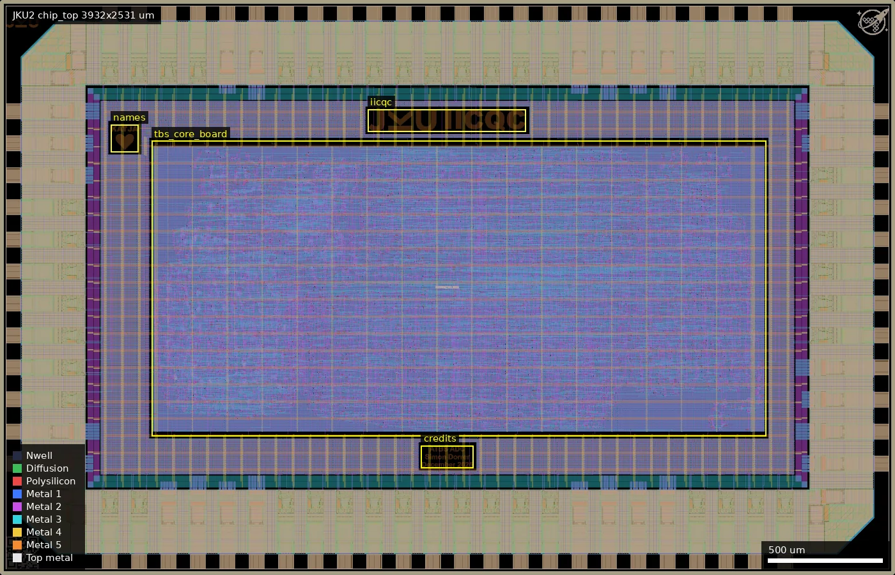
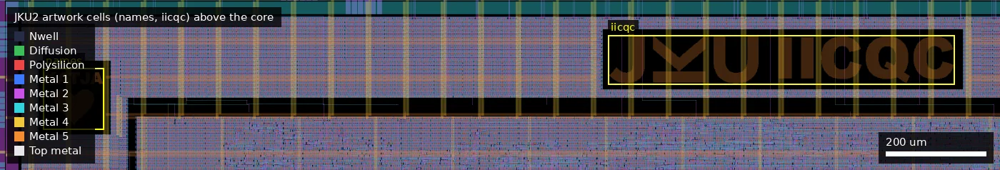
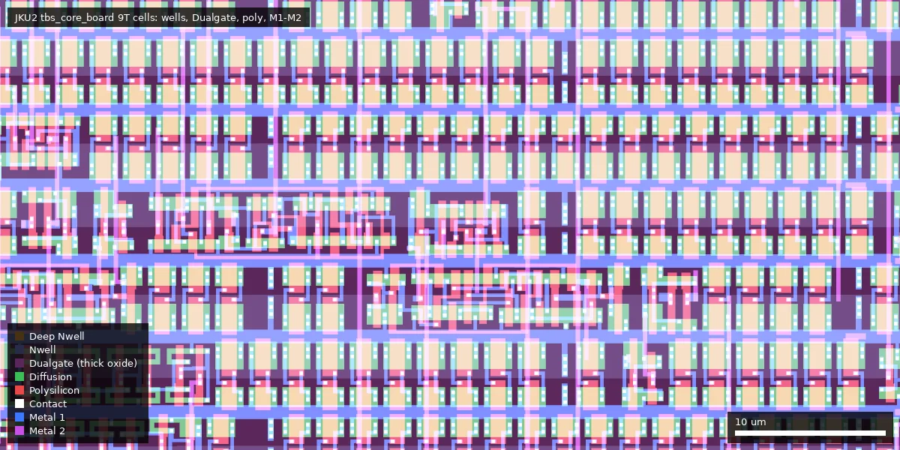

# JKU2: gf180mcu-jku-atbs-adc (ws-run1)

| | |
|---|---|
| Repository | https://github.com/iic-jku/gf180mcu-jku-atbs-adc @ 2fae3a6 (main, last commit 2026-10-04) |
| Slot | 1x0p5 (DIE_AREA 3932 um x 2531 um, core 3048 um x 1647 um) |
| Top cell | chip_top |
| Licence in repo | `LICENSE` is the Solderpad Hardware License v2.1 text with the notice "SPDX-License-Identifier: Apache-2.0 WITH SHL-2.1", copyright 2026 Simon Dorrer, JKU (audit: SHL-2.1; GitHub: NOASSERTION). The 10 files with SPDX headers still say Apache-2.0. |
| README | OK (753 words), mostly template build instructions plus layout render and die micrograph |
| Taped-out layout | JKU2_chip_top_0_8, 3932 x 2531 um, 1 placement on the G801 reticle |

## What the repo actually contains

The digital core of an ATBS ADC (adaptive threshold-based sampling, a level-crossing style converter for biosignals such as ECG), taken from Simon Dorrer's master's thesis "Threshold-Based Sampling ASIC with FOSS tools" (stated in the VHDL headers, dated October 2024). The chip is digital only (confirmed in the taped-out layout: see below). The analog parts of the ADC are off-chip: two comparators (upper and lower threshold), two 8-bit parallel DACs with write strobes (plus PWM alternatives), an input select switch (MAX4564 named in the source), a biosignal amplifier with leads-off detection, and a switched-capacitor clock consumer. The core tracks the input between two DAC thresholds, time-stamps each crossing, adapts the threshold step (ATBS mode), stores spikes in a memory and sends them out over UART.

Structure:

- `macros/tbs_core_board/`: the single design macro. VHDL source of record in `vhdl/` (`rtl/tbs_core_ea.vhd`, `rtl/tbs_core_board.vhd` and sub-entities: `adaptive_threshold_control`, `analog_trigger`, `dac_control`, `debouncer`, `memory2uart`, `pwm_modulator`, `sc_noc_generator`, `spike_detector`, `spike_encoder`, `spike_memory`, `sync_chain`, `time_measurement`, `uart`), converted to one Verilog file `verilog/rtl/tbs_core_board.v` by `vhdl2verilog.sh`, which is what LibreLane synthesises. Also FPGA project trees for Quartus (DE10-Standard) and Vivado (S7-Mini), ModelSim testbenches, and MATLAB scripts.
- Macro flow (`macros/tbs_core_board/librelane/config.yaml`): LibreLane Classic, die 2700 um x 1300 um, 25% target density, `STD_CELL_LIBRARY: gf180mcu_fd_sc_mcu9t5v0` with the 3.3 V Liberty corners (tt_025C_3v30, ss_n40C_3v00, ss_125C_3v00, ff_n40C_3v60, ff_125C_3v60), clock 125 ns (8 MHz), routing limited to Metal4, one ECO antenna diode inserted. 17823 cells, 297763 um2 cell area. Signoff: no setup or hold violations in any corner (worst setup slack about 47 ns), antenna, LVS and DRC passed.
- Top (`src/chip_top.sv`, `src/chip_core.sv`, `librelane/config.yaml`): LibreLane Chip flow, pads `gf180mcu_fd_io__bi_24t` (33 outputs), `gf180mcu_fd_io__in_c` (12 inputs and reset), `gf180mcu_fd_io__in_s` (clock), `gf180mcu_ws_io__dvdd/dvss` (12 VDD, 13 VSS); 72 pads in total. Top reports show antenna, LVS and DRC passed; top STA reports no reg-to-reg paths (all logic is inside the macro).
- `ip/`: wafer.space ID and logo, plus JKU, IICQC, "credits" and "names" artwork cells.
- `cocotb/chip_top_tb.py` (621 lines): five tests (TBS with full and "virtual" DAC resolution, ATBS, UART debugging) with a committed waveform dump.
- `gds/chip_top.zip` and `release/v.1.0.0/gds/chip_top.gds.chip_top.precheck.20251217_161339.output.zip`: final GDS and precheck output. The precheck output decompresses to SHA-256 `abdbf57879b209b6ab20ab4dd5c1638e4b1ed90ed915d500a704ca3591a7ef4b`, exactly the hash in `project.json`, so the manufactured layout is in the repo (the layout check below confirms it, apart from wafer.space's COMP fill).
- `release/v.1.0.0/img/`: layout renders and Keyence/Andonstar die micrographs.
- `macros/tbs_core_board/measurements/generate_ecg/`: MATLAB generator and data files for ECG test stimuli (arbitrary waveform generator input). `macros/tbs_core_board/reconstruction/`: MATLAB signal reconstruction and SNDR scripts with recorded data named "PoC" (8-bit ATBS and 5-bit TBS, 10 Hz sine, over UART). These predate the silicon (committed December 2025) and come from the FPGA proof of concept, not from this chip.

No silicon measurement results are in the repo; the README shows only a die photo.

### Licence detail

Same arrangement as JKU1. Root `LICENSE` is SHL-2.1 (Solderpad wrapper over Apache-2.0, which the recipient may treat as plain Apache-2.0), appendix "Copyright 2026 Simon Dorrer, Johannes Kepler University, Department for Integrated Circuits, SPDX-License-Identifier: Apache-2.0 WITH SHL-2.1". The repo was Apache-2.0 until commit 0f8a391 (2026-05-16), after tapeout. SPDX headers in the top RTL, scripts and docs still read `Apache-2.0`; the VHDL sources carry only an author/thesis header with no licence statement.

## Taped-out layout

| Measured fact | Value |
|---|---|
| Die (reticle cell `JKU2_chip_top_0_8`) | 3932 x 2531 um, one placement at (0.06 mm, 20.788 mm) on the reticle |
| Pads | 72 labelled pads: 33 `gf180mcu_fd_io__bi_24t` (`bidir_PAD[0..32]`), 13 `in_c` (`input_PAD[0..11]`, `rst_n_PAD`), 1 `in_s` (`clk_PAD`), 12 `gf180mcu_ws_io__dvdd`, 13 `gf180mcu_ws_io__dvss`; 4 corner cells. Matches `docs/pin_planning.txt` |
| Standard cells | `gf180mcu_fd_sc_mcu9t5v0`: 22,471 logic cells and 88,475 fill/tap/endcap cells, all inside `tbs_core_board`. A few 7-track cells sit at top level between core and pad ring: 193 `tiel`, 33 `tieh`, 5 `buf_8`, 1 `antenna` (pad-control tie-offs), plus 1,716 7T endcaps and 29,734 fill cells |
| SRAM / hard macros | none (the spike memory is flip-flops inside the macro) |
| Macro | `tbs_core_board`, 2700 x 1300 um at (666,611)-(3366,1911), the only design block |
| Artwork cells | `gf180mcu_ws_ip__iicqc` (693 x 99 um at (1616,1951)), `ws_ip__credits` (231 x 99 um at (1850,471)), `ws_ip__names` (122 x 122 um at (486,1861)), `ws_ip__jku` (143 um at (26,2361)), `ws_ip__logo`, `ws_ip__id` |
| Devices | every standard cell is thick-oxide: Dualgate (55/0), V5_XTOR (112/1), Nwell and LVPWELL each have 110,946 shapes inside `tbs_core_board`; in a 300 x 200 um sample of the macro all 9,159 merged poly polygons lie inside Dualgate. No thin-oxide 3.3 V transistors found by layer counts. So the "3.3 V" signoff is a 5 V cell library operated at a lowered supply |
| Not present | no MIM (no capacitor layer), no DNWELL, no BJT/Schottky markers, no resistor or capacitor devices, no analog layout. `RES_MK`, `MOS_CAP_MK`, `ESD_MK`, `Pad` occur only in the IO ring; `DIODE_MK` in the macro is 66 antenna diodes |

Is it an ADC on the die? No. The layout has no comparator, no capacitor DAC (neither MIM nor MOM structures), no resistor ladder and no analog pad. The "ADC" is only the digital controller. The comparator outputs arrive on ordinary `in_c` digital inputs (`comp_upper_i` = `input_in[10]`, `comp_lower_i` = `input_in[11]`, from `src/chip_core.sv` at the tapeout tag; pad labels `input_PAD[10]` at (58.5,1336) and `input_PAD[11]` at (58.5,1195) on the left edge), and the thresholds leave as 8-bit digital words on `bidir_PAD` outputs. The analog pad access the ADC needs is off-chip. I did not extract netlist connectivity from pad to macro port.

### Does it match the repository?

Yes. I extracted the precheck output GDS at `2fae3a6` (SHA-256 `abdbf578...`, the `project.json` hash). Top cell box is identical (3932 x 2531 um), cell count is the same (1,066), and the 24 non-fill top-level instance types have identical counts. A geometric XOR of the whole die over 23 layers gave zero area on every layer except COMP (22/0): 19,737 squares of 5 x 5 um (493,425 um2) present only in the taped-out file, which is wafer.space's active-area dummy fill. The other committed file, `gds/chip_top.zip` (`6b864279...`), does not match: it has the same cell and instance counts but an XOR against the taped-out layout is non-zero on poly, M1 to M5 and COMP (0.34 to 1.1 mm2 per layer), consistent with the fill the precheck step adds (I did not classify the direction of the differences).

Whole die: pad ring around the 2700 x 1300 um `tbs_core_board` macro (outlined at (666,611)); the `iicqc`, `credits` and `names` artwork cells are outlined above and below it.

The `names` (x 486-608, y 1861-1983) and `iicqc` (x 1616-2309, y 1951-2050) artwork cells in the strip above the macro; they are pure logo geometry, not circuits.

60 x 30 um inside `tbs_core_board` at (1400,800) um in macro coordinates: 9-track cells with Dualgate (thick oxide) over every row.

## Authors and affiliations

| Person / organisation | Role | Affiliation | Source |
|---|---|---|---|
| Simon Dorrer (GitHub `simi1505`) | Everything: HDL (master's thesis), floorplan, pin plan, hardening (152 of 158 commits) | JKU Linz, IICQC | `AUTHORS.md`, VHDL headers, `gh api users/simi1505` |
| Jonathan Hager | 5 commits (simulation waveform dumps) | JMU Würzburg per the JKU1 repo; not stated here | git log |
| Jakob Schaumberger (GitHub `JakobSchaumberger`) | 1 commit in October 2026 fixing the pin mapping of `dac_pwm_lower_o` | JKU per the JKU1 `AUTHORS.md`; not stated here | git log, PR #1 |
| IICQC, JKU Linz (`iic-jku`) | Hosting organisation, sponsor | Johannes Kepler University Linz | `gh api orgs/iic-jku`, README acknowledgements |

## Value for GF180MCU characterisation and PDK development

### Verdict: Low

One synthesised digital macro on stock cells with stock IO; the layout confirms the ADC's analog blocks (comparators, DACs, capacitors, resistors) are not on the chip, and no MIM, resistor, DNWELL or other non-logic device exists outside the IO ring. The only process-relevant point is that it uses the 9-track 5 V (Dualgate) library signed off against the 3.3 V Liberty corners.

### Test structures and measurable circuits

Nothing purpose-built.

| Structure | Exercises | Access | Where |
|---|---|---|---|
| `tbs_core_board` macro run at 3.3 V | Function and maximum clock frequency of `gf180mcu_fd_sc_mcu9t5v0` at 3.0 to 3.6 V against the `*_3v30`/`*_3v00`/`*_3v60` Liberty data (STA: 125 ns period met with about 47 ns worst slack, so roughly 13 MHz predicted at the slowest corner; inferred from the slack figure) | `clk_PAD`, UART and DAC output pads | `macros/tbs_core_board/reports/hold_setup_timing.rpt` |
| `bi_24t` PWM and DAC bus outputs | IO cell drive and edge rate | Bidir pads | `src/chip_core.sv` |

Simulation results in the repo: STA reports, cocotb RTL/gate-level tests and ModelSim testbenches. No SPICE-level data.

### Candidate PDK additions

- None in cells or devices.
- Flow notes: the macro config supplies its own `LIB` map so the 5 V 9T cells are timed at 3.3 V corners alongside `gf180mcu_fd_io` 3v30 and `gf180mcu_ws_io` libs; it also disables KLayout DRC at macro level and adds one ECO diode via `Odb.InsertECODiodes`. Useful as an example of a 3.3 V digital signoff setup.

### What would be needed to use it

A packaged or chip-on-board die plus an external analog front end: two comparators, two 8-bit parallel DACs (or RC filters on the PWM outputs), input switch and amplifier, an 8 MHz clock and a UART host. No PCB design, pinout table or test plan for the ASIC is in the repo (only FPGA pin documents under `verilog/quartus` and `verilog/vivado`, and `docs/pin_planning.txt` with pad counts). The MATLAB reconstruction scripts could be reused to evaluate ADC performance once a board exists.

## Notes and caveats

- Silicon bug, fixed in the repo after tapeout: at tag `tapeout-submitted-2025-12-18`, `src/chip_core.sv` assigns `dac_pwm_upper_o` to both `bidir_out[26]` and `bidir_out[2]`, so `dac_pwm_lower_o` is not connected to any pad on the manufactured chip. Commit de47f82 (2026-10-03, "Fix pin mapping for dac_pwm_lower_o") changes `bidir_out[2]` to `dac_pwm_lower_o`. HEAD RTL therefore differs from silicon; use the tag for the as-built netlist. The parallel DAC outputs are unaffected.
- `gds/chip_top.zip` (hash `6b864279…`) is the pre-precheck GDS and does not match `project.json`; the precheck output in `release/v.1.0.0/gds/` does.
- The platform description says "digital core of an ATBS ADC"; that is accurate, and it means the chip is not an ADC on its own.
- The macro's hardened views (`macros/tbs_core_board/final/`) are git-ignored and absent; a 76 MB `out.def` is committed instead.
- `src/chip_core.sv` still has the template header "© 2025 XXX Authors".
- The measurement and reconstruction data being FPGA-derived is inferred from file names ("PoC") and commit dates, not stated explicitly; nothing in the layout can settle it.
- The silicon bug above (`dac_pwm_lower_o` unconnected) is read from the RTL at the tag, not from the layout. I looked for top-level routing on the macro's `dac_pwm_lower_o` pin (at about (1091.9, 621.7) um) and found no top-level shapes on M1-M4 within 3 um of the pin position computed from the macro placement, which is weakly consistent with it being unconnected, but a proper pad-to-pin extraction (LayoutToNetlist) was not done.
