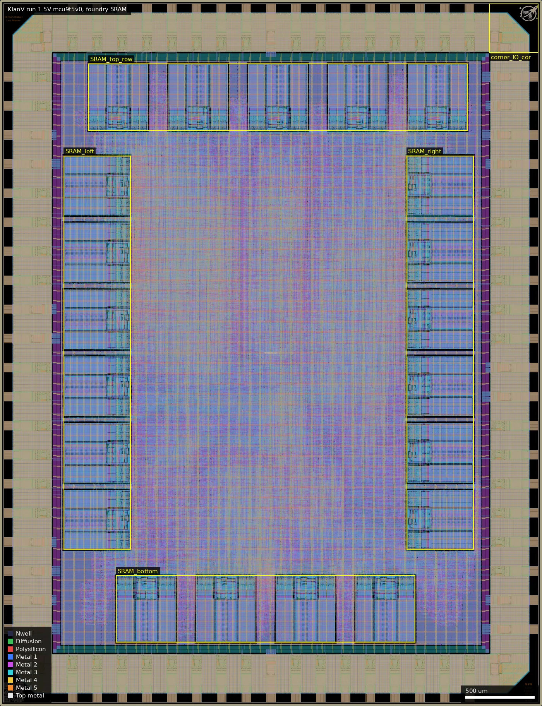
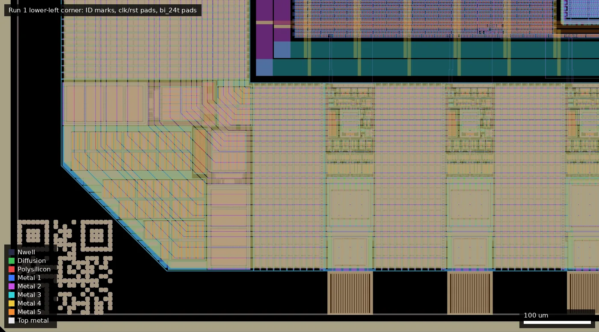
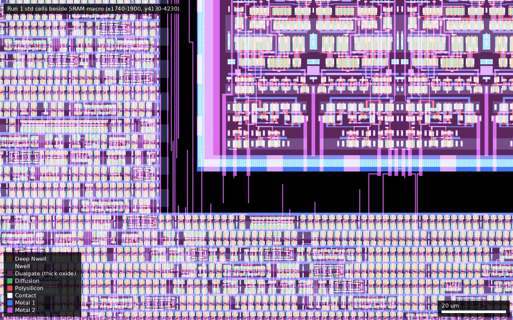

# KIAN: KianV: A 32-bit RISC-V Linux SoC taped out on GF180MCU (ws-run1)

| | |
|---|---|
| Repository | https://github.com/splinedrive/gf180mcu-kianv-rv32ima-sv32 @ 2483ecb (main, last commit 2026-01-15) |
| Slot | 1x1 |
| Top cell | chip_top |
| Licence in repo | Apache-2.0 |
| README | THIN (original but only 59 words) |
| Taped-out layout | KIAN_chip_top_8_0, 3932 x 5122 um, 1 placement on the G801 reticle |

## What the repo actually contains

The KianV RV32IMA SoC with SV32 MMU and Zicntr/Zicsr/Zifencei/SSTC, able to run Linux and XV6. It has instruction and data caches, an SDRAM controller, SPI, UART and GPIO.

Built with the wafer.space template on `gf180mcu_fd_sc_mcu9t5v0` standard cells with 21 foundry `gf180mcu_fd_ip_sram__sram512x8m8wm1` macros (5 V) and `gf180mcu_fd_io` pads (54 bidir, 8 DVDD, 10 DVSS). Clock target is 33 ns (30 MHz), with STA across 15 corners labelled 3v30/3v00/3v60 on the 5 V library cells.

The final GDS is in the repo as a zip (`gds/chip_top.gds.zip`, 32 MB, 209 MB unpacked); it matches the taped-out layout (see below). There are no timing or DRC reports. An `fpga/` directory holds a ULX3S (ECP5) build. Commit messages mention a GF180 SRAM CEN protocol fix, hold-margin changes, a Metal3 density tweak for DRC rule M3.2b (30.1%), and a bonding fix.

## Taped-out layout

| Measured | Value |
|---|---|
| Die | 3932 x 5122 um (20.1 mm2), one placement on G801 |
| Pads | 54 `gf180mcu_fd_io__bi_24t` (labels `bidir_PAD[0..53]`), `in_s` (clk_PAD), `in_c` (rst_n_PAD), 8 `gf180mcu_ws_io__dvdd`, 10 `gf180mcu_ws_io__dvss`, 4 `fd_io__cor`; 82 shapes on the Pad layer; IO filler cells fill10/5/1/nc |
| Standard cells | `gf180mcu_fd_sc_mcu9t5v0`: 88,941 logic cells, 246,524 fill/tap/endcap placements. Top types: nand2_1 15,104, dffq_1 10,257 (so about 10.3k flip-flops), dlyc_1 9,027 (hold-fix delay cells, about 10% of logic with dlyb/dlyd), clkinv_1 6,350 |
| SRAM | 21 x `gf180mcu_fd_ip_sram__sram512x8m8wm1` (512 x 8 bit, 431.9 x 484.9 um each, 21 x 4 kbit = 10.5 kB) |
| Oxide | All of the core is Dualgate / V5_XTOR: every std cell and the SRAM carry both layers (Dualgate covers about 99% of a macro, 206,510 of 209,400 um2). IO cells carry Dualgate in their drivers (V5_XTOR is not drawn in `bi_24t`) |
| MIM, DNWELL, high-res poly, BJT | None on the die (no MIM or DNWELL layer shapes; RES_MK appears only inside the foundry IO cells) |
| Custom content | None beyond wafer.space logo, credits, names, ID (QR) cells at the corners; no hand-drawn cells |

SRAM positions (lower-left x,y in um; macros are 432 x 485, rotated 90 degrees on the left and right columns): bottom row at y=462: x=842, 1421, 2000, 2579; left column at x=462, y=1135, 1620, 2105, 2590, 3075, 3560; right column at x=2950 with the same six y values; top row at y=4175: x=642, 1221, 1800, 2379, 2958. The RTL (`icache.v`, `dcache.v`, `sram_sp_gf180_512x56.v`) builds the I-cache as 2 ways x 7 tiles = 14 macros and the D-cache as 7 tiles, giving the 21; which physical macro belongs to which cache cannot be told from the flat layout. There is no TLB SRAM: the SV32 MMU TLB is in flip-flops (RTL reading; there are no other macros in the layout).

Pad-ring function, from the RTL index map in `chip_core.sv` (pad label n = index n; labels checked in the layout): PAD[0..3] are inputs (UART RX, SPI0/flash/SPI1 MISO); PAD[4..13] are UART TX and the SPI0, flash and SPI1 CS/SCLK/MOSI outputs; PAD[14..52] are a 16-bit single-data-rate SDRAM interface (clk, cke, 2 DQM, 13 address, 2 bank, CS/WE/RAS/CAS, 16 bidirectional DQ); PAD[53] is a GPIO. No PSRAM interface. The IO cells use cs=0 (CMOS input), slow-slew bit 0 (fast) and no pull-ups or pull-downs set statically.

### Does it match the repository?

Yes, with one version caveat. The repo's GDS (`gds/chip_top.gds.zip`, added in commit 1892792, tag `GF180MCU_Tapeout_Dec2025`, unchanged at 2483ecb) was unpacked and compared with the reticle layout: top-level instance counts are identical (21 SRAM, 54 bi_24t, 10 dvss, 8 dvdd, 4 cor, in_s, in_c, 335,465 mcu9t5v0 placements, 741,906 router via placements, 1,062 IO filler cells). wafer.space adds fill, seal ring and `$n` suffixes only. So the layout is the repo's committed GDS. The summary's pinned commit 2483ecb is two commits newer than the tape-out: the only source change since the tag is `src/cache.v`, where the `BYPASS_CACHES` branch was rewritten; `BYPASS_CACHES` defaults to 0 in `defines_soc.vh`, so the taped-out and HEAD designs behave identically (the 21 SRAMs are in use).

Overview: the SRAM macros are boxed (top row y 4175-4660, left and right columns x 462-947 and 2950-3435, bottom row y 462-947); the rest of the core is standard cells; the corner box (3550-3906, 4740-5096) is a `cor` cell with the wafer.space logo.

Lower-left corner (x 0-900, y 0-500): ID/QR cell at (26,26), the first pads of the bottom edge, and the ring of power rails inside the pad row.

Close-up at x 1740-1900, y 4130-4230 (detail style): 9-track 5 V standard cells (left and bottom) next to the corner of the SRAM at (1800,4175); the purple tint is Dualgate, which covers all of the logic and the SRAM.

## Authors and affiliations

| Person | Role | Affiliation | Source |
|---|---|---|---|
| Hirosh Dabui (GitHub splinedrive) | CPU and SoC | GitHub bio: "M.Sc.CE., Technical University of Berlin", Berlin | GitHub profile, matched by commit identity |
| Leo Moser (mole99) | project template | not stated | git log |

## Value for GF180MCU characterisation and PDK development

### Verdict: Low

Ordinary synthesised digital on stock cells and foundry SRAM; a functional and yield data point. The layout confirms nothing purpose-built: no MIM, DNWELL, high-res poly or custom cells. The only silicon-checkable timing is the 33 ns target. Its distinguishing feature is scale: a whole 5 V (Dualgate) 9-track core of about 89k logic cells and about 10.3k flip-flops, plus 21 foundry SRAMs.

### Test structures and measurable circuits

Nothing purpose-built (confirmed from the layout). 21 foundry SRAM macros (5 V Dualgate) are exercised functionally as I-cache (14) and D-cache (7). About 10.0k delay cells (dlyc 9,027, dlyb 635, dlyd 382), presumably hold-fix insertions, are in the logic.

### Candidate PDK additions

Nothing found.

### What would be needed to use it

A board with SDRAM and SPI flash to boot Linux; none is described in the repo.

## Notes and caveats

- Run 2 carries the same RTL on the 3.3 V library, so measuring both gives an Fmax and power comparison between the 5 V library run at 3.3 V and the native 3.3 V library. Differences in the layout: this die has 88,941 logic cells and 21 foundry SRAMs of 432 x 485 um; run 2 has 76,850 logic cells and ocd SRAMs of 301 x 322 um.
- The README says the CPU sources were added afterwards and points to github.com/splinedrive/kianv-rv32-linuxcore.
