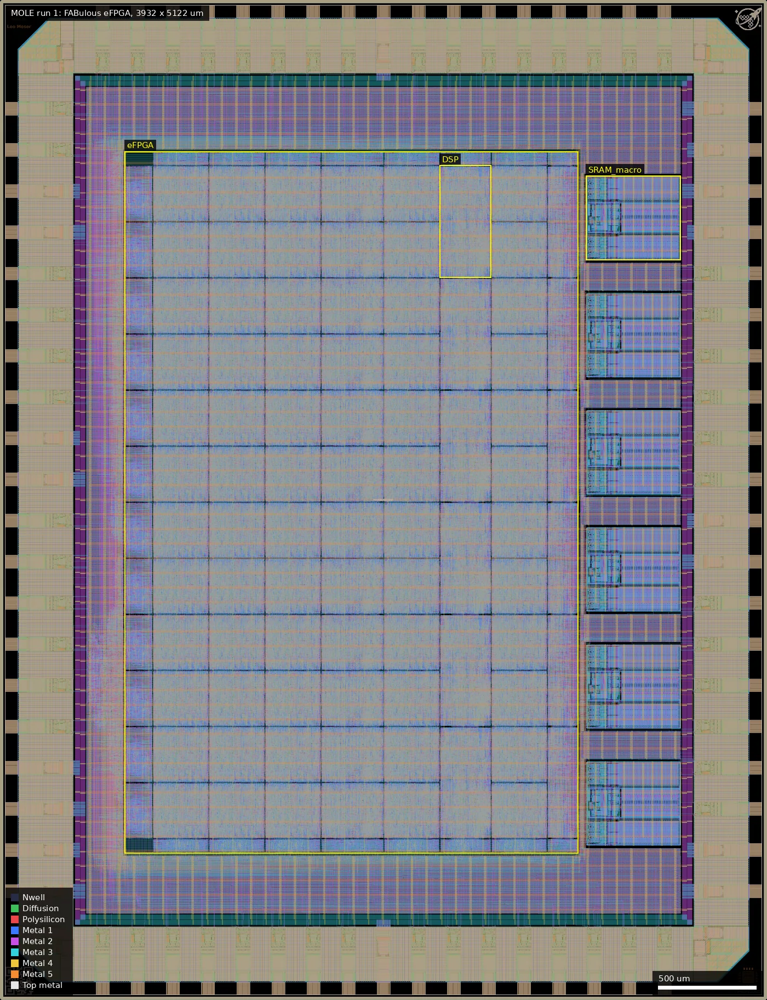
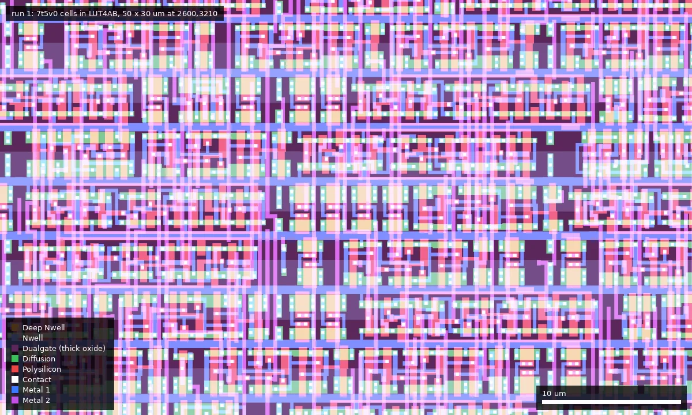
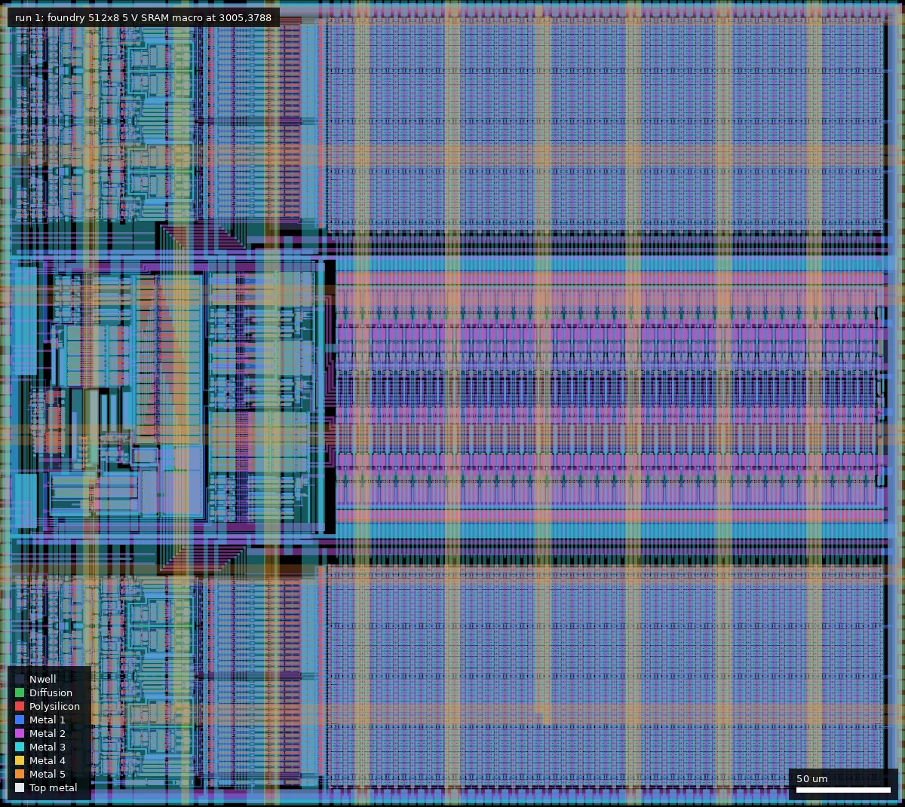

# MOLE: FABulous FPGA (ws-run1)

| | |
|---|---|
| Repository | https://github.com/mole99/gf180mcu-fabulous-fpga @ 97da81d (main, last commit 2025-12-16) |
| Slot | 1x1 |
| Top cell | chip_top |
| Taped-out layout | MOLE_chip_top_8_4, 3932 x 5122 um, 1 placement on the G801 reticle |
| Licence in repo | Apache-2.0 |
| README | TEMPLATE+NOTE (84% the project-template README plus about 120 words of own text) |

## What the repo actually contains

An embedded FPGA generated with the FABulous framework: 480 LUT4, 12 register-file tiles, 6 MAC tiles and 6 foundry 5 V 512x8 SRAM tiles, with 48 programmable IOs. It is configured over SPI (passive) or from one of 16 slots of an external SPI flash (active).

The fabric is assembled from individually hardened tile macros. The fabric macro itself contains zero standard cells (112 macros); the tiles hold about 4,202 `gf180mcu_fd_sc_mcu7t5v0` cells. Top-level clock target is 40 ns; tiles are hardened at 20 ns. The flow uses a custom LibreLane branch (`leo/gf180mcu`) and PDK tag 1.6.6.

Fabric macro metrics in the repo: 0 DRC, 0 LVS differences, 0 antenna violations. The tape-out GDS is only in the release (135 MB, in `../releases/`); there are no final views or top-level STA reports in git.

## Taped-out layout

| Measured | Value |
|---|---|
| Die | 3932 x 5122 um, one placement at (16.028, 10.424) mm on G801 |
| Pads / IO cells | 56 signal pads: 53 `gf180mcu_fd_io__bi_24t`, 2 `in_c`, 1 `in_s`; 8 `gf180mcu_ws_io__dvdd`, 10 `dvss`; 4 corners; 82 Pad shapes |
| Fabric | `eFPGA` macro 2324.56 x 3595.76 um at (640, 750). Tile instances: 60 LUT4AB (= 480 LUT4), 12 RegFile, 12 W_IO4 (= 48 IOs), 6 DSP (MAC), 6 GF_SRAM interface tiles, 5 + 4 + 1 + 1 single/term tiles, 2 DSP terms, 2 SRAM terms, 1 S_WARMBOOT |
| Config storage | latches: 51,691 `latq_1`, not split between config bits and RegFile storage. No SRAM or flop array for config |
| SRAM macros | 6 x `gf180mcu_fd_ip_sram__sram512x8m8wm1` (431.9 x 484.9 um each) at x 3005 to 3490, stacked on the right edge, outside the `eFPGA` macro |
| Standard cells | `gf180mcu_fd_sc_mcu7t5v0`: 203,757 logic placements (expanded through the tiles), 295,366 fill/tap/cap; most used `latq_1` 51,691, `buf_1` 44,562, `mux4_1` 24,574, `nand2_1` 12,165 |
| Device flavour | 5 V throughout: all COMP inside the `eFPGA` macro (2.395 mm2) lies inside Dualgate, and V5_XTOR covers 7.84 of 7.88 mm2 of its Dualgate. Foundry SRAM macros: also 100 % inside Dualgate. IO cells: partly Dualgate, no V5_XTOR |
| MIM, DNWELL, high-res poly | none: no MIM or DNWELL layer exists in the file; RES_MK has 1,096 shapes (same count as run 2, so from the pad cells' ESD/pull resistors, not tested per cell) |
| Custom / hand-drawn cells | none: tiles are synthesised standard cells; the only drawn geometry is the foundry IO and SRAM cells and wafer.space logo/credits/id cells (a FABulous logo `gf180mcu_ws_ip__logo_fabulous` at the lower right) |

### Does it match the repository?

Yes for the fabric. The repo's `ip/fabric/macro/gf180mcuD/gds/eFPGA.gds` at 97da81d (extracted to scratch, repo untouched) was loaded next to the taped-out `eFPGA` cell: same bounding box (2324.56 x 3595.76 um), the same 75 cell names with identical instance counts (60 LUT4AB, 12 RegFile, 12 W_IO4, 6 DSP, 6 GF_SRAM, terminations, WARMBOOT), and zero XOR area on COMP, Poly2, Metal1, Dualgate and V5_XTOR. The top level has the 6 SRAM macros, 53+2+1 signal pads and the wafer.space seal ring, fill and ID cells, as the summary describes. The standard-cell library, previously "inferred", is confirmed as `7t5v0`. The repo's remark that the fabric macro holds zero standard cells refers to its top level only: the tiles inside hold about 204 k logic placements in the expanded layout (the repo's figure of about 4,202 cells is not reproduced by the layout; it is probably a count over one copy of each tile, not checked). The release GDS `chip_top.gds` was also loaded against the reticle cell: identical top-level cell names and instance counts (173 names, no differences) and zero XOR on Dualgate, V5_XTOR and Pad; Poly2 differs by 441,204 um2 (wafer.space fill, not separately measured); metal layers were not compared.

### What can be measured on this die

The die carries no dedicated test structures; everything below is reachable only through a bitstream.

| Structure | Cell / position | Size and devices | Pads |
|---|---|---|---|
| Programmable logic | 60 `LUT4AB` instances, tile 287.3 x 287.3 um, first at (2518, 3125) | 5 V cells (Dualgate + V5_XTOR); 8 LUT4 per tile | via fabric routing to the 12 `W_IO4` tiles on the west edge (x 640 to 783) |
| SRAM interface tiles | 6 `GF_SRAM` at x 2805 to 2964 | 158.5 x 574.6 um; connect to the 6 SRAM macros (512x8, 5 V) at the right edge | fabric |
| MAC | 6 `DSP`, 263.8 x 574.6 um, first at (2254, 3700) | standard cells (no hand-drawn devices seen in the cell list) | fabric |
| Pad ring | 53 `bi_24t` + 2 `in_c` + 1 `in_s` | foundry `gf180mcu_fd_io`, 5 V | 56 |

## Authors and affiliations

| Person | Role | Affiliation | Source |
|---|---|---|---|
| Leo Moser (GitHub mole99) | sole author (136 of 138 commits) | not stated (GitHub location: Austria) | git shortlog, AUTHORS.md, GitHub profile |

## Value for GF180MCU characterisation and PDK development

### Verdict: Medium

Not built for characterisation, but an FPGA is a reconfigurable test vehicle: ring oscillators and carry-chain delay lines can be programmed into the LUT4AB tiles after fabrication (`break_comb_loop` in `custom.v` preserves combinational loops) and brought out on any of 48 pads. What limits it is that no oscillator design, test plan, or GF180 timing model for FABulous exists in the repo.

### Test structures and measurable circuits

| Structure | Exercises | Access | Where |
|---|---|---|---|
| Post-fab programmable ring oscillators / delay lines in LUT4AB tiles | 7t5v0 cell and routing-mux delay | any of 48 pads; per-pad CS/SL/IE/PU/PD driven from the fabric | tile sources, `custom.v` |
| 6 SRAM tiles (foundry 512x8, 5 V) | SRAM macro function and access time | from fabric | SRAM tile |
| 6 MAC tiles | arithmetic path delay | from fabric | MAC tile |
| IO pad configuration from fabric | `gf180mcu_fd_io` drive strength, slew, pulls | pads | top level |

No simulation results suitable for comparison with silicon are in the repo. The layout confirms the library is `gf180mcu_fd_sc_mcu7t5v0` and that every logic device is a 5 V thick-oxide (Dualgate + V5_XTOR) transistor: about 204 k logic cells including 51.7 k `latq_1`, so the die is a large 5 V standard-cell population (as opposed to the 3.3 V cells of run 2) once oscillators are loaded. It carries no MIM, DNWELL or resistor structures of its own.

### Candidate PDK additions

None as cells. By-products: a GF180 latch map (`latq_1`), a tile-macro flow, and a MAGIC_GDS_FLATGLOB list for false DRC hits in the foundry SRAM and IO cells. Documented PDK/flow issues: Metal2 minimum density unreachable (worked around with `Metal2_ignore_active`), `ERROR_ON_MAGIC_DRC: False`, and OpenROAD requiring standard-cell rows even for a macro-only fabric.

### What would be needed to use it

Packaged or bonded die, SPI configuration, and a Yosys/nextpnr flow targeting this fabric. Someone has to write the oscillator/delay-line bitstreams and a timing model to compare against.

## Notes and caveats

- The release GDS (`chip_top.gds`) agrees with the manufactured layout: same top-level cell names and instance counts (173 names, no differences), and the layers compared differ only by wafer.space fill. Its file hash differs from the platform hash because the platform hash is of the precheck output.
- Repository fabric GDS and the manufactured `eFPGA` cell are geometrically identical on the layers compared (see Taped-out layout).
- No bring-up data in the repo.
- The run 2 successor is `../../ws-run2/MOLE`.
