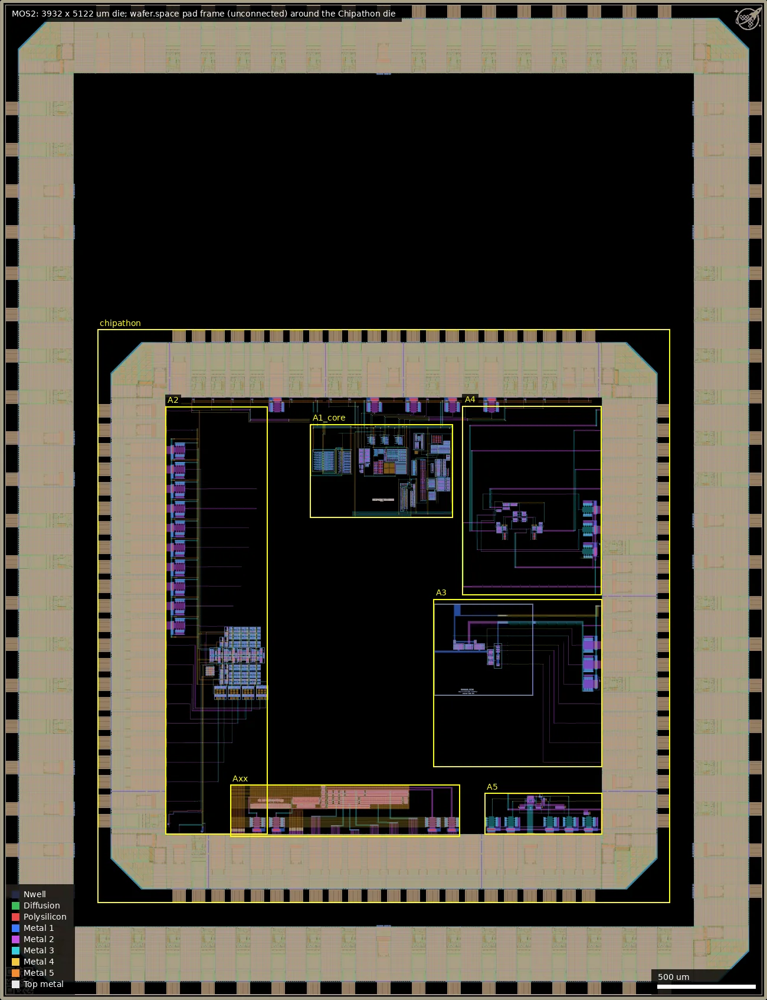
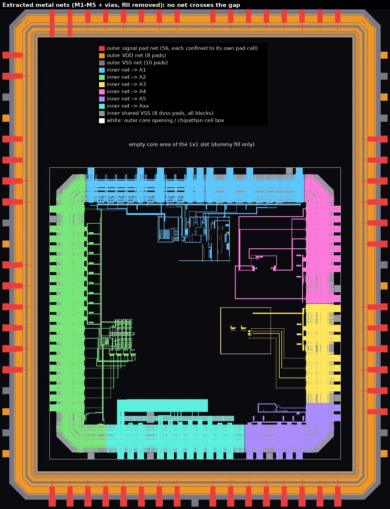
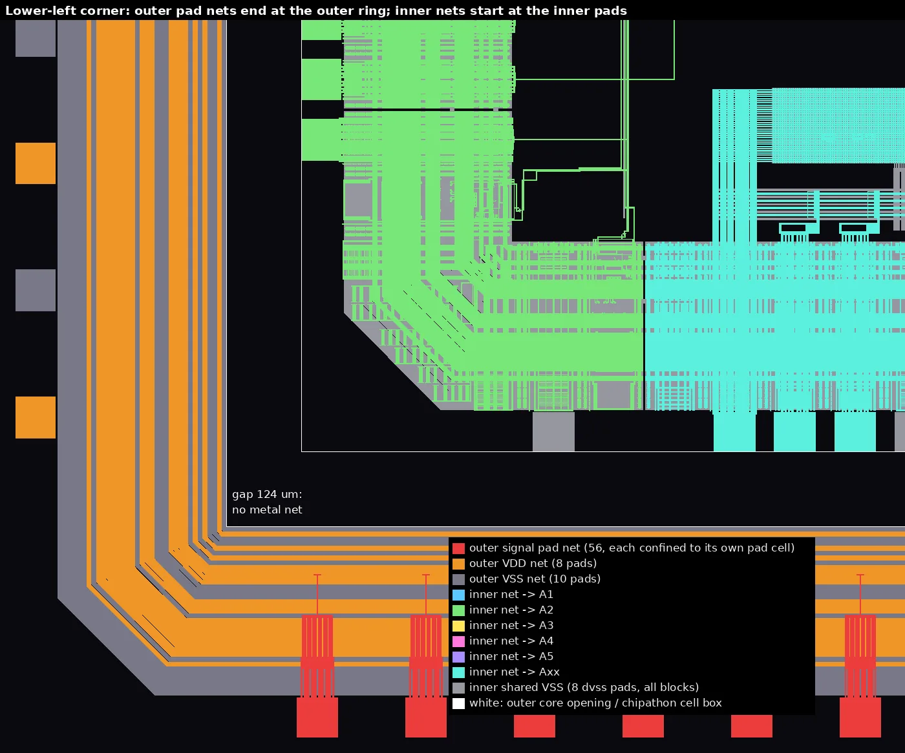
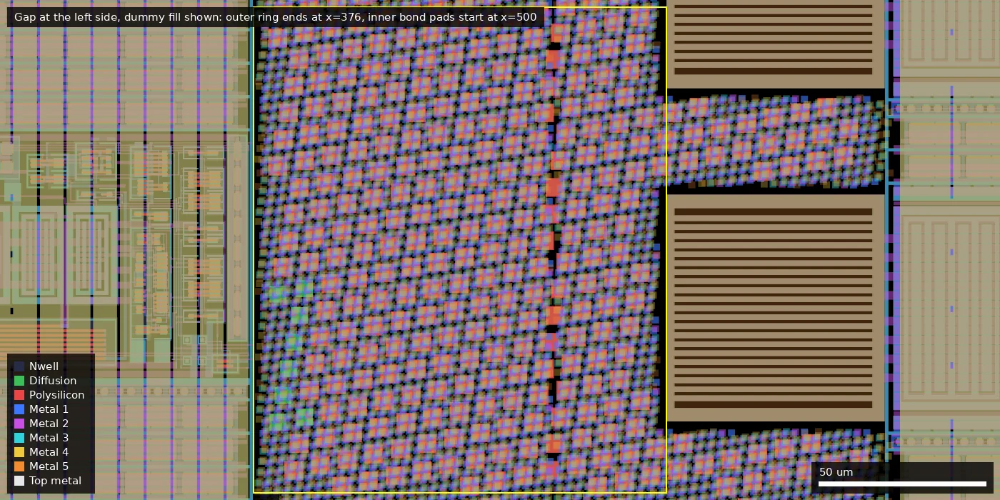
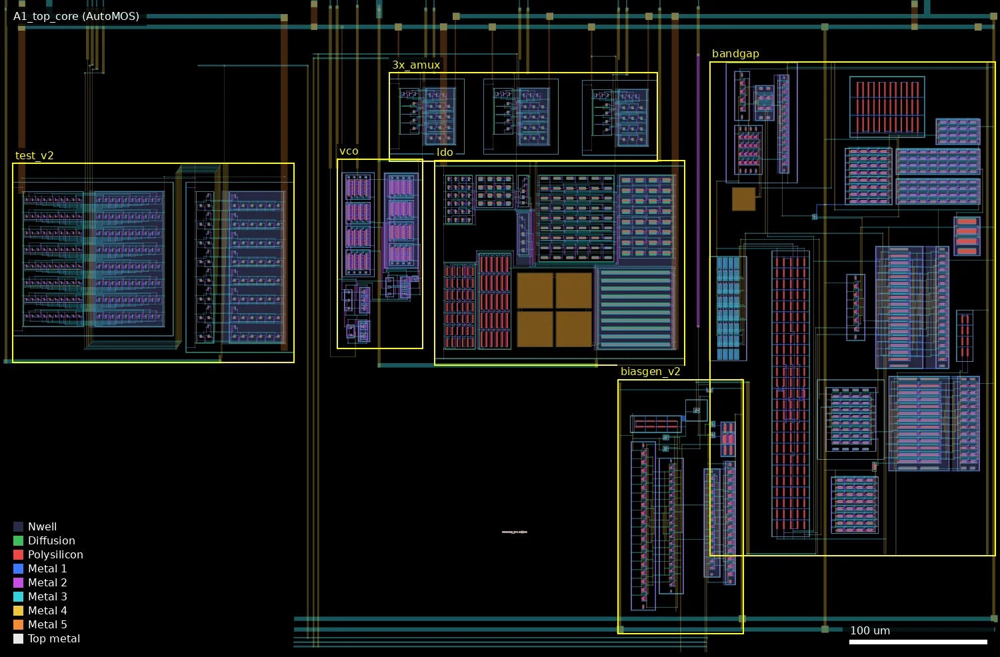
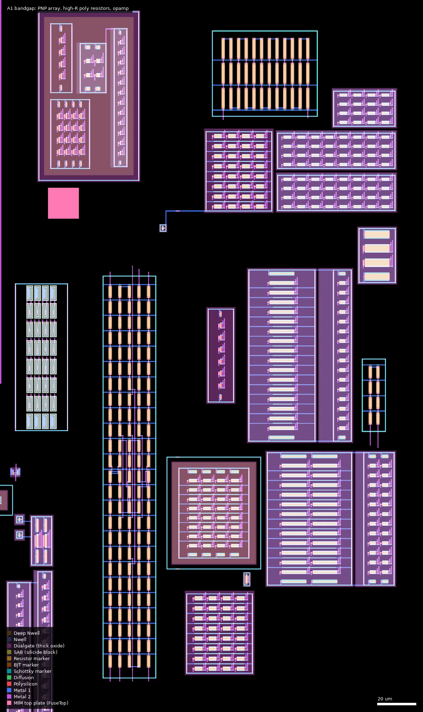
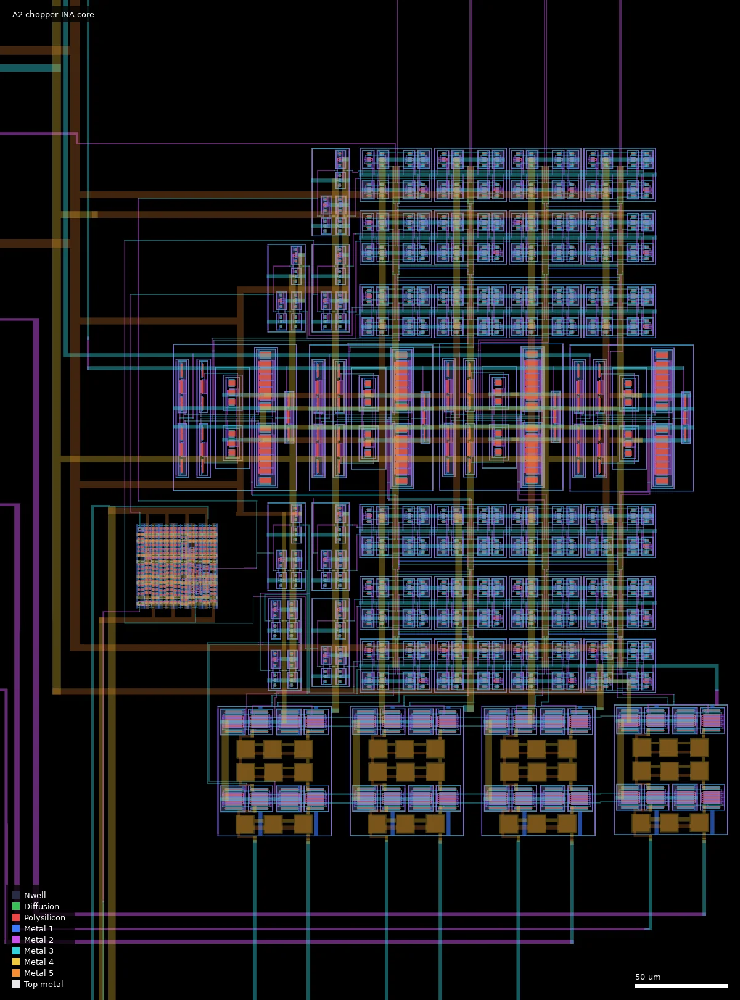
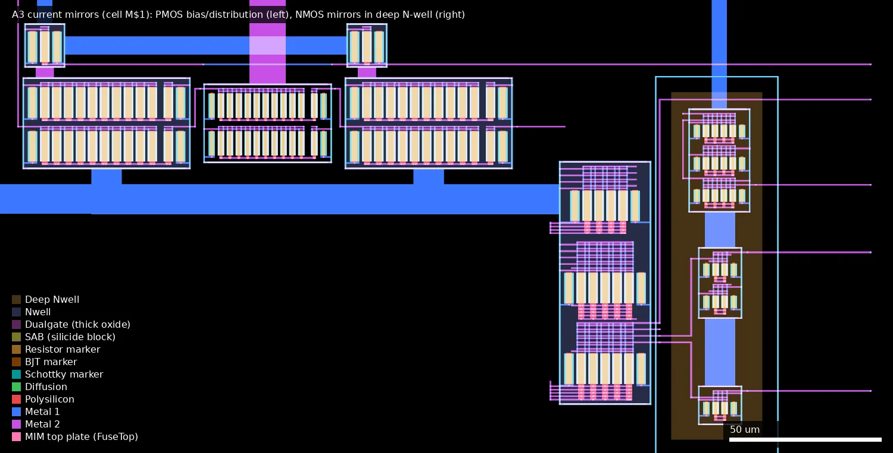
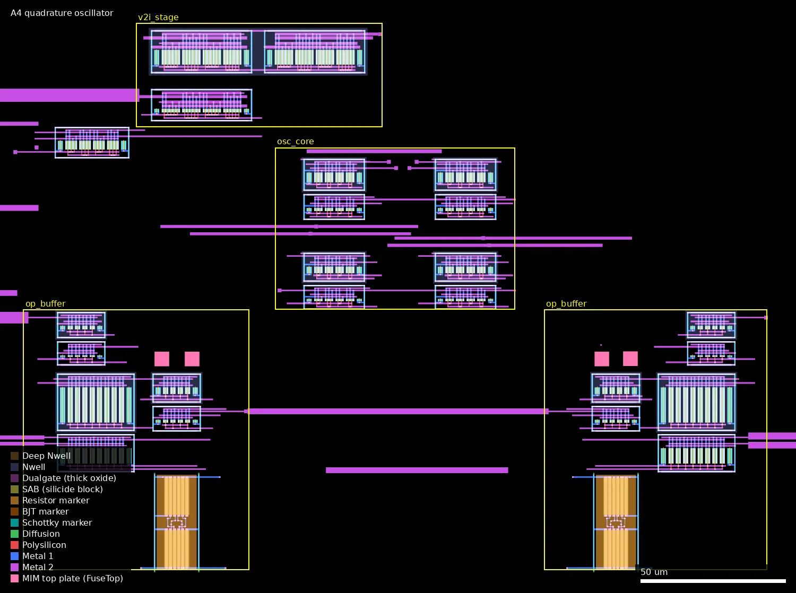
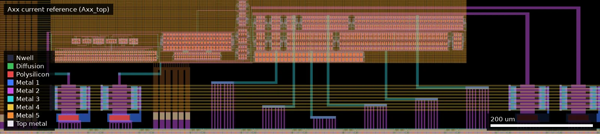

# MOS2: AutoMOS-Chipathon-2025 full size (ws-run1)

| | |
|---|---|
| Repository | https://github.com/AutoMOS-project/AutoMOS-chipathon2025 @ 85e9753 (`update-for-ws`, last commit 2025-12-18) |
| Slot | 1x1 |
| Top cell | chip_top |
| Licence in repo | MIT (`LICENSE`; audit: PRESENT, GitHub detects MIT). No SPDX headers in sources. |
| README | OK (535 words), but it describes only the AutoMOS team's own block and the Docker workflow, not the chip that was taped out |
| Taped-out layout | `MOS2_chip_top_10_6`, 3932 x 5122 um, 1 placement on the G801 reticle |

## What the repo actually contains

The README and `docs/proposal.md` describe one team's project ("CMOS 180nm VCO and LDO
Design with Open-Source EDA and GLayout": bandgap + bias generator + 1.8 V LDO + ring VCO).
The repository is in fact the **integration repository for the whole SSCS Chipathon 2025
Analog/AI track ("A track") shared die**, holding six teams' analog blocks and the common
pad ring. The wafer.space submission is that complete Chipathon die dropped unchanged
into the middle of a wafer.space 1x1 template frame (platform description: "Embedded
Chipathon design").

Structure of the taped-out layout, read from the cell hierarchy of
`designs/libs/A_track_core/chiptop_A_track_ws_embedded/chiptop_A_track_ws_embedded__fixed_filled.gds.tar.gz`
(179 MB GDS, top cell `chip_top`, 3932 x 5122 um):

- Outer ring: the stock wafer.space template pad frame (`gf180mcu_fd_io__bi_24t` x40,
  `in_c` x13, `in_s` x1, `asig_5p0` x2, `gf180mcu_ws_io__dvdd` x8, `gf180mcu_ws_io__dvss` x10,
  corners, fillers, `gf180mcu_ws_ip__id`, `gf180mcu_ws_ip__logo`, `sealring`). The template's two
  `gf180mcu_fd_ip_sram__sram512x8m8wm1` macros are present in
  `designs/libs/A_track_core/padring_ws/chip_top.gds` but absent from the embedded GDS.
- Cell `chipathon` placed at (500, 500) um: the Chipathon die, about 2935 um square
  (`padring.def`: corners at 0 and 2580 um), containing its own complete pad ring
  `padring` (`gf180mcu_fd_io__asig_5p0` x55, `bi_t` x16, `dvdd` x9, `dvss` x8, `brk5` x9, `cor` x4,
  fillers; 88 bond pads) and six team blocks.
- `chip_top` itself holds only the template's pad pin squares (Metal5) and their labels, and
  `chipathon` holds marker/label datatypes plus two Metal2 shapes inside the inner die. **No
  metal connects the outer wafer.space ring to the inner Chipathon ring.** This is now
  confirmed by connectivity extraction of the taped-out layout (see "Taped-out layout" below):
  none of the 74 outer pads reaches the inner die, so the outer pads are dummies and the
  circuits are reachable only through the inner ring's 88 pads.
- Dummy fill cells (`COMP_FILL`, `POLY2_FILL`, `METAL1..5_FILL`) were added at top level.

Sub-designs on the die (one line each):

| Block | Team name (where stated) | Function | Devices | Sources in repo |
|---|---|---|---|---|
| `A1_top` | AutoMOS | Bandgap (`bandgap`, 5x `pnp_05p00x00p42`), bias generator (`biasgen_v2`), LDO (`ldo`: 10 x 50 um / 0.5 um `pfet_05v0` pass device, `ldo_OTA`), 3-stage current-starved ring VCO with buffer and enable gate (`vco`, `nfet_03v3`/`pfet_03v3`, L = 0.28 um), three 2:1 analog muxes for external override of reference and bias, 8:1 analog test mux (`test_v2`) | 118 `nfet_05v0`, 108 `pfet_05v0`, 13 `nfet_03v3`, 14 `pfet_03v3`, 249 `ppolyf_u_1k_6p0`, 5 `cap_mim_2f0fF`, 5 PNP | Full xschem schematics, symbols, GDS, extracted netlists, netgen LVS reports, testbenches (`designs/libs/core_*`, `tb_*`, `A1_core`, `A1_tb`) |
| `A2_top` | "GenYZ" (GDS release file names) | 4-channel chopper instrumentation amplifier with low-pass filters and a clock divider (pins `IN1..4P/N`, `OUT1..4P/N`, `CLK_IN`, `RST_IN`, `VBIAS`, `VCM`) | Measured from the layout (flat cell): 3.3 V thin-oxide analog devices, 36 MIM capacitors (9 x 9 um), 5 V standard cells flattened in for the clock divider; see "Taped-out layout" | Flat GDS only on this branch (`A2_core/A2_top/A2_top.gds`, one cell). Schematics (`A2_TOP.sch`, `switch_A/B/C`, `INA_STAGE_FIXED`, `lpf`, `clockdiv.v`) exist only on the default branch `integration` |
| `A3_top` | "gLayout-mahowalders" (`A3_core/README.md`) | Three NMOS current-mirror variants: plain (`vanilla_cm`), biased (`biased_cm`), cascode (`cascode_cm`), with a PMOS bias/distribution stage | 20 `nfet_03v3`, 26 `pfet_03v3` | Schematics, GDS, LVS report |
| `A4_top` | "SiliconSouls" (GDS release file names) | Quadrature oscillator (`osc_core`, `v2i_stage`, 2x `op_buffer`; pads `VOUT0/90/180/270`, `VCTRL`, `VREF`, `IBIAS`, `EN`) | Measured from the layout: 3.3 V thin-oxide `nfet`/`pfet`, all L = 0.28 um; 24 high-R poly resistors (1.0 x 12.55 um), 4 MIM capacitors (5 x 5 um) | GDS only (`A4_core/A4_top/A4_top.gds`, `delay_stage.gds`); README is "Schematics Placeholder" |
| `A5_top` | not stated | Gilbert-cell mixer (`Gilbert_mixer_interdigited`, degeneration resistor, `4t-ota` buffer, biasing network with local NMOS/PMOS mirrors, output stage) | `nfet_03v3`, `pfet_03v3`, `ppolyf_u`, `ppolyf_u_1k`, `cap_mim_2f0fF` | Schematics and GDS; no LVS report |
| `Axx_top` | not stated | Current reference generator: error amplifier plus mirrors producing 2 uA, 20 uA and 50 uA sourcing and sinking outputs, reference voltages | 35 `nfet_03v3`, 25 `pfet_03v3` | Schematics, GDS, LVS report (failing, see caveats) |

All blocks are full-custom analog. gLayout (submodule `designs/gLayout`, the team's fork
`AutoMOS-project/gLayout-AutoMOS-cp25`) was used to generate layout primitives; generated cell
names such as `L_route_*`, `c_route_*`, `straight_route_*`, `via_array_*` are visible in `A4_top`.
Schematic capture is xschem, layout KLayout, LVS magic + netgen (`run_lvs.sh` in several cell
directories), DRC the KLayout deck (a copy sits in `A1_core/A1_top/main.drc`).

Other directories:

- `designs/Chipathon2025_pads/`: xschem symbols and magic views of the IO cells and the
  secondary ESD cell.
- `designs/libs/A_track_core/chiptop_A_track/releases/`: 30 intermediate top-level GDS versions
  (v2 to v12), about 2.5 GB.
- `designs/libs/A_track_core/fills/`: unit fill cells.
- `designs/libs/A_track_core/Bracolin_submmitted/Bracolin_submitted.gds`: an unrelated
  reference layout (top cell `IDDMIMS3`), not instantiated in the die.
- `designs/gf180mcu` (wafer-space/gf180mcu @ fb4b8f5) and
  `designs/globalfoundries-pdk-libs-gf180mcu_fd_pv` (LuighiV fork @ 66f2dfe): PDK and DRC deck
  submodules.
- `docs/`: template workflow documents plus the AutoMOS proposal (PDF and markdown).
- `releases/chiptop_A_track_v12_exported.gds` (GitHub release v1.0, 2025-10-14): the snapshot
  sent to the foundry for the Chipathon's own run, "DRC clean version".

Verification evidence present: netgen reports `A1_top_comp.out`, `A1_top_core_comp.out`,
`A3_top_comp.out`, `layout_ldo/ldo_comp.out` (all "Circuits match uniquely"), and
`Axx_top_comp.out` (fails). One KLayout DRC database for an old version
(`chiptop_A_track_v6_0001dbu.rdb`). No DRC report for the final embedded layout and no
silicon data.

Branches: the default branch is `integration`, not the listed `update-for-ws`. `integration`
contains the same eleven wafer.space commits (rebased, different hashes) and is 55 commits
ahead: it adds the A2 schematics, pad-symbol updates, and packaging documents
(`docs/Analog_AI_wirebonding_diagram.pdf`/`.svg`, `docs/padring_export.pdf`,
`docs/LQFP10X10-64-OP-01-B-R3-ECN-10717.pdf`, last commit 2026-08-24 "Update wirebonding").
The layout files are the same on both; the difference is material only for documentation.
`main` is 92 commits behind and holds just the early template.

## Taped-out layout

Measured from `layout/MOS2.oas` (the design as placed on the G801 reticle).

| | |
|---|---|
| Die | 3932 x 5122 um, 5 metal layers (Metal5 is the pad metal; no MetalTop), 1 placement on the reticle |
| Outer ring (wafer.space template) | 74 bond pads: `bi_24t` x40, `in_c` x13, `in_s` x1, `asig_5p0` x2, `gf180mcu_ws_io__dvdd` x8, `gf180mcu_ws_io__dvss` x10; core opening (376,376)-(3556,4746). **None is connected to anything inside** |
| Inner die `chipathon` | 2935 x 2935 um at (500,500)-(3435,3435), with its own ring `padring`: 88 bond pads (22 per side, 100 um pitch, 60 x 60 um openings on the outer edge of the inner ring): `asig_5p0` x55, `bi_t` x16, `dvdd` x9, `dvss` x8, plus `brk5` x9 splitting the ring into 9 supply segments |
| Gap between the rings | 124 um (left, bottom), 121 um (right), 1311 um (top); contains dummy fill only |
| Standard cells | none placed as cells in the hierarchy except 12 + 1 `sc_tieh_tiel` pad-strap cells (5 V 9-track tie-high/tie-low); the A2 clock divider's 5 V standard cells are flattened into `A2_top` |
| SRAM | none |
| Custom blocks | `A1_top` (core 726 x 473 um), `A2_top` (525 x 2191 um, flat), `A3_top` (863 x 858 um), `A4_top` (715 x 967 um), `A5_top` (602 x 210 um), `Axx_top` (1177 x 263 um); 30 secondary ESD cells `io_secondary_5p0` |
| Device flavours on the inner die | 3.3 V thin-oxide `nfet`/`pfet` (minimum L = 0.28 um); 5 V thick-oxide (Dualgate + V5_XTOR marker; no 6 V devices) `nfet` L >= 0.6 um and `pfet` L >= 0.5 um, many NMOS in deep N-well; vertical PNP (32 sites); unsalicided P+ poly and high-sheet poly resistors; MIM capacitors (50 top plates); N+/psub and P+/nwell ESD diodes. No native, LDMOS, Schottky or eFuse devices |

### Does it match the repository?

Yes. The archive `chiptop_A_track_ws_embedded__fixed_filled.gds.tar.gz` was unpacked and
compared with the taped-out layout:

- Same top-cell extent (3932 x 5122 um) and the same top-level instance list, apart from one
  extra cell `SLOTS` in the taped-out layout (14 slot shapes of 2 x 10 um on the Metal1/Metal2
  slot datatypes over A3's wide straps at (2338,1607)-(3036,2010)).
- A geometric XOR of the whole `chipathon` cell (flattened, merged, in 16 tiles) on every one
  of the 52 layer/datatype pairs present in both files (COMP, Poly2, implants, Contact, Via1 to
  Via4, Metal1 to Metal5, Dualgate, V5_XTOR, SAB, Resistor, MIM top plate, marker layers and the
  label-bearing layers) gives zero difference; this was redone for this version of the summary.
  The block cells `A1_top` ... `Axx_top` and `padring` have identical bounding boxes; their shape
  counts differ only because shapes were merged differently on conversion.
- The dummy fill is on datatype 4 in the repo GDS and has been moved onto the drawing
  datatype 0 in the taped-out layout. This, the renamed top cell and the file format are
  enough to explain why the submitted file hash matches no file in the repository.

So `__fixed_filled` is the taped-out design. The Chipathon's own foundry release
(`releases/v1.0/chiptop_A_track_v12_exported.gds`) was not compared.

### Is the outer pad ring connected to the circuits? No.

This was the open question in the repo-only summary. It was settled three ways:

1. **Extracted connectivity** (KLayout `LayoutToNetlist`, Metal1 to Metal5 with Via1 to Via4,
   hierarchical, whole die, dummy fill cells removed; Via4 cuts that land on a MIM top plate are
   connected to the plate and not to Metal4). The top cell has 58 nets. No net of the top cell
   has a pin on `chipathon`, and `chipathon` exports no net upward. Repeating the extraction
   with Poly2 and contacts added gives the same result.
2. **Per outer pad** (probed at each of the 74 pad labels):
   - 56 signal pads (`bidir_PAD[0..39]`, `input_PAD[0..11]`, `clk_PAD`, `rst_n_PAD`,
     `analog_PAD[0..1]`): each is its own net, confined to its own IO cell (net extent
     68 x 270 um for the digital cells, 68 x 350 um for the two `asig_5p0`). The core-side pins
     of these cells are not routed anywhere.
   - 8 `VDD` pads: one net, the outer ring's supply rail.
   - 10 `VSS` pads: one net, the outer ring's ground rail.
   - Outer pads reaching an inner pad or a block: **0 of 74**.
3. **Geometry of the gap, with the fill left in**: every shape in the region between the outer
   ring's inner edge and the `chipathon` box was collected and merged per layer. The largest
   merged polygon is 10.25 um across (supply stubs of the `gf180mcu_ws_io__dvdd`/`dvss` cells;
   the fill squares are 2 to 5.6 um) and the gap is at least 121 um wide. No polygon touches
   both sides, the fill cells contain one layer each and no vias, and COMP and Poly2 were
   checked the same way.

The substrate is of course common, and the inner ring's `VSS` is one net shared by all six
blocks, but it is not tied in metal to the outer ring's `VSS`.

### Inner ring: which pad reaches which block

From the same extraction (metal only; "via ESD" means the metal net ends at an
`io_secondary_5p0` cell and continues through its 40 x 10 um poly series resistor, confirmed by
the extraction with poly included). Pad centres are 532 um (left, bottom) or 3403 um (right,
top) from the die origin; the other coordinate is given.

| Block | Side | Pads (position along the side, um) |
|---|---|---|
| A1 | top (y = 3403) | `TEST_OUT` 918 (to `test_v2`), `TEST_SEL_2/1/0` 1018/1118/1218, `TEST_EN` 1318, `TEST_IBIAS` 1418, `TEST_IBIAS_OVRD` 1518, `VTEST` 1618 (supply), `VCO_OUT` 1718, `VCO_EN` 1818, `VCO_IN` 1918 (via ESD to `vco`), `LDO_OUT` 2018 (`dvdd` cell), `VCO_IBIAS` 2118, `VCO_IBIAS_OVRD` 2218, `LDO_IBIAS` 2318, `LDO_IBIAS_OVRD` 2418, `LDO_VREF` 2518, `LDO_VREF_OVRD` 2618, `LDO_EN` 2718, `BIAS_EN` 2818, `VSS_A1` 2918, `VDD_A1` 3018 |
| A2 | left (x = 532) | `CLK_IN_A2` 918, `VDD_A2` 1018, `OUT4N/4P/3N/3P/2N/2P/1N/1P_A2` 1118 to 1818, `IN4N/4P/3N/3P/2N/2P/1N/1P_A2` 1918 to 2618, `VBIAS_A2` 2718, `VCM_A2` 2818, `A_VSS_A2` 2918, `A_VDD_A2` 3018; bottom: `VSS_A2` 918, `RST_N_A2` 1018 |
| Axx | bottom (y = 532) | `VDD3V3_AXX` 1218, `VREF12` 1318 (via ESD), `VCOMP` 1418, `VSS_AXX` 1518, `IOUTN_2UA` 1618, `IOUTP_2UA` 1718, `IOUTN_20UA` 1818, `IOUTP_20UA` 1918, `IOUTN_50UA` 2018, `IOUTP_50UA` 2118, `VREFN_AXX` 2218, `VREFP_AXX` 2318 |
| A5 | bottom / right | bottom: `VIN_V_LO_A5` 2518, `VIN_V_RF_A5` 2618, `VSS_A5` 2718, `VIN_V_RFb_A5` 2818, `VIN_V_LOb_A5` 2918, `I_BIAS_A5` 3018 (all five signals via ESD); right: `VDD3V3_A5` 918, `VOUT_V_IF_A5` 1018 |
| A3 | right (x = 3403) | `VSS_1_A3` 1118, `VCM_OUT_A3` 1218, `BCM_OUT_A3` 1318, `CCM_OUT_A3` 1418, `V_BIAS_IN_A3` 1518, `EN_A3` 1618, `V_AUX_A3` 1718, `V_IN_A3` 1818, `VSS_2_A3` 1918, `VDD3V3_A3` 2018 |
| A4 | right (x = 3403) | `VDD_A4` 2118, `VSS_A4` 2218, `EN` 2318, `VREF` 2418, `VCTRL` 2518, `IBIAS` 2618 (to `v2i_stage`), `VOUT0` 2718, `VOUT90` 2818, `VOUT180` 2918, `VOUT270` 3018 |
| none | bottom | `ana57` 1118 and `ana47` 2418: `asig_5p0` pads with no connection |

What the extraction shows beyond the pad list:

- **Supplies.** The 9 `dvdd` pads are 9 separate nets (`VDD_A1`, `VTEST`, `LDO_OUT`, `VDD_A2`,
  `A_VDD_A2`, `VDD3V3_A3`, `VDD_A4`, `VDD3V3_A5`, `VDD3V3_AXX`), one per `brk5` segment of the
  ring, each reaching only its own block. All 8 `dvss` pads (`VSS_A1`, `VSS_A2`, `A_VSS_A2`,
  `VSS_1_A3`, `VSS_2_A3`, `VSS_A4`, `VSS_A5`, `VSS_AXX`) are a single net that enters all six
  blocks; `A_VSS_A2` is not a separate analog ground.
- **Digital pads.** For the 16 `bi_t` cells the pad itself stays inside the cell, as expected;
  the cell's core pins were traced separately. `Y` (input to core) reaches the block for 14 of
  them, and `A` (output from core) is driven from `A1_top_core` for `VCO_OUT`. The mode pins
  (`OE`, `IE`, `PU`, `PD`, `CS`, `SL`, `PDRV0/1`) are strapped by `sc_tieh_tiel` cells in A1 and
  A3 and inside the flat block in A2 and A4.
- **Dead-end pads in A1.** `TEST_IBIAS` ends at its ESD cell and `TEST_IBIAS_OVRD`'s `Y` wire
  ends in `A1_top` without reaching `A1_top_core`. This agrees with the netlist
  (`A1_top.spice`: `* noconn TEST_IBIAS_OVRD`), so these two pads do nothing.
- **A4 outputs are paired.** `VOUT0` and `VOUT180` are the same metal net, and `VOUT90` and
  `VOUT270` are the same metal net. Each pair is joined inside one `op_buffer` instance by a
  chain of Metal2/Metal3 wires with no device in the path (traced polygon by polygon; the joins
  are near (2754..2786, 2401..2446) for 0/180 and (2538..2570, 2401..2446) for 90/270). The die
  therefore offers two distinct oscillator outputs, each on two pads, not four phases. Without a
  schematic for A4 it cannot be said whether this is intended (for example force/sense pads on
  one buffer output) or a layout error; an extraction including the transistors, or a statement
  from the authors, would settle it.
- **A2 outputs are paired too.** Extracted metal connectivity puts `OUT4N`/`OUT4P`, `OUT3N`/`OUT3P`,
  `OUT2N`/`OUT2P` and `OUT1N`/`OUT1P` on one net each (pads 1118+1218, 1318+1418, 1518+1618,
  1718+1818 on the left side), joined by a Metal3 strap and Metal2 stubs inside `A2_top`. The
  die therefore has four single-ended outputs, each on two pads, not eight differential pads.
  (An earlier version of this summary said the P and N outputs were separate nets; that was wrong.)
  The eight `IN` pads are eight separate nets.

### Where the circuits are and what they are made of

Coordinates are die coordinates in um. MOS sizes are per gate finger, measured as Poly2 over
COMP; finger counts include dummy fingers, so they are upper bounds on the electrically active
count. "5 V" means thick oxide (Dualgate) with the V5_XTOR marker; "3.3 V" means thin oxide.

| Structure | Cell | Position (x0,y0)-(x1,y1) | Devices measured in the layout | Pads |
|---|---|---|---|---|
| A1 bandgap | `bandgap` (with `bandgap_opamp`) | (2108,2544)-(2317,2905) | 32 vertical PNP sites (BJT marker 3.7 x 8.28 um each; the netlist uses 2 + 16 + 2 + 2 and 10 dummies). High-sheet poly resistors under Dualgate (`ppolyf_u_1k_6p0`), 1.0 um wide: 133 segments of 4.5 um and 36 of 9.0 um. 5 V `pfet` 12.8/0.8 (46 fingers), 4.0/0.5 (80), 3.2/0.8 (46), 12.8/3.2 (4); 5 V `nfet` 4.0/1.0 (64) and, in deep N-well, 4.0/0.6 (40). Opamp: deep-N-well `nfet` 0.5/2.0 (30), `pfet` 2.0/1.0 (8) and 0.5/1.0 (14), one 16 x 16 um MIM | none directly (supply `VDD_A1`, enable `BIAS_EN`) |
| A1 bias generator | `biasgen_v2` | (2041,2487)-(2133,2673) | 5 V `nfet` 0.5/0.8 (20), 0.5/2.0 (20); 5 V `pfet` 1.0/0.8 (16), 1.0/1.5 (16), 1.0/6.0 (6); 8 high-sheet poly segments 1.0 x 4.5 um | via test mux only |
| A1 LDO | `ldo` | (1907,2683)-(2090,2833) | Pass device 5 V `pfet`, 10 fingers of 50/0.5 (500 um total). Error amplifier and bias: `pfet` 5.5/1.0 (32), `nfet` 5.0/0.6 (54), 3.0/1.0 (16), 1.25/1.0 (24). Divider: high-sheet poly, 1.0 um wide, 42 segments of 5.0 um and 30 of 10.0 um. Four 25 x 25 um MIM capacitors | `LDO_OUT`, `LDO_VREF`, `LDO_IBIAS` (through 2:1 muxes), `LDO_EN` |
| A1 ring VCO | `vco` | (1836,2695)-(1899,2834) | 3.3 V only: `nfet` 1.0/0.28 (173 fingers), 0.5/0.28 (3); `pfet` 1.0/0.40 (168), 1.0/0.28 (10), 0.5/0.28 (4). The PMOS are mostly L = 0.40 um, not 0.28 um | `VCO_IN`, `VCO_IBIAS`, `VCO_EN`, `VCO_OUT` |
| A1 8:1 test mux | `test_v2` (`test_decoder`, `test_all_tg`) | (1599,2685)-(1805,2831) | 5 V transmission gates and decoder: deep-N-well `nfet` 0.5/0.6 (88), 1.5/0.6 (16); `pfet` 0.5/0.5 (88), 1.5/0.5 (48) | `TEST_OUT`, `TEST_SEL_0..2`, `TEST_EN`, supply `VTEST` |
| A1 2:1 analog muxes | `top_amux_2x1` x3 | (1874,2832)-(2070,2897) | each: deep-N-well `nfet` 1.5/0.6 (4), 0.5/0.6 (3); `pfet` 1.5/0.5 (12), 0.5/0.5 (3) | `LDO_VREF`, `LDO_IBIAS`, `VCO_IBIAS` and their `_OVRD` selects |
| A2 chopper INA, 4 channels | `A2_top` (flat) | block (848,849)-(1373,3040); active area about (1070,1530)-(1380,1910) | 3.3 V: `nfet` 9.0/0.5 (128 fingers), 2.0/0.5 (384), 1.0/0.28 (66), 0.5/6.9 (24), deep-N-well 3.0/3.0 (24); `pfet` 9.0/0.5 (128), 2.0/0.5 (384), 6.0/3.0 (64), 1.0/0.5 (88), 0.5/6.9 (36). 36 MIM capacitors of 9 x 9 um (bottom row of the active area). Clock divider at about (1050,1660)-(1100,1715): flattened 5 V standard cells (223 NMOS and 223 PMOS fingers including fill/decap cells). 10 secondary ESD cells | `IN1..4P/N_A2`, `OUT1..4P/N_A2`, `VBIAS_A2`, `VCM_A2`, `CLK_IN_A2`, `RST_N_A2` |
| A3 current mirrors | `M` inside `A3_top` | (2321,1709)-(2603,1971); devices in (2325,1710)-(2600,1840) | 3.3 V: `pfet` 10/2.0 (78 fingers, bias and distribution), `nfet` 8.0/1.0 (26), and `nfet` 4.0/1.0 (30) in a deep N-well (41 x 126 um, `DNWell_Rect`). 3 secondary ESD cells | `V_IN_A3`, `V_AUX_A3`, `V_BIAS_IN_A3`, `VCM_OUT_A3`, `BCM_OUT_A3`, `CCM_OUT_A3`, `EN_A3` |
| A4 quadrature oscillator | `osc_core`, `v2i_stage`, `op_buffer` x2 | (2621,2448)-(2703,2504); (2572,2511)-(2657,2547); (2533,2358)-(2611,2448) and (2713,2358)-(2790,2448) | All 3.3 V at L = 0.28 um. Core: `nfet` 0.72 (20 fingers) and 1.08 (20), `pfet` 2.16 (20) and 3.245 (20). V-to-I: `nfet` 1.25 (22), `pfet` 5.0 (44). Each buffer: `nfet` 5.3 (10), 1.0 (6), 0.5 (6); `pfet` 12.0 (10), 2.2 (6), 1.13 (6); a further 14 fingers of `nfet` 3.0/0.28 in the block, not attributed to a named cell; 12 high-sheet poly segments 1.0 x 12.55 um; two 5 x 5 um MIM | `VCTRL`, `VREF`, `IBIAS`, `EN`; outputs on `VOUT0`=`VOUT180` and `VOUT90`=`VOUT270` (see above) |
| A5 Gilbert mixer | `Gilbert_mixer_interdigited`, `Biasing_network_with_local_mirror`, `Degeneration_resistor`, `4t-ota`, `Output_stage` | (2688,1011)-(2760,1045); (2655,949)-(3026,1033); (2690,973)-(2746,988); (2762,1037)-(2769,1045); (2772,1038)-(2780,1044) | 3.3 V. Mixer core: `nfet` 4.0/0.28 (20 fingers) and 2.0/0.28 (14). Output stage `nfet` 2.0/0.28 (6). OTA: `nfet` 0.5/0.28 (4), `pfet` 0.3/0.28 (2). Bias: `nfet` 0.75/1.0 (50), `pfet` 0.5/0.4 (16), five 5 x 5 um MIM. Resistors: one unsalicided P+ poly 4.0 x 1.0 um (degeneration), two high-sheet poly 20 x 1.0 um. 5 secondary ESD cells in a row along the pads | `VIN_V_RF_A5`, `VIN_V_RFb_A5`, `VIN_V_LO_A5`, `VIN_V_LOb_A5`, `I_BIAS_A5`, `VOUT_V_IF_A5` |
| Axx current reference | `Axx_top` | block (1181,839)-(2358,1103); transistor arrays about (1290,980)-(2100,1100) | 3.3 V long-channel arrays: `nfet` 4.0/2.0 (344 fingers), 2.0/2.0 (298), 2.0/4.0 (110), 0.5/2.0 (27), 1.0/2.0 (12); `pfet` 2.0/2.0 (344), 5.0/5.0 (60), 1.0/2.0 (39), 2.0/1.0 (28). 4 secondary ESD cells | `IOUTP/N_2UA`, `IOUTP/N_20UA`, `IOUTP/N_50UA`, `VREF12`, `VCOMP`, `VREFP_AXX`, `VREFN_AXX` |
| Secondary ESD cell | `io_secondary_5p0` (30 on the die: A1 5, A2 10, A3 3, A4 3, A5 5, Axx 4) | e.g. (2077,3009)-(2156,3085) | Unsalicided P+ poly series resistor 40 x 10 um; four N+/psub and four P+/nwell diodes of 10 x 10 um under Dualgate | in series with the analog pads listed "via ESD" |
| Pad-strap cell | `sc_tieh_tiel` (12 in A1, 1 in A3) | e.g. (2186,3072)-(2197,3080) | 5 V `nfet` 0.66/0.6 x2, `pfet` 0.9/0.5 x2 | `bi_t` mode pins |

## Authors and affiliations

| Person / organisation | Role | Affiliation | Source |
|---|---|---|---|
| Luighi Viton-Zorrilla (`LuighiV`) | AutoMOS lead; bandgap, bias generator, top integration, LVS/DRC clean-up, wafer.space embedding (226 commits) | not stated (GitHub bio: "Electronic engineer, enthusiastic programmer") | README team list, git log, `gh api users/LuighiV` |
| Julio David Vilca Pizarro (`jvilcap`) | AutoMOS: LDO schematic and layout, decoder, analog mux (60 commits) | not stated (commit email domain is a Peruvian university, hint only) | README, git log, `docs/schedule/Chipathon2025_github_issues.tsv` |
| Rodrigo Marin (`madorat`) | AutoMOS: VCO and test mux (40 commits) | not stated | README, git log, schedule TSV |
| Aleta Edna, `keisyandretta` | A2 block (chopper INA) | not stated | git log paths (`A2_core`) |
| Saptarshi Ghosh, Subham Pal | A3 block (current mirrors) | not stated | git log paths (`A3_core`) |
| Vasil Yordanov | A5 block (Gilbert mixer), pad views | not stated | git log paths |
| Alex Mantilla (`AlexMantilla1`) | Axx block (current reference), top-level integration | not stated (GitHub location Bucaramanga, Colombia) | git log paths, `gh api` |
| A4 team "SiliconSouls" | Quadrature oscillator | not stated; no commits attributable | GDS file names only |
| `JuanMoya` | Pad ring symbols, top integration; forwarded the GDS to the foundry for the Chipathon run | not stated | git log, release v1.0 notes |
| Jianxun Zhu, Peter Kinget | Authors of the upstream Chipathon analog project template (OTA example, KLayout library manager, docs) | not stated in this repo | git log paths (`core_analog`, `scripts`), README reference to the IIC-OSIC-TOOLS template (role inferred) |
| SSCS Chipathon 2025 | Programme under which the die was designed | IEEE SSCS | README |

## Value for GF180MCU characterisation and PDK development

### Verdict: High

The die is a collection of device-level analog circuits with direct analog pad access
(55 `asig_5p0` pads, 52 of them wired to a circuit): a bandgap, PTAT bias generator, LDO, two
oscillators, a precision current reference, three current-mirror topologies, a mixer and a
chopper amplifier, across both the 3.3 V and the 5 V device families, with schematics and
testbenches for most of them. The taped-out layout is geometrically identical to the repo's
final GDS, and every block was found and its devices measured. Its value is limited by pad
access: extraction confirms that the wafer.space pad frame is not connected to anything, so
all measurements have to be made on the inner ring's 88 pads (60 x 60 um, 100 um pitch), which
sit 500 um or more inside the die edge. Sources are missing for two blocks (A2 on this branch,
A4 entirely).

### Test structures and measurable circuits

Pad names are those of the inner Chipathon ring (`designs/libs/A_track_core/padring/padring.v`,
`padring.sch`). "ASIG" pads are `gf180mcu_fd_io__asig_5p0`; digital controls use
`gf180mcu_fd_io__bi_t` with tie-high/tie-low cells setting the pad mode. Supplies are per team
on `dvdd`/`dvss` pads: `VDD_A1`/`VSS_A1`, `VDD_A2`/`VSS_A2`, `A_VDD_A2`/`A_VSS_A2`, `VDD3V3_A3`/
`VSS_1_A3`/`VSS_2_A3`, `VDD_A4`/`VSS_A4`, `VDD3V3_A5`/`VSS_A5`, `VDD3V3_AXX`/`VSS_AXX`, plus
`LDO_OUT` and `VTEST` (both on `dvdd` cells). In the layout the nine `dvdd` pads are nine
separate nets and all eight `VSS` pads are one net (extracted). Cell names, positions and
measured device sizes for every row are in the table under "Taped-out layout"; all pads listed
here were confirmed by extraction to reach the named block unless noted.

| Structure | What it exercises | Access (inner-ring pads) | Repo paths | Simulation to compare against |
|---|---|---|---|---|
| A3 plain, biased and cascode NMOS current mirrors | `nfet_03v3` / `pfet_03v3` matching, output resistance, mirror gain error versus topology; 3.3 V domain | `V_IN_A3`, `V_AUX_A3`, `V_BIAS_IN_A3`, outputs `VCM_OUT_A3`, `BCM_OUT_A3`, `CCM_OUT_A3`, enable `EN_A3` | `designs/libs/A3_core/{vanilla_cm,biased_cm,cascode_cm,bias,top_level,A3_top}` | Schematics only; no testbench or results in this repo |
| Axx current reference | `nfet_03v3`/`pfet_03v3` mirror ratios and error-amplifier offset; absolute currents 2/20/50 uA, sourcing and sinking | `IOUTP_2UA`, `IOUTN_2UA`, `IOUTP_20UA`, `IOUTN_20UA`, `IOUTP_50UA`, `IOUTN_50UA`, `VREF12`, `VCOMP`, `VREFP_AXX`, `VREFN_AXX` | `designs/libs/Axx_core/*` | Schematics only |
| A1 bandgap + bias generator | `pnp_05p00x00p42` Vbe and PTAT slope, `ppolyf_u_1k_6p0` ratio and absolute value, `pfet_05v0` mirrors | Indirect only: the 2 uA PTAT copy is routed to input 5 of the test mux and appears on `TEST_OUT` when `TEST_EN`=1 and `TEST_SEL_2..0`=101; the 10 uA source/sink copies feed the LDO and VCO bias. The bandgap outputs `VBG`, `VZTC`, `ICTAT`, `IZTC` are marked `noconn` in `A1_top_core.spice` and reach no pad | `designs/libs/core_bandgap`, `core_biasgen`, `tb_bandgap`, `tb_biasgen` | Testbench schematics (`tb_bandgap_dc_tran`, `_stb`, opamp AC/CMRR); no stored results |
| A1 LDO (1.8 V target) | `pfet_05v0` pass-device Ron and dropout, loop stability, `ppolyf_u_1k_6p0` feedback divider, `cap_mim_2f0fF` compensation | Output on the `LDO_OUT` pad. Reference and bias via `LDO_VREF` and `LDO_IBIAS` with `LDO_VREF_OVRD` / `LDO_IBIAS_OVRD`; enable `LDO_EN`. In the netlist the internal input of the reference mux is tied to VSS, so the LDO needs an external reference on `LDO_VREF` | `designs/libs/core_ldo`, `layout_ldo`, `tb_ldo` | Plot images of op, DC, AC, PSRR, noise, stability and transient runs (`tb_ldo/*/tb_ldo_*.png`); no raw data |
| A1 ring VCO | `nfet_03v3` (L = 0.28 um) / `pfet_03v3` (mostly L = 0.40 um in the layout) inverter delay versus bias current and control voltage (current-starved, 3 stages), supplied from the LDO output | `VCO_IN` (control), `VCO_IBIAS` + `VCO_IBIAS_OVRD`, `VCO_EN`, output `VCO_OUT` through a `bi_t` digital pad | `designs/libs/core_vco`, `tb_vco`, `core_vco/vco/Top_VCO.ipynb` | Testbench schematics and a notebook; the proposal quotes 2.4 GHz, which a `bi_t` pad is unlikely to pass |
| A1 8:1 analog test mux and 2:1 muxes | `pfet_05v0`/`nfet_05v0` transmission-gate on-resistance and leakage | `TEST_OUT`, `TEST_SEL_0..2`, `TEST_EN`, supply `VTEST`; seven of the eight inputs are tied to VSS. The `TEST_IBIAS` and `TEST_IBIAS_OVRD` pads are not connected to the core (extracted; the netlist agrees) | `designs/libs/core_test`, `layout_test_all_tg`, `layout_test_decoder`, `A1_core/top_amux_2x1` | `tb_test_tg`, `tb_test_tristate` schematics |
| A4 quadrature oscillator | Oscillator frequency versus control voltage and bias; 3.3 V `nfet`/`pfet` at L = 0.28 um, high-sheet poly resistors and MIM capacitors in the two output buffers | `VCTRL`, `VREF`, `IBIAS`, `EN`; only two distinct outputs: `VOUT0` and `VOUT180` are one metal net, `VOUT90` and `VOUT270` another (extracted) | `designs/libs/A4_core/A4_top/*.gds` | None (no schematic) |
| A5 Gilbert mixer | `nfet_03v3` switching quad and transconductor, `ppolyf_u` / `ppolyf_u_1k` loads, `cap_mim_2f0fF` | `VIN_V_RF_A5`, `VIN_V_RFb_A5`, `VIN_V_LO_A5`, `VIN_V_LOb_A5`, `I_BIAS_A5`, `VOUT_V_IF_A5` | `designs/libs/A5_core/*` | Schematics only |
| A2 4-channel chopper INA | Amplifier offset and 1/f noise with chopping, switch charge injection, on-chip clock divider; 3.3 V devices from 0.28 um to 6.9 um channel length, 36 MIM capacitors | `IN1..4P/N_A2`, `OUT1..4P/N_A2` (P and N of each channel are one net: four distinct outputs, extracted), `VBIAS_A2`, `VCM_A2`, `CLK_IN_A2`, `RST_N_A2` | GDS on this branch; schematics on `integration` | None on this branch |
| Secondary ESD cell `io_secondary_5p0` (used on analog inputs) | `diode_pd2nw_06v0` and `diode_nd2ps_06v0` (4 x 10 um x 10 um each) clamp leakage, 40 um x 10 um `ppolyf_u` series resistor | 30 instances on the die; in the signal path of `VCO_IN`, `VCO_IBIAS`, `LDO_IBIAS`, `LDO_VREF`, `VREF12`, `EN_A3` and the five A5 inputs (extracted), so any of these pads at low current. `TEST_IBIAS` is connected to nothing but its ESD cell, which makes it a stand-alone ESD-cell test point against `VTEST`/`VSS` | `designs/libs/A5_core/io_secondary_5p0`, `designs/Chipathon2025_pads/` | `io_secondary_DC_tb.svg` |

Voltage domains (measured from Dualgate coverage of the gates): the A1 analog core uses 5 V
devices with the 3.3 V VCO in an island fed by the LDO; A2, A3, A4, A5 and Axx use 3.3 V
devices, with 5 V devices only in pad-strap cells and in A2's flattened standard cells.

Device-level PDK testbenches (not silicon structures) are in `designs/libs/tb_analog/`:
`tb_bjt_diode`, `tb_capacitor`, `tb_nmos_diode`, `tb_pmos_diode`, `tb_resistor` (with
`tb_resistor.png`).

### Candidate PDK additions

- **`io_secondary_5p0`**: a small secondary ESD cell (series poly resistor plus two diode
  clamps) with schematic, symbol, magic and GDS views, LVS-checked inside `A1_top` and `A3_top`.
- **`sc_tieh_tiel`**: a tie-high/tie-low pair built from `gf180mcu_fd_sc_mcu9t5v0__tieh`/`tiel`
  for strapping `bi_t` pad control pins in a pad ring without digital logic
  (`designs/libs/A1_core/top_tieh_tiel`).
- **xschem symbols for the IO cells** (`designs/Chipathon2025_pads/xschem/symbols/`) and an
  xschem/Verilog/DEF description of an analog pad ring (`A_track_core/padring/`).
- **DRC deck changes** in the LuighiV fork of `globalfoundries-pdk-libs-gf180mcu_fd_pv`: commits
  "Add COMP density rule" and "Update poly2 count to include dummies" (2025-10-02), on top of
  "Minor updates for gf180mcu DRC rules". Worth diffing against the upstream deck.
- **netgen setup differences**: every LVS directory carries a private `gf180mcuD_setup.tcl`
  that differs from the copy in the `wafer-space/gf180mcu` submodule in how `cap_mim_2f0fF` is
  handled (parallel merging disabled, unconditional `equate classes` with
  `cap_mim_2f0_m4m5_noshield`). The extraction script also needs `gds flatglob cap_mim`, `pfet*`,
  `nfet*` before reading gLayout output. Both point at friction between gLayout-generated
  layout and the stock magic/netgen flow.
- **gLayout fixes** in `AutoMOS-project/gLayout-AutoMOS-cp25`: commits "Fix to BJT model",
  "Test bjt with new parameters", "Add bandgap and biasgen", "Update current mirror block".
- **Layout hygiene issues hit before submission** (commit messages of 2025-12-11 to 12-17):
  zero-area geometries and empty hierarchies had to be deleted, an out-of-boundary geometry
  fixed, and the database unit changed to 0.001 um.

### What would be needed to use it

- Access to the inner pads. The outer wafer.space pads are confirmed dead (0 of 74 connected),
  so a standard wafer.space package or probe card that lands on the outer ring measures
  nothing. Probes or wire bonds must land on the inner ring's 60 x 60 um pads at 100 um pitch:
  the left and bottom rows are 502 to 562 um from the die edge, the right row 499 to 559 um,
  and the top row about 1.7 mm from the top edge, so bond wires have to cross the unused
  outer ring. The inner ring has 88 pads (79 distinct and useful: `ana47`, `ana57`, `TEST_IBIAS`
  and `TEST_IBIAS_OVRD` reach no circuit, and two A4 and four A2 output pads duplicate others)
  against the 64-lead LQFP drawing kept on `integration`, so a bond-out covers a subset.
  Confirmation from the authors of the intended bonding would still help.
- For A4, a schematic or a transistor-level extraction to say which oscillator phases appear on
  the two output nets, and whether the pairing of `VOUT0`/`VOUT180` and `VOUT90`/`VOUT270` is
  intended.
- The wirebonding diagram and pad-ring export from the `integration` branch, and a pad-number
  to signal table (only `padring.v` instance order exists here).
- Bench equipment: source-measure units for the mirrors, current reference and bandgap PTAT
  current; a spectrum analyser or fast scope with an active probe for the two oscillators and
  the mixer; a low-noise analyser for the chopper amplifier.
- Schematics for A4 and (on this branch) A2, and a written test plan; none exists.
- Raw simulation data: only plot images are stored (`*.raw` is git-ignored), so reference
  numbers have to be regenerated from the testbench schematics.

## Notes and caveats

- The submitted layout hash (`d4cd6202...`) matches none of the GDS files in the repo
  (`padring_ws/chip_top.gds`, the two files inside the `.tar.gz` archives) nor the release
  asset. The final GDS files are git-ignored and only two compressed archives were committed.
  The layout comparison shows that `__fixed_filled` is the taped-out design (zero XOR on the
  52 layers compared for the inner die, same top-level instances); the hash differs because
  the fill datatype, top-cell name and file format were changed on the way to the reticle.
- Platform name and description do not say that the die holds six teams' circuits; the README
  covers only A1.
- `Axx_top_comp.out` reports "Netlists do not match" and "Top level cell failed pin matching".
  No LVS evidence exists for A2, A4 or A5, and the top-level schematic
  `chiptop_A_track.sch` instantiates only A1, A3, A5 and Axx (commit message: "Waiting for A2
  and A4").
- The outer ring is unconnected: this is now an extracted result, not an inference (0 of 74
  outer pads reach the inner die; see "Taped-out layout").
- The connectivity extraction covers metal, vias and (in a second run) poly and contacts. It
  does not recognise transistors, so "reaches block X" means a conductor path to that block,
  not that the circuit behind it is correct. No LVS of the taped-out layout was run here.
- In the A4 layout the four output pads carry only two nets (`VOUT0` = `VOUT180`, `VOUT90` =
  `VOUT270`), joined by metal inside each `op_buffer`. Whether that is intended is unknown;
  there is no A4 schematic.
- MOS finger counts in the layout tables include dummy fingers, and the widths and lengths
  are drawn dimensions measured from Poly2 over COMP.
- The repository's device counts for A1 (for example "5 PNP") are netlist instances with
  multipliers; the layout has 32 PNP unit cells.
- The `__exported` archive still has a duplicate set of pad-ring cells inside `Axx_top`; in
  the `__fixed_filled` archive `Axx_top` no longer references them.
- Submodule URLs for `gf180mcu` and the DRC deck use SSH (`git@github.com:`).
