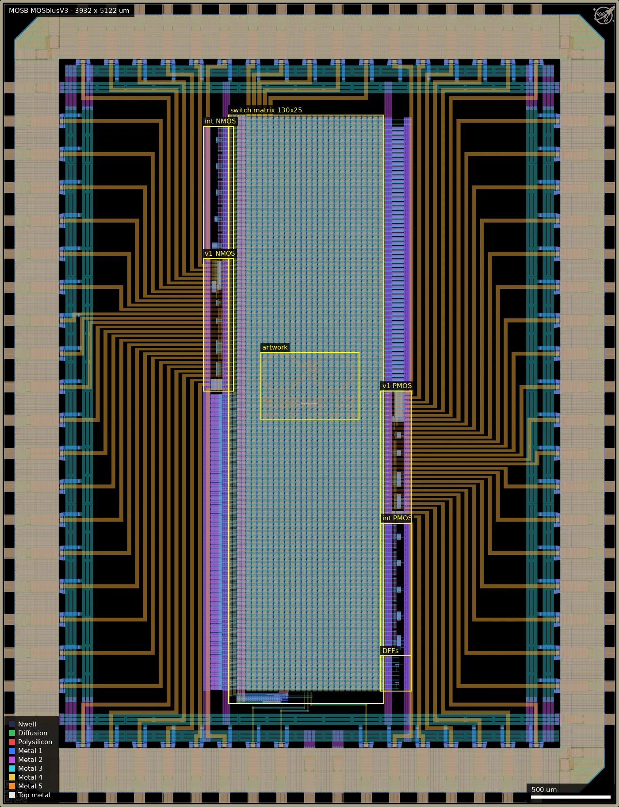
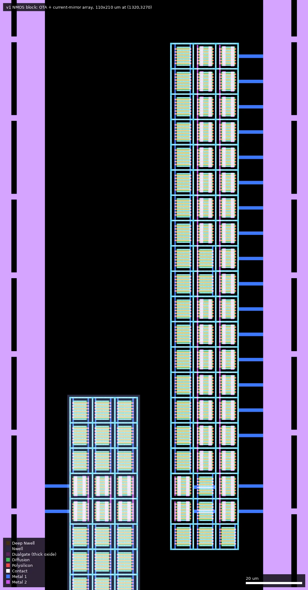
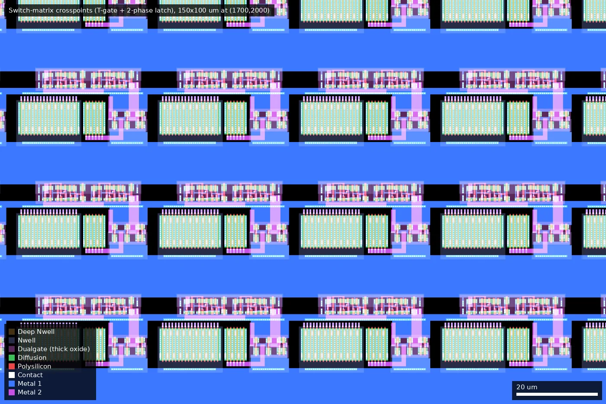
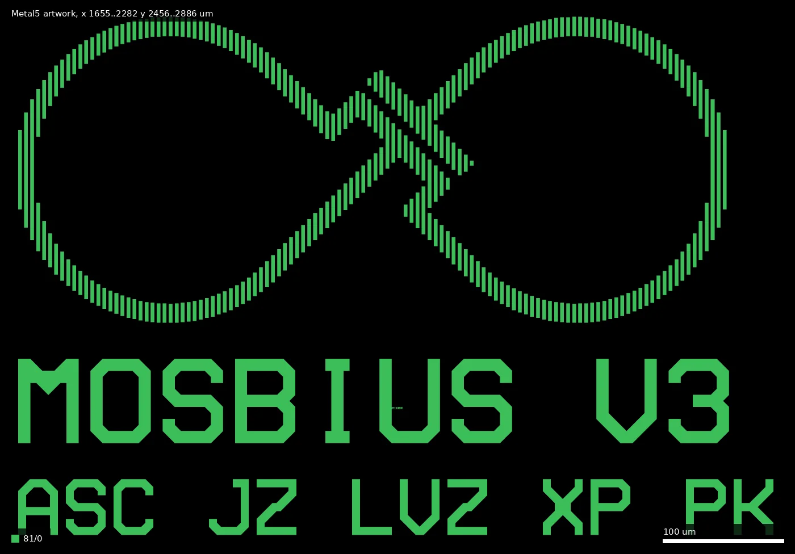

# MOSB: MOSbiusV3 (ws-run1)

| | |
|---|---|
| Repository | none listed on platform.wafer.space |
| Taped-out layout | MOSB_chip_top_4_2, 3932 x 5122 um, 2 placement(s) on the G801 reticle |
| Slot | 1x1 (manifest) |
| Top cell | chip_top |
| Licence in repo | n/a |
| README | n/a |

## What the repo actually contains

No repository was listed for this project, so nothing was cloned and there is nothing to audit. The platform description is empty, and `designs.csv` lists no commit. This summary is therefore written from the manufactured layout alone (public reticle `ws-run1`, layout `MOSB/chip_top.gds`, SHA256 `e5f4ff37ef6aaa487ae2c23959f81b9207213b2ac4a470ba2da550cac0002498`).

## Taped-out layout

The die is a programmable analog test fabric: 68 analog pads feed a 130 x 25 switch matrix that routes them to arrays of 3.3 V NMOS and PMOS transistors, current mirrors, OTAs and inverters. The only digital logic is the matrix configuration memory and its clock/scan interface. The name on the die is "MOSBIUS V3" (see the artwork below), so it is a MOSbius chip.

| Fact | Value (source: layout.json and layout queries) |
|---|---|
| Die size | 3932 x 5122 um, `padframe` plus `top_analog_plus_esd` (3180 x 4370 um core at 376,376) |
| Pads / IO cells | 68 `gf180mcu_fd_io__asig_5p0` analog pads (labelled `ANALOG_PAD[0..67]`, Metal5), 2 `gf180mcu_ws_io__dvdd`, 4 `gf180mcu_fd_io__dvss`, 4 corners. No digital IO cells |
| Standard cells | `mcu9t5v0` (9-track, 5 V): 17,889 logic cells and 8,134 fill. Types: latq_1 6,500; inv_1 6,546; nand2_1 3,252; inv_4/8/12/20 about 400 each; dffrnq_4 2; nand2_4 2 |
| SRAM macros | none |
| Switch matrix | 130 x 25 = 3,250 crosspoints (`swmatrix_Tgate`, 32.5 x 46 um each, one `DFF_2phase_1` of 2 latq_1 + inv_1 + nand2_1 per crosspoint); block `full_switch_matrix_130_by_25_no_probes` 987 x 3736 um at (1451,656) |
| Device blocks | five 194 um wide columns of pinned-out devices (below), 3.3 V thin oxide (no Dualgate) |
| Custom analog cells | `TILE_NMOS/PMOS_L0P5_W5_NF6` transistor tiles, `ota_nmos/pmos`, `inv_16x`, `current_mirror_array_nmos/pmos`, MOS-cap decap blocks, 68 per-pad ESD cells |
| Text / artwork | Metal5 infinity-loop logo, "MOSBIUS V3" and "ASC JZ LVZ XP PK" at (1655,2455)-(2282,2886) |

### Does it match the repository?

There is no repository to compare with. The lead in the earlier notes (`github.com/mosbiuschip`, organisation of the MOSbius chip authors) is unverified: it was not fetched and nothing on the platform links it to this submission. The layout is, however, consistent with it being a MOSbius design (the cell names `swmatrix_*`, `top_mosbius_devices_*`, `mosbius_logo`, and the artwork text).

*Whole die (3932 x 5122 um). The switch matrix is the tall block at x 1451..2438, y 656..4392; the device columns sit either side of it (NMOS on the left at x 1290..1484, PMOS and DFFs on the right at x 2418..2612); 68 pad cells around the edge are joined to the matrix by the wide Metal4/5 fan-out wiring.*

### Device blocks

All blocks are 194 x 842 um (DFF block 194 x 226 um); gate counts are poly-over-diffusion fingers extracted from the layout (no Dualgate or V5_XTOR on any of them, so thin-oxide 3.3 V devices). Tile fingers are all L = 0.5 um, W = 5 um, six fingers per tile ("NF6"). The tile cells named `TILE_NMOS_...` in the PMOS blocks are PMOS devices in n-wells by geometry; names are not reliable, the flavour here is from the well.

| Block (cell) | Position (um, lower-left) | N fingers | P fingers | Contents (by cell and label names) |
|---|---|---|---|---|
| `top_mosbius_devices_int_nmos` | (1290,3479) | 216 | 0 | plain NMOS tiles, each terminal pinned to the matrix ("int" = internal-node access) |
| `top_mosbius_devices_v1_nmos` | (1290,2639) | 624 | 432 | NMOS current-mirror array (`NMOS_CM_ARRAY_IOUT_1X..16X`), diff-pair/current-source labels (`NMOS_DP_1X/4X`, `NMOS_CS_4X`), `ota_nmos`, `inv_16x` |
| `top_mosbius_devices_v1_pmos` | (2418,1799) | 120 | 1674 | PMOS equivalents (`PMOS_CM_ARRAY_IOUT_*`, `PMOS_DP_*`, `PMOS_CS_*`), `ota_pmos`, `inv_16x` |
| `top_mosbius_devices_int_pmos` | (2418,959) | 0 | 504 | plain PMOS tiles |
| `top_mosbius_devices_int_dff` | (2418,735) | 34 | 34 | 5 V thick-oxide (Dualgate + V5_XTOR) latch/DFF cells |

*Close-up of the v1 NMOS block at x 1320..1430, y 3270..3480: the 3 x 18 tile current-mirror array (right) and the 3-column OTA/diff-pair tiles (left); each tile has its terminals on Metal1 stubs going to the switch-matrix pin columns.*

*Crosspoints at x 1700..1850, y 2000..2100: the large green blocks are the pass-gate transistors (NMOS 6 x 8 um, PMOS 18 x 8 um fingers, all L = 0.28 um, thin oxide), with the thick-oxide 2-phase latch (Dualgate, dark) above each.*

### Pad protection

Each of the 68 analog pads has an `io_secondary_3p3` ESD cell (94 x 164 um): a `ppolyf_s_resistor` (poly 10.6 x 20 um, RES_MK 10 x 20 um), `diode_nd2ps` (4 instances of 11.2 x 10.3 um), `diode_pd2nw` (4 x 11.6 x 10.9 um plus 6 x 6.6 x 5.9 um) and a pad landing 44 x 34 um. These are 68 identical copies of diodes and a poly resistor with accessible geometry, not separately exposed test devices.

### Artwork and text

*Metal5 only, x 1655..2282, y 2456..2886 um (cell `artwork`): an infinity-loop logo (`mosbius_logo`, 588 x 254 um), the title "MOSBIUS V3" and a second line "ASC JZ LVZ XP PK".*

The second line is the only text that could name people; it reads like four sets of initials, but the layout does not say whose, so authors are not established here. The source for the name "MOSbius V3" is this artwork.

## Authors and affiliations

Not stated in the manifest. The die carries "ASC JZ LVZ XP PK" in artwork (source: layout, Metal5). The expansion of those initials is unknown. MOSbius is known (outside this layout) as Peter Kinget's (Columbia University) educational analog chip platform and a 2025 IEEE SSCS Chipathon track; that association is unverified for this submission.

## Value for GF180MCU characterisation and PDK development

### Verdict: High

- What it offers: a die where several hundred thin-oxide 3.3 V transistors of identical geometry (L = 0.5 um, W = 5 um x 6 fingers per tile; 960 N and 2,610 P thin-oxide fingers across the blocks) can be wired from 68 pads through programmable switches into single devices, mirrors with 1x/2x/4x/8x/16x ratios, diff pairs and OTAs. That is directly usable for Vt, gm, mismatch and matching characterisation against the simulation models.
- Switch fabric: 3,250 thin-oxide pass-gates (L = 0.28 um; NMOS W = 48 um, PMOS W = 144 um total per crosspoint) can be measured for on-resistance and leakage.
- Configuration memory: 6,500 latq_1 plus the two 5 V `dffrnq_4` give a 5 V standard-cell latch array in an unusual (shift/clock-phase) use.
- Pad protection: 68 copies of the ESD structure (poly resistor plus diode set).
- Possible PDK additions: a parametrised multi-finger tile/current-mirror/OTA set and a switch matrix are not in the PDK; the MOSbius `swmatrix_Tgate` and `TILE_*` cells could be proposed.
- What would be needed to use it: the switch configuration bit-stream protocol (CLK, DATA, EN labels exist on Metal2 in `digital_interface_and_clock_gen`, 332 x 80 um at (1501,656)) and how those reach pads are not extracted here; series pass-gate resistance means the device terminals are not four-wire measurable. Mapping of pad index to matrix row and column would settle this (netlist extraction or the MOSbius documentation).

## Notes and caveats

- No repository: everything above is geometry and cell/label names. Block identity ("OTA", "current mirror", "inverter 16x") comes from cell and label names, not extracted circuits; device flavour and L/W come from geometry. Counts are gate polygons extracted from hierarchical cells, not netlist devices.
- The die is 3932 x 5122 um although the manifest says slot size 1x1.
- Pad to matrix connectivity was not extracted; pad names are labels on Metal5.
- Unverified lead: `github.com/mosbiuschip` (MOSbius organisation). Not fetched; not linked to this submission. A repository there would settle the schematic, pad map and configuration protocol.
