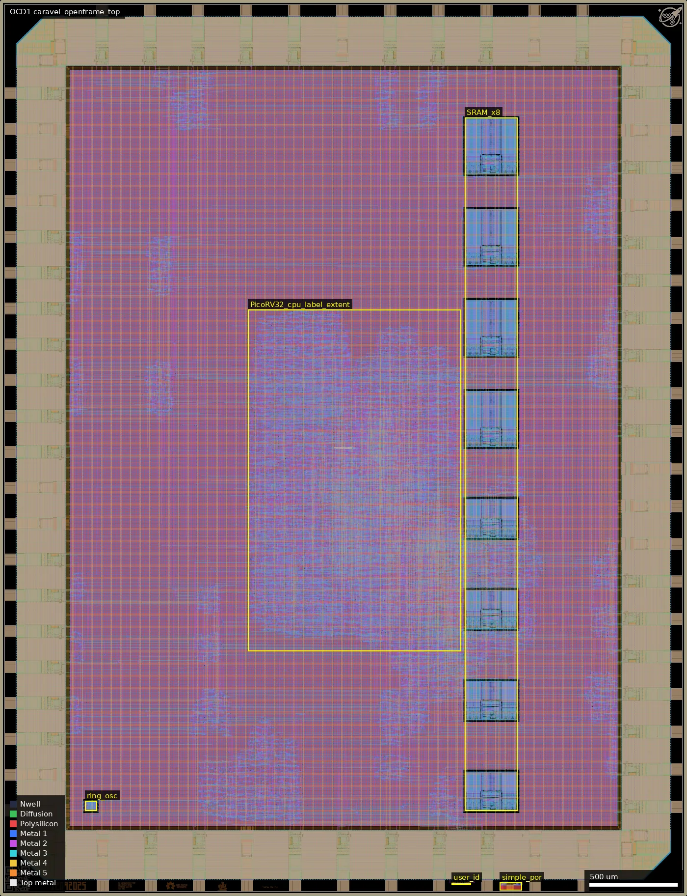
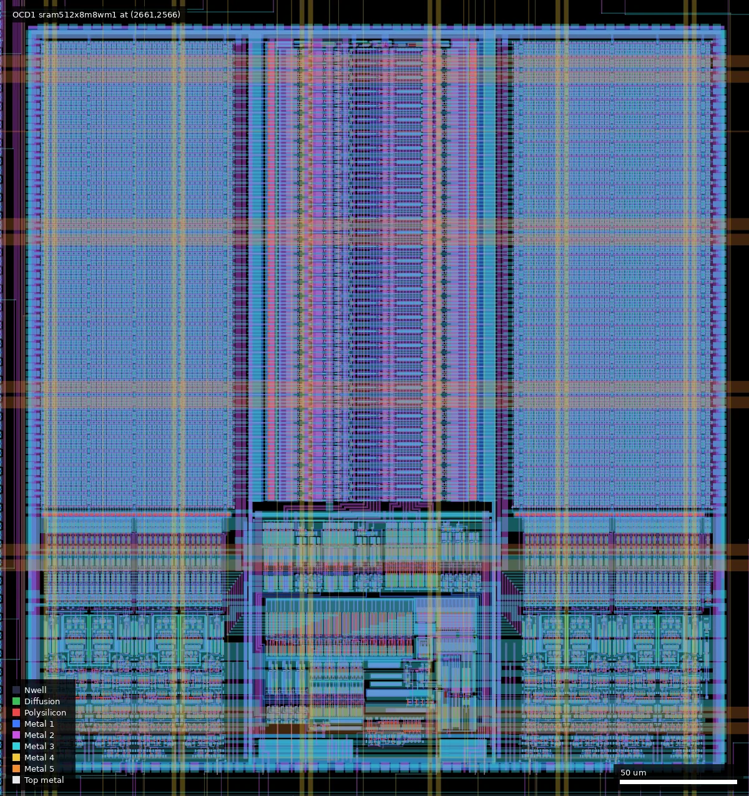
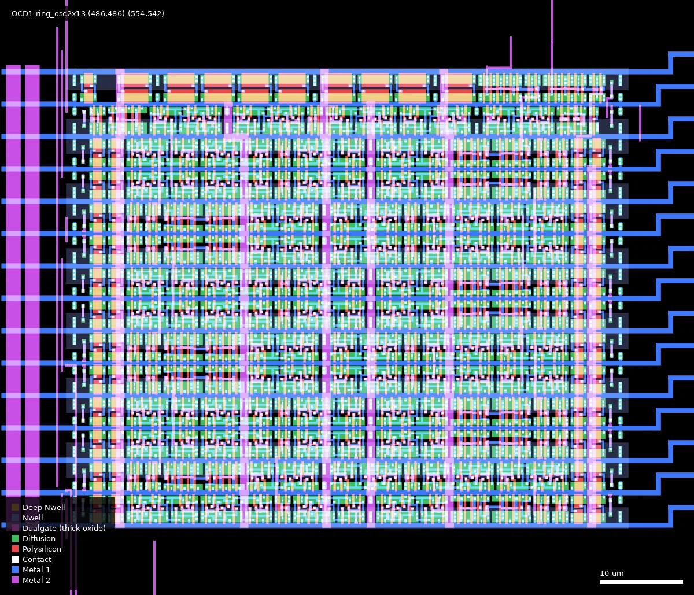
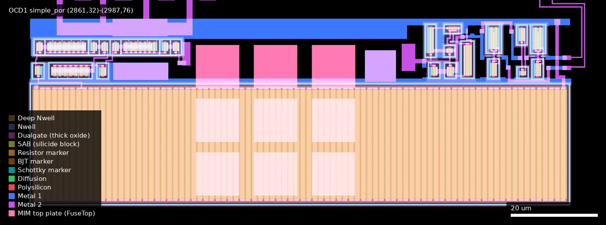
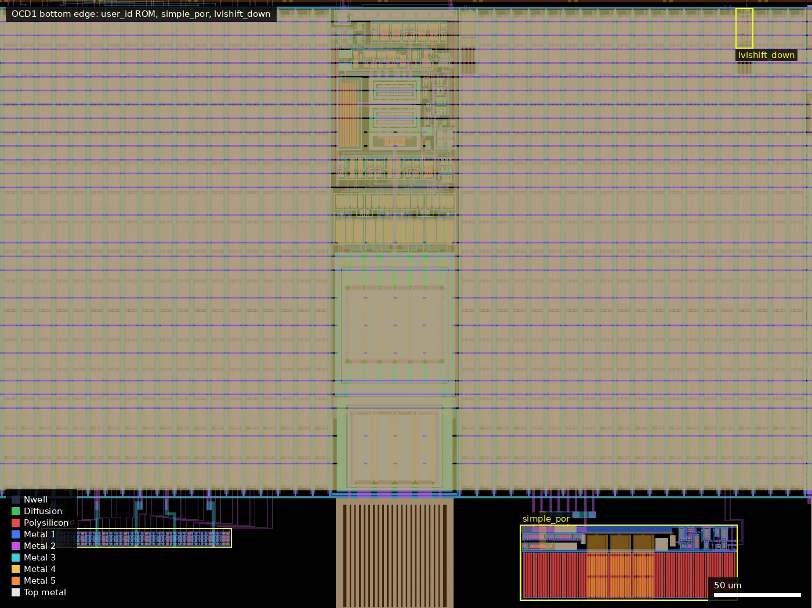

# OCD1: openframe_caravel_picorv32 (ws-run1)

| | |
|---|---|
| Repository | https://github.com/RTimothyEdwards/gf180mcu_ocd_openframe @ 9ef4567 (main, last commit 2025-11-30). The taped-out design is **not** on main: it is on branch `caravel_picorv32` @ 349e17e (last commit 2026-01-02) |
| Slot | 1x1 |
| Taped-out layout | OCD1_caravel_openframe_top_8_6, 3932 x 5122 um, 1 placement on the G801 reticle (run 1); matches `gds/caravel_openframe_filled.gds.gz` at 349e17e on branch `caravel_picorv32` |
| Top cell | caravel_openframe_top |
| Licence in repo | No LICENSE file; Apache-2.0 SPDX headers in sources (copyright Open Circuit Design, LLC; some files derived from Efabless Caravel; picorv32/picosoc are ISC) |
| README | Missing at top level; documentation is `magic/README` on main and `doc/README` on the `caravel_picorv32` branch |

## What the repo actually contains

A GF180MCU port of the Efabless Caravel "openframe" harness: a fixed padframe with 44 GPIO, a reset pad, a power-on-reset, a via-programmed 32-bit user-ID ROM and a user area. `verilog/rtl/gf180mcu_padframe.v` describes it as "a reference design for use of the 3.3V-enabled libraries for the gf180mcu open PDK".

The repository has two very different branches:

- **`main` (the checked-out HEAD, 3 commits, Nov 2025):** only the empty openframe template. Padframe layout in magic (`magic/caravel_openframe.mag`, `gf180mcu_padframe.mag`), an empty `openframe_project_wrapper`, `gds/caravel_openframe.gds.gz` (9.5 MB), top-level LVS output (`lvs/`), the `simple_por` macro (`ip/simple_por/`). There is no cell called `caravel_openframe_top` on main.
- **`caravel_picorv32` (6 further commits, 2025-12-09 to 2026-01-02):** the chip that was submitted. `doc/hashes.txt` on that branch says "URL (note that this is not in the main branch)" and names top cell `caravel_openframe_top` and file `gds/caravel_openframe_filled.gds.gz` (55 MB). Everything below refers to this branch (read with `git show origin/caravel_picorv32:<path>`).

Contents of the `caravel_picorv32` branch:

- `verilog/rtl/`: padframe (`gf180mcu_padframe.v`), `caravel_openframe.v`, and the user project: `picosoc.v` + `picorv32.v` (PicoRV32 SoC adapted from the sky130 Caravel openframe example), `mem_wb.v`, `housekeeping*.v`, `spimemio.v`, `simpleuart.v`, `simple_spi_master.v`, two counter/timers, `gpio_wb.v`, `gpio_vector_wb.v`, `dll.v` + `dll_controller.v` + `ring_osc2x13.v`, `clock_div.v`, `clock_routing.v`, `debug_regs.v`.
- `librelane/`: LibreLane "Classic" flow config for `openframe_project_wrapper` only (die area 350..3529.9 x 350..4719.9 um, clock on `gpio_in[38]`, 15 ns period, 20 % target density). `STD_CELL_LIBRARY: gf180mcu_as_sc_mcu7t3v3` (Avalon Semiconductor 3.3 V 7-track cells). STA corners tt_025C_3v30, ss_125C_3v00, ss_n40C_3v00, ff_n40C_3v60, ff_125C_3v60; the ss corners list the tt standard-cell lib (no ss lib is referenced). LibreLane run directories are deliberately not committed (`librelane/README`).
- Macros in the wrapper: 4x `gf180mcu_ocd_ip_sram__sram512x8m8wm1` and 4x `gf180mcu_ocd_ip_sram__sram256x8m8wm1` (3 kB of CPU RAM: 512x32 + 256x32; `mem_wb.v` comment: "Could use more memory here but want to exercise both macros"), and the hand-placed `ring_osc2x13` (`ip/ring_osc2x13/`, magic layout, 13 trimmable stages built from `gf180mcu_as_sc_mcu7t3v3` inv/invz/clkbuff cells; its README says it must be manually generated so stage delays are not left to P&R).
- Padframe: `gf180mcu_ocd_io` cells `__bi_a` (44 GPIO with OE/IE/schmitt/slew/PU/PD/2-bit drive select), `__in_s` (reset), `__dvdd`/`__dvss` (5 V), `__vdd`/`__vss` (3.3 V), `__cor`, and three custom 10 um filler variants `gf180mcu_ocd_io__fill10x/y/z` that embed a `constant_block` (loopback 1/0 per pad) and a `lvlshift_down` cell (two `gf180mcu_fd_sc_mcu7t5v0` inverters used as a 5 V to 3.3 V level shifter for the POR output).
- `ip/simple_por/`: 5 V-domain analog POR (see table below), with hand-written SPICE netlist and ngspice testbenches.
- `ip/wafer_space/`: seal ring, ID and logo cells.
- `gds/`: `caravel_openframe_top.gds.gz` (43 MB, pre-fill) and `caravel_openframe_filled.gds.gz` (55 MB), `hashes.txt`.
- `validate/`: netgen LVS output `caravel_openframe_comp.out` ending "Final result: Circuits match uniquely." and KLayout DRC report `caravel_openframe_drc_klayout.lyrdb` with zero items. `netlist/layout/caravel_openframe.spice` (35 MB extracted netlist). `verilog/gl/openframe_project_wrapper.pnl.v` (65 MB powered gate-level netlist).
- `verilog/dv/`: cocotb tests copied from Caravel (hello_world, UART, SPI master, timers, housekeeping, GPIO vectors) and one iverilog test `gpio_vector`. No simulation logs or results are committed.

None of the three libraries under test is in the repo or a submodule (there are no submodules). They are read from the installed PDK (`pdk_dir::libs.ref/gf180mcu_ocd_io`, `.../gf180mcu_ocd_ip_sram`, `.../gf180mcu_as_sc_mcu7t3v3`), i.e. the versions that `open_pdks` installs for gf180mcuD. `gf180mcu_padframe.v` states that `gf180mcu_ocd_io` is "distributed with the GF180MCU open PDK by the open_pdks installer". The upstream source repositories for the three libraries are not named in this repo.

No timing reports, no silicon bring-up data and no test firmware beyond the Caravel DV programs are present.

## Taped-out layout

| Item | Measured |
|---|---|
| Die size | 3932 x 5122 um (design 3880 x 5070 um inside the seal ring), 1 placement on the G801 reticle at (16.028, 15.606) mm |
| Pads and IO cells | 45 signal pads: 44 `gf180mcu_ocd_io__bi_a` (labels `gpio[0..43]` on Metal5) and 1 `in_s` (`resetb`); 6 `dvdd`, 6 `dvss`, 3 `vdd`, 3 `vss` power cells; 4 corner cells; 3 filler types (`fill10` x969, `fill10x` x45, `fill10z` x17, `fill10y` x1, `fill5` x3) |
| Standard cells | only `gf180mcu_as_sc_mcu7t3v3` (Avalon 3.3 V, 7-track) in the core: 34,339 logic placements plus 523,652 fill/tap placements; `dfxtp_2` x3452, `dfsrtp_2` x1194 (about 4.6 k flip-flops), `inv_2` x5088, `mux2_2` x4669, `buff_2` x3598. No 9-track cells |
| SRAM macros | 4 x `gf180mcu_ocd_ip_sram__sram512x8m8wm1` (301.3 x 321.9 um) at x = 2661, y = 3086 / 3606 / 4126 / 2566; 4 x `sram256x8m8wm1` (301.3 x 224.9 um) at x = 2661, y = 486 / 1006 / 1526 / 2046 |
| Hand-placed blocks | `ring_osc2x13` (68.1 x 56.0 um) at (486, 486); `simple_por` (125.8 x 43.6 um) at (2861, 32); `user_id_programming` (109.5 x 10.8 um) at (2584, 63); `lvlshift_down` (22.3 x 9.0 um) at (2986.5, 352.3); `constant_block` x45 |
| Thick oxide (Dualgate, 55/0) | 2.6 mm2 in total, almost all in the pad cells; in the core only `simple_por` (all 132 gates), `lvlshift_down` and the pad cells' 5 V side. SRAM macros, standard cells and the ring oscillator have no Dualgate |
| MIM / resistor markers | only in `simple_por`: 9 MIM top plates of 10 x 10 um (layer 75/0, CAP_MK 117/5), poly resistor marker (62/0) 3340 um2, RES_MK 3084 um2, SAB 3109 um2 |

### Does it match the repository?

Yes, to the last commit of branch `caravel_picorv32`. I extracted `gds/caravel_openframe_filled.gds.gz` from the three commits that touched it (1172320 on 2025-12-09, 9111f20 on 2025-12-16, 349e17e on 2026-01-02; read with `git show`, repo untouched) and compared each with the `caravel_openframe` subtree of the taped-out layout:

- Recursive instance counts per cell name (with `$n` suffixes stripped): the taped-out layout and 349e17e agree for every cell name except the wafer.space additions (seal ring, ID, logo, which sit outside `caravel_openframe`; the repo's filled GDS already carries them) and the metal / poly dummy-fill cells (the repo file has them, the layout subtree has them elsewhere or regenerated). 9111f20 differs in addition by 4 `ESD_CLAMP_COR` cells; 1172320 also lacks 148 `antenna_tiedown_3v256x8m81/3v512x8m81` cells.
- Merged areas: Nwell, Poly2 and Dualgate are identical in all three; in one SRAM macro (box 2661,2566 to 2963,2888) Pplus and Nplus are 26809.62 and 25609.09 um2 in the layout and in 349e17e, but 25951.89 / 23075.79 (1172320) and 25951.89 / 23095.13 (9111f20): the layout contains the PP.8 correction of the last commit.
- Conclusion: the manufactured design is `caravel_openframe_filled.gds.gz` at 349e17e (2026-01-02), which settles the open question in the caveats. Fill shapes were not compared (wafer.space regenerates them), and the platform SHA256 of the reticle file is not expected to equal the repo file's hash.

*Whole die (3932 x 5122 um). Padframe around a 3.2 x 4.4 mm core; the 8 SRAM macros in one column on the right (x = 2661 to 2962 um); the PicoRV32 and peripherals are flat standard-cell logic, so the outlined box (1420,1400 to 2640,3350) is only the extent of the `picosoc.cpu` net labels (approximate); the ring oscillator at the lower left (486,486); `user_id` and `simple_por` in the bottom pad edge.*

*One 512x8 SRAM macro at (2661,2566), 301 x 322 um: two bit-cell arrays either side of the row decoder, column mux and sense circuitry at the bottom. No Dualgate anywhere in the macro.*

*Hand-placed ring oscillator `ring_osc2x13` at (486,486), 68 x 56 um: 12 `delay_stage` rows (4 `invz_2`, 2 `clkbuff_4`, 3 `inv_2` each) plus one `start_stage` (5 `invz_2`, `nor2_2`), all `gf180mcu_as_sc_mcu7t3v3`.*

*`simple_por` at (2861,32), 126 x 44 um, 5 V analog POR: the large striped area is the poly resistor array (resistor marker, SAB), the pink squares are MIM top plates (nine, 10 x 10 um), the transistors with Dualgate at the top (cascoded mirrors on the left, Schmitt/buffer on the right).*

*Bottom pad edge (2560,28 to 3030,380): `user_id_programming` (2584,63) and `simple_por` (2861,32) sit between pad cells; `lvlshift_down` (2986.5,352.3) is at the upper right. The big striped column in the middle is a `bi_a` pad cell.*

### Blocks, devices and pad connections

| Block | Layout evidence |
|---|---|
| PicoRV32 SoC | no hierarchy (flattened by synthesis); net labels `user_project.picosoc.cpu.*` (2266 labels) lie in x 1396 to 2618, y 1373 to 3328 um (caravel_openframe coordinates, add 26 um for reticle coordinates); peripherals (`spimemio`, `simpleuart`, `counter_timer_0/1`, `hkspi`, `dll`, `openframe_clocking`, `soc_mem`, 44 `gpio_wb` instances) are interleaved in the same region. 3.3 V thin-oxide logic only |
| SRAM | 8 macros, 4 x 512x8 and 4 x 256x8, all in one column; devices inside are named `nmos_5p0`/`pmos_5p0` but no gate lies inside Dualgate or V5_XTOR, so they are 3.3 V thin-oxide devices |
| `ring_osc2x13` | 13 stages as described; also 2 `inv_6`, 2 `inv_2` and diode cells at the output; its power rails `ring_osc_power_connect` (95.6 x 58 um) are separate from the P&R rails; no Dualgate |
| `simple_por` | 5 blocks: `reduction_mirror` (2355 um2 of poly, all in Dualgate), `large_mimcap` (39 x 39.6 um), `schmitt_inverter`, `std_buffer`, `std_inverter`. All 132 poly gates lie inside Dualgate (thick oxide), but none overlaps V5_XTOR (112/1), so the 6 V devices are marked by Dualgate only. Nine 10 x 10 um MIM capacitors, one poly resistor bank |
| `lvlshift_down` | `gf180mcu_fd_sc_mcu7t5v0` `inv_12` and `inv_8` (5 V cells), in Dualgate and V5_XTOR |
| `user_id_programming` | 32 `tieh_4` + 32 `tiel_4` cells and a 95 x 5 um via-programmed block (`user_id_vias`), `gf180mcu_as_sc_mcu7t3v3` |
| `constant_block` x45 | in each `fill10x` cell: 2 `buff_12`, 1 `tiel_4`, 1 `tieh_4` (the per-pad loopback constants); also 405 `lvlshift_up` inside the `bi_a` / `in_s` pad cells |
| IO cells | `bi_a`: 184 of 234 gates in Dualgate (5 V pad side), the rest thin oxide (3.3 V core side), as expected for a dual-voltage cell |

Connections checked by extracted connectivity (KLayout `LayoutToNetlist` on the `caravel_openframe` cell, Metal1-5 and Via1-4, dummy fill excluded; each net intersected with the pad-cell placement boxes, pads named from the nearest Metal5 label; the path through the IO cell devices is not traced):

- `simple_por`: the nets `porb` and `Vout` run from the POR at (2942..2964, 34) up to y = 351 um, i.e. to `lvlshift_down` (placed at y = 326 to 349 um in these coordinates); none of the POR's labelled nets (`Vin`, `Vout`, `por`, `porb`) touches any pad cell. `In`, `VDD` and `VSS` labels are on the global supply nets. So the POR is internal, as the summary stated, and not observable on a pad.
- GPIO pad controls: for each of the 44 `gpio_wb` instances, the 9 net labels `user_project.picosoc.genblk1[N].gpio_wb.gpio_ctrl.pad_gpio_*` (output enable, input enable, slew, drive0/1, schmitt, pull-up/down selects) were probed on the wrapper boundary and traced. Every one of the 44 x 9 nets touches exactly one pad cell, the `bi_a` whose pad label is `gpio[N]` (N = 0..43). So the software-configurable pad controls of the summary exist and go to the pad with the matching number, including GPIO 13/14/15 (monitors) and 38 (clock). I did not trace the data paths (clock input on GPIO 38, UART on 5/6, trap on 13, oscillator monitors on 14/15): those nets are unlabelled flat logic.
- The `In`, `VDD`, `VSS` labels of `simple_por` are on global supply nets that touch every pad cell, so the POR is powered from the padframe rails; I did not determine which rail carries which voltage.

## Authors and affiliations

| Person / organisation | Role | Affiliation | Source |
|---|---|---|---|
| R. Timothy Edwards (GitHub `RTimothyEdwards`) | Sole committer (9 commits across both branches); padframe, POR, ring oscillator, flow, verification | Open Circuit Design, LLC | git log; "Written by Tim Edwards" and "SPDX-FileCopyrightText: 2025 Open Circuit Design, LLC" headers; GitHub profile company "Open Circuit Design" |
| Efabless Corporation | Original Caravel / openframe RTL, POR concept, DV tests | Efabless | "SPDX-FileCopyrightText: 2020 Efabless Corporation" headers |
| picorv32 / picosoc authors | CPU core | not stated | ISC licence headers in `picorv32.v`, `picosoc.v` |
| Avalon Semiconductor | 3.3 V standard cell library used (not in repo) | not stated | library name; `librelane/config.yaml` comment |

## Value for GF180MCU characterisation and PDK development

### Verdict: Medium

It is not a characterisation chip, but it is a full-chip use "in anger" of three new 3.3 V libraries (dual-voltage IO, 3.3 V SRAM, 3.3 V standard cells), with a pad-observable ring oscillator/DLL, a mask-ID ROM and an analog POR, and it has clean LVS and KLayout DRC reports in the repo.

### Test structures and measurable circuits

| Structure | What it exercises | Access | Where |
|---|---|---|---|
| `gf180mcu_ocd_io__bi_a` x44 | IO cell drive strength (2-bit `drive0/drive1`), slew select, schmitt/CMOS input threshold, pull-up/pull-down strength, 5 V pad / 3.3 V core level shifting | Every GPIO is software configurable through `gpio_wb.v` / `gpio_vector_wb.v`; GPIO 16-35 have no special function | `verilog/rtl/gf180mcu_padframe.v`, `picosoc.v` |
| `ring_osc2x13` + DLL | Delay of `gf180mcu_as_sc_mcu7t3v3` inv_2 / invz_2 / clkbuff_4 stages at 3.3 V; 13 trimmable stages | "Clock1 monitor" on GPIO[14] and "Clock2 monitor" on GPIO[15] through programmable dividers (`clock_routing.v`); control via housekeeping SPI (GPIO 1-4) | `ip/ring_osc2x13/` (magic layout, extracted `ring_osc2x13.spice`, LVS `validate/comp.out`), `verilog/rtl/ring_osc2x13.v`, `dll*.v`; on the die at (486,486), 68 x 56 um, 12 `delay_stage` + 1 `start_stage`, each delay stage 4 `invz_2` + 2 `clkbuff_4` + 3 `inv_2` |
| `gf180mcu_ocd_ip_sram__sram512x8m8wm1` x4, `__sram256x8m8wm1` x4 | 3.3 V SRAM function and access time inside a synthesised system (15 ns clock constraint) | Only through the CPU (firmware memory test, UART on GPIO 5/6, flash on GPIO 36-42); no direct pin access | `verilog/rtl/mem_wb.v`, `librelane/config.yaml`; on the die in one column at x = 2661 um, y = 486 to 4448 (all thin oxide) |
| PicoRV32 SoC in `gf180mcu_as_sc_mcu7t3v3` | Functional / Fmax data point for the 3.3 V standard cells; clock from pad GPIO[38] or the DLL | External clock sweep; trap monitor GPIO[13] | `verilog/rtl/`, `verilog/gl/` |
| `simple_por` | `nfet_06v0`/`pfet_06v0` cascoded step-down mirrors (8x, 7x, 8x), `ppolyf_u_1k_6p0` 2000 um and 200 um x 1 um bias resistors, 9x 10x10 um `cap_mim_2f0_m4m5_noshield`, Schmitt trigger; POR delay versus supply | Indirect only: `porb` is level-shifted to 3.3 V and resets the SoC; not on a pad in this chip (checked: its labelled nets reach `lvlshift_down`, no pad cell). Layout: 132 poly gates, all in Dualgate; 9 MIM top plates of 10 x 10 um; one poly resistor bank (resistor marker 3340 um2); the exact resistor lengths were not extracted | `ip/simple_por/netlist/simple_por.spice` and `*_tb*.spice`; on the die at (2861,32), 126 x 44 um |
| `lvlshift_down` | 5 V to 3.3 V down-shift using two `gf180mcu_fd_sc_mcu7t5v0` inverters on different rails | Indirect (POR path) | `verilog/rtl/lvlshift_down.v`, `magic/lvlshift_down.mag` |
| `user_id_programming` | Via-programmed 32-bit ROM | Read as `mask_rev` by the SoC | `magic/user_id_programming.mag`, `scripts/set_user_id.py` |

Voltage domains: pads 5.0 V (`vddio`/`vssio`, DVDD/DVSS inside the pad cells), core 3.3 V (`vccd`/`vssd`).

Simulation data to compare against: the ngspice POR testbenches (decks only, no stored waveforms; the netlist comment says "Calibrated to about 40-50ms rise time", the verilog model comment says 15 ms), `ip/ring_osc2x13/lib/ring_osc2x13.lib`, and the SRAM `.lib` corner files in the PDK install (not in the repo). No stored STA reports.

### Candidate PDK additions

- The three libraries themselves are already distributed through open_pdks; this chip is a silicon validation vehicle for them: `gf180mcu_ocd_io` (dual-voltage 5 V pad / 3.3 V core IO), `gf180mcu_ocd_ip_sram` (256x8 and 512x8 here), `gf180mcu_as_sc_mcu7t3v3`.
- `simple_por` (5 V POR macro: GDS, LEF, magic, netlist) and `ring_osc2x13` (hand-placed trimmable ring-oscillator hard macro in the 3.3 V cells) are reusable IP.
- `gf180mcu_ocd_io__fill10x/y/z`: padframe filler cells carrying constant-one/zero loopback and a level shifter; a candidate addition to the IO library.
- The openframe harness itself is a template (`doc/README` gives a 12-step procedure).
- PDK/tool problems the author recorded:
  - `ip/simple_por/mag/README` lists 12 items found while drawing the POR: ppolyf resistors not getting L/W in ngspice (netlist comment says later corrected in the PDK), MiM `M=` multiplier ignored, magic device-generator metal-stack parsing (`THICKMET0P9`), mvpmos guard ring drawn with nsubdiff instead of mvnsubdiff, rule DF.5 "MV P-field overlap", rule DV.9 (MV FET with LV guard ring not flagged), `ppolyf_u_1k`/`ppolyf_u_1k_6p0` contact-distance rules and device generation ("Needs a lot of work"), MiM bottom-plate spacing/surround rules. Most are marked "(Fixed)"; items 8 and 12 are not.
  - `simple_por.v`: the GF IO library verilog models power with `supply0`/`supply1`, so a power ramp cannot be simulated.
  - `doc/README`: LVS merged VSS and DVSS in the IO corner cell (commit dee3bb5 says the IO library was updated to resolve this "false positive ground node shorting"); netgen could not parse the `generate` block of the ID ROM (worked around in 92ec3c5 by generating a gate-level module).
  - Commit 349e17e: SRAM core cell NPLUS/PPLUS patterns violated DRC rule PP.8 and were corrected in the SRAM library.

### What would be needed to use it

Packaged or chip-on-board test on a Caravel-style board: 5 V and 3.3 V supplies, external clock on GPIO[38], SPI flash on GPIO 36-42 (or housekeeping SPI on GPIO 1-4), UART on GPIO 5/6. For IO characterisation: firmware that steps drive/slew/pull settings, plus a scope and a source-meter. For the ring oscillator: a frequency counter on GPIO 14/15 and a trim sweep. Missing: any test plan, firmware for memory test or oscillator sweep, pinout/bond-out document, expected-value tables.

## Notes and caveats

- The platform lists the repository without a branch; the default branch does not contain the submitted design. Anyone cloning main gets the empty template.
- The platform sha256 (`adf56210...`) does not match any GDS in the repo, as expected: the reticle file is a different file (it contains wafer.space's fill and ID marks). The uncompressed `gds/caravel_openframe_filled.gds.gz` on the branch hashes to `fe2a78f1...`, which matches `doc/hashes.txt`; `gds/hashes.txt` on the same branch holds a different, older value (`7fbdb6fa...`). From the layout comparison above, the manufactured design is the file at the last commit 349e17e (2026-01-02, PP.8 fix): the SRAM Pplus/Nplus areas in the layout equal those of 349e17e and differ from the two earlier versions.
- `doc/README` still says LVS fails and that "most macros (namely SRAM and standard cells, but not I/O) are being ignored by LVS"; later commits (e99c5a0, 92ec3c5) say the chip "now passes LVS" and `validate/caravel_openframe_comp.out` agrees. The README text is stale.
- `doc/README` states that wrapper power connections and some edge routes were fixed by hand after LibreLane, so the committed LibreLane config does not reproduce the taped-out layout on its own.
- `CTS_CLK_BUFFERS` in `librelane/config.yaml` names `gf180mcu_as_sc_mcu9t3v3__clkbuff_*` (9-track) while the selected library is the 7-track one. The layout contains only `gf180mcu_as_sc_mcu7t3v3` cells in the core (`clkbuff_12` x1307 and other 7-track buffers), so no 9-track cell was used.
- The three 5 V cells of `lvlshift_down` are from `gf180mcu_fd_sc_mcu7t5v0` (`inv_12`, `inv_8`), as the summary said.
- `simple_por` is drawn with Dualgate only (no V5_XTOR marker on its 6 V devices) while the 5 V standard cells of `lvlshift_down` carry both; useful when checking how the PDK flow treats the two markers.
- Upstream repositories of the three libraries are not referenced; library versions are whatever was installed in `/usr/share/pdk/gf180mcuD` on the author's machine.
