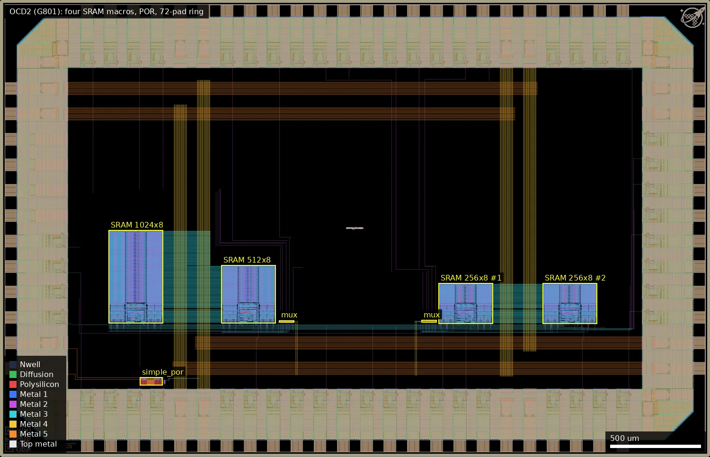
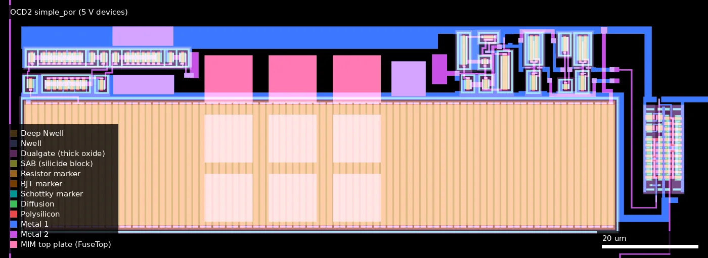
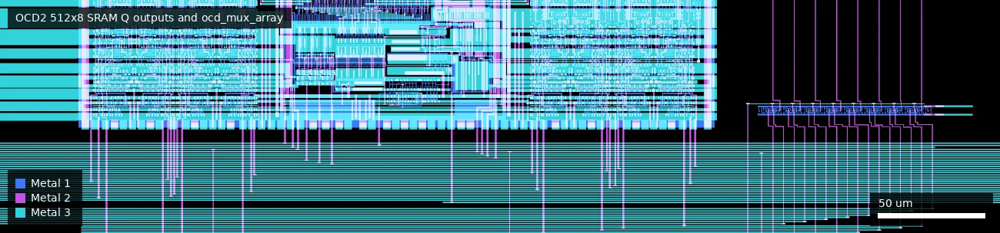
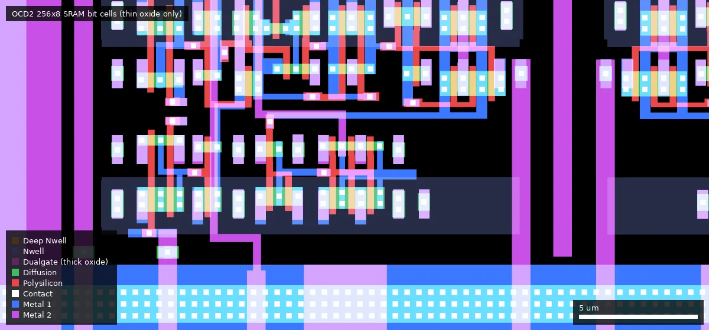
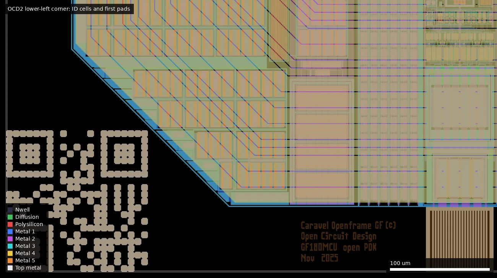

# OCD2: ocd_sram_test (ws-run1)

| | |
|---|---|
| Repository | https://github.com/RTimothyEdwards/gf180mcu_ocd_sram_test @ 6d4f609 (main, last commit 2026-07-04). The run-1 chip is only in history; last run-1 state is commit e2539ed (2026-07-01) |
| Slot | 1x0p5 |
| Taped-out layout | OCD2_gf180mcu_ocd_sram_top_2_8, 3932 x 2531 um, 2 placements on the G801 reticle |
| Top cell | gf180mcu_ocd_sram_top |
| Licence in repo | No LICENSE file; Apache-2.0 SPDX headers in sources (Open Circuit Design, LLC; some files derived from Efabless Caravel) |
| README | Missing at top level; the documentation is `doc/README` (pinout, build, bench test setup) |

## What the repo actually contains

One repository holds two generations of the same break-out test chip for the 3.3 V SRAM library `gf180mcu_ocd_ip_sram`. Each SRAM macro has its control, address and data pins wired straight to pads, with no logic in between except an 8-bit 2:1 output multiplexer.

**This chip (OCD2, run 1).** Top cell `gf180mcu_ocd_sram_top`, manufactured on G801. It carries one `gf180mcu_ocd_ip_sram__sram1024x8m8wm1`, one `__sram512x8m8wm1` and two `__sram256x8m8wm1` cores, plus the 5 V `simple_por` macro running from DVDD with its output level-shifted to a pad. The `rst_n` pad is unused. Its sources are not in the checked-out tree: use `git show e2539ed:<path>` (or check out that commit). This is the chip that the photo, the bench capture and the "14 to 16 second" POR result in the repo refer to, so it is the only one of the pair with silicon evidence: the 256-byte macro read back a 4-bit count correctly at 3.3 V.

**Which files belong to which chip**

| | Run 1 chip (OCD2, `gf180mcu_ocd_sram_top`) | Run 2 chip (OCD3, `gf180mcu_ocd_sram2_top`) |
|---|---|---|
| Where | git history only; last complete state at commit e2539ed | HEAD (6d4f609) |
| Top layout | `magic/gf180mcu_ocd_sram_top.mag`, `magic/gf180mcu_ocd_sram_test.mag` | `magic/gf180mcu_ocd_sram2_top.mag`, `magic/gf180mcu_ocd_sram_test2.mag` |
| GDS | `gds/gf180mcu_ocd_sram_top.gds.gz`, `gds/gf180mcu_ocd_sram_filled.gds.gz` | `gds/gf180mcu_ocd_sram2_top.gds.gz` (18.6 MB), `gds/gf180mcu_ocd_sram2_filled.gds.gz` (24 MB) |
| Netlist (LVS source) | `verilog/gf180mcu_ocd_sram_test.v` | `verilog/gf180mcu_ocd_sram_test2.v` |
| Extracted netlist | `magic/gf180mcu_ocd_sram_test.spice` | `netlist/layout/gf180mcu_ocd_sram_test2.spice` |
| SRAM macros | `sram1024x8m8wm1`, `sram512x8m8wm1`, 2x `sram256x8m8wm1` | `sram1024x8m8wm1`, `sram512x8m8wm1`, `sram256x8m8wm1`, `sram64x8m8wm1` |
| POR | `ip/simple_por/` (`simple_por`, 5 V devices, powered from DVDD, output through `lvlshift_down`) | `ip/simple_por_3v3_regulated/` (`por_3v3_selfbiased`, 3.3 V devices, powered from VDD) |
| DRC report | `validate/sram_top_drc_klayout.lyrdb` (0 items) | `validate/sram2_top_drc_klayout.lyrdb` (0 items) |
| LVS | `validate/comp.out` at e2539ed: "Circuits match uniquely" | `validate/comp.out` at HEAD: "Circuits match uniquely" |
| wafer.space cells | `magic/wafer_space/gf180mcu_ws_ip__id.mag` | `..._marker`, `..._project_id`, `..._shuttle_id`, `..._qrcode_id` (COB alignment markers, added in 6d4f609) |

The run-1 files were renamed/replaced in commit 1bbbd1b (2026-07-04, "Updating from chip version 1 to chip version 2"). Shared by both and present at HEAD: `verilog/chip_half_frame.v` + `magic/chip_half_frame.mag` (padframe), `verilog/ocd_mux_array.v` + `magic/ocd_mux_array.mag` (8x `gf180mcu_as_sc_mcu7t3v3__mux2_4`, hand placed), `constant_block`, `gf180mcu_ocd_io__fill10x`, `lvlshift_down`, `ip/simple_por/` (still in the tree but not instantiated in the run-2 netlist), `scripts/`, `validate/`, and `doc/` (README, `hashes.txt`, layout picture `gf180mcu_ocd_sram_test.png`, `chip_photo.jpg`, `4bit_count_bench_test.png`).

Build: hand-assembled in magic, no synthesis or P&R flow. `scripts/run_gen_gds.sh` writes GDS from magic, `scripts/run_fill_gds.sh` runs the KLayout fill script, `validate/run_lvs.sh` runs netgen against the PDK SPICE libraries for `gf180mcu_ocd_io`, `gf180mcu_as_sc_mcu7t3v3` and each SRAM macro (full transistor-level comparison since commit 959e10b), `validate/run_drc.sh` runs the KLayout deck.

Padframe (`doc/README`): a wafer.space half-height frame re-drawn with `gf180mcu_ocd_io` cells; every other DVDD/DVSS pair replaced by VDD/VSS (3.3 V) pads; 24 mA drive pads replaced by selectable-drive pads; analog pads unused; each bidirectional pad is hard-programmed as input or output through local loopback constants from `constant_block` inside the 10 um filler cells. Pads are 5 V (DVDD), core 3.3 V (VDD).

Where the library under test lives: nowhere in this repo and there are no submodules. The LVS script reads `${PDK_ROOT}/gf180mcuD/libs.ref/gf180mcu_ocd_ip_sram/spice/*.spice`, so the macros come from the open_pdks installation. The commit log refers to "the SRAM macro repository" / "SRAM library (gf180mcu_ocd_ip_sram)" without a URL.

Silicon data in the repo (all from the run-1 chip): `doc/chip_photo.jpg` (COB bench setup), `doc/4bit_count_bench_test.png` (Digilent WaveForms capture dated 2026-06-30 showing Q[3:0] of a 256-byte macro reading back a 0-15 count; about 16 values per 0.65 us read off the screenshot, i.e. roughly a 25 MHz read rate, my estimate), the bench wiring table in `doc/README`, and the commit message of 1bbbd1b: the first chip "has been tested on silicon" and the original PoR "although functional, has a 14 to 16 second delay period when the chip is operated at a 3.3V external supply".

Not present: SRAM SPICE simulations, timing characterisation data, a working digital testbench (`verilog/README`: "Currently the testbench does not run because 'inout' ports are not allowed to be driven by registers"), or the tester driver code ("will be committed to the repository when it is available").

## Taped-out layout

| Measured on `layout/OCD2.oas` | |
|---|---|
| Reticle cell, size | `OCD2_gf180mcu_ocd_sram_top_2_8`, 3932 x 2531 um (chip frame `gf180mcu_ocd_sram_test` 3880 x 2479 um at 26,26), 2 placements on G801 (x 4.052 and 8.044 mm, y 20.788 mm) |
| Pads | 72 openings (Pad 37/0): 46 `gf180mcu_ocd_io__bi_a`, 5 `__in_c`, 1 `__in_s`, 4 `__asig_5p0` (analog, unused), 4 each `__vdd`, `__vss`, `__dvdd`, `__dvss`; 4 corner cells |
| SRAM macros | `sram1024x8m8wm1` at (602.8, 738.8) 301.3 x 515.8 um; `sram512x8m8wm1` at (1225.7, 738.8) 301.3 x 321.9 um; `sram256x8m8wm1` at (2428.8, 736.3) and (3006.6, 736.3), 301.3 x 224.9 um each. Bit cell `018SRAM_cell1_3v*` 2.76 x 3.67 um; thin oxide only (no Dualgate in any macro) |
| Standard cells | `gf180mcu_as_sc_mcu7t3v3`: 16 `mux2_4` (two `ocd_mux_array`, 8 each) plus 22 fill; `gf180mcu_fd_sc_mcu7t5v0`: `inv_8` and `inv_12` inside `lvlshift_down` plus 7 fill. No other logic |
| Custom blocks | `simple_por` at (775.9, 396.8) 125.8 x 43.6 um; `lvlshift_down` at (906.2, 403.5) 22.3 x 9.0 um; `ocd_mux_array` at (1545.8, 743.8) and (2334.9, 745.3), 82.7 x 11.9 um each; `copyright_block` at (321.2, 34.3); wafer.space `id` (26, 26) and `logo` (3762.8, 2361.8) |

### Does it match the repository?

Yes, with one history question settled. At the pinned commit 6d4f609 the tree holds only the run-2 GDS; the run-1 GDS had to be extracted from history (`git show <commit>:gds/gf180mcu_ocd_sram_top.gds.gz`, scratch copies only). I XORed the cells layer by layer against the OAS and compared the placed instances of the chip frame cell.

- The 1024, 512 and 256 cores, `simple_por`, `chip_half_frame` and `ocd_mux_array` are geometrically identical to the GDS of commit b63e370 (2026-01-02, the PP.8 rebuild). The chip frame cell's own shapes and instance list are identical too. b63e370 is the last commit that touched the run-1 GDS before the rename in 1bbbd1b, so this is the state at e2539ed.
- The December GDS (739641d, 2025-12-16) has the same frame, POR, mux and top-level geometry, but its SRAM cores differ in Pplus/Nplus only (256 core 442/1316 um2, 512 core 858/2514 um2, 1024 core 1689/4911 um2 of XOR). That is the PP.8 implant fix: the manufactured chip carries the fixed cores. The earlier GDS of commits 46f8f5f and 6667b43 differ more (metal, and in 46f8f5f also diffusion and contact).
- Same cell types and counts as the repo's run-1 description: 1 + 1 + 2 SRAM cores, 16 mux cells, one POR, 72 pads. Not compared: the dummy fill, seal ring and the wafer.space `id` cell (added or replaced by the foundry flow); the platform sha256 does not match any repo file because the slot file is a re-exported OAS.

Whole OCD2 die (0,0 to 3932,2531 um): four SRAM macros and the muxes in the middle band at y 736 to 1255 um, the POR at the lower left (775.9, 396.8), the rest of the core empty apart from power straps; the 72-pad ring fills the border.

### Test structures and pad access

Pad access was traced on a flattened metal 1 to 5 extraction of the frame cell (via stack connected, fill removed). A net was followed from the IO cell output pin (`bidir_Y[n]`, `input_Y[n]`, `clk_Y`) to the macro pins, and from the mux outputs to the IO cell input pin (`bidir_A[n]`). The step from the pad opening to the IO cell pin goes through the IO cell's own buffer devices, which this metal-only trace does not cross; that step rests on the cell naming and the author's LVS-clean netlist. Pad numbers below are the author's, via `doc/README` (bidir index to pad).

| Structure | Cell, position, size | What the layout shows | Pads |
|---|---|---|---|
| 1024x8 SRAM | `sram1024x8m8wm1`, (602.8, 738.8), 301.3 x 515.8 | A0-A7, A8 (input pin 3) and A9 (input pin 1, this macro only) reach it; 3.3 V thin oxide only | A0-A7 = bidir 9..2 (pads 14..7), A8 = pad 70, A9 = pad 68; CEN = bidir 18 (pad 27) |
| 512x8 SRAM | `sram512x8m8wm1`, (1225.7, 738.8), 301.3 x 321.9 | A0-A8 reach it; CEN = bidir 19 (pad 28) | shared bus |
| 256x8 SRAM x2 | `sram256x8m8wm1`, (2428.8, 736.3) and (3006.6, 736.3), 301.3 x 224.9 | A0-A7 reach both; CEN = bidir 20 and 21 (pads 29, 30) | shared bus |
| Shared bus | across all four macros | CLK (from `clk_Y`, pad 1), GWEN (bidir 0, pad 3), D0-D7 (bidir 17..10, pads 24-21 and 18-15) and WEN0-WEN7 (bidir 22..29) each reach all four macros on one net | pads as listed |
| Output muxes | `ocd_mux_array` x2: (1545.8, 743.8) for 1024/512, (2334.9, 745.3) for 256/256; `mux2_4` x 8 each | select = `input_Y[0]` (pad 67) and `input_Y[2]` (pad 69); mux A input = macro 1 (1024 or first 256), B input = macro 2. Bit order is reversed (Q0 enters mux bit 7) | select pads 67, 69 |
| Q outputs | mux outputs to IO cell input pins | 256 mux outputs go to bidir_A[30..37], the 1024/512 mux outputs to bidir_A[38..45]. The author's netlist (`verilog/gf180mcu_ocd_sram_test.v` at e2539ed) agrees. `doc/README` labels the same pads the other way round (pads 43-50 "1024/512", 51-60 "256") | pads 43-50 and 51-60 (README numbering) |
| `simple_por` | (775.9, 396.8), 125.8 x 43.6 | 44 gate regions, all inside Dualgate and V5_XTOR (6 V devices); poly resistor serpentine of 88 segments x 25 um x 1 um (about 2200 um, taken as the 2000 um and 200 um resistors) all inside Dualgate; 9 MIM top plates of 10.4 x 10.4 um inside Dualgate; ISOSUB marker over the block | no direct pad |
| `lvlshift_down` | (906.2, 403.5), 22.3 x 9.0 | 44 gate regions in Dualgate and V5_XTOR, two 5 V inverters (`inv_8`, `inv_12`); input `AH` is on the net of `simple_por`'s `por` output | its output `YL` reaches bidir_A[1] (pad 4). `porb` is not connected |
| `rst_n` pad | frame | `rst_n_Y` has no connection to any labelled core net; the netlist marks it unused; PU/PD loopback constants only | pad 2 has no function on this chip |
| IO ring | `chip_half_frame` | 5 V (Dualgate, V5_XTOR) IO cells; per-pad PU/PD, drive and input-enable bits set by loopback constants (`gf180mcu_ocd_io__fill10x`, with `mcu7t3v3` tie cells) | all signal pads |

`simple_por` at (775.9, 396.8) to (901.7, 440.4): the long poly resistor serpentine along the bottom with the MIM top plates (pink and lilac squares) above it, 5 V transistors at the top right and in the small block at the far right.

The 512x8 macro's Q pins (top) running down to the first `ocd_mux_array` at (1545.8, 743.8), box x 1190-1660, y 690-800 um, metal 1 to 3.

Thin-oxide 6T bit cells of the second 256x8 macro, box x 3010-3040, y 738-752 um (near its lower-left corner at 3006.6, 736.3); no Dualgate is drawn anywhere in the macro.

Lower-left corner (20-520, 20-300 um): the wafer.space ID cell (QR pattern) at (26, 26) and the `copyright_block` text at (321, 34) reading "Caravel Openframe GF (c), Open Circuit Design, GF180MCU open PDK, Nov 2025". The pad cells are the chamfered ring on the right.

**Devices on the die.** Thin-oxide 3.3 V: the four SRAM macros (8192, 4096, 2048 and 2048 bits) and the 16 `mux2_4` cells. Thick-oxide 5/6 V (Dualgate + V5_XTOR): the whole IO ring, `simple_por` and `lvlshift_down`. High-value poly resistors: `simple_por` only (about 2.2 mm of 1 um wide poly in Dualgate). MIM capacitors: nine 10.4 x 10.4 um plates, `simple_por` only. No BJT, LDMOS, eFuse or native devices were identified; diode markers appear in the IO cells and `lvlshift_down` (ESD and the level shifter).

## Authors and affiliations

| Person / organisation | Role | Affiliation | Source |
|---|---|---|---|
| R. Timothy Edwards (GitHub `RTimothyEdwards`) | Sole committer (12 commits); layout, POR designs, verification, bench test | Open Circuit Design, LLC | git log; "Written by Tim Edwards" headers; "SPDX-FileCopyrightText: 2025 Open Circuit Design, LLC"; GitHub profile company "Open Circuit Design" |
| Efabless Corporation | Origin of padframe/POR concept (caravel-gf180mcu) | Efabless | file headers citing https://github.com/efabless/caravel-gf180mcu/ |
| "rebelmike" | COB breakout board used for testing (https://codeberg.org/rebelmike/ws-breakout) | not stated | `doc/README` |
| Avalon Semiconductor | 3.3 V standard cells used for the mux and POR buffers | not stated | cell names; POR README |

## Value for GF180MCU characterisation and PDK development

### Verdict: High

A purpose-built memory test chip: new 3.3 V SRAM macros with every pin on a pad, plus a power-on-reset test circuit with a pad output, clean LVS/DRC, a documented pinout and bench setup, and (for the run-1 chip) first silicon results. The taped-out layout is the January 2026 rebuild of the run-1 GDS and agrees with the repository's run-1 netlist: the SRAM pins reach the pads as described, and the SRAM cores and the 5 V POR are on the die as drawn. The one point to watch when probing is that the Q-output pad groups are swapped relative to `doc/README` (see Notes).

### Test structures and measurable circuits

| Structure | What it exercises | Access (pad numbers from `doc/README`, counter-clockwise from lower left) | Where |
|---|---|---|---|
| `gf180mcu_ocd_ip_sram__sram1024x8m8wm1`, `__sram512x8m8wm1`, `__sram256x8m8wm1` (both chips); second `__sram256x8m8wm1` (run 1 only); `__sram64x8m8wm1` (run 2 only) | 3.3 V 6T bit-cell read/write margins, minimum operating VDD, data retention voltage, access time (clock to Q), setup/hold on A/D/WEN, per-bit write mask, standby current per macro via CEN | Shared CLK (1), GWEN (3), A0-A7 (14..7), A8 (70), A9 (68), D0-D7 (24..21, 18..15), WEN0-7 (40..37, 34..31), one CEN per macro (27-30), Q on two 8-bit groups (43-50 and 51-54, 57-60), output select inputs 67 and 69 | `verilog/gf180mcu_ocd_sram_test2.v` (run 2), `verilog/gf180mcu_ocd_sram_test.v` at e2539ed (run 1) |
| `ocd_mux_array` x2 | `gf180mcu_as_sc_mcu7t3v3__mux2_4` in the Q path (adds a fixed delay to access-time measurements); confirmed in the layout at (1545.8, 743.8) and (2334.9, 745.3) | select pads 67, 69 (traced to the mux S pins) | `verilog/ocd_mux_array.v`, `magic/ocd_mux_array.mag` |
| `gf180mcu_ocd_io` pads | Input pads `__in_c`/`__in_s` and `__bi_a` fixed as input or as high-drive output; 5 V pad ring with 3.3 V core | all signal pads | `verilog/chip_half_frame.v` |
| Run 1 POR: `simple_por` | 44 gate regions, all 5/6 V (Dualgate + V5_XTOR), cascoded step-down mirrors and Schmitt trigger; poly resistor serpentine of 88 x 25 um segments, 1 um wide (about 2200 um; the 2000 um + 200 um pair of the schematic), 9 MIM plates of 10.4 x 10.4 um, all in Dualgate; delay versus DVDD | POR `por` output on pad 4 through `lvlshift_down` (5 V to 3.3 V), traced in the layout; `porb` is unconnected. Block at (775.9, 396.8) | `ip/simple_por/netlist/simple_por.spice`, `*_tb*.spice` |
| Run 2 POR: `por_3v3_selfbiased` | `nfet_03v3`/`pfet_03v3` (L=0.28 um) self-biased amplifier regulating an internal 1.2 V bias, two `ppolyf_u_1k` 2500 um x 1 um resistors, `cap_mim_2f0_m4m5_noshield` 10x10 um m=36 timing cap and m=4 compensation, `diode_nd2ps_03v3` on `ena`, Schmitt inverter, `gf180mcu_as_sc_mcu7t3v3` buffers; spec 40 ms delay at 3.3 V, 20 ms at 1.8 V | `porb` on pad 4; `ena` from the `rst_n` pad (2), which has a pull-up | `ip/simple_por_3v3_regulated/` (xschem `.sch`, magic, schematic and extracted netlists, LVS output) |

Simulation data for comparison: POR testbench decks only (`ip/simple_por/netlist/*_tb*.spice`, `ip/simple_por_3v3_regulated/xschem/simple_por_tb.sch`, `simple_por_tb2.sch`, `schmitt_tb.sch`); no stored waveforms or numbers apart from the specifications quoted in `ip/simple_por_3v3_regulated/doc/README`. No SRAM simulation data in this repo; `.lib` timing for the macros is in the PDK install.

Functional notes from `doc/README` that a tester needs: CEN must be high at power-on and then driven low; a write is a CLK pulse with GWEN low; reading needs a further CLK pulse with GWEN high; "can also test the core at 1.8V".

### Candidate PDK additions

- `gf180mcu_ocd_ip_sram` macros at 64, 256, 512 and 1024 bytes x 8 bit, 3.3 V. The 1024-byte macro was created during this project (commit 6667b43: "the circuitry exists for a 10-bit address, so I created a 1kB SRAM macro and added it to the library"); the 64-byte macro was added for run 2 so that it "(possibly?) barely fits in a single Tiny Tapeout slot".
- `por_3v3_selfbiased`: a complete 3.3 V POR macro (GDS, LEF, xschem, magic, LVS-clean netlists) with documented limits (not 5 V tolerant; trips at about 1.5 V on supplies slower than 0.1 s; could be improved with a bandgap reference).
- `simple_por`: 5 V POR macro, now with a silicon data point (14-16 s delay when run from 3.3 V).
- `gf180mcu_ocd_io` dual-voltage padframe and the loopback-constant filler cell `gf180mcu_ocd_io__fill10x`.
- PDK/library issues recorded in commit messages: antenna violations on SRAM macro inputs fixed by adding tie-down diodes to the macros (6667b43); DRC rule PP.8 (minimum enclosed area) violated in the SRAM core (b63e370); IO corner cell shorting DVSS and VSS in LVS (46f8f5f); case mismatch of VDD/VSS labels in the SRAM library (959e10b); a KLayout DRC rule giving false positives on the wafer.space project/shuttle code text, "needs to be fixed but is not a blocker" (6d4f609); and the 12-item magic/PDK device-generator list in `ip/simple_por/mag/README` (ppolyf and MiM models and rules).

### What would be needed to use it

Chip-on-board or packaged parts on the wafer.space COB breakout (70-pin mezzanine; mapping table in `doc/README`). Supplies: 5 V (DVDD) and 3.3 V (VDD); the author also ran the pad ring at 3.3 V to match a 3.3 V logic analyser. Equipment: pattern generator / logic analyser (one Digilent Analog Discovery 2 covers 4 data and 6 address bits; full coverage needs two, or an FPGA board), variable core supply and a source-meter for retention and standby current, oscilloscope for POR timing. Missing: tester scripts, a shmoo or march-test plan, expected timing numbers, and the SRAM library sources themselves.

## Notes and caveats

- OCD2 and OCD3 point at the same repository and commit. HEAD contains only the run-2 chip; the run-1 chip has to be checked out from history (e2539ed or earlier).
- Which GDS was manufactured: settled from the layout. The SRAM cores in the OAS match the 2026-01-02 rebuild (commit b63e370, sha256 of the uncompressed filled GDS `94ad68c5...`) and not the December file (`7e63cafc...`), which differs in the SRAM implant layers only (the PP.8 fix). The platform sha256 (`ed49ce0e...`) matches neither because the slot file is a re-exported OAS with new fill, seal ring and ID cells.
- Run 2 (OCD3): uncompressed `gds/gf180mcu_ocd_sram2_filled.gds.gz` hashes to `e6310800...`, matching `doc/hashes.txt`, but not the platform sha256 (`ade917d9...`); the OCD3 layout matches that GDS in content (see OCD3).
- The run-1 `doc/README` text for select pins 67/69 ("512 byte 1 or 2") was stale relative to the run-1 netlist, which has one 1024-byte and one 512-byte macro on that mux.
- The behavioural model `ip/simple_por_3v3_regulated/verilog/por_3v3_selfbiased.v` has ports `por, porb, porb_u` and no `ena`, while the schematic and the chip netlist use `ena, por, porb, por_unbuf`. The directory is named `simple_por_3v3_regulated` and also holds an unused `por_3v3_regulated.sch`.
- `ip/simple_por_3v3_regulated/validate/sram_top_drc_klayout.lyrdb` (block-level DRC) contains 3 items; I did not decode them. The chip-level report has none.
- The upstream location of `gf180mcu_ocd_ip_sram`, `gf180mcu_ocd_io` and `gf180mcu_as_sc_mcu7t3v3` is not given; versions are those in the author's `/usr/share/pdk/gf180mcuD`.
- Q-output pad groups: from the layout and from the author's own run-1 netlist, pads 43-50 (bidir 30..37) carry the 256-byte mux and pads 51-60 (bidir 38..45) the 1024/512 mux. `doc/README` and its bench table label them the other way (Q/5 = 1024/512 on 43-50, Q/2 = 256 on 51-60). The bench setup in `doc/README` enables all four macros (shared D, address, WEN and CLK) and writes them together, so the swap does not invalidate the 4-bit read-back in `doc/4bit_count_bench_test.png`, but it matters for any test that uses the per-macro CEN pads and the mux selects: the pads named Q/2 would show the 1024/512 group.
- `rst_n` (pad 2) is not connected to anything in the run-1 core, and the POR output on pad 4 is `por` (not `porb`) after the 5 V to 3.3 V shifter; the `doc/README` text ("porb, low during reset") describes the run-2 chip.
- Not checked: pad opening to IO cell pin (device path through the IO buffer); the fill, seal ring and ID cell; any antenna or DRC status of the final OAS.
