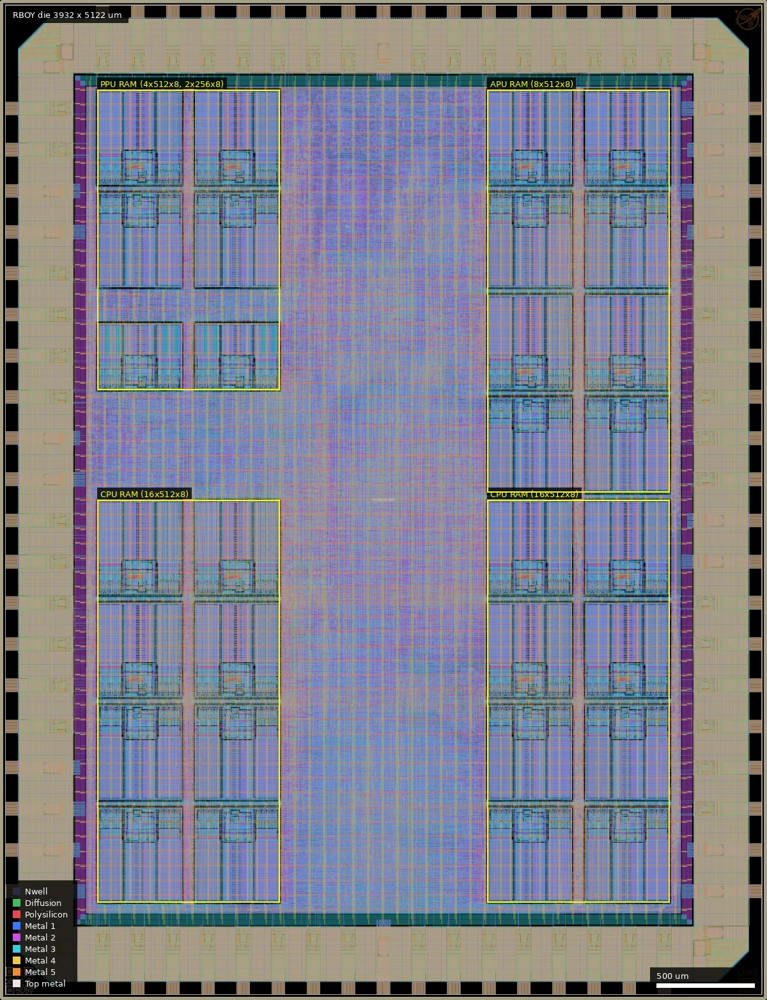
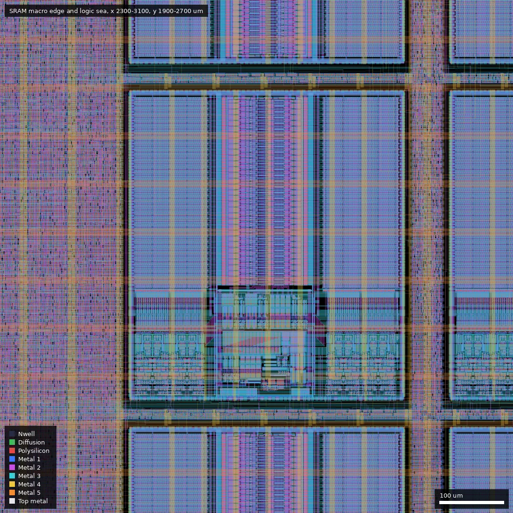
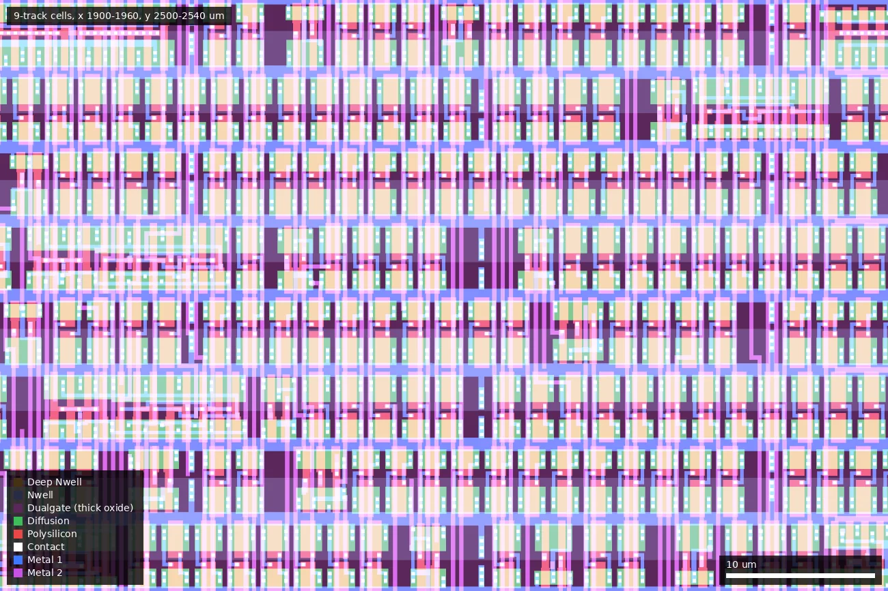

# RBOY: RISCBoy-180 (ws-run1)

| | |
|---|---|
| Repository | https://github.com/Wren6991/RISCBoy-180 @ 8c2bfda (main, last commit 2026-07-14; tags v1.0.rc1, v1.0-rc2) |
| Slot | 1x1 (die 3932 x 5122 um) |
| Top cell | chip_top |
| Licence in repo | Apache-2.0 (LICENSE file) |
| README | OK (140 words of own text; the long design diary is in `notes.md`) |
| Taped-out layout | RBOY_chip_top_12_6, 3932 x 5122 um, 1 placement on the G801 reticle |

## What the repo actually contains

RB180, a single-chip games console made by Luke Wren in a two-week effort on the first wafer.space shuttle (free slot, README acknowledgement). It reuses his RISCBoy design (iCE40 original) and adds an audio processor.

- Two Hazard3 RISC-V cores ("CPU" and "APU"), identical RV32IM_Zba_Zbb_Zbkb_Zbs_Zca_Zcb_Zclsd_Zilsd with single-cycle multiplier and branch predictor (`doc/rb180_datasheet.adoc`; claims the first public tapeout of Zilsd/Zclsd). Hazard3 JTAG DTM is replaced with Luke's Two-Wire Debug (TWD, 2 pads DIO/DCK) with a virtual UART channel.
- RISCBoy PPU (tiled backgrounds, affine sprites, scanline/palette RAMs) with SPI/quad/"octal" 8080 LCD output (`hdl/dispctrl`), parallel async-SRAM controller for up to 256 kB external SRAM (38 pads), boot ROM from SPI flash, streaming-SPI peripheral, UART, GPIO, timers, an audio pipeline (16-bit 48 kSa/s to 1.5 MSa/s 4-bit PWM with a first-order sigma-delta and filters).
- Flow: LibreLane Chip flow, `STD_CELL_LIBRARY: gf180mcu_fd_sc_mcu9t5v0` (9-track 5 V), 5 V only supply, 25 MHz clk_sys target (datasheet: "5V single-supply operation at up to 25 MHz (post-PnR STA, slow corner)"). Many hand-tuned config knobs and SDC tricks documented in `librelane/config.yaml`, `librelane/chip_top.sdc` and `notes.md`.
- Macros: foundry `gf180mcu_fd_ip_sram__sram512x8m8wm1` x28 and `sram256x8m8wm1` x2 (release rc2 netlist; both counts confirmed in the layout), via `hdl/mem/sram_wrapper.v` (CPU 8 kB, APU 4 kB, PPU memories); `gf180mcu_name_plate`, ws ID and logo macros. IO: 53 `gf180mcu_fd_io__bi_t`, 3 `in_s`, ws dvdd x8 / dvss x10. About 250,000 instances total (rc2 `chip_top.pnl.v`); the layout holds 69,949 logic and 179,358 filler cells.
- Scan cells without a scan chain: `librelane/gf180_scanflop_map.v` is a custom Yosys techmap that maps synchronous-set/clear/enable flops ("pseudo-DFFE") onto `sdffq/sdffrnq/sdffsnq` scan cells (SE as sync reset/enable select), because the stock flow lacks an enable/sync-reset flop mapping. Netlist: ~6,300 `sdff*` cells, ~300 plain `dffq`. This is not DFT (no scan chain); the SDC disables hold checks to the D or SI pins on the pseudo-DFFE flops (SCANMAP block in `notes.md`). A bug in this map (sync-set mapped as clear) was found in gate-level sim and fixed (commit "fuck fuck fuck fuck FUCK").
- Clocking structures: `hdl/clocks/clocks.v` with glitchless clock muxes (`hdl/cells/cell_clkmux_glitchless.v`) selecting padin_clk, x2/3 (`cell_clkdiv_3over2.v`), /2, or DCK for clk_sys and clk_audio independently; clock-root anchor buffers (`clkroot_anchor.v` instantiates `gf180mcu_fd_sc_mcu9t5v0__clkbuf_16`), false-path anchors, ICGs (`icgtn_4` x2 in the final netlist; clock gating was mostly removed with `NOCLOCKGATES`), DDR output cells, an async SRAM PHY with negedge flops. A planned programmable DCO ring oscillator is listed in the notes ("Maybe DCO ring osc") but not implemented (no oscillator in RTL or netlist; the layout contains no cells outside the stock library, the SRAM macros and the wafer.space ID/logo/name plate).
- Chip ID: IDCODE 0x00280035 readable over TWD. Software: boot ROM, tests (`software/tests/{iram,eram,flash}`), cocotb gate-level and RTL sims.
- **Post-tapeout material (committed June-July 2026)**: `pcb/bringup/` is a KiCad bring-up board (RP2350 picoprobe-style debug probe tunnelling TWD, level shifters, 5 V/3.3 V/external supply by jumper, SRAM, SPI flash, LCD, socket for the standard wafer.space COB-to-socket PCB), with `SPEC.md` stating its purposes: smoke test, "sweep voltages and get coarse V/F sweeps", validate 3.3 V operation (supply 3.0 to 5.5 V). `doc/rb180_datasheet.adoc` is a datasheet with pinout. No silicon test results are in the repo (checked docs and notes; the bring-up board has been drawn but no measured data committed).
- Releases: `v1.0.rc1` (chip_top.gds 157 MB, pnl.v) and `v1.0-rc2` (chip_top.gds 122 MB, nl.v, pnl.v); no metrics, libs or reports are attached. The taped-out layout is the rc2 GDS (see below); rc1 differs. The git history has commits after the 3 Dec deadline (a98e9bd ECO diodes on pad_DIO, 2025-12-18, and PCB work to July 2026), so HEAD is not the submitted state.

## Taped-out layout

| Measured | Value |
|---|---|
| Die | 3932 x 5122 um, one placement on reticle G801 (cell `RBOY_chip_top_12_6` at 24.012 mm, 15.606 mm) |
| Pad ring | 74 IO cells, all in the 1x1 ring: 53 `gf180mcu_fd_io__bi_t`, 3 `gf180mcu_fd_io__in_s` (left edge, one at y 4566 labelled DCK), 8 `gf180mcu_ws_io__dvdd`, 10 `gf180mcu_ws_io__dvss`; per edge: bottom 16 bi_t + 1 dvss, top 16 bi_t + 1 dvss, right 12 bi_t + 4 dvdd + 4 dvss, left 9 bi_t + 3 in_s + 4 dvdd + 4 dvss. Pad labels (Metal5) include SRAM_A[0..16], SRAM_DQ[0..15], SRAM_CSn/OEn/WEn, LCD_DAT[n], GPIO[n], AUDIO, DCK |
| Standard cells | `gf180mcu_fd_sc_mcu9t5v0` only (9-track, 5 V): 69,949 logic cells, 179,358 filler/decap cells (fill_1/2, fillcap_4 to 64). Largest types: nand2_1 17,153; clkinv_1 5,513; nor2_1 5,029; scan flops `sdffq_4` 2,132 + `sdffrnq_4` 2,110 + `sdffq_1` 1,954 (6,196 in these three types); `dffrnq_1` 463; `dlyc_1` 547 (hold buffers) |
| SRAM macros | 30 foundry macros: 28 x `sram512x8m8wm1` (431.86 x 484.88 um) and 2 x `sram256x8m8wm1` (431.86 x 340.88 um), placed at the coordinates in `librelane/config.yaml` |
| Custom / hand-drawn / analog | None. The only non-library top-level cells are the SRAM macros, `gf180mcu_name_plate` (3763,26), `gf180mcu_ws_ip__logo` (3763,4953) and `gf180mcu_ws_ip__id` (26,26) |
| Oxide, passives | Dualgate (55/0) and V5_XTOR (112/1) cover all gates of the logic cells (sampled in a 600 x 600 um box: 100 % of gate area); no thin-oxide-only logic. No MIM, no high-resistance poly layer, no DNWELL, no eFuse shapes in the layer list. Resistor (RES_MK, 990), diode (DIODE_MK, 1,277) and SAB (2,307) marker shapes exist; their bounding boxes lie in the IO ring bands, so they are inside the pad cells (not checked shape by shape) |

### Does it match the repository?

Yes, for the submitted tag, not for HEAD. The taped-out layout agrees instance for instance with the release asset `v1.0-rc2` (`chip_top.gds`, tag at 8d8606a, 2025-12-03 22:08 UTC): I counted every instance in the top cell by cell name (with `$n` suffixes removed) in both files: 906,676 instances in the release, 906,684 on the reticle, the extra 8 being wafer.space's seal ring and 7 fill cells; zero per-cell count differences. The earlier `v1.0.rc1` GDS does not match (for example nor2_1 5,029 here against 4,368 in rc1, 135 cells with different counts), which settles the earlier open question: the platform hash did not match either release file because the layout is rc2 after wafer.space post-processing (fill, seal ring, ID marks), not because of an unknown commit. HEAD (8c2bfda) is 43 commits after the rc2 tag.

The other repository claims check out: 30 SRAM macros (28 + 2) in the types stated; 53 bi_t, 3 in_s, 8 dvdd and 10 dvss pads; 9-track 5 V library only; no oscillator or other custom cell. The macro placements in `librelane/config.yaml` at HEAD equal the placements in the layout, which identifies each macro:

- CPU instruction/data RAM (`iram_u`, 16 x 512x8 = 8 kB): the two lower blocks, x 500-1432 and x 2500-3432, y 500-2560 um.
- APU RAM (`apu_u.ram_u`, 8 x 512x8 = 4 kB): right side, x 2500-3432, y 2600-4660 um.
- PPU scanline buffers (`scanbuf0/1`, 4 x 512x8): upper left, x 500-1432, y 3650-4660 um.
- PPU palette RAM (`pram_u`, 2 x 256x8): x 500-1432, y 3125-3466 um.

The CPU, APU, PPU, audio and bus logic are flattened into one sea of cells; the layout has no hierarchy below the die, so they cannot be separated visually. Roughly, the logic fills the centre column (x 1450-2500) and the gaps around the macros.

*Whole die in `full` style: the four groups of SRAM macros marked in yellow (CPU RAM lower left and lower right, APU RAM upper right, PPU RAM upper left), logic in the centre column, IO ring around the edge.*

*x 2300-3100, y 1900-2700 um: one 512x8 macro (centre) with its neighbours above and below, and the standard-cell sea to its left; macros are tightly butted, with their own power straps visible.*

*x 1900-1960, y 2500-2540 um, `detail` style: a mix of stock 9-track logic and filler cells, all under the Dualgate (thick-oxide) mask, the only transistor flavour used outside the pads.*

Test structures and measurable circuits: none are drawn on the die. The measurable items are whole-chip (the clock-select, SRAM bus and audio paths listed below) and the 30 SRAM macros, whose positions are given above.

## Authors and affiliations

| Person | Role | Affiliation | Source |
|---|---|---|---|
| Luke Wren | all RTL, flow tuning, PCB, docs (215 commits); author of Hazard3, RISCBoy, TwoWireDebug | not stated (GitHub: Cambridge, UK; no company) | git shortlog, copyright headers "Copyright (C) 2025 Luke Wren", `gh api users/Wren6991` |
| Leo Moser | template author, helped debug flow (82 commits) | notes.md calls him "Leo from wafer.space" | notes.md, AUTHORS.md |
| Tim Ansell, TrevorPeyton | 1 commit each | not stated | git shortlog |

## Value for GF180MCU characterisation and PDK development

### Verdict: Medium
A 250k-cell (70k logic) 9-track 5 V design with a documented intent to sweep supply voltage (3.0 to 5.5 V) and measure frequency, a timing-critical external-SRAM interface with documented STA, clock muxes/dividers that let an external clock be swept, and a custom scan-flop techmap. No purpose-built device or oscillator structures (confirmed in the layout: no MIM, high-resistance poly, DNWELL or custom cells), so not High. The 30 foundry SRAM macros, all in 5 V thick oxide, are the one extra measurable block.

### Test structures and measurable circuits
| Structure | Exercises | Access | Where |
|---|---|---|---|
| Whole-chip V/F sweep | gf180mcu_fd_sc_mcu9t5v0 delay vs VDD (3.0 to 5.5 V); Hazard3 critical path (~1 ns slow-corner violation at 41.7 ns, later closed, per notes) | CLK pad (selectable x1, x2/3, x1/2) and TWD debug to run self-checks | `pcb/bringup/SPEC.md`, `hdl/clocks`, `librelane/chip_top.sdc` |
| 53 bi_t pads, SRAM bus (16 DQ, 17 A), 25 MHz | IO cell `gf180mcu_fd_io__bi_t` drive/timing, output delays to pad (STA shows 2.6 ns pad delay at 2.87 pF load) | SRAM_* pads | `hdl/cells/async_sram_phy_gf180mcu.v`, `notes.md` |
| 30 SRAM macros (28 x 512x8, 2 x 256x8) | foundry SRAM at 5 V and at reduced VDD; vendor model bugs noted | via CPU/APU/PPU, TWD; positions: CPU RAM 16 macros lower left and lower right (y 500-2560 um), APU RAM 8 macros right (y 2600-4660), PPU 4 x 512x8 + 2 x 256x8 upper left | `hdl/mem/sram_wrapper.v`, `librelane/config.yaml`, layout |
| Glitchless clock muxes + 3/2 divider | functional clock structures; padin_clk and DCK domain crossings | CLK pad, DCK pad | `hdl/cells/*.v`, `hdl/clocks/clocks.v` |
| Audio 1.5 MHz PWM out, 4-bit | IO toggling, noise | AUDIO pad | `hdl/apu/aout` |

Simulation/STA results are not in the repo (no metrics or libs); only netlists and layout in releases, plus STA excerpts in `notes.md`, so comparison needs a re-run of the flow.

### Candidate PDK additions
- Techmap `librelane/gf180_scanflop_map.v` (enable / sync-set / sync-reset flops onto scan cells), a candidate for the PDK/LibreLane flow as it improves density; also latch regfile experience (no active-low latch in the library; CTS gave each latch its own inverter).
- Documented PDK/flow problems (from `notes.md`): (1) Magic and KLayout DRC report many violations inside the foundry standard-cell library, which the author believes are false positives of the DRC decks, filed as wafer-space/gf180mcu-project-template issue 34, plus one DRC from a relative placement of `sdffrnq_4` and `nand3_4`; (2) the pad model `gf180mcu_fd_io__bi_*` does not model PU/PD (issue filed); (3) the SRAM simulation model needs an extra CSn edge before first access, does not initialise internal variables and cannot be used for RTL sims, no preload (to be filed on the GF180MCU repo); (4) sram macros carve holes in PDN (extra straps on edges), SRAM PDN connection issues; (5) CTS only runs when YAML clock flags are given, clock-gate inference clocks roots, resizer seldom upsizes; (6) OpenSTA lacks `set_ideal_network`, `-through` on `set_output_delay`; (7) low default file-handle limit breaks Magic stream-out XOR; (8) KLayout DRC takes ~3 h and ~20 GB; (9) DRT crash on MacOS and KLayout-vs-Magic XOR on MacOS (to file).

### What would be needed to use it
Packaged or COB-on-socket part, the bring-up board in `pcb/bringup` (design only; no evidence it was built), a 5 V supply that can be swept and a clock source; TWD probe firmware is not in this repo (hacked picoprobe is referenced). Measurement of Fmax would use the debug-run software tests in `software/tests`.

## Notes and caveats

- 18 submodules (Hazard3 and its test suites, RISCBoy, libfpga, TwoWireDebug, fpgascripts); several nested ones for tests only; all cloned OK.
- `CLOCK_PERIOD: 20` in `config.yaml` is for the pad clock; clk_sys is constrained in the SDC (the notes say 41.67 ns, 24 MHz; datasheet says 25 MHz).
- The notes state timing was "within a nanosecond" at the slow corner on Day 13, then reported clean after the register-file change; no final STA report is shipped to confirm.
- The repo extends past the tapeout (PCB work to July 2026), so HEAD does not equal the submitted layout. The layout matches release `v1.0-rc2` exactly (checked instance by instance); the platform sha differs from the release file hashes only because wafer.space added fill, seal ring and ID marks.
