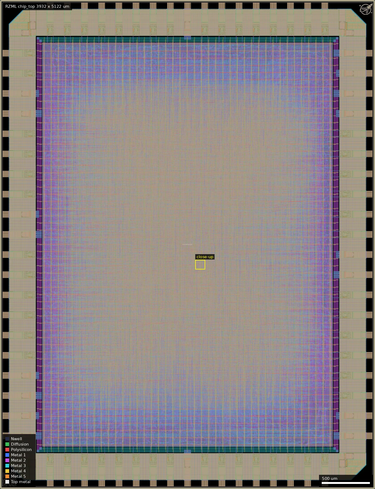
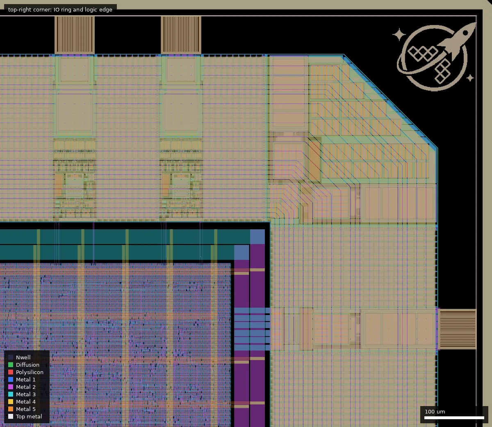

# RZML: LGN FashionMNIST - Logic Gate Network trained on FashionMNIST (ws-run1)

| | |
|---|---|
| Repository | https://gitlab.com/rejunity/ws0-lgn-fxnist-gf180mcu-tapeout @ ddbd922 (main, last commit 2025-12-20, "Chip 2nd iteration, PDK 1.6.6") |
| Slot | 1 x 1 |
| Top cell | `chip_top` |
| Taped-out layout | RZML_chip_top_12_2, 3932 x 5122 um, 1 placement(s) on the G801 reticle |
| Licence in repo | none (no LICENSE file; audit: MISSING) |
| README | Unmodified GitLab boilerplate. The audit's "OK, 989 words" is wrong: nothing in it describes the project. |

## What the repo actually contains
Three commits (Initial commit 19f4175, "Checksum" d444854, "Chip 2nd iteration, PDK 1.6.6" ddbd922). This repo is a delivery container for the final layout only:
- `chip_top.gds`, 228 MB, via Git LFS (the real file is present).
- `chip_top.md5`, `.sha1`, `.sha256` and a Makefile target that generates them. sha256 `f86c8f2d...c316f371f0` matches the file. The platform hash (`cc0cee0d...d7c7b1`) does not match it: the platform file is the repo GDS plus a seal ring and reticle wrapper (checked cell-by-cell below).
- `fxnist.info`, two provenance pointers: the design commit https://github.com/rejunity/ws0-lgn-fxnist/commit/0a26078af0cae4c6be2e6b62dcaf1fc5d8d385c7 ("Merge remote-tracking branch 'wafer-space/main'") and the template commit gf180mcu-project-template@01d1540 ("update PDK (1.6.5)"; the repo's commit message says PDK 1.6.6).
- `.gitattributes` (LFS rule).

**Published here:** the final layout, its checksums and these pointers.
**Not published here:**
- RTL, the LibreLane config, the trained network and training scripts.
- Netlist, SDC, logs and reports.
- Testbench and licence.

**Where the source lives:** the README says nothing about this (it is the stock GitLab text). Only `fxnist.info` names it: GitHub `rejunity/ws0-lgn-fxnist`, which I confirmed exists, is public and is Apache-2.0 ("FashionMNIST LGN on Wafer.Space GF180 shuttle"). It holds the wafer.space template tree plus `src/{chip_core.sv, lgn.v, net.v, popcount.v}`, `pth_to_verilog.py`, `npz_to_verilog.py` and several trained networks (`.npz`/`.pth`/`.v`, with test accuracy and shape in the file names, e.g. `binTestAcc8873 ... 2x12000`). Observed in that repo, not this one:
- `chip_core.sv` takes 8 pixel inputs plus `write_enable` (`~input[8]`), outputs 16 bits on `bidir_out[15:0]`, and drives the remaining bidirs with `~rst_n`.
- `librelane/config.yaml` has `CLOCK_PERIOD: 1000` (1 MHz) and `PL_TARGET_DENSITY_PCT: 10`.
- `src/net.v` is 1,122,998 bytes, the same size as the 2x12000 network. I take that as the deployed network (about 88.7% binary test accuracy per its file name; inferred, not confirmed).

**What the GDS shows (via `strings`, approximate):**
- Standard cells: `gf180mcu_fd_sc_mcu7t5v0` (about 44 cell types in use, about 83k filltie, about 10.5k buf_8, 7.6k nand2_1, 7.3k nor2_1, 7.1k xor2_1, 5.1k xor3_1, 3.6k dlyb_1).
- Pads: `gf180mcu_fd_io__bi_24t` (43 names), `in_c` (14), `in_s` (2), wafer.space `dvdd`/`dvss` (9/11 names).
- No SRAM macros.
- Net names such as `i_chip_core.lgn.calc_categories[0].sum_bits.y[...]` show a flat synthesised netlist.
- Very large amounts of fill (about 130k Metal4 fill cells).

## Taped-out layout

| Measured | Value |
|---|---|
| Die (reticle cell `RZML_chip_top_12_2`) | 3932 x 5122 um, 1 placement on the G801 reticle (24.012, 5.242 mm) |
| Pads / IO cells | 42 `gf180mcu_fd_io__bi_24t`, 13 `in_c`, 1 `in_s`, 4 `cor`, 8 `gf180mcu_ws_io__dvdd`, 10 `gf180mcu_ws_io__dvss`; 82 Pad shapes; labels `clk_PAD`, `rst_n_PAD`, `input_PAD[0..11]`, `bidir_PAD[0..41]`, VDD, VSS |
| Standard cells | `gf180mcu_fd_sc_mcu7t5v0` (7-track, 5 V): 88,407 logic cells in 37 cell families, 1,024 `dffq` flops, and 434,355 fill/tap/endcap/antenna cells (83,863 filltie, about 346k fill and decap cells, 2,332 antenna, 2,160 endcap, 226 tiel, 79 tieh) |
| SRAM macros | none |
| Oxide, passives | Dualgate and V5_XTOR on the 5 V library cells and IO cells only; no MIM, high-resistance poly or DNWELL; RES_MK/DIODE_MK markers come from the IO cells and antenna cells |
| Custom content | none: no hand-drawn devices; only the wafer.space logo and ID cells plus seal ring |

Overview of the whole die (style `full`). There is no macro and no visible block structure: the core is one placed-and-routed gate array. The Metal4 power stripes show as vertical lines.

Close-up of the top-right corner, box (3100, 4400) to (3932, 5122) um: two `bi_24t` pad cells on the top edge, a `cor` cell, the wafer.space logo cell (3762..3906, 4953..5096) and the power ring around the logic.

### What the design is, from the layout

A flat network of two-input and three-input gates feeding adder trees. There are no hierarchy levels inside the core (the only non-library cells are fill, pad, ID and logo cells). Cell mix (families, all drive strengths summed): `buf` 22,552, `xor2` 8,035, `nand2` 7,834, `nor2` 7,638, `clkbuf` 6,340, `xor3` 5,428, `oai21` 4,545, `aoi21` 4,421, `dlyb` 3,644, `xnor2` 3,015, `and2` 2,808, `clkinv` 2,280, `xnor3` 1,978, `or2` 1,881, `dffq` 1,024, `oai32` 881, others under 650. Reading the mix: the `nand2`/`nor2`/`and2`/`or2`/`xor2`/`xnor2`/`aoi21`/`oai21` cells are what two-input learned gates map to, and the many `xor3`/`xnor3` cells (7.4k) with `oai32`/`oai33` are the signature of the popcount (bit-count) adders that sum gate outputs into class scores (geometry and cell mix suggest this; I did not extract the netlist). The 1,024 flops are the only state; about 3,600 `dlyb` and 320 `dlyc` delay cells are hold-fix buffers, and about 22.5k `buf` cells plus 6.3k `clkbuf` are timing/fanout repair, which is why 26% of the logic cells are buffers. Of the 88k logic cells roughly 52k are functional gates (the rest are buffers, delay cells and flops). The exact layer sizes and the trained accuracy cannot be read from the layout.

### Does it match the repository?

The repo contains the GDS (`chip_top.gds`, 228,183,686 bytes via Git LFS; the working tree holds the real file and its size equals the LFS pointer's). I loaded it and compared flattened cell counts with the taped-out layout: all 523,922 standard-cell, IO and fill placements agree exactly per cell type, with the same die size (3932 x 5122 um) and the same pad ring. The only differences are the reticle-level wrapper and a `sealring` cell that wafer.space added. So the submitted layout is the repo GDS plus seal ring and marks; the platform hash differing from the repo checksum is consistent with that added wrapper. The GDS is on the default branch at the listed commit.

## Authors and affiliations
| Person | Role | Affiliation | Source |
|---|---|---|---|
| Renaldas Zioma ("rej", GitHub rejunity) | design and tape-out (all commits) | GitHub bio: "Research"; no company named | git log, gh api users/rejunity |
| Leo Moser | wafer.space template named in fxnist.info | not stated | fxnist.info |

## Value for GF180MCU characterisation and PDK development
### Verdict: Low
A large synthesised gate array (flat logic-gate network) on stock 7t5v0 cells with 1 MHz timing intent. It was not built for characterisation, and no sources or reports are in this repo.

### Test structures and measurable circuits
Nothing purpose-built. The only measurable is functional: feed images through the 8-bit pixel interface and compare the 16 outputs with the Python model (the upstream repo has it). A clock sweep would give a fmax figure for a very deep, wide synthesised logic cone. Simulation results to compare against are not in this repo.

### Candidate PDK additions
None. The layout has no custom devices, macros, MIM or resistors; the only angle for characterisation is the very large uniform 7-track 5 V logic block.

### What would be needed to use it
Packaged or bonded die. The upstream repo is needed for the net and the testbench. No pin map, test plan or measured results are in the GitLab repo.

## Notes and caveats
- The repo URL on the platform is GitLab; the sources are on GitHub; only `fxnist.info` links them.
- I did not read the upstream repo beyond its file list, `chip_core.sv`, the config and the README.
- The `strings` counts in the section above were approximate; the exact counts are in "Taped-out layout".
- The deployed network is inferred from the upstream repo file sizes; the layout shows only gate counts and cell types, not the layer sizes.
