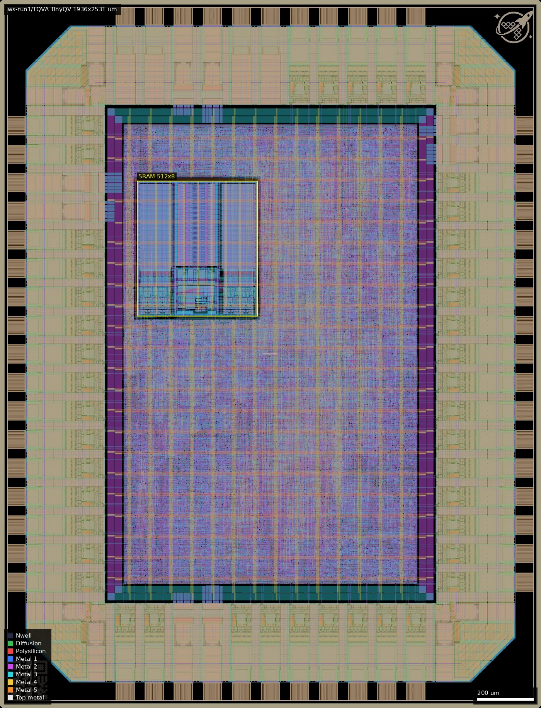
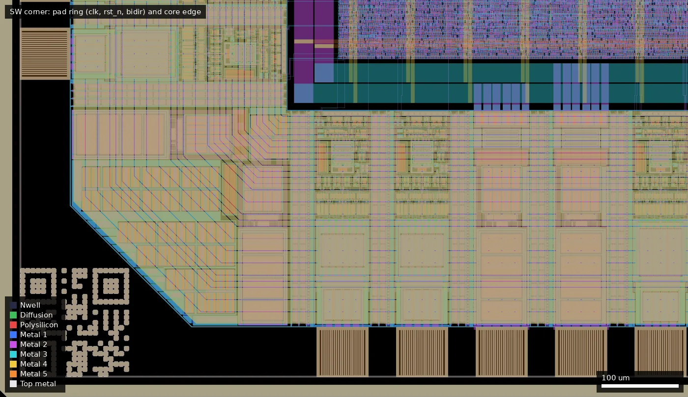
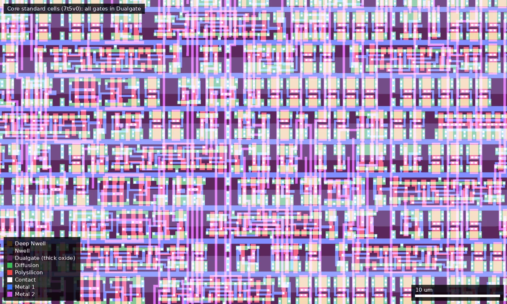

# TQVA: TinyQV - Crowdsourced Risc-V SoC (run 1)

| | |
|---|---|
| Repository | https://github.com/MichaelBell/ws01-tinyQV @ 2c8630b (main, last commit 2026-08-14); submodule `src/tinyQV` = https://github.com/MichaelBell/tinyQV @ 880b4f4 (2025-12-02) |
| Slot | 0.5 x 0.5 (quarter), `0p5x0p5` |
| Top cell | `chip_top` |
| Licence in repo | `LICENSE` = Apache-2.0 (GitHub detection and file present; no per-file claim recorded by the audit) |
| Taped-out layout | `TQVA_chip_top_14_8`, 1936 x 2531 um, 1 placement on the G801 reticle |
| README | OK: 1633 words, about 916 of them project-specific on top of the wafer.space template README |

## What the repo actually contains

TinyQV is an RV32EC RISC-V core that fetches directly from QSPI flash and uses one or two QSPI PSRAMs (APS6404) as RAM, wrapped as a Tiny Tapeout style SoC (`tt_um_MichaelBell_tinyQV`, `src/project.v`) with peripherals taken from the Tiny Tapeout Risc-V competition. The repo is the wafer.space `gf180mcu-project-template` (Leo Moser) with the TinyQV SoC dropped into `chip_core.sv`.

The same repository holds all slot sizes, so ws-run1 TQVA/TQVB/TQVC and ws-run2 TQVA/TQVC share one source tree. **How the slot variants are produced:** there are no branches or per-slot RTL (only `main` and one tag). The slot is chosen by the `SLOT` variable in the Makefile (`AVAILABLE_SLOTS = 1x1 0p5x1 1x0p5 0p5x0p5`, default `0p5x0p5`), which runs `librelane librelane/slots/slot_${SLOT}.yaml librelane/config.yaml`. Each `librelane/slots/slot_*.yaml` sets `DIE_AREA`, `CORE_AREA`, the `PAD_NORTH/EAST/SOUTH/WEST` pad order and a `VERILOG_DEFINES: SLOT_xxx`; `src/slot_defines.svh` turns that define into the pad counts (`NUM_DVDD_PADS`, `NUM_DVSS_PADS`, `NUM_INPUT_PADS`, `NUM_BIDIR_PADS`, `NUM_ANALOG_PADS`). `src/chip_core.sv` is parameterised on those counts and only wires up the first 33 bidir pads and the first two input pads, so a larger slot just means more unused pads (bidir >= 33: input, input-enable off, pull-down on; analog pads left unconnected). CI (`.github/workflows/ci.yml`) builds all four slots as a matrix. The three built layouts are committed as `gds/tinyqv_quarter.gds.gz` (0p5x0p5), `gds/tinyqv_hwidth.gds.gz` (0p5x1) and `gds/tinyqv_hheight.gds.gz` (1x0p5); there is no 1x1 build. I matched each file to a slot from the pad-cell counts in `strings` (see the variant paragraph below). These are the same three files attached to the GitHub release `ws-run1`.

Technology choices (from `librelane/config.yaml` and the layouts):

- Standard cells: `gf180mcu_fd_sc_mcu7t5v0` (7-track, 5 V cell library from the PDK's default flow), but timing is closed for the **3.3 V** supply: `DEFAULT_CORNER: nom_tt_025C_3v30`, with a 3v30 corner set (tt 25C 3.30 V, ss -40C and 125C 3.00 V, ff -40C and 125C 3.60 V) alongside the 5 V corners (tt 5.00, ss 125C 4.50, ff -40C 5.50). 24 STA corners are listed; resizer corners are tt and ff only (the config comment says setup margins are large "as not resizing on slow corners").
- Clock: `CLOCK_PERIOD: 41.6` (24 MHz). The README says: intended to run at 3.3 V and 24 MHz, "although this timing is only met at the nominal corner", and "should also work at up to around 40 MHz at 5 V" (a claim; no 5 V frequency run is in the repo).
- IO pads: `gf180mcu_fd_io__bi_24t` for all bidirs, `in_c` / `in_s` (clock is a Schmitt `in_s`) for inputs, `gf180mcu_fd_io__asig_5p0` analog pads (present, unused), wafer.space `gf180mcu_ws_io__dvdd` / `dvss` power pads, all on one VDD/VSS net. Pad pull-ups/downs are driven from the core (`input_pu`, `bidir_pu` etc.), used e.g. for sensible QSPI default latency.
- SRAM: exactly one foundry macro `gf180mcu_fd_ip_sram__sram512x8m8wm1` (512 x 8, the "Scratch RAM" at 0xFFFFC00-0xFFFFDFF, wrapped in `src/tinyQV/cpu/internal_ram.v`, instance `i_chip_core.tt.i_tinyqv.cpu.i_scratch.i_sram`, placed at (490, 1400) um). This is the 5 V SRAM macro, but the config supplies its `3v30` and `ss_n40C_3v00`, `ss_125C_3v00`, `ff_n40C_3v60`, `ff_125C_3v60` liberty views, so it is used at 3.3 V. The Config comment says to specify the SRAM in `pdn_cfg.tcl` and `PDN_MACRO_CONNECTIONS`.
- Core logic is synthesised (Yosys, `SYNTH_STRATEGY: "AREA 3"`) from `src/tinyQV` plus `src/user_peripherals`: UART, SPI, PWM, Gamepad Pmod, AY8913 and PWL synth audio, PRISM, Pulse TX, 256x120 VGA graphics (VGA Pmod), VGA tester, AffineX, CORDIC, universal decoder, DWARF line-table accelerator. Netlist references in the quarter GDS include about 3000 `dffq_1`, 430 `dffrnq_1`, about 950 `latq_1` and about 900 `dly*` hold-fix buffers (`strings` counts, approximate).
- Wafer.space blocks: `ip/gf180mcu_ws_ip__id` (chip ID) and `ip/gf180mcu_ws_ip__logo`.

Other directories: `cocotb/` (cocotb RTL and gate-level testbenches, `chip_top_tb.py`, `chip_core_tb.py`, TinyQV `test.py`), `scripts/` (KLayout render script), `flake.nix`/`shell.nix` (Nix environment with Leo Moser's LibreLane branch), `.github/` CI. Flow settings: PDK from `wafer-space/gf180mcu` tag `PDK_TAG ?= 1.6.5` (`make clone-pdk`), LibreLane Chip flow; KLayout antenna check is **disabled** in `meta.substituting_steps` (commit 66a0b66 "Disable antenna check"), Magic DRC kept (4c294b6 "Keep Magic DRC"); `DRT_ANTENNA_REPAIR_ITERS: 10`.

What is **not** in the repo: no LibreLane run logs, STA/DRC/LVS/antenna reports, no timing numbers, no silicon bring-up or test results, no run-2 specific files. Verification evidence is limited to the cocotb tests and CI.

Known limitations stated by the author: README (added 2026-08-14, after tape-out): "Due to an implementation bug, multi-word loads and stores can't be used against Scratch RAM." Timing is met at the nominal corner only.

## Taped-out layout

| Measured in `layout/TQVA.oas` | |
|---|---|
| Die | 1936 x 2531 um (4.90 mm2), reticle cell `TQVA_chip_top_14_8`, one placement at (28.004, 20.788) mm |
| Pads / IO cells | 38 `gf180mcu_fd_io__bi_24t` bidir, 5 `in_c` + 1 `in_s` inputs (`clk_PAD` is the `in_s`; `rst_n_PAD` and 4 `input_PAD` are `in_c`), 4 `asig_5p0` analog, 4 `gf180mcu_ws_io__dvdd` + 4 `dvss`, 4 `fd_io__cor` corners, 364 IO fill cells. Clock and reset are on the south edge (x 448 and 552 um), `bidir_PAD[0..6]` follow along the south edge, `bidir_PAD[7..21]` run up the east edge, `analog_PAD[0..3]` and `bidir_PAD[22..26]` are on the north edge, `input_PAD`, `bidir_PAD[27..37]` on the west edge (Metal5 pad labels) |
| Standard cells | all `gf180mcu_fd_sc_mcu7t5v0` (7-track, 5 V library): 98,296 placements, of which 35,711 are logic cells and 62,585 are fill, tap, end-cap and decap cells (25,031 `fillcap_*`, 9,657 `filltie`, 1,098 `endcap`) |
| Sequential cells | 3,464 flip-flops (2,987 `dffq_1`, 430 `dffrnq_1`, 47 other sizes/types), 955 `latq_1` latches, 937 `dly*` delay cells (756 `dlyb_1`) |
| SRAM | 1 x `gf180mcu_fd_ip_sram__sram512x8m8wm1`, 431.86 x 484.88 um at (490, 1400) to (921.86, 1884.88) |
| Transistor flavours | 5 V/6 V thick oxide only. In a 400 x 400 um sample of the core (1000..1400, 500..900), all 28,114 merged Poly2 shapes lie inside Dualgate (55/0) and inside V5_XTOR (112/1); both layers are one polygon over that box. Whole die: Dualgate 2.83 mm2, V5_XTOR 1.70 mm2. These are 5 V-library devices run at the 3.3 V supply (as `config.yaml` implies) |
| Not present | no DNWELL, no MIM (no layers in the file), no high-resistance poly, no BJT, no custom (non-library) cells. `RES_MK` (808 shapes) and `DIODE_MK` (823) markers come from the IO cells (ESD), not from user circuits (inferred from the 44 pads; not traced shape by shape) |
| Wafer.space blocks | `gf180mcu_ws_ip__logo` at (1766.75, 2361.75)-(1910, 2505) and `gf180mcu_ws_ip__id` (QR-style ID) at (26, 26)-(168.8, 168.8), seal ring and fill |

The core is one flat sea of placed cells (hierarchy is flattened by the flow; no `tt_um_*` or peripheral hierarchy survives in cell or net names, and only pad names are labelled), so the individual peripherals (UART, SPI, VGA, AY8913 and so on) cannot be located separately from the layout. The only identifiable block in the core is the SRAM.

### Does it match the repository?

Yes. `releases/ws-run1/tinyqv_quarter.gds.gz` is byte-identical (after gunzip) to `gds/tinyqv_quarter.gds.gz` at commit 3a0985e (2025-12-15, the last commit touching `gds/`, still in HEAD 2c8630b). The top cell of that GDS (`chip_top`) and the taped-out cell have identical placement counts for every child cell type after stripping the `$n` suffixes (264 distinct children, including the SRAM, all 38 `bi_24t`, 4 `asig_5p0`, all logic cells, the logo and ID blocks). The XOR of the taped-out layout against the repo GDS is zero on the physical layers that the flow draws (Contact, Via1-Via4, Pad, Dualgate, V5_XTOR, Nwell, Pplus, Nplus, SAB). It is non-zero only on COMP, Poly2 and Metal1-Metal5, where wafer.space regenerated its dummy fill (e.g. COMP differs by 238,125 um2, Metal1 by 157,105 um2). So the layer-level differences are fill, not design. This also resolves the earlier worry about the platform sha256 not matching the repo hash: the platform file is the fill-regenerated version of this GDS. Only the quarter-slot file belongs to this project; the earlier statement that the slot-to-file mapping was inferred is now checked from the layout.

## Authors and affiliations

| Person | Role / contribution | Affiliation | Source |
|---|---|---|---|
| Mike Bell (GitHub `MichaelBell`) | TinyQV core, SoC integration, this port (37 of 115 commits) | not stated (GitHub profile has no company or bio) | `AUTHORS.md`, `git shortlog`, `gh api users/MichaelBell` |
| Leo Moser (`leomoser`) | wafer.space project template, padring, flow and CI (76 commits) | not stated in repo | `AUTHORS.md`, `git shortlog` |
| Tim 'mithro' Ansell, TrevorPeyton | one commit each in template history | not stated | `git shortlog` |
| Adam Gebregziaber (`Adhaywe`), Han (`HX2003`), htfab, Ken Pettit (`kdp1965`), Laurie Hedge (`laurie-hedge`), Maciej Lewandowski (`mlewandowski0`), Matt Venn (`mattvenn`), Rebecca G. Bettencourt (`RebeccaRGB`), Renaldas Zioma (`rejunity`), Toivo Henningsson (`toivoh`) | TinyQV peripherals from the Tiny Tapeout Risc-V competition | not stated in the repo (Renaldas Zioma's GitHub bio says "Research", no company named) | `AUTHORS.md` (peripherals list), `gh api users/rejunity` |

## Value for GF180MCU characterisation and PDK development

### Verdict: Low

Ordinary synthesised digital on stock `gf180mcu_fd_sc_mcu7t5v0` cells with one foundry SRAM macro; nothing was built for characterisation and there are no analog or probe structures. The useful parts are functional-and-fmax data points: a ~100k-cell-reference SoC closed at 24 MHz for 3.3 V on 5 V-library cells, and the 5 V SRAM macro used at 3.3 V.

### Test structures and measurable circuits

| Structure | What it exercises | Access | Where |
|---|---|---|---|
| Whole-chip fmax at 3.3 V | 7t5v0 standard-cell delay at VDD = 3.3 V; compare with nom/ss/ff STA (README: met at nominal corner only, target 24 MHz) | CLK pad (`clk_PAD`, Schmitt `in_s`), run code from QSPI flash, UART on `bidir[25]`/`input[0]`, debug UART on `bidir[27]` | `librelane/config.yaml`, `librelane/chip_top.sdc`, `src/chip_core.sv` |
| Scratch RAM `sram512x8m8wm1` at 3.3 V | foundry 5 V SRAM macro functionality, access time and retention at 3.3 V (liberty `3v30`/`ss`/`ff` views supplied in config) | CPU load/store to 0xFFFFC00-0xFFFFDFF via UART monitor; byte accesses only because of the documented multi-word bug | `src/tinyQV/cpu/internal_ram.v`, config `MACROS` |
| `bi_24t` pads driving QSPI at up to 24 MHz | IO cell drive/timing at 3.3 V (SCK on `bidir[11]` has a relaxed 18 % output delay in the SDC) | QSPI flash/PSRAM pins `bidir[8..15]` | `librelane/chip_top.sdc` |
| Latch-based and flop logic mix (955 latches, 3464 flops) | basic functional yield | normal operation | GDS cell names |

Simulation results that silicon could be compared against: none stored in the repo (no STA or SDF output, no logs). The design inputs (SDC, 24 liberty corners) are there, so a run could reproduce them.

### Candidate PDK additions

Nothing new. Config workarounds that are mostly inherited from the wafer.space template: `MAGIC_GDS_FLATGLOB` list that flattens foundry SRAM sub-cells because "DUALGATE drawn into high-level cells" would show 3.3 V devices to Magic; `KLAYOUT_FILLER_OPTIONS: Metal2_ignore_active` because the minimum Metal2 density cannot be met (dummy metal moved to active metal during the precheck); `MAGIC_EXT_UNIQUE: notopports`; a commented-out OpenROAD bug workaround (issue 8229, `PL_TIME_DRIVEN`/`PL_ROUTABILITY_DRIVEN`). Project-specific: KLayout antenna check disabled and `DRT_ANTENNA_REPAIR_ITERS: 10`; large hold margins (`PL_RESIZER_HOLD_SLACK_MARGIN: 0.25`) and setup margins (`PL_RESIZER_SETUP_SLACK_MARGIN: 5.75`) because the resizer does not run on slow corners.

### What would be needed to use it

Packaged or bonded die on the wafer.space breakout board, 3.3 V supply, a 24 MHz clock source, a QSPI flash (e.g. WS25Q128JVSIQ) and one or two APS6404 PSRAMs on the Tiny Tapeout-style pinout from the README, a UART adapter, and RISC-V test firmware (not in this repo; the TinyQV tool chain lives upstream). To test fmax or the SRAM you would sweep the clock and supply while running a self-checking program; no such program is provided. Probing the SRAM macro alone is not possible (it is only reachable through the core).

## Notes and caveats

- Which GDS file belongs to which project: now checked. The taped-out layout has the same child-cell counts as `gds/tinyqv_quarter.gds.gz`; the platform hash differs from the repo GDS hash only because wafer.space regenerated the dummy fill (XOR is zero on all non-fill layers).
- Run-1 vs run-2 differences are not documented in the repo; comparing the layouts shows that ws-run2/TQVA is the same design with a different chip-ID block (see that project's summary).
- The repo has no run logs, so DRC/LVS/timing status of the submitted layout is unverified (this layout pass did not run DRC or LVS) (the README's "only at nominal corner" statement is the only timing evidence).
- Unused inputs 2 and later on the core side have neither pull-up nor pull-down set in `chip_core.sv` (`input_pu`/`input_pd` are 0), so they float unless driven externally.
- `AUTHORS.md` is stated by the repo to be non-exhaustive.

## Variant: this submission

**This submission (ws-run1/TQVA, quarter slot).** Built with `SLOT=0p5x0p5`: die 1936 x 2531 um, core area 442..1494 x 442..2089 um, 4 DVDD + 4 DVSS pad pairs, 4 input pads, 38 bidir pads, 4 analog pads. The matching pre-built layout is `gds/tinyqv_quarter.gds.gz` (also the release asset `tinyqv_quarter.gds.gz`): `strings` shows 39 `bi_24t` names (38 pads + the cell definition), 5 `asig_5p0` names (4 pads + definition), 2 `sram512x8m8wm1` names and 98,296 placements of `gf180mcu_fd_sc_mcu7t5v0__*` cells in the taped-out layout (35,711 logic, 62,585 fill/tap/decap). The other two slot GDS files in `gds/` are not this project. The sha256 on the platform (`9888...bbb7b`) does not equal the sha256 of the decompressed repo GDS (`8a633454...da0ed`); the layout comparison above shows the difference is regenerated dummy fill only. This is the smallest die of the family and has the least spare area: 33 of the 38 bidir pads are used by the design.
