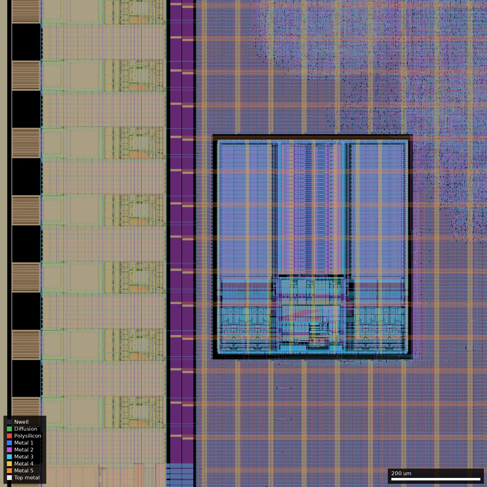
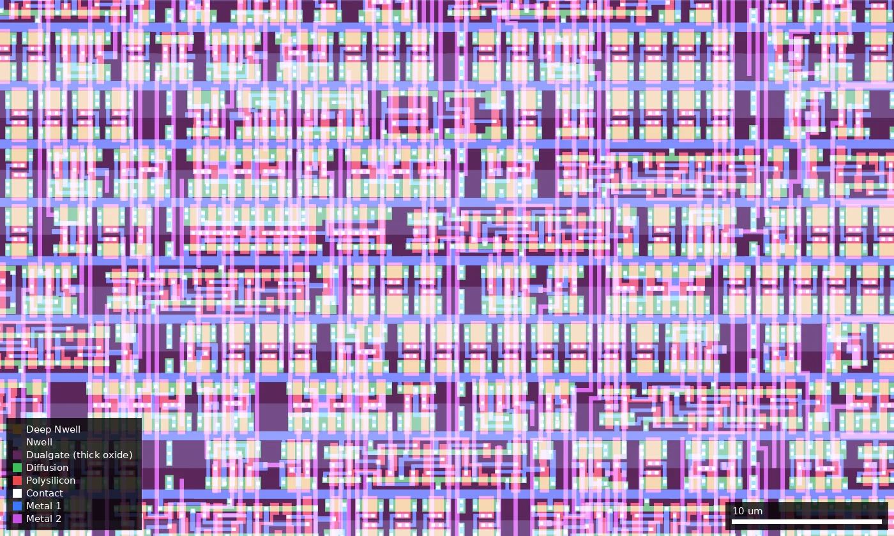

# TQVB: TinyQV - Crowdsourced Risc-V SoC (0.5x1) (run 1)

| | |
|---|---|
| Repository | https://github.com/MichaelBell/ws01-tinyQV @ 2c8630b (main, last commit 2026-08-14); submodule `src/tinyQV` = https://github.com/MichaelBell/tinyQV @ 880b4f4 (2025-12-02) |
| Slot | 0.5 x 1 (half width), `0p5x1` |
| Top cell | `chip_top` |
| Licence in repo | `LICENSE` = Apache-2.0 (GitHub detection and file present; no per-file claim recorded by the audit) |
| Taped-out layout | `TQVB_chip_top_14_6`, 1936 x 5122 um, 1 placement on the G801 reticle (at x 28.004 mm, y 15.606 mm) |
| README | OK: 1633 words, about 916 of them project-specific on top of the wafer.space template README |

## What the repo actually contains

TinyQV is an RV32EC RISC-V core that fetches directly from QSPI flash and uses one or two QSPI PSRAMs (APS6404) as RAM, wrapped as a Tiny Tapeout style SoC (`tt_um_MichaelBell_tinyQV`, `src/project.v`) with peripherals taken from the Tiny Tapeout Risc-V competition. The repo is the wafer.space `gf180mcu-project-template` (Leo Moser) with the TinyQV SoC dropped into `chip_core.sv`.

The same repository holds all slot sizes, so ws-run1 TQVA/TQVB/TQVC and ws-run2 TQVA/TQVC share one source tree. **How the slot variants are produced:** there are no branches or per-slot RTL (only `main` and one tag). The slot is chosen by the `SLOT` variable in the Makefile (`AVAILABLE_SLOTS = 1x1 0p5x1 1x0p5 0p5x0p5`, default `0p5x0p5`), which runs `librelane librelane/slots/slot_${SLOT}.yaml librelane/config.yaml`. Each `librelane/slots/slot_*.yaml` sets `DIE_AREA`, `CORE_AREA`, the `PAD_NORTH/EAST/SOUTH/WEST` pad order and a `VERILOG_DEFINES: SLOT_xxx`; `src/slot_defines.svh` turns that define into the pad counts (`NUM_DVDD_PADS`, `NUM_DVSS_PADS`, `NUM_INPUT_PADS`, `NUM_BIDIR_PADS`, `NUM_ANALOG_PADS`). `src/chip_core.sv` is parameterised on those counts and only wires up the first 33 bidir pads and the first two input pads, so a larger slot just means more unused pads (bidir >= 33: input, input-enable off, pull-down on; analog pads left unconnected). CI (`.github/workflows/ci.yml`) builds all four slots as a matrix. The three built layouts are committed as `gds/tinyqv_quarter.gds.gz` (0p5x0p5), `gds/tinyqv_hwidth.gds.gz` (0p5x1) and `gds/tinyqv_hheight.gds.gz` (1x0p5); there is no 1x1 build. I matched each file to a slot from the pad-cell counts in `strings` (see the variant paragraph below). These are the same three files attached to the GitHub release `ws-run1`.

Technology choices (from `librelane/config.yaml` and the layouts):

- Standard cells: `gf180mcu_fd_sc_mcu7t5v0` (7-track, 5 V cell library from the PDK's default flow), but timing is closed for the **3.3 V** supply: `DEFAULT_CORNER: nom_tt_025C_3v30`, with a 3v30 corner set (tt 25C 3.30 V, ss -40C and 125C 3.00 V, ff -40C and 125C 3.60 V) alongside the 5 V corners (tt 5.00, ss 125C 4.50, ff -40C 5.50). 24 STA corners are listed; resizer corners are tt and ff only (the config comment says setup margins are large "as not resizing on slow corners").
- Clock: `CLOCK_PERIOD: 41.6` (24 MHz). The README says: intended to run at 3.3 V and 24 MHz, "although this timing is only met at the nominal corner", and "should also work at up to around 40 MHz at 5 V" (a claim; no 5 V frequency run is in the repo).
- IO pads: `gf180mcu_fd_io__bi_24t` for all bidirs, `in_c` / `in_s` (clock is a Schmitt `in_s`) for inputs, `gf180mcu_fd_io__asig_5p0` analog pads (present, unused), wafer.space `gf180mcu_ws_io__dvdd` / `dvss` power pads, all on one VDD/VSS net. Pad pull-ups/downs are driven from the core (`input_pu`, `bidir_pu` etc.), used e.g. for sensible QSPI default latency.
- SRAM: exactly one foundry macro `gf180mcu_fd_ip_sram__sram512x8m8wm1` (512 x 8, the "Scratch RAM" at 0xFFFFC00-0xFFFFDFF, wrapped in `src/tinyQV/cpu/internal_ram.v`, instance `i_chip_core.tt.i_tinyqv.cpu.i_scratch.i_sram`, placed at (490, 1400) um). This is the 5 V SRAM macro, but the config supplies its `3v30` and `ss_n40C_3v00`, `ss_125C_3v00`, `ff_n40C_3v60`, `ff_125C_3v60` liberty views, so it is used at 3.3 V. The Config comment says to specify the SRAM in `pdn_cfg.tcl` and `PDN_MACRO_CONNECTIONS`.
- Core logic is synthesised (Yosys, `SYNTH_STRATEGY: "AREA 3"`) from `src/tinyQV` plus `src/user_peripherals`: UART, SPI, PWM, Gamepad Pmod, AY8913 and PWL synth audio, PRISM, Pulse TX, 256x120 VGA graphics (VGA Pmod), VGA tester, AffineX, CORDIC, universal decoder, DWARF line-table accelerator. Netlist references in the quarter GDS include about 3000 `dffq_1`, 430 `dffrnq_1`, about 950 `latq_1` and about 900 `dly*` hold-fix buffers (`strings` counts, approximate).
- Wafer.space blocks: `ip/gf180mcu_ws_ip__id` (chip ID) and `ip/gf180mcu_ws_ip__logo`.

Other directories: `cocotb/` (cocotb RTL and gate-level testbenches, `chip_top_tb.py`, `chip_core_tb.py`, TinyQV `test.py`), `scripts/` (KLayout render script), `flake.nix`/`shell.nix` (Nix environment with Leo Moser's LibreLane branch), `.github/` CI. Flow settings: PDK from `wafer-space/gf180mcu` tag `PDK_TAG ?= 1.6.5` (`make clone-pdk`), LibreLane Chip flow; KLayout antenna check is **disabled** in `meta.substituting_steps` (commit 66a0b66 "Disable antenna check"), Magic DRC kept (4c294b6 "Keep Magic DRC"); `DRT_ANTENNA_REPAIR_ITERS: 10`.

What is **not** in the repo: no LibreLane run logs, STA/DRC/LVS/antenna reports, no timing numbers, no silicon bring-up or test results, no run-2 specific files. Verification evidence is limited to the cocotb tests and CI.

Known limitations stated by the author: README (added 2026-08-14, after tape-out): "Due to an implementation bug, multi-word loads and stores can't be used against Scratch RAM." Timing is met at the nominal corner only.

## Taped-out layout

| Measured in `layout/TQVB.oas` | |
|---|---|
| Die | 1936 x 5122 um (9.92 mm2), reticle cell `TQVB_chip_top_14_6`, 1 placement on the G801 reticle |
| Pads / IO cells | 44 `gf180mcu_fd_io__bi_24t` bidir, 5 `in_c` + 1 `in_s` inputs (`clk_PAD` is the `in_s`), 6 `asig_5p0` analog, 8 `gf180mcu_ws_io__dvdd` + 8 `dvss`, 4 `fd_io__cor` corners, 774 IO fill cells. South edge: `clk_PAD` (x 485 um), `rst_n_PAD` (623), `input_PAD[0..3]` (761..1451); east edge: `bidir_PAD[0..21]` (y 509..4613); north edge: `analog_PAD[5..0]` (x 485..1451); west edge: `bidir_PAD[22..43]` (y 4613..509). The two east/west columns have gaps in the pad pitch where the 8+8 power pads sit |
| Standard cells | all `gf180mcu_fd_sc_mcu7t5v0`: 159,384 placements, 35,416 logic cells and 123,968 fill, tap, end-cap and decap cells |
| Main logic cell types | 8,753 `nand2_1`, 3,208 `clkinv_1`, 3,174 `oai21_1`, 2,991 `dffq_1`, 434 `dffrnq_1`, 955 `latq_1` latches, 801 `dlyb_1` + 140 `dlya_1` delay cells |
| SRAM | 1 x `gf180mcu_fd_ip_sram__sram512x8m8wm1`, 431.86 x 484.88 um at (490, 1400) to (921.86, 1884.88) |
| Transistor flavours | 5 V/6 V thick oxide only. In a 400 x 400 um core sample (1000..1400, 2600..3000) all 28,325 merged Poly2 shapes (51,647 um2) lie inside Dualgate (55/0) and V5_XTOR (112/1); the 7t5v0 library run at the 3.3 V supply |
| Not present | no DNWELL, MIM, high-resistance poly, BJT or custom (non-library) cells: none of those layers exists in the file (layer list in `layout.json`). `RES_MK` (988 shapes), `DIODE_MK`, `MOS_CAP_MK` and `ESD_MK` markers belong to the IO cells and the SRAM macro (not traced shape by shape) |
| Wafer.space blocks | `gf180mcu_ws_ip__logo` (143.25 um square, NE corner at (1766.75, 4952.75)) and `gf180mcu_ws_ip__id` (142.8 um square, at (26, 26)-(168.8, 168.8)), seal ring and fill |

The core is a flat sea of placed cells (hierarchy flattened by the flow; only pad names are labelled), so individual peripherals cannot be located. The only identifiable core block is the SRAM. The placed logic forms a blob of roughly 1000 x 1700 um in the middle of the 1052 x 4238 um core (about x 450..1490, y 1650..3350 um, see the overview); the rest of the core (all of it north of y 3400 and south of the SRAM) is filler, tap and decap cells, which is why 124k of the 159k placements are fill.

### Does it match the repository?

Yes. The repo's `gds/tinyqv_hwidth.gds.gz` at 3a0985e (2025-12-15, the last commit touching `gds/`, so it is also in the designs.csv commit 2c8630b) is the 0.5x1 build: top cell `chip_top`, 1936 x 5122 um, and the same 255 distinct child cell types with identical placement counts to the taped-out cell once `$n` suffixes are stripped (473,729 top-level placements in both). XOR of the taped-out layout against that GDS (flattened, merged) is zero on Contact, Via1-Via4, Pad, Nwell, Pplus, Nplus, Dualgate and V5_XTOR; it is non-zero on COMP (0.44 mm2) and Poly2 (0.28 mm2) and Metal1-Metal5 (e.g. Metal1 0.27 mm2), which is wafer.space's regenerated dummy fill. So the layer-level differences are fill, not design, and the earlier "inferred from pad counts" statement is now checked directly.

### What the 0.5x1 variant adds over the quarter slot (ws-run1/TQVA) and the 1x0.5 slot (TQVC)

The logic and SRAM are the same in all three; the differences are in the floorplan. TQVA and TQVC figures are from their summaries.

| | Quarter (TQVA) | 1x0.5 (TQVC) | 0.5x1 (TQVB) |
|---|---|---|---|
| Die | 1936 x 2531 um | 3932 x 2531 um | 1936 x 5122 um |
| Bidir pads | 38 | 46 | 44 |
| Power pad pairs (DVDD + DVSS) | 4 | 8 | 8 |
| Input / analog pads | 5 `in_c` + 1 `in_s` / 4 | same / 4 | same / 6 |
| SRAM | 1 x 512x8 | 1 x 512x8 | 1 x 512x8 |
| Logic cells | 35,711 | 36,116 | 35,416 |
| `dffq_1` / `latq_1` / `dlyb_1` | 2,987 / n.s. / 756 | 2,971 / 955 / 761 | 2,991 / 955 / 801 |
| Fill/tap/decap cells | 62,585 | 137,094 | 123,968 |

So the 0.5x1 slot adds no peripherals and no memory: it adds 6 bidir pads and 2 analog pads over TQVA, 4 more power pad pairs and about 2.7 mm2 more (mostly empty) core (4.46 mm2 against 1.73 mm2). Of the 44 bidir pads only `bidir_PAD[0..32]` are used by the SoC; the 11 pads `bidir_PAD[33..43]` (west edge, y 509..2333) are tied off as inputs with pull-down, and the 6 analog pads are unconnected. Each slot is a separate synthesis and placement run (logic cell counts differ by up to 700, TQVB being the smallest), so timing and power are not directly comparable between the variants. TQVB is the only one of the three with six analog pads, which makes it the only variant where bare analog pads (2 x 3 on the north edge) are accessible, though nothing is behind them.

## Authors and affiliations

| Person | Role / contribution | Affiliation | Source |
|---|---|---|---|
| Mike Bell (GitHub `MichaelBell`) | TinyQV core, SoC integration, this port (37 of 115 commits) | not stated (GitHub profile has no company or bio) | `AUTHORS.md`, `git shortlog`, `gh api users/MichaelBell` |
| Leo Moser (`leomoser`) | wafer.space project template, padring, flow and CI (76 commits) | not stated in repo | `AUTHORS.md`, `git shortlog` |
| Tim 'mithro' Ansell, TrevorPeyton | one commit each in template history | not stated | `git shortlog` |
| Adam Gebregziaber (`Adhaywe`), Han (`HX2003`), htfab, Ken Pettit (`kdp1965`), Laurie Hedge (`laurie-hedge`), Maciej Lewandowski (`mlewandowski0`), Matt Venn (`mattvenn`), Rebecca G. Bettencourt (`RebeccaRGB`), Renaldas Zioma (`rejunity`), Toivo Henningsson (`toivoh`) | TinyQV peripherals from the Tiny Tapeout Risc-V competition | not stated in the repo (Renaldas Zioma's GitHub bio says "Research", no company named) | `AUTHORS.md` (peripherals list), `gh api users/rejunity` |

## Value for GF180MCU characterisation and PDK development

### Verdict: Low

Ordinary synthesised digital on stock `gf180mcu_fd_sc_mcu7t5v0` cells with one foundry SRAM macro; nothing was built for characterisation and there are no analog or probe structures. The useful parts are functional-and-fmax data points: a ~35k-logic-cell SoC closed at 24 MHz for 3.3 V on 5 V-library cells, and the 5 V SRAM macro used at 3.3 V.

### Test structures and measurable circuits

| Structure | What it exercises | Access | Where |
|---|---|---|---|
| Whole-chip fmax at 3.3 V | 7t5v0 standard-cell delay at VDD = 3.3 V; compare with nom/ss/ff STA (README: met at nominal corner only, target 24 MHz) | CLK pad (`clk_PAD`, Schmitt `in_s`), run code from QSPI flash, UART on `bidir[25]`/`input[0]`, debug UART on `bidir[27]` | `librelane/config.yaml`, `librelane/chip_top.sdc`, `src/chip_core.sv` |
| Scratch RAM `sram512x8m8wm1` at 3.3 V | foundry 5 V SRAM macro functionality, access time and retention at 3.3 V (liberty `3v30`/`ss`/`ff` views supplied in config) | CPU load/store to 0xFFFFC00-0xFFFFDFF via UART monitor; byte accesses only because of the documented multi-word bug | `src/tinyQV/cpu/internal_ram.v`, config `MACROS` |
| `bi_24t` pads driving QSPI at up to 24 MHz | IO cell drive/timing at 3.3 V (SCK on `bidir[11]` has a relaxed 18 % output delay in the SDC) | QSPI flash/PSRAM pins `bidir[8..15]` | `librelane/chip_top.sdc` |
| Latch-based and flop logic mix (955 latches, 3,425 flops) | basic functional yield | normal operation | counted in the taped-out layout |
| 11 unused `bi_24t` pads (`bidir_PAD[33..43]`, input with pull-down) and 6 unconnected `asig_5p0` analog pads | spare pad cells; no circuit behind them (analog pads are bare 5 V analog IO cells) | pads only | taped-out layout |

Simulation results that silicon could be compared against: none stored in the repo (no STA or SDF output, no logs). The design inputs (SDC, 24 liberty corners) are there, so a run could reproduce them.

### Candidate PDK additions

Nothing new. Config workarounds that are mostly inherited from the wafer.space template: `MAGIC_GDS_FLATGLOB` list that flattens foundry SRAM sub-cells because "DUALGATE drawn into high-level cells" would show 3.3 V devices to Magic; `KLAYOUT_FILLER_OPTIONS: Metal2_ignore_active` because the minimum Metal2 density cannot be met (dummy metal moved to active metal during the precheck); `MAGIC_EXT_UNIQUE: notopports`; a commented-out OpenROAD bug workaround (issue 8229, `PL_TIME_DRIVEN`/`PL_ROUTABILITY_DRIVEN`). Project-specific: KLayout antenna check disabled and `DRT_ANTENNA_REPAIR_ITERS: 10`; large hold margins (`PL_RESIZER_HOLD_SLACK_MARGIN: 0.25`) and setup margins (`PL_RESIZER_SETUP_SLACK_MARGIN: 5.75`) because the resizer does not run on slow corners.

### What would be needed to use it

Packaged or bonded die on the wafer.space breakout board, 3.3 V supply, a 24 MHz clock source, a QSPI flash (e.g. WS25Q128JVSIQ) and one or two APS6404 PSRAMs on the Tiny Tapeout-style pinout from the README, a UART adapter, and RISC-V test firmware (not in this repo; the TinyQV tool chain lives upstream). To test fmax or the SRAM you would sweep the clock and supply while running a self-checking program; no such program is provided. Probing the SRAM macro alone is not possible (it is only reachable through the core).

## Notes and caveats

- Which GDS file belongs to which project: now checked. The taped-out layout has the same child-cell counts as `gds/tinyqv_hwidth.gds.gz`, and the platform hash differs from the repo hash only because wafer.space regenerated the dummy fill (XOR is zero on all non-fill layers).
- Run-1 vs run-2 differences are not documented anywhere in the repo.
- The repo has no run logs, so DRC/LVS/timing status of the submitted layout is unverified (this layout pass did not run DRC or LVS; the README's "only at nominal corner" statement is the only timing evidence).
- Unused inputs 2 and later on the core side have neither pull-up nor pull-down set in `chip_core.sv` (`input_pu`/`input_pd` are 0), so they float unless driven externally.
- `AUTHORS.md` is stated by the repo to be non-exhaustive.

## Variant: this submission

**This submission (ws-run1/TQVB, half-width slot).** Built with `SLOT=0p5x1`: die 1936 x 5122 um, core 442..1494 x 442..4680 um, 8 DVDD + 8 DVSS pad pairs, 6 input pads, 44 bidir pads, 6 analog pads (all confirmed in the taped-out layout). The matching pre-built layout is `gds/tinyqv_hwidth.gds.gz` (checked above). The logic is the same as the quarter-slot version; the extra area and pads are unused. Bidir pads 33..43 are tied as inputs with input-enable off and pull-down on, the 6 analog pads are unconnected. The core area is about 2.6 times that of TQVA with the same density target (`PL_TARGET_DENSITY_PCT: 50`), but the layout shows the logic occupying a blob in the middle, so placement, wire lengths and hold/setup slack will differ from TQVA even though the RTL is identical (no per-slot timing reports are in the repo). The platform sha256 (`1ce58339...cab2ac3270c3005b9cda36abb2` as listed in project.json) does not equal the sha256 of the decompressed repo GDS (`e2ffbd6f...19e73`); the XOR above shows the difference is regenerated dummy fill only.
