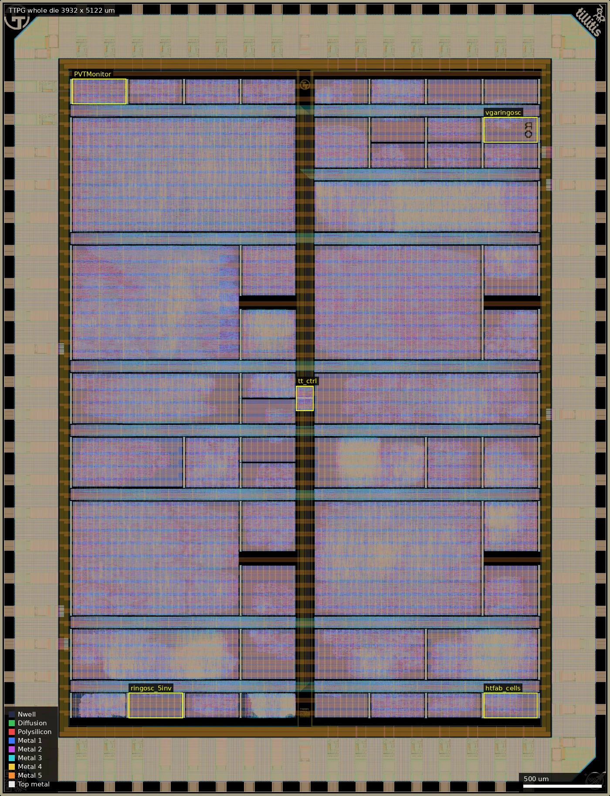
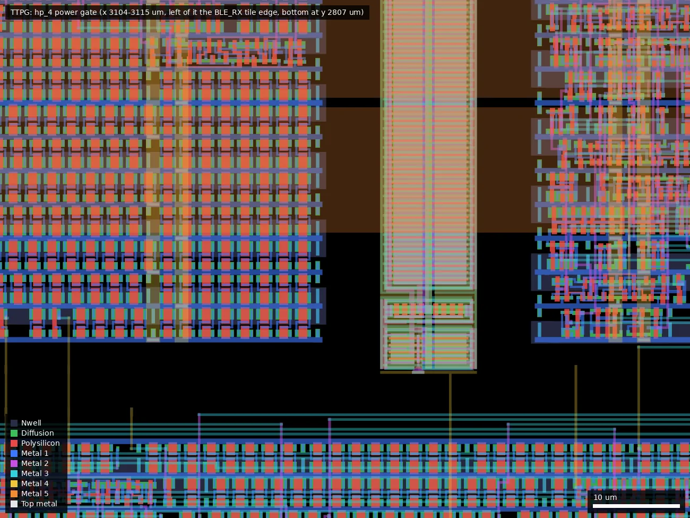
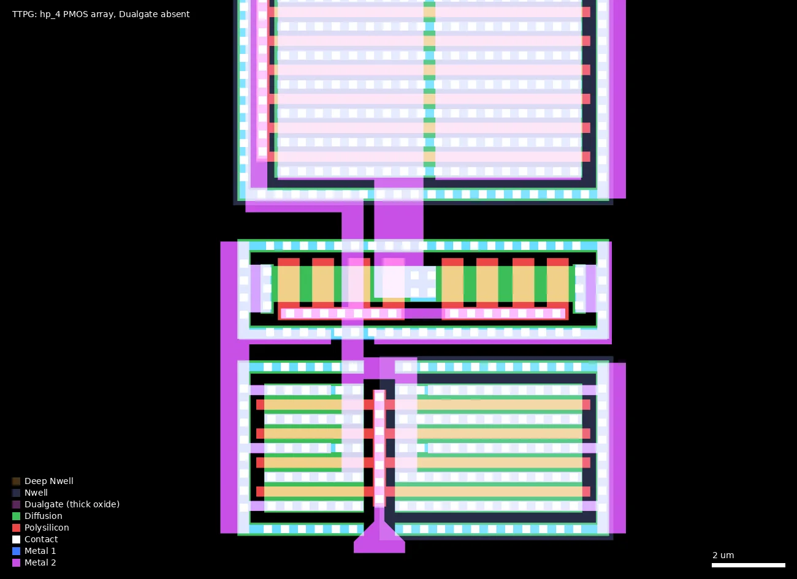
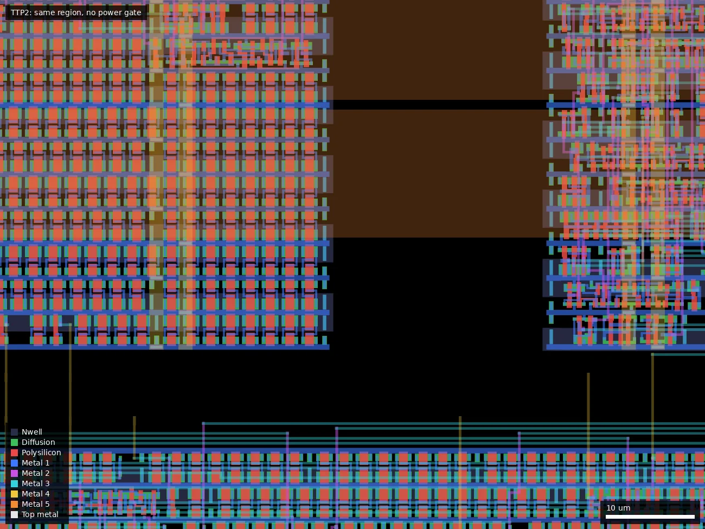

# TTPG: Tiny Tapeout GF 0p2 - Power Gated Variant (ws-run1)

| | |
|---|---|
| Repository | https://github.com/TinyTapeout/tinytapeout-gf-0p2 @ 4150e96 (main, last commit 2026-04-29); taped out from ff701ba on branch `powergate` (committed 2025-12-10), release `tapeout-ws2512-powergate` |
| Slot | 1x1 |
| Top cell | tt_gf_wrapper |
| Licence in repo | Apache-2.0 (`LICENSE`; no licence claim on the platform) |
| README | Thin: 75 words, links out to tinytapeout.com and the multiplexer docs; does not mention the power-gated variant |
| Taped-out layout | TTPG_tt_gf_wrapper_6_2, 3932 x 5122 um, 1 placement on the G801 reticle (x 12.036 mm, y 5.242 mm) |

## What the repo actually contains

### This variant (TTPG, die id G801TTPG)

TTPG is the power-gated build: release `tapeout-ws2512-powergate` ("Tapeout with Power Gating and Split rail I/O"), built from commit ff701ba, the one commit on branch `powergate` on top of the TTP2 commit. That commit sets `no_power_gating: false`, moves `tt-multiplexer` to b6bed69 and the PDK submodule to cae6f09, and changes the testbench supply names to `dvdd`/`dvss`. The resulting differences from TTP2, read from the two release netlists:

- Every one of the 52 projects gets its own PMOS header switch between the core rail and its local `GPWR` rail: 26 x `tt_pg_3v3_hp_1`, 21 x `tt_pg_3v3_hp_2`, 5 x `tt_pg_3v3_hp_4` (11.2 um wide, 160.72 / 325.36 / 736.96 um tall, sized to the project height). The mux forces the high-performance (`hp`) variant for all sizes (`py/tt/placer.py`). The placed macros contain no Dualgate or V5_XTOR shapes (measured in the taped-out layout), so the switches are 3.3 V thin-oxide devices (0.28 um gates) while the logic they feed is thick-oxide 7t5v0 cells; see `## Taped-out layout`.
- The pad ring is `gf180mcu_ocd_io` instead of `gf180mcu_fd_io`, cell for cell (16 `bi_24t`, 10 `in_c`, 3 `in_s`, 29 `asig_5p0`), with split rails: 4 `dvdd` + 6 `dvss` for the IO ring and 2 `vdd` + 4 `vss` for the core, on separate nets (`dvdd`/`dvss` versus `vdpwr`/`vgnd` in `odb_power.py`).
- Per-module Metal5 power straps are generated (`ModulePowerStrapper` enabled in `odb_route.py`).
- The project macros, `tt_mux` and `tt_ctrl` are the same designs (identical GDS sizes in the two `macros.zip` archives, except `tt_um_chip_rom`, whose ROM is regenerated per build); `shuttle_index.json` differs only in the commit fields.

Submitted layout: `releases/tapeout-ws2512-powergate/tt_gf_wrapper.oas` (16.5 MB), precheck output GDS 544.5 MB, sha256 `f9e7dee5...` matching `project.json`. The baseline build without gates is TTP2.

### The shuttle (common to TTP2 and TTPG)

Tiny Tapeout GF 0.2 is a multi-project die: 52 small user designs behind the Tiny Tapeout multiplexer, on a wafer.space 1x1 slot (die 3932 x 5122 um per `cfg/gf180mcuD.yaml` in `macros.zip`). One project at a time is selected through three control pads (`ctrl_ena`, `ctrl_sel_inc`, `ctrl_sel_rst_n`) and gets 8 inputs (`ui`), 8 outputs (`uo`), 8 bidirectionals (`uio`), `clk` and `rst_n`. All 52 projects on this shuttle are digital: `shuttle_index.json` lists every mux column as `digital`, `cfg/gf180mcuD.yaml` has `analog: []`, and no project has `analog_pins`.

The repository is the integration repo, not the design sources:

| Path | Contents |
|---|---|
| `config.yaml`, `modules.yaml`, `mux_overrides.yaml` | Shuttle id `ttgf0p2`, PDK `gf180mcuD`, top macro `tt_gf_wrapper`, submission deadline 2025-11-24, `no_power_gating: true` on `main` |
| `projects/tt_um_*/` (52 dirs) | Per project: hardened `.oas` layout, `.lef`, gate-level `.v` netlist, `info.yaml`, `docs/info.md`, `commit_id.json`, `pdk.json`, `stats/`. No RTL, no testbenches; those live in each author's own repo (linked in the table below, not cloned here) |
| `tt-multiplexer/` (submodule, `gf-experimental` branch, 30c3f44) | Mux RTL (`rtl/tt_mux.v`, `tt_ctrl.v`, `tt_top.v`, `tt_gf_gpio.v`, `prim_gf180mcuD/`), LibreLane build scripts and custom OpenDB placement/routing/power scripts in `ol2/tt_top/` |
| `tt/` (submodule tt-support-tools) | Shuttle tooling, chip ROM generator, logo generator |
| `gf180mcu/` (submodule wafer-space/gf180mcu @ 77cb860, describes as 1.6.4) | PDK: `gf180mcu_fd_io`, `gf180mcu_fd_ip_sram`, `gf180mcu_fd_pr`, `gf180mcu_fd_sc_mcu7t5v0`, `gf180mcu_fd_sc_mcu9t5v0` |
| `librelane/` (submodule) | Flow |
| `verilog/dv/mux/` | cocotb mux testbench (`test_mux_tb.v`); `verilog/gl/` is empty in git |
| `docs/` | `full_gds.png`, `logic_density.png`, datasheet includes |

Flow: each project was hardened in its own repo by the Tiny Tapeout GitHub action (LibreLane 2.4.2 for 44 projects, 3.0.0.dev45 for 7; `pdk.json` in each project dir), then `tt_ctrl`, `tt_mux` and the top level are hardened here with LibreLane. Top-level timing corners in `ol2/tt_top/build.py` are `tt_025C_3v30`, `ss_125C_3v00`, `ff_n40C_3v60`, so the chip is a 3.3 V design built on the 5 V-rated 7-track library.

Standard cells: `gf180mcu_fd_sc_mcu7t5v0` everywhere (496,406 cell-instance lines across the project netlists) except `tt_um_rejunity_vga_test01`, which is the only project using `gf180mcu_fd_sc_mcu9t5v0` (9,613 instance lines). No SRAM macros, no custom cells, no analog devices in any user project (checked by scanning every `projects/*/*.v`).

Pad frame (`tt-multiplexer/ol2/tt_top/tt_gf_wrapper.v`, 74 pads): 3 control inputs, `clk`, `rst_n`, 8 `ui` (input cells `in_c`/`in_s`), 8 `uo` and 8 `uio` (`bi_24t`, 24 mA drive setting), 22 pads wired as analog (`asig_5p0`) plus 5 reserved and 2 "VDD Analog" positions also built as `asig_5p0`, and the supply pads. The 22 analog pads exist physically but nothing is routed to a user project on this shuttle.

Also on the die: `gf180mcu_ws_ip__id` and `gf180mcu_ws_ip__logo` (wafer.space id/logo macros), four Tiny Tapeout logo macros on metal (`tt_logo_top`, `tt_logo_bottom`, `tt_logo_corner_tl`, `tt_logo_corner_tr`).

Verification artefacts are in the release assets, not in git: full LibreLane run directory for the top level (`GDS.zip`, about 800 files per variant: synthesis, STA, DRC, LVS, antenna reports), all hardened macros (`macros.zip`), final GDS/OAS/netlist (`foundry_submission.zip`), gate-level mux simulation waveform (`gl_test_vcd.zip`, `results.xml`), and the wafer.space precheck log, run tarball and output GDS. Both precheck logs end "Precheck successfully completed" with KLayout density, antenna, DRC and Magic DRC checks clear. No silicon bring-up data is in the repo.

### Projects on the shuttle (52, identical on both variants)

Author and function are as declared in each project's `info.yaml`; addresses and source commits are from `shuttle_index.json`.

| Addr | Macro | Title | Author (as declared) | Function | Tiles | Source repo@commit |
|---|---|---|---|---|---|---|
| 0 | `tt_um_chip_rom` | Chip ROM | Uri Shaked | ROM with information about the chip | 1x1 | TinyTapeout/tt-chip-rom@bb74372 |
| 1 | `tt_um_factory_test` | Tiny Tapeout Factory Test | Tiny Tapeout | Factory test module | 1x1 | TinyTapeout/ttgf0p2-factory-test@e2afeb5 |
| 32 | `tt_um_zedtc1_top` | Zedulo TestChip1 | Zedulo | Integration of UART and SPI IP's | 1x1 | ZeduloTech/ttgf-zed_tc1@49dd039 |
| 33 | `tt_um_waferspace_vga_screensaver` | Wafer.space Logo VGA Screensaver | Uri Shaked | Wafer.space Logo bouncing around the screen (640x480, TinyVGA Pmod) | 1x2 | TinyTapeout/tt-waferspace-vga-screensaver@ef9a2f0 |
| 38 | `tt_um_schoeberl_wildcat` | Wildcat RISC-V | Martin Schoeberl | Wildcat: a 3-stage RISC-V implementation | 3x2 | schoeberl/ttgf-wildcat@3d80b97 |
| 39 | `tt_um_MichaelBell_tinyQV` | TinyQV Risc-V SoC | Michael Bell | A Risc-V SoC for Tiny Tapeout | 3x4 | MichaelBell/ttgf0p2-tinyQV@05c3ee5 |
| 101 | `tt_um_BLE_RX` | SCµM-BLE-RX | Dingyu Zhou | Digital Baseband for SCµM3 BLE | 3x4 | ZDYnb/ttgf-BLE_Receiver@deabc38 |
| 102 | `tt_um_gf0p2_faust_top` | Silly-Faust | Louis Ledoux, Cochard Pierre | Trial to use the audio circuit compiler for open silicon | 4x2 | Bynaryman/ttgf0p2-faust-mlir-silicon@3a95209 |
| 103 | `tt_um_htfab_caterpillar` | Simon's Caterpillar | htfab | Port of Caterpillar Logic to Simon Says PMOD | 1x2 | htfab/ttgf0p2-caterpillar@d6f414f |
| 128 | `tt_um_vga_clock` | VGA clock | Matt Venn | Shows the time on a VGA screen | 1x1 | mattvenn/GF180-VGA-clock-waferspace@b6cebcb |
| 129 | `tt_um_essen` | 2x2 MAC Systolic array with DFT | Julia Desmazes | 2x2 multiply and accumulate systolic array supporting signed 8 bit values with design for test infrastructure. | 1x2 | Essenceia/Systolic_MAC_with_DFT@40af618 |
| 130 | `tt_um_urish_usb_cdc` | USB CDC (Serial) Device | Uri Shaked | USB to UART bridge, 115200 baud rate | 1x2 | urish/tt-usbcdc-device@3b4fa47 |
| 134 | `tt_um_rejunity_vga_test01` | VGA Drop (audio/visual demo) | ReJ aka Renaldas Zioma, eriQue aka Erik Hemming, Matthias Kampa | Tiny 8 part Megademo! TBL^Nesnausk^SonikClique | 2x2 | rejunity/tt08-vga-drop@1aaffbb |
| 135 | `tt_um_algofoogle_raybox_zero` | raybox-zero TTGF0p2 edition | algofoogle (Anton Maurovic) | TTGF0p2 v1.8-dev submission of 'simple VGA ray caster game demo' from TT07/TTCAD25a | 3x4 | algofoogle/ttgf0p2-raybox-zero@e970ffb |
| 194 | `tt_um_2048_vga_game` | 2048 sliding tile puzzle game (VGA) | Uri Shaked | Slide numbered tiles on a grid to combine them to create a tile with the number 2048. | 2x2 | urish/tt-2048-game@5f31e53 |
| 196 | `tt_um_thezoq2_quickscope` | Quickscope | Frans Skarman | A quick logic analyzer | 1x2 | TheZoq2/tt-um-thezoq2-quickscope@0bac396 |
| 197 | `tt_um_lisa` | LISA 8-Bit Microcontroller | Ken Pettit | 8-Bit Microcontroller SOC with 128 bytes DFFRAM module | 3x4 | kdp1965/ttgf-um-lisa@47394c4 |
| 198 | `tt_um_MATTHIAS_M_PAL_TOP_WRAPPER` | easy PAL | Ken Pettit | This is a simple PAL (by Matthias Musch) using shift-register based configuration | 1x2 | kdp1965/ttgf-um-easy-PAL@9934a6b |
| 199 | `tt_um_a1k0n_nyancat` | VGA Nyan Cat | Andy Sloane | Displays the classic nyan.cat animation | 1x2 | a1k0n/ttgf0p2-a1k0n-nyan@70a13d8 |
| 288 | `tt_um_mmorri22_lockpick_game` | Notre Dame - Lockpick Game TT Example | Matthew Morrison | An example SystemVerilog Implementation of a pipelined input/output for future TinyTapeout use in the classroom | 1x2 | mmorri22/lockpick@e91ac30 |
| 295 | `tt_um_kianV_rv32ima_uLinux_SoC` | KianV uLinux SoC | Hirosh Dabui | A RISC-V ASIC that can boot μLinux. | 4x4 | TinyTapeout/KianV-RV32IMA-RISC-V-uLinux-SoC@a55d169 |
| 358 | `tt_um_mmorri22_cse_30342` | Notre Dame - CSE 30342 - DIC - Advanced FSM Final Project Example | Matthew Morrison | Example of SystemVerilog code with FSM and IO pipelining. | 1x2 | mmorri22/tt_um_mmorri22_cse_30342@d02f138 |
| 359 | `tt_um_simple_riscv` | Simple RISC-V | kinako71-2 | Simple RISC-V based on the university lecture | 4x2 | urish/TTGF0p2@3bd809e |
| 384 | `tt_um_kercrafter_leds_racer` | LEDs Racer | KerCrafter | Funny electronic game with WS2812B LEDs | 1x2 | KerCrafter/FPGA-LEDs-Racer@3934b10 |
| 385 | `tt_um_frequency_counter` | Frequency Counter SSD1306 OLED | Pawel Sitarz (embelon) | Simple Frequency Counter displaying result on SSD1306 SPI OLED | 1x2 | embelon/ttgf-frequency-counter-oled@5cd5a50 |
| 391 | `tt_um_proppy_megabytebeat` | megabytebeat | proppy | Best-of compilation of bytebeat 2011's greatest hits on-a-chip. | 3x2 | proppy/ttgf-bytebeat@b8f189a |
| 451 | `tt_um_htfab_asicle2` | Asicle v2 | htfab | Wordle clone in raw silicon | 2x2 | htfab/ttgf0p2-asicle2@617a913 |
| 454 | `tt_um_noritsuna_CAN_CTRL` | CAN Controller for Rocket | Noritsuna Imamura | CAN Controller for Rocket | 1x2 | noritsuna/ttgf0p2-tt_um_noritsuna_CAN_CTRL@3382f0e |
| 455 | `tt_um_rejunity_z80` | Zilog Z80 | ReJ aka Renaldas Zioma | Z80 open-source silicon. Goal is to become a silicon proven, pin compatible, open-source replacement for classic Z80. | 2x2 | rejunity/z80-open-silicon@fcca06f |
| 481 | `tt_um_htfab_rotfpga2` | ROTFPGA v2 | htfab | A reconfigurable logic circuit made of identical rotatable tiles | 1x2 | htfab/ttgf0p2-rotfpga@7630b66 |
| 483 | `tt_um_digital_clock_example` | 7-Segment Digital Desk Clock | Samuel Ellicott | 7-Segment Desk Clock | 1x1 | sellicott/digital_clock_gf0p2@cb29e49 |
| 485 | `tt_um_javibajocero_top` | MarcoPolo | Javier Munoz Saez | when this UART receives 'MARCO' answers ' POLO! ' , adapted from https://github.com/javiBajoCero/ttihp-verilog-template | 1x1 | javiBajoCero/ttgf-verilog-template@60d81a4 |
| 487 | `tt_um_flummer_ltc` | Linear Timecode (LTC) generator | Thomas Flummer | Timecode generator for audio video syncronization | 1x1 | flummer/tt-um-flummer-ltc@445f151 |
| 513 | `tt_um_rejunity_sn76489` | Classic 8-bit era Programmable Sound Generator SN76489 | ReJ aka Renaldas Zioma | The SN76489 Digital Complex Sound Generator (DCSG) is a programmable sound generator chip from Texas Instruments. | 1x1 | rejunity/tt05-psg-sn76489@9c47b3e |
| 515 | `tt_um_rejunity_vga_logo` | VGA Tiny Logo | Renaldas Zioma | Large 480x480 pixels Tiny Tapeout logo with bling and dithered colors crammed into 1 tile! | 1x1 | rejunity/ttgf-vga-tiny-tapeout-animated-logo@1990f02 |
| 517 | `tt_um_dlmiles_ringosc_5inv` | Ring Oscillator (5 inverter) | Darryl Miles | Ring Oscillator (5 inverter) | 1x1 | dlmiles/ttgf0p2-ringosc-5inv@5d157f5 |
| 519 | `tt_um_urish_simon` | Simon Says memory game | Uri Shaked | Repeat the sequence of colors and sounds to win the game | 1x1 | urish/tt-simon-game@4406395 |
| 545 | `tt_um_kbeckmann_flame` | Flame demo | Konrad Beckmann & Linus Mårtensson | Flame demo | 1x1 | kbeckmann/ttgf0p2-kbeckmann-flame@4995c9c |
| 547 | `tt_um_wokwi_445338187869298689` | WokwiPWM | Ken Pettit | A 4-channel PWM impelemented in PWM gates | 1x1 | kdp1965/ttgf-um-wokwi-pwm@7b302e2 |
| 549 | `tt_um_SophusAndreassen_dogbattle` | Dog Battle Game | Sophus Andreassen | A simple VGA dog battle game with 2 moving boxes that collide. | 1x1 | jorgenkraghjakobsen/tt_gf_dog_fight@64f1c9b |
| 551 | `tt_um_zacky1972_PVTMonitorSuite` | PVTMonitorSuite | Susumu Yamazaki | PVTMonitorSuite: A fully digital, modular suite for measuring gate delays, flip-flop timings, and clock skew under varying process, voltage, and te... | 1x1 | zacky1972/ttgf0p2-PVTMonitorSuite@39c84d4 |
| 577 | `tt_um_wokwi_392873974467527681` | PILIPINAS_IC | Alexander Co Abad and Dino Dominic Ligutan | 7-seg Display for PILIPINASLASALLE | 1x1 | alexandercoabad/PILIPINAS_IC@2b47c8c |
| 579 | `tt_um_wokwi_442081253563458561` | PRISM 8 with TinySnake | Ken Pettit | PRISM plus Tiny Snake implemented in Wowki | 1x1 | kdp1965/ttgf-um-pettit-prism@8b88e9a |
| 581 | `tt_um_calonso88_spi_i2c_reg_bank` | Register bank accessible through SPI and I2C | Caio Alonso da Costa | Register bank accessible through SPI and I2C | 1x1 | calonso88/tt_spi_i2c_reg_bank@42088eb |
| 583 | `tt_um_htfab_cells` | Cell mux | htfab | All the gf180mcu 7-track standard cells | 1x1 | htfab/ttgf0p2-cells@b9b93b0 |
| 609 | `tt_um_spi_cpu_top` | Super-Simple-SPI-CPU | James Ashie Kotey | A 4-bit CPU using the SPI Flash RAM from the QSPI PMOD to load programs. | 1x1 | Sheffield-Chip-Design-Team/SPI-CPU-Final@3aeeb62 |
| 610 | `tt_um_dlmiles_bad_synchronizer` | Example of Bad Synchronizer | Darryl Miles project from Eric Smith | Figure 29.3 from Dally & Harting | 1x1 | dlmiles/ttgf25a-bad-synchronizer@71b873f |
| 611 | `tt_um_htfab_vga_tester` | Video mode tester | htfab | Experiment with different VGA timing parameters | 1x1 | htfab/ttgf0p2-vga-tester@c942582 |
| 612 | `tt_um_multi_bit_puf_wrapper` | One Bit PUF | Yimin Gao and Ceylan Morgul | It is a PUF based on a difference of two registers | 1x1 | Capulus123/ttihp03-multi-bit-puf@64a9385 |
| 613 | `tt_um_dlmiles_ddr_throughput_test` | DDR throughput and flop aperature test | Darryl Miles project from Eric Smith | Grab data on every edge of clock with varying pos pulse width | 1x1 | dlmiles/ttgf25a-ddr-throughput-test@26f5e45 |
| 614 | `tt_um_algofoogle_vgaringosc` | Ring osc on VGA | algofoogle (Anton Maurovic) | VGA display visualisation of a ring oscillator doing work | 1x1 | algofoogle/ttgf0p2-vga-ring-osc@cdefb8e |
| 615 | `tt_um_dlmiles_loopback` | GF180MCU loopback tile with input skew measurement | Darryl Miles project from Eric Smith | Count up to 10, one second at a time. | 1x1 | dlmiles/ttgf25a-loopback-with-skew@b29b383 |

Projects relevant to process characterisation, individually:

- **`tt_um_dlmiles_ringosc_5inv`** (addr 517, Darryl Miles). Free-running ring of `inv_1` cells with an enable on `ui[0]` and a 16-stage ripple divider: /1 to /128 on `uo[0..7]`, /256 to /32768 on `uio[0..7]`. Netlist has 21 `inv_1`, 16 `dffrnq_1`, 4 `dlyb_1`, 1 `and3_1`. The title says 5 inverters; the netlist holds 21 `inv_1`, so which of them form the ring was not traced.
- **`tt_um_algofoogle_vgaringosc`** (addr 614, Anton Maurovic). Hand-instantiated `inv_2` chain (162 `inv_2` in the netlist) with selectable loop-back taps at 3, 5, 7, 9, 13, 17, 21, 25, 33, 41, 49, 65, 97 and 161 stages (`clksel[3:0]` on `ui[3:0]`), plus fixed 5-stage `inv_1` and 5-stage `inv_4` rings (`clksel2` on `uio[1:0]`). Raw oscillator on `uio[4]`, /2, /4, /8 on `uio[5..7]`. Docs expect 15 MHz to 350 MHz. This gives stage delay versus ring length and versus drive strength from one tile.
- **`tt_um_zacky1972_PVTMonitorSuite`** (addr 551, Susumu Yamazaki). Inverter ring and NAND2 ring with dividers (`uo[0]`, `uo[1]`; docs give t_pd = 1/(32 x 51 x f) and 1/(32 x 41 x f)), clk-to-Q plus setup measurement for a standard DFF and for DICE and LEAP-DICE radiation-hardened flip-flops built from gates, and a time digitiser for clock skew, read out on `uio[7:0]` against an external 50 MHz reference. The docs say "no standard cells from the GF180MCU PDK process are used"; the hardened netlist is entirely `gf180mcu_fd_sc_mcu7t5v0` cells (427 `buf_1`, 196 `dffrnq_1`, 60 `clkinv_1`, 43 `nand2_1`, ...), so that sentence can only mean none are instantiated by hand in the RTL.
- **`tt_um_htfab_cells`** (addr 583, htfab). One instance of each cell of the 7-track library with inputs on `ui[7:5]`/`uio[2:0]` and 210 cell outputs paged onto `uo[7:0]` by `ui[4:0]` (27 pages). The netlist references 223 distinct `gf180mcu_fd_sc_mcu7t5v0__*` cell names (the PDK LEF has 229 macros). A functional truth-table check of the whole library in silicon, including tristate, latch, ICG and delay cells.
- **`tt_um_dlmiles_loopback`** (addr 615), **`tt_um_dlmiles_ddr_throughput_test`** (addr 613), **`tt_um_dlmiles_bad_synchronizer`** (addr 610) (Darryl Miles, ported from Eric Smith's sky130 designs). Loopback with input-skew measurement, a clock-doubler with variable pulse width built from `inv_2`/`dlyb_1`/`dlyc_1` chains to probe flip-flop aperture, and a deliberately bad synchroniser for metastability rate. These exercise flip-flop setup/hold and the pad input/output path delay.
- **`tt_um_multi_bit_puf_wrapper`** (addr 612, Yimin Gao and Ceylan Morgul). 256 cross-coupled cells (256 `nor2_1` + 256 `or2_1` + 256 `latq_1`) read out by address; start-up state depends on local device mismatch.
- **`tt_um_factory_test`** (addr 1). Input-to-output mirror and 8-bit counter; the reference for pad-to-pad delay through the mux.
- **`tt_um_essen`** (addr 129, Julia Desmazes). 2x2 MAC systolic array with a scan chain/JTAG ("with DFT"); a structural-test data point rather than a device structure.
- **`tt_um_lisa`** (addr 197, Ken Pettit). Microcontroller with a 128-byte flip-flop/latch RAM (no SRAM macro).

## Taped-out layout

| Measured in `layout/TTPG.oas` | |
|---|---|
| Die (top cell `TTPG_tt_gf_wrapper_6_2`) | 3932 x 5122 um, same as TTP2 |
| Top-cell children | 1274 instances: the 1222 of TTP2 plus 52 `tt_pg_3v3_hp_*` power gates (26 `hp_1`, 21 `hp_2`, 5 `hp_4`); 52 tiles, 15 `tt_mux`, 1 `tt_ctrl`, 74 pads, 1062 IO fill cells |
| Pads | 74 `gf180mcu_ocd_io` cells at the same 74 positions as TTP2: 16 `bi_24t`, 10 `in_c`, 3 `in_s`, 29 `asig_5p0`, 4 `dvdd`, 6 `dvss`, 2 `vdd`, 4 `vss`; 4 `cor` corners (355.02 um) |
| Standard cells | `mcu7t5v0`: 200,155 logic, 360,323 fill/tap; `mcu9t5v0`: 3,625 logic, 5,988 fill/tap. Differs from TTP2 by one logic cell (`tt_um_chip_rom` is regenerated per build) and 22 fill/tap placements |
| SRAM macros | none |
| Power gates | 52 `tt_pg_3v3_hp_1/2/4`, one per tile, see below |
| Layers present | As TTP2: no DNWELL, no MIM. Poly resistors (`tie_poly_res*`, `ppolyf`) and MOS caps only in pad-ring cells |
| Custom or analog content | None in tiles. The only non-library, non-tile cells are the 52 power gates and the pad library |

### Does it match the repository?

- Release `tapeout-ws2512-powergate` (`foundry_submission.zip/README.md`: generated from tinytapeout-gf-0p2 at ff701baa3a12..., i.e. the `powergate` branch, not 7416232 which both tags point at). The release `tt_gf_wrapper.oas` and the reticle cell have identical bounding box and identical top-cell children by name (1274, after stripping `$n`): 52 tiles, 52 power gates, 15 mux, 1 ctrl, 74 pads, 1062 IO fill. This agrees with the netlist-based description in this summary (26/21/5 gates, 16/10/3/29 pads, 4+6 `dvdd/dvss`, 2+4 `vdd/vss`).
- Tile spot check: all 52 tile bounding boxes equal `repo/projects/<tile>/<tile>.oas` (except `tt_um_chip_rom`, which has no OAS in `projects/`). Per-layer XOR over 17 layers of the flattened placed cells `tt_um_dlmiles_ringosc_5inv`, `tt_um_algofoogle_vgaringosc`, `tt_um_htfab_cells` and `tt_um_zacky1972_PVTMonitorSuite` against their repo OAS: zero area difference. The same four tiles are also identical in TTP2, as are the placements (position and orientation) of all 52 tiles, the 15 mux, `tt_ctrl` and the logos. A full-die XOR was not run.
- The `gf180mcu_ocd_io` cell layouts could not be compared against a source (the `cae6f09` submodule commit is not in the local clone); only their measured content is given below.

Whole die at 2.8 um/px; tiles, mux spine and pad ring are in the same places as in TTP2. Marked: `tt_um_zacky1972_PVTMonitorSuite` (466-813, 4453-4614 um), `tt_um_algofoogle_vgaringosc` (3119-3465, 4206-4367 um), `tt_um_dlmiles_ringosc_5inv` (830-1177, 502-662 um), `tt_um_htfab_cells` (3119-3465, 502-662 um), `tt_ctrl` (1910-2022, 2477-2638 um). The power gates are 11 um wide strips and are not resolvable at this scale.

### What differs between TTPG and TTP2 in the layout

| | TTP2 | TTPG |
|---|---|---|
| Power gates | none | 52 (26 `hp_1`, 21 `hp_2`, 5 `hp_4`) |
| Pad library | `gf180mcu_fd_io` | `gf180mcu_ocd_io`, same footprints (75.32 x 350 um) |
| Supply pads (16 positions) | 6 `dvdd`, 10 `dvss` | 4 `dvdd`, 6 `dvss`, 2 `vdd`, 4 `vss`; the six changed slots are the same positions in both dies: (26,941), (26,1152), (26,2840), (3906,2418), (3906,3895), (3906,4106) um (pad cell origins) |
| Top-level Metal5 | 173 shapes, 5.06 mm2 | 554 shapes, 7.87 mm2 (per-module power straps) |
| Top-level Metal4 | 10312 shapes, 1.08 mm2 | 10361 shapes, 1.15 mm2 |
| Thick-oxide markers in IO cells (`bi_24t`) | Dualgate 10958 um2, no V5_XTOR | Dualgate 7888 um2, V5_XTOR 3227 um2 |
| Tiles, mux, ctrl, logos | same | same position and content |

The `V5_XTOR` marker appears on the `bi_24t`, `in_c` and `in_s` cells of the `ocd` library and on none of the `fd` IO cells (geometry difference only; I did not evaluate what the marker does in the foundry deck for these cells).

### The power-gate macros

| Property | `tt_pg_3v3_hp_1` | `tt_pg_3v3_hp_2` | `tt_pg_3v3_hp_4` |
|---|---|---|---|
| Count | 26 | 21 | 5 |
| Size (um) | 11.2 x 160.76 | 11.2 x 325.40 | 11.2 x 736.96 |
| PMOS gates (poly over COMP in Nwell and Pplus) | 191 | 397 | 906 |
| Main array: gates of 8.5 um width, 0.28 um length | 190 | 395 | 902 |
| Total W of the 8.5 um gates | 1615 um | 3357.5 um | 7667 um |
| NMOS gates (control buffer) | 9 | 10 | 20 |
| Dualgate, V5_XTOR | none | none | none |
| Labels | `VPWR`, `VGND`, `GPWR`, `ctrl` (Metal4) | same | same |

- Device type: thin-oxide 3.3 V. None of the three macros has a single Dualgate or V5_XTOR shape (area 0), while the logic they feed is the 5 V/6 V-library `mcu7t5v0` on Dualgate and V5_XTOR. The gate length is 0.28 um, the 3.3 V pfet minimum, and the `hp_2` count (395 gates x 8.5 um = 3357.5 um) equals the `pfet_03v3` W=3357.5u nf=395 of the schematic in the gf-0p3 copy. This is geometric evidence, not an extracted netlist.
- Structure: a long column of PMOS gates 8.5 um wide and 0.28 um long (the main array) with, at the bottom end, a small stage of NMOS and PMOS fingers (the `ctrl` buffer); see the detail render.
- Where they sit: each strip abuts a tile of identical height (same bottom and top within 0.04 um) with a 3.36 um gap to the tile edge, outside the tile, in the channel between tiles. Left of the tile for 16 tiles and right of it for 15; in the other 21 cases two same-height tiles are adjacent and the strip sits exactly between them, so geometry cannot say which tile it serves (that needs connectivity, not extracted). The strips sit at x about 451-463 um and 3104-3115 um for the tall tiles, and elsewhere inside the tile columns for the single-row tiles.
- `hp_4` is used for every 736.96 um tile (kianV, BLE_RX, tinyQV, raybox_zero, lisa), `hp_2` for 325.36 um tiles, `hp_1` for 160.72 um tiles.
- Example of scale: the 346.64 x 160.72 um tiles (ring oscillators, cells mux, PVT monitor) have an `hp_1` with 1615 um of PMOS gate width in series with their supply.
- `ctrl` pin wiring to `tt_mux`/`um_pg_ena` and the connection of `GPWR` to the tile rails were not traced.

TTPG, x 3060-3140, y 2790-2850 um: the bottom end of the `hp_4` gate (11.2 um wide, x 3104-3115 um) in the channel to the right of the `tt_um_BLE_RX` tile (left, ends x 3100.7 um), with the next tile to the right. The control stage is at the bottom of the strip (y about 2807-2815 um).

Same macro at x 3098-3120, y 2806-2822 um in detail style: the control stage (small NMOS/PMOS groups in the middle and lower part) and the first rows of the big PMOS finger array above it. There is no Dualgate (thick oxide) shading anywhere.

The same box in TTP2: only straps in the channel, no gate.

## Authors and affiliations

| Person or organisation | Role | Affiliation | Source |
|---|---|---|---|
| Tiny Tapeout (org `TinyTapeout`) | Shuttle operator, repo owner | Tiny Tapeout, tinytapeout.com | `gh api orgs/TinyTapeout`, README |
| Uri Shaked (`urish`) | Shuttle integration; 279 commits; author of chip ROM, Simon, 2048, USB CDC, wafer.space screensaver | Tiny Tapeout / Wokwi (GitHub bio) | `git shortlog`, `gh api users/urish` |
| Sylvain Munaut (`smunaut`) | Author of tt-multiplexer (331 of the submodule's commits), GF180 port, power gates, top-level P&R scripts | not stated | copyright headers in `tt-multiplexer/rtl/*.v`, submodule `git shortlog` |
| Matt Venn (`mattvenn`) | Tiny Tapeout founder; mux contributor; VGA clock project | YosysHQ and Tiny Tapeout (GitHub profile) | `gh api users/mattvenn` |
| htfab | Mux contributor (10 commits here), 5 projects incl. Cell mux | not stated | `git shortlog`, `info.yaml` |
| Kristaps Jurkans | Datasheet tooling commits | not stated | `git shortlog` |
| TinyTapeoutBot | 195 automated project-import commits | Tiny Tapeout automation | `git shortlog` |
| Darryl Miles (`dlmiles`) | Ring oscillator and three timing-test tiles (three "from Eric Smith") | not stated; location UK | `info.yaml`, `gh api users/dlmiles` |
| Anton Maurovic (`algofoogle`) | VGA ring oscillator, raybox-zero | not stated; Adelaide | `info.yaml`, `gh api` |
| Susumu Yamazaki (`zacky1972`) | PVTMonitorSuite | University of Kitakyushu (GitHub company field) | `gh api users/zacky1972` |
| Tillitis, Wit | Funded GF180mcuD support in Tiny Tapeout | sponsors | `docs/funding.typ` |
| wafer.space | Funded manufacturing of the GF 0p2 silicon | sponsor / shuttle provider | `docs/funding.typ` |
| 40-odd individual project authors | One tile each | as declared in the project table; affiliations mostly not stated. Named institutions that appear in titles or repo paths: Notre Dame (Matthew Morrison, course CSE 30342), Sheffield Chip Design Team (James Ashie Kotey), Zedulo | `projects/*/info.yaml` |

## Value for GF180MCU characterisation and PDK development

### Verdict: Medium

Not built as a characterisation chip and everything is synthesised digital on the stock 7-track cells, but several tiles are deliberate delay and timing monitors (three ring-oscillator designs, a full-library cell mux, flip-flop aperture/metastability tests) with direct pad access, and the die exists in two builds (TTP2 without and TTPG with per-project power gates and a different IO library) that differ in nothing else, which makes an A/B comparison possible. No device-level or analog structures.

### Test structures and measurable circuits

Everything below runs on the 3.3 V core supply using `gf180mcu_fd_sc_mcu7t5v0` cells, which are built from the 5 V/6 V thick-oxide devices (the cell GDS carries the Dualgate and V5_XTOR layers), so these measure the 05v0/06v0 transistor models at 3.3 V. Access is always through the Tiny Tapeout mux: select the project address, then use the `ui`/`uo`/`uio` pads. Every measurement therefore includes the mux tristate buffers and the `bi_24t` pad driver; `tt_um_factory_test` (address 1) gives the reference for that path.

| Structure | What it exercises | Access | Where |
|---|---|---|---|
| Ring oscillator, `inv_1`, with /1.../32768 divider | `inv_1` stage delay at 3.3 V; frequency versus supply and temperature | addr 517; enable `ui[0]`; outputs `uo[0..7]`, `uio[0..7]` | `projects/tt_um_dlmiles_ringosc_5inv/` |
| Configurable `inv_2` ring, 14 selectable lengths (3 to 161 stages), plus fixed 5-stage `inv_1` and `inv_4` rings | Stage delay versus chain length and drive strength; wire load contribution | addr 614; `ui[3:0]`, `uio[1:0]` select; `uio[4]` raw, `uio[5..7]` divided | `projects/tt_um_algofoogle_vgaringosc/` |
| Inverter ring and NAND2 ring; DFF, DICE-FF and LEAP-DICE-FF clk-to-Q + setup; skew digitiser | `inv`/`nand2` propagation delay, flip-flop timing arcs in the `.lib` | addr 551; `uo[0]`, `uo[1]` frequencies; `uio[7:0]` counter; needs external 50 MHz on `ui[1]` | `projects/tt_um_zacky1972_PVTMonitorSuite/` |
| All 7-track standard cells, one instance each (223 cell names) | Functional correctness of every cell in the library, including `bufz`/`invz`, latches, `icgt*`, `dly*` | addr 583; page `ui[4:0]`, inputs `ui[7:5]`, `uio[2:0]`, outputs `uo[7:0]` | `projects/tt_um_htfab_cells/` |
| DDR/aperture test, loopback with skew, bad synchroniser | Flip-flop setup/hold window, metastability resolution, pad input path skew | addr 613, 615, 610; needs a skewable clock/data source | `projects/tt_um_dlmiles_*` |
| 256-bit latch PUF | Local mismatch of `nor2_1`/`or2_1`/`latq_1` | addr 612 | `projects/tt_um_multi_bit_puf_wrapper/` |
| 9-track cells in one project | Only `gf180mcu_fd_sc_mcu9t5v0` usage on the die; functional data point | addr 134 (VGA demo) | `projects/tt_um_rejunity_vga_test01/` |
| IO cells: `bi_24t`, `in_c`, `in_s`, `asig_5p0`, supply cells | Pad drive strength (set to the 24 mA code), input thresholds (CMOS and Schmitt), ESD, pad leakage on the 29 unused `asig_5p0` pads | pads directly | `tt-multiplexer/rtl/tt_gf_gpio.v`, `ol2/tt_top/tt_gf_wrapper.v` |
| TTPG only: 52 PMOS power gates `tt_pg_3v3_hp_1/2/4` | 3.3 V thin-oxide `pfet_03v3` on-resistance and off-state leakage (measured in the placed layout: no Dualgate or V5_XTOR, 0.28 um gates, `hp_2` = 395 x 8.5 um; same as the schematic in the gf-0p3 copy of tt-multiplexer) | Not individually pinned out. Observable as core supply current with a project selected versus deselected, and as the frequency difference of the same ring oscillators between TTP2 and TTPG | `tt_pg_3v3_hp_*` cells, 52 placements, one in the channel beside each tile (see `## Taped-out layout`) |
| TTPG only: `gf180mcu_ocd_io` pad library with separate IO (`DVDD`/`DVSS`) and core (`VDD`/`VSS`) rails | Same pad functions as `gf180mcu_fd_io` in a different cell library; allows core and IO to be supplied and measured separately | supply pads | powergate release netlist `tt_gf_wrapper.nl.v` |

Simulation results to compare against: the top-level LibreLane STA reports and SPEF for `tt_ctrl`/`tt_mux` are in `GDS.zip`/`macros.zip`; each project's `stats/metrics.csv` holds its own hardening metrics. No SPICE results for the ring oscillators are in this repo (the oscillating-frequency estimates are prose in the project docs). No power-gate simulation results are in this repo.

### Candidate PDK additions

- `tt_pg_3v3_hp_1`, `tt_pg_3v3_hp_2`, `tt_pg_3v3_hp_4`: header power-switch macros for GF180MCU by Sylvain Munaut. In this repo's history they appear only as GDS, LEF and a blackbox Verilog model (tt-multiplexer commit b6bed69, "[hack] Import power gate directly"); the xschem schematics and magic layouts are in the tt-multiplexer copy used by the gf-0p3 shuttle (`pg/gf180mcuD/`).
- The tt-multiplexer GF180 port itself: `rtl/prim_gf180mcuD/` (primitive wrappers), `rtl/tt_gf_gpio.v` (one wrapper over all pad cell types), and the OpenDB scripts that place power gates and strap per-module power.
- Workarounds recorded in the build, each a pointer to something in the PDK or flow that needed help: `MAGIC_EXT_SHORT_RESISTOR` ("Fixes LVS failures when more than two pins are connected to the same net"), `MAGIC_EXT_UNIQUE: notopports` (added with the power gates), `LVS_FLATTEN_CELLS` for the logo and id macros, `no_drc_cells.txt`, commits "IO routing to fix antenna", "fix: corner logo DRC violations", "fix: top level IO routing DRC violations", "fix: fill", and the wafer-space/gf180mcu commits the shuttle pulled in for fill generation.
- `gf180mcu_ocd_io` used in anger on TTPG (it is not part of the PDK snapshot checked out on `main`).

### What would be needed to use it

- Packaged or bonded parts on the Tiny Tapeout demo board, or any setup that can drive the 3 mux control pads plus `clk`/`rst_n` and reach the 24 user pads. Bare-die probing is possible but the pads are a standard ring, not probe-card friendly test structures.
- A frequency counter or oscilloscope for the ring oscillators (divided outputs are at pad-friendly frequencies; the raw `uio[4]` output of the VGA ring oscillator at up to 350 MHz is beyond what the `bi_24t` pad will pass cleanly).
- A skewable two-channel clock/data source for the three timing tiles; a 50 MHz reference for PVTMonitorSuite.
- Controlled supply and temperature if the goal is PVT data. For the TTP2/TTPG comparison, parts from both builds measured in the same fixture, and a current measurement on the core supply.
- Each author's upstream repo for RTL and test plans; none of that is in this repo.

## Notes and caveats

- TTP2 and TTPG point at the same repository and the platform records the same default-branch commit for both. They are distinguished only by release: `tapeout-ws2512` and `tapeout-ws2512-powergate`. Both git tags point at the same commit 7416232 ("fix: fill", 2025-12-10). The power-gated build was actually generated from commit ff701ba, the single extra commit on branch `powergate` ("feat: power gating and split rail IO"), as recorded in that release's `shuttle_index.json` and `foundry_submission.zip/README.md`. Checking out the `tapeout-ws2512-powergate` tag does not give the power-gated source.
- The `powergate` commit moves the `gf180mcu` submodule to cae6f09, which is not present in the local clone of wafer-space/gf180mcu (not reachable from the fetched refs), so the `gf180mcu_ocd_io` library sources used for TTPG could not be inspected here. It also moves `tt-multiplexer` to b6bed69, which is present.
- `main` has moved 5 commits past the tapeout (documentation and render updates only; `git diff --stat 7416232 HEAD` touches docs, images and the `tt` submodule pointer).
- The repo has 96 remote branches; 93 are per-project CI import branches, the others are `main` and `powergate` (`projects/<macro>-<run id>`), not alternative designs.
- The release directories on disk under `TTP2/releases/` and `TTPG/releases/` are identical copies holding all three releases. The `sha256` in each `project.json` matches the precheck output GDS of the corresponding release (TTP2: `6c2f1172...`, TTPG: `f9e7dee5...`), verified by hashing.
- `g801-draft-2` is an earlier draft submission (one OAS, tag at 707b0ca) and was not analysed.
- Project contents were first checked through the gate-level netlists; the taped-out layout was then compared per tile (bounding boxes for all 52, per-layer XOR for four tiles) and agrees with the repo OAS files.
- Mux address to physical position mapping, and which of the 52 gates is `hp_1`, `hp_2` or `hp_4` (26, 21 and 5 instances), is in `cfg/modules_placed.yaml` inside `macros.zip`; not reproduced here.
- That the power gate is enabled only while its project is selected is inferred from the `um_pg_ena` per-module outputs of `tt_mux`; the control logic was not traced further.
