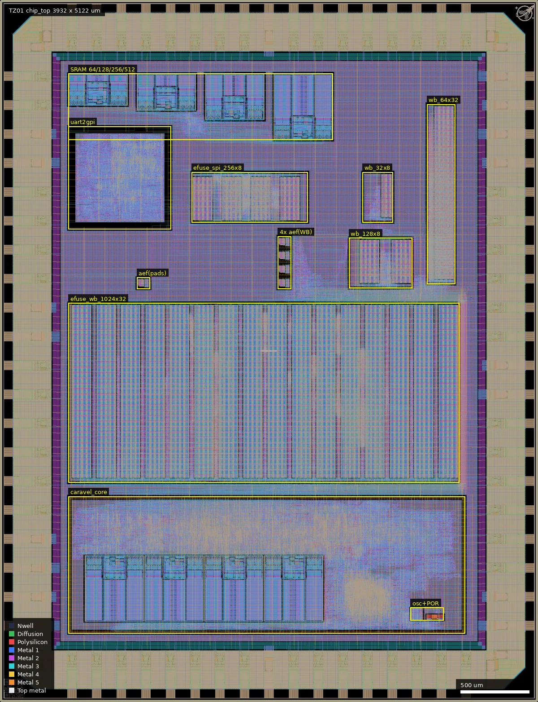
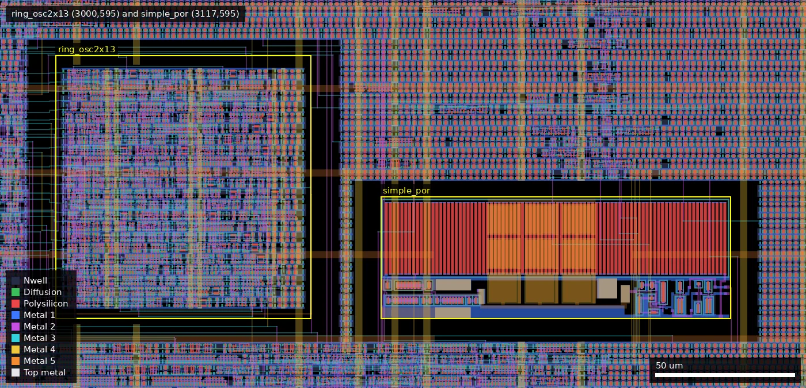
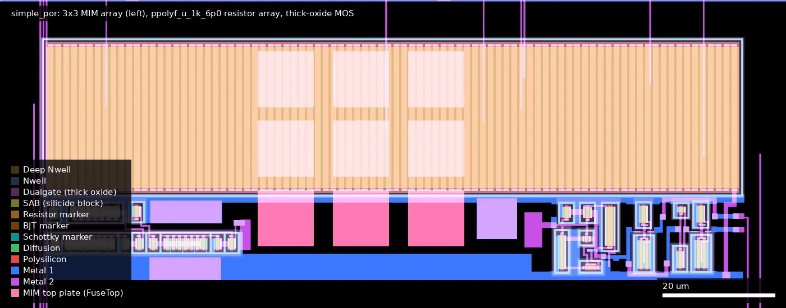
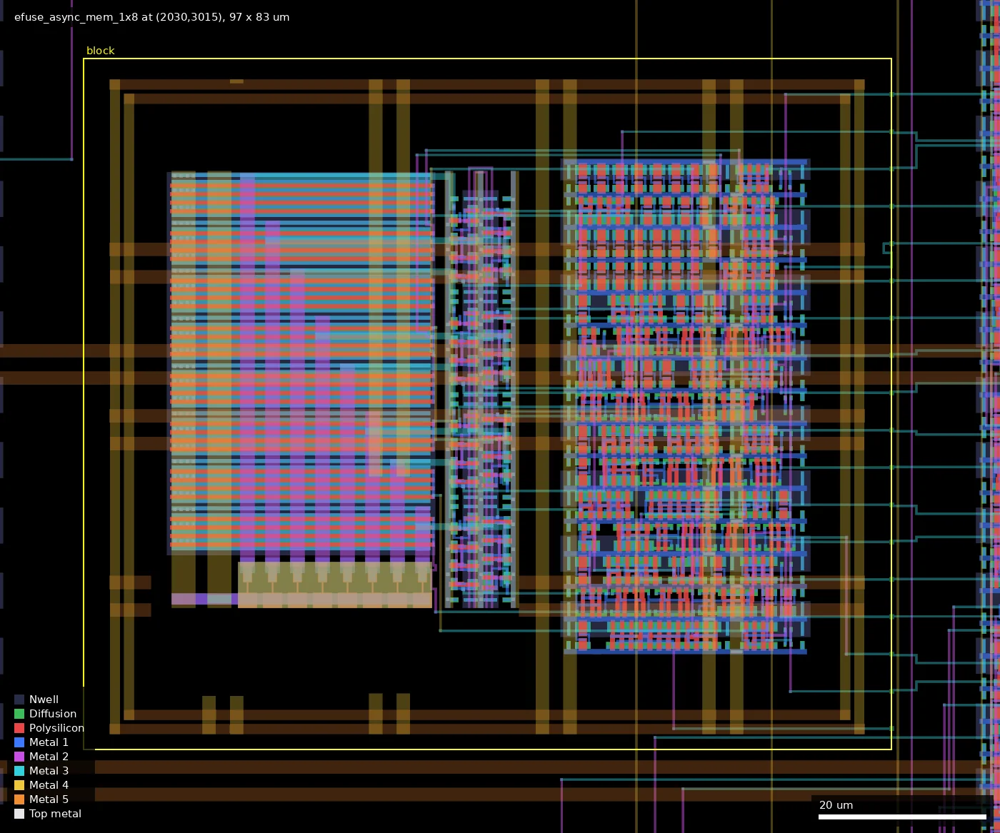
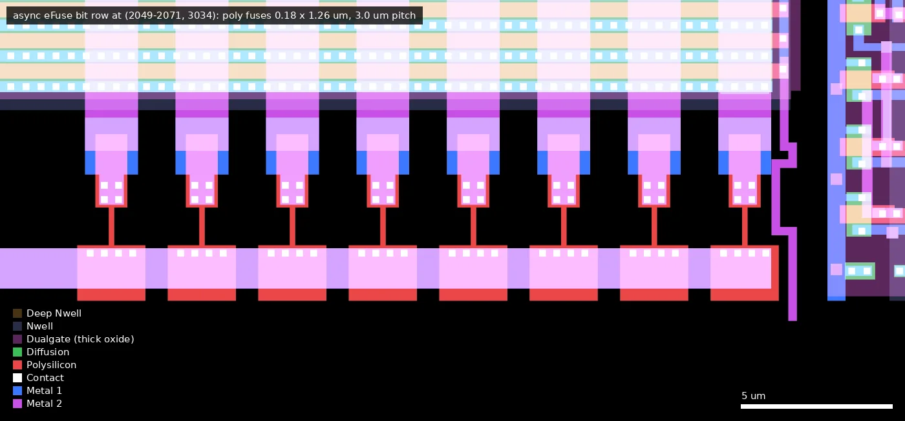
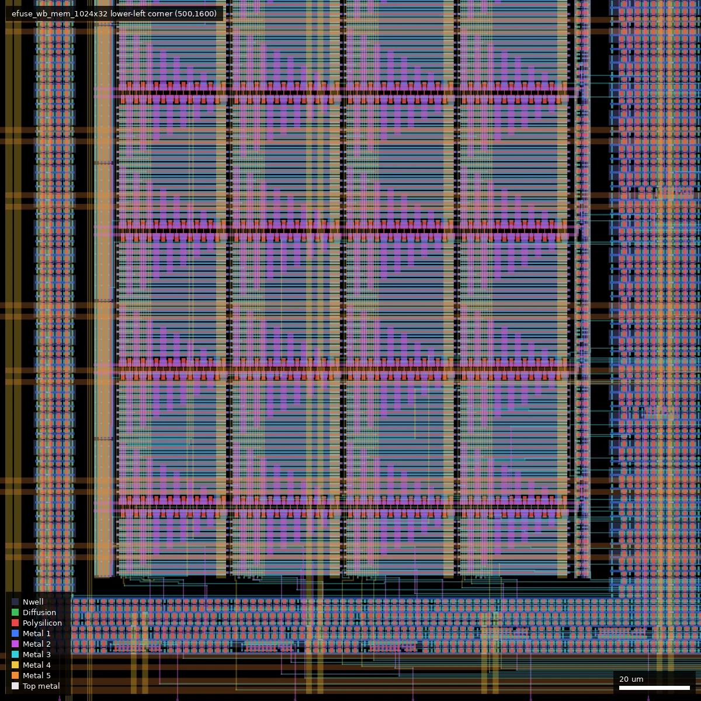

# TZ01: TillitisZedulo-testchip2025 (ws-run1)

| | |
|---|---|
| Repository | https://github.com/ZeduloTech/gf180mcu-testchip2025 @ 1d1f91d (main, last commit 2026-06-17) |
| Slot | 1x1 |
| Top cell | chip_top |
| Licence in repo | Apache-2.0 (`LICENSE`); foundry SRAM models carry GlobalFoundries Apache-2.0 headers |
| README | OK (1491 words): IP list, address map, eFuse variants, UART2GPI protocol, test list, full pad table |
| Taped-out layout | TZ01_chip_top_2_4, 3932 x 5122 um, 2 placements on the G801 reticle |

## What the repo actually contains

A 1x1 test chip built on a Caravel port for wafer.space (VexRiscv management core) whose main purpose is to put several sizes and interface styles of eFuse memory on silicon, together with the foundry SRAMs behind a test controller and a Zedulo peripheral macro. The README states the goal as "to test the flow and several open-source IPs".

Sub-designs:

| Block | What it is | Where |
|---|---|---|
| `caravel_core` | Caravel management SoC (VexRiscv, housekeeping SPI, digital PLL with `ring_osc2x13` DCO, `simple_por`, 2 kB RAM from 4x `gf180_ram_512x8_wrapper`), hardened separately as a macro | `caravel/verilog/`, `caravel/librelane/`, `caravel/final/` (GDS, LEF, lib, pnl, spef) |
| `efuse_wb_mem_1024x32`, `_64x32`, `_128x8`, `_32x8` | Synchronous eFuse memories with Wishbone interface at 0x3000_0000, 0x3000_1000, 0x3000_2000, 0x3000_3000 | `ip/efuse_wb_mem_*/` (GDS, LEF, `.nl.v`, `.pnl.v`, behavioural array model, 9 corner dirs with `.lib` and `.sdf`) |
| `efuse_spi_mem_256x8` | eFuse memory with a 25-series-EEPROM-style SPI interface, on pads | `ip/efuse_spi_mem_256x8/` |
| `efuse_async_mem_1x8` x5 | One-byte asynchronous eFuse, read and latched once at reset; four are mapped as one 32-bit Wishbone word at 0x3000_4000, one is wired entirely to pads | `ip/efuse_async_mem_1x8/`, `src/wb_async_efuse.v` |
| `uspi_sramtest` + 4 SRAM wrappers | Zedulo micro-SPI controller (commands for CEN, write mask, address, read/write with auto-increment) driving `gf180_ram_64x8_wrapper`, `_128x8_`, `_256x8_`, `_512x8_` | `src/sramtest/uspi_sramtest.sv`, `ip/sram/` |
| `uart2gpi` | Zedulo UART-to-peripheral bridge with OpenTitan-derived UART, GPIO, PWM, I2C; hardened as a macro | `uart2gpi/src/`, `uart2gpi/final/` (complete LibreLane views and `metrics.csv`) |
| Glue | Wishbone switch/mux, pad configuration | `src/chip_core.sv`, `src/wb_efuses.v`, `src/wb_switch.v`, `src/wb_mux_5.v`, `src/pinout.vh` |

Flow: LibreLane "Chip" flow (`librelane/config.yaml`, nix shell with the `leo/gf180mcu` LibreLane branch), `gf180mcu_fd_sc_mcu7t5v0` standard cells, `gf180mcu_fd_io` pads, single 5 V domain (corners tt_025C_5v00, ss_125C_4v50, ff_n40C_5v50), 45 ns clock period (22 MHz). Hierarchical: Caravel core, `ring_osc2x13`, `uart2gpi` and the eFuse blocks are pre-hardened macros.

Final outputs in the repo: `final/gds/chip_top.gds.gz` (commit 11bf153, 2025-12-15: "Update the GDS. Should be clear for production."), `final/nl/chip_top.nl.v`, `final/pnl/chip_top.pnl.v`. No top-level DRC/LVS/timing reports or metrics are committed; `uart2gpi/final/metrics.csv` is (0 routing DRC errors, 0 antenna violations, 8772 max-slew violations summed over corners).

Verification: `cocotb/chip_top_tb.py` with 13 tests listed in `cocotb/test_list.json` (eFuse read/write from the CPU, async eFuse, housekeeping SPI, PLL, UART, self-sufficient boot from eFuse, SPI eFuse used as boot flash for a second chip instance, SPI SRAM, UART2GPI), run on RTL and gate level in CI. Caravel-side programs and Verilog benches in `caravel/sim/caravel_sw/` and `caravel/sim/caravel_tb/`. No simulation logs committed.

Post-silicon: the last commit (1d1f91d, 2026-06-17, "Add WB efuse bringup test") adds `caravel/sim/caravel_sw/efuse_rw_bringup.c`, described in its header as an "eFuse Wishbone memory read-write test for bringup (without the largest eFuse and with UART output)". It covers the 64x32, 128x8 and 32x8 blocks. No measured results are in the repo.

Where the new IP comes from (no submodules; everything is vendored as hard views):

- eFuse macros: generated with https://github.com/egorxe/gf180_efuse_compiler (README). GDS cell names show a custom array (`efuse_cell`, `efuse_bitline`, `efuse_bitline_block_*`, `efuse_senseamp`, plain `nmos`/`pmos` pcells) surrounded by `gf180mcu_fd_sc_mcu7t5v0` control logic. No schematic, SPICE netlist or generator source for the array is in this repo.
- SRAM: `ip/sram/gf180_ram_*_wrapper.gds.gz` contain the stock foundry macros `gf180mcu_fd_ip_sram__sram64x8m8wm1`, `__sram128x8m8wm1`, `__sram256x8m8wm1`, `__sram512x8m8wm1` (5 V) inside a wrapper cell that adds via/power connections; commit ca583b7 says the wrappers are from https://github.com/egorxe/gf180mcu-sram-wrappers. These are not new SRAM designs.
- Caravel port: https://github.com/egorxe/gf180mcu-caravel-template.
- `ip/simple_por/`: the Open Circuit Design / Efabless 5 V POR (GDS, LEF, netlist, testbenches), unchanged as far as file names show.

## Taped-out layout

| Item | Measured from `layout/TZ01.oas` |
|---|---|
| Reticle cell, size | `TZ01_chip_top_2_4`, 3932.0 x 5122.0 um (1x1 slot), placed twice on G801 (at 0.060, 10.424 mm and 4.052, 10.424 mm, both r0) |
| Pads | 74 pad slots: 42 `gf180mcu_fd_io__bi_24t` (bidir), 13 `in_c`, 1 `in_s` (clk), 8 `gf180mcu_ws_io__dvdd`, 10 `dvss`, plus 4 corner cells. Pad labels `clk_PAD`, `rst_n_PAD`, `input_PAD[0..11]`, `bidir_PAD[0..41]` agree with the README table |
| Standard cells | `gf180mcu_fd_sc_mcu7t5v0` only: 58,018 logic cells (mostly buf_2, nand2_1, dffq_1, oai21_1) and 228,360 fill/tap cells |
| SRAM | 8 foundry 5 V macros: 4x `sram512x8m8wm1` inside `caravel_core` (2 kB management RAM), and one each of 64x8, 128x8, 256x8, 512x8 at top level for the SPI test controller |
| eFuse macros | 10 placements: `efuse_wb_mem_1024x32`, `_64x32`, `_128x8`, `_32x8`, `efuse_spi_mem_256x8`, 5x `efuse_async_mem_1x8`. 38,184 poly fuse markers in total (32768 + 2048 + 1024 + 256 + 2048 + 40) |
| Analog / custom | `ring_osc2x13` (91.9 x 95.3 um), `simple_por` (125.8 x 43.6 um, 9 MIM caps + 88 `ppolyf_u_1k_6p0` strips), eFuse bit-line/sense-amp cells (custom `nmos`/`pmos`/`efuse_cell` pcells) |
| Transistor flavours | Every gate checked is thick-oxide: no polysilicon-over-COMP gate lies outside Dualgate in `caravel_core` (656,191 gate regions), `uart2gpi` (119,704), `efuse_wb_mem_1024x32` (184,412), `_64x32`, `efuse_spi_mem_256x8`, the 512x8 and 64x8 SRAM wrappers, the async eFuse and the POR and ring oscillator. All are also marked V5_XTOR except the 44 gates of the POR (inside `caravel_core`), which are Dualgate without V5_XTOR (656,147 of 656,191 core gates marked). No thin-oxide 3.3 V logic. Not checked: the pad cells, the 128x8/256x8 SRAM wrappers, `efuse_wb_mem_128x8`/`_32x8` |
| Other devices | 9 MIM capacitors (POR), 88 poly resistors (POR), 38,184 poly fuses; no BJT, no LDMOS, no native devices found by layer (DIODE_MK 13,003 shapes are std-cell/IO diodes) |

### Does it match the repository?

Yes. Compared the GDS in the repository (`final/gds/chip_top.gds.gz`, uncompressed 223 MB) with the taped-out layout, cell by cell after stripping the `$n` suffixes:

- Same top-cell bounding box (3932 x 5122 um), same 2572 distinct base cell names, no cell present in only one of them.
- Same counts for every macro: `caravel_core` 1, `uart2gpi` 1, `efuse_wb_mem_*` 1 each, `efuse_spi_mem_256x8` 1, `efuse_async_mem_1x8` 5, `ring_osc2x13` 1, `simple_por` 1.
- 41 base cell names differ in count, all fill cells (Metal1-5, Poly2, COMP fill: the wafer.space fill step) and router/SRAM-internal via and strap cells (for example `M2_M1` 23858 vs 23724, `Metal5_fill_cell` 415344 vs 412460). I did not settle why the via and SRAM strap counts differ slightly (the macro-level instance counts are equal); the wafer.space flow regenerates fill, which explains the fill cells only.
- Commit of record: `wafer.space-bench/data/designs.csv` records **1d1f91d** (`1d1f91d4f362`, the commit this summary was written from), not 11bf153. The repository GDS is byte-identical at 11bf153 ("Update the GDS. Should be clear for production", 2025-12-15) and at 1d1f91d (sha256 `00b6df76...` of the .gz at both; commit 4ab0358 of 2026-02-23 only changed file modes). Later commits changed README, CI, firmware and tests, not the layout. So this summary reflects the repository state of the taped-out layout. The earlier worry that the platform hash did not match the repo GDS is explained by the wafer.space ID/logo cells and fill, not by a different design.
- Not settled: whether the committed GDS passed DRC/LVS (no reports in the repository).

Whole die, 3932 x 5122 um, pad ring around the edge. Outlined: `caravel_core` (500,500 to 3400,1500) with four 512x8 SRAMs inside it, the 1024x32 eFuse (500,1600 to 3356,2911), UART2GPI (500,3450), SPI eFuse (1400,3500), the 32x8, 128x8 and 64x32 Wishbone eFuses on the right, the four test SRAMs along the top (500..2432, 4100..4585), the pad-connected async eFuse at (1000,3015), the four Wishbone async eFuses at (2030, 3015..3315), and the oscillator and POR at the lower right of the core.

### Test structures located in the layout

| Structure | Cell, position (um), size | Device details measured | Pads |
|---|---|---|---|
| Pad-connected async eFuse (8 bits) | `efuse_async_mem_1x8`, (1000,3015), 97.3 x 83.0 | 8 poly fuses, each 1.26 x 0.18 um (PLFUSE marker, in a 5.53 x 2.26 um EFUSE_MK cell), 3.0 um pitch; no transistor in the fuse cell; all gates Dualgate | `prog[k]` inputs: extracted connectivity (Metal1-5 and vias, fill excluded) shows `prog[2]` and `prog[3]` on the same net as the `in_c` pad cells for `input[4]`, `input[5]` (README pads 60, 61, left edge), and `prog[0]`, `prog[1]`, `prog[4]`, `prog[5]`, `prog[6]` joined to their input pad cells through one `buf_8` each. `prog[7]` and `reset_n` could not be confirmed by this method. Outputs, ready: not traced |
| Four Wishbone async eFuses (32 bits) | `efuse_async_mem_1x8`, (2030, 3015/3115/3215/3315) | same cell; their `prog`, `out` pins sit on nets that match no pad cell | none (Wishbone word 0x3000_4000 via CPU) |
| SPI eFuse | `efuse_spi_mem_256x8`, (1400,3500), 849.7 x 365.8 | 4 x `efuse_array_64x8` (2048 fuses) | via pad cells for CS (`input[1]`) and the SPI pads |
| Wishbone eFuses | `efuse_wb_mem_1024x32` (500,1600; 2856.5 x 1311.1; 16 x `efuse_array_64x32`), `_64x32` (3120,3050; 206.1 x 1311.1), `_128x8` (2550,3020; 464.5 x 365.8), `_32x8` (2650,3500; 222.7 x 365.8) | 1.92 um fuse pitch in the 1024x32 array | CPU only |
| eFuse select and sense devices | `efuse_bitline_block_*`, `efuse_senseamp` | program/select NMOS L = 0.6 um, finger W about 30.5 um; PMOS L = 0.5 um, W 31.0 or 38.25 um; sense amp gates L 0.5 / 0.6 um, W 1.22 / 0.82 um; all Dualgate + V5_XTOR | internal |
| Ring oscillator | `ring_osc2x13`, (3000,595) in the core, 91.9 x 95.3 | 1154 PMOS + 1180 NMOS gate regions (std cells `inv`, `clkbuf`, `invz`, `latrnq`), all 5 V; 13 stages, 26 trim bits (netlist header: 30.4 to 66.4 MHz in SPICE) | no direct metal path to a pad. By the gate-level netlist: ring -> digital PLL -> clock divider -> `wb_clk` and `user_clock`; housekeeping routes them to `mprj_io[33]` and `[32]` by default (`clk1/clk2_output_dest` reset to 1), i.e. pads 11 and 10 after division. Checked from RTL and the PNL netlist, not by metal tracing |
| Power-on reset | `simple_por`, (3117,595), 125.8 x 43.6 | 9 MIM caps of 10 x 10 um (`mim_2p0fF`, netlist `cap_mim_2f0_m4m5_noshield`, about 1.8 pF at 2 fF/um2), 88 `ppolyf_u_1k_6p0` strips each 1.0 x 25.0 um body (2200 um in total = netlist R1 2000 um + R2 200 um); 29 PMOS + 15 NMOS gate regions, all Dualgate (netlist: `pfet_06v0`/`nfet_06v0`) | none: `porb` and `por` are internal to the core. No programming-supply pad exists either; the fuses are programmed from the common VDD (8 `dvdd` pads) with the `prog` pins |
| SRAM macros | `gf180_ram_{64,128,256,512}x8_wrapper`: (500,4350), (1000,4315), (1500,4245), (2000,4100), each 431.9 wide, 232.9 / 268.9 / 340.9 / 484.9 tall; 4 x 512x8 in the core at (619..2361, 585) | stock foundry macros inside the wrapper | SPI pads 49-53 (README) |

`caravel_core` lower right, 290 x 140 um from (2980,570): the 13-stage `ring_osc2x13` (left box, a dense block of standard cells) and `simple_por` (right box, with the resistor array across the top and the three MIM-cap columns below it).

`simple_por` at (3110,590), 140 x 55 um, analog style: 88 poly resistor strips (orange, top), the 3 x 3 grid of MIM top plates (pink squares) and the thick-oxide transistors of the Schmitt trigger and bias mirror at the lower right.

`efuse_async_mem_1x8` at (2030,3015), 97 x 83 um (the pad-connected instance at (1000,3015) is the same cell): fuse array and bit lines on the left, sense logic in the middle, synthesised control logic on the right.

Eight fuses of one async eFuse row at (2046..2076, 3028..3042): each is the thin vertical polysilicon line (0.18 um wide, 1.26 um long) between a contact pad and a wide poly/Metal1 strap; there is no transistor in the bit cell.

Lower-left corner (500,1600, 200 x 200 um) of `efuse_wb_mem_1024x32`: tiles of the fuse array with the rows of programming/select devices running horizontally, and the control logic along the bottom.

## Authors and affiliations

| Person / organisation | Role | Affiliation | Source |
|---|---|---|---|
| egorxe / Egor Lukyanchenko | Caravel port, eFuse compiler and all eFuse blocks, Wishbone glue, cocotb tests, final GDS (52 commits) | not stated (GitHub profile empty) | git log; `AUTHORS.md`; SPDX "© 2025 egorxe"; README |
| Zedulo (GitHub org `ZeduloTech`; committers "Zedulo", "Zedulo.com", `snapaa257`) | SRAM SPI test controller, UART2GPI macro, SRAM integration (18 commits) | Zedulo, Sweden, zedulo.com | git log; `AUTHORS.md`; "Copyright (c) 2025 Zedulo" header; `gh api orgs/ZeduloTech` |
| Leo Moser (`mole99`) | wafer.space project template that the repo is forked from (74 template commits) | not stated (GitHub location Austria) | git log; `AUTHORS.md` |
| Tillitis | "support" | not stated in the repo | platform description and project name only |
| GlobalFoundries PDK Authors | SRAM macros and models | GlobalFoundries | headers in `ip/sram/*.v` |
| Tim 'mithro' Ansell, TrevorPeyton | one template commit each | not stated | git log |

## Value for GF180MCU characterisation and PDK development

### Verdict: High

It is a memory test chip for a macro type the open PDK does not have: ten eFuse macros (38,184 poly fuses, confirmed from the layout) in five sizes and three interface styles, one of them with its programming inputs on pads, plus four foundry SRAM sizes with external SPI access. The layout also carries a MIM-capacitor plus long-poly-resistor POR and a trimmable ring oscillator.

### Test structures and measurable circuits

| Structure | What it exercises | Access (pad numbers from the README table) | Where |
|---|---|---|---|
| `efuse_async_mem_1x8` (pad instance) | Programming of single eFuse bits (program current/time, blown and unblown resistance as seen by the sense amplifier), sense margin versus VDD, read-at-reset behaviour | `aef_prog_0..7` inputs (58-61, 64-67), `aef_out_0..7` (32, 37-43), `aef_ready` (31), `aef_reset` (68) | `ip/efuse_async_mem_1x8/`, `src/chip_core.sv` |
| `efuse_spi_mem_256x8` | 2 kbit eFuse array, program/read through SPI without the CPU | SPI clock 51, MOSI 53, MISO 52 (muxed with SRAM), CS 55 | `ip/efuse_spi_mem_256x8/` |
| `efuse_wb_mem_1024x32` (32 kbit), `_64x32`, `_128x8`, `_32x8`; 4x async on Wishbone | Array-size scaling of bit line and sense amplifier, programming yield over about 39 kbit in total | Through Caravel firmware (flash 19-22, UART 7/9, housekeeping SPI 3-6) | `ip/efuse_wb_mem_*/`, `src/wb_efuses.v`, `caravel/sim/caravel_sw/efuse_rw*.c` |
| Foundry SRAM 64x8, 128x8, 256x8, 512x8 (`gf180mcu_fd_ip_sram`, 5 V) | Function and bit errors of the stock 5 V macros; access time only coarsely, since the SPI controller is in the path | SPI: CS 50, clock 51, MOSI 53, MISO 52, debug 49 | `src/sramtest/uspi_sramtest.sv`, `ip/sram/` |
| `ring_osc2x13` DCO + digital PLL in Caravel | `gf180mcu_fd_sc_mcu7t5v0` gate delay at 5 V (13 stages, 26 trim bits) | Divided clock on `caravel_io_7/8` (pads 10, 11) through the clock divider and housekeeping mux (gate-level netlist, not metal tracing); trim via housekeeping SPI. The ring output itself is not on a pad | `caravel/ring_osc2x13/`; in the layout at (3000,595), 91.9 x 95.3 um |
| `simple_por` | 5 V POR delay; 9 MIM caps (about 1.8 pF) and a 2200 um x 1 um `ppolyf_u_1k_6p0` resistor chain, 5 V transistors | None: `porb`/`por` are internal to the Caravel core; only visible through reset behaviour | `ip/simple_por/`; in the layout at (3117,595), 125.8 x 43.6 um |
| Whole chip | Functional/yield data point for a 5 V synthesised SoC at 22 MHz | all | `final/` |

All circuits are in the single 5 V domain with `gf180mcu_fd_io` pads. The fuse element, now settled from the layout, is a bare polysilicon fuse (1.26 x 0.18 um, drawn on the PLFUSE 125/5 marker inside an EFUSE_MK 80/5 cell outline of 5.53 x 2.26 um) with no transistor in the bit cell; the access devices are the thick-oxide NMOS/PMOS of the bit-line blocks. All 38,184 fuses are this one cell. There is no separate eFuse programming supply pad: programming uses the common 5 V VDD pads and the `prog` inputs.

Simulation data to compare silicon against: per-macro `.lib` and `.sdf` at nine corners for every eFuse block, behavioural eFuse models with timing assertions (`MIN_PRESET_NS = 1`, `MIN_SENSE_NS = 3`, `MIN_WRITE_NS = 1000` in `efuse_async_array_1x8.v`), the Verilator bench for the SRAM tester (`src/sramtest/sim/`), and the cocotb suite. No analog (SPICE) simulation of the fuse cell or sense amplifier is in this repo; it would be in the eFuse compiler repository.

### Candidate PDK additions

- An eFuse / OTP memory compiler and macro family for GF180MCU (`efuse_cell`, bit line, sense amplifier, Wishbone/SPI/async wrappers). This is the main upstream candidate; source at https://github.com/egorxe/gf180_efuse_compiler. The layout shows the PDK has the PLFUSE/EFUSE_MK marker layers but no poly-fuse device model or pcell here: the fuse cell is hand-drawn, and a characterised fuse (blown/unblown resistance, program current) would be the missing piece.
- A verified `ppolyf_u_1k_6p0` resistor model: the POR netlist notes "ppolyf resistors do not simulate correctly" and the die carries a 2200 um long chain of them (88 strips), so the POR delay on silicon would be a direct check of that model, together with the `cap_mim_2f0_m4m5_noshield` MIM model (9 x 10 x 10 um).
- SRAM wrapper cells that make the foundry `gf180mcu_fd_ip_sram` macros usable in LibreLane (https://github.com/egorxe/gf180mcu-sram-wrappers), with per-size `.lib` files.
- A Caravel management-core port for the wafer.space template, including a "self-sufficient" boot mode from eFuse (`caravel_start_mode` pad 69).
- Workarounds visible in `librelane/config.yaml`: `MAGIC_GDS_FLATGLOB` list for the foundry SRAM (cells that must be flattened "to get rid of 3.3V devices (DUALGATE drawn into high-level cells)"), `Metal2_ignore_active` for fill density, `KLayout.Antenna` check disabled, `Checker.YosysSynthChecks` disabled ("Fails due to multisources in PLL"), delay cells excluded from P&R (`caravel/librelane/pnr_exclude.cells`: "they degrade timing").

### What would be needed to use it

Packaged or chip-on-board parts; the README pad numbering is stated to be compatible with the wafer.space COB project. 5 V supply, clock on pad 0, reset on pad 1. For the pad-level async eFuse: a pattern generator and a way to measure supply current during programming. For the SPI eFuse and SPI SRAM: any SPI host. For the Wishbone eFuses: SPI flash with the firmware in `caravel/sim/caravel_sw/` and a UART. Missing: eFuse programming conditions (voltage, pulse width, current) and expected resistance values, the SPI SRAM command documentation (README section "SPI SRAM" is "TODO"; the command set is only in the header comment of `uspi_sramtest.sv`), a written bring-up procedure and any bring-up results.

## Notes and caveats

- The platform describes an "eFUSE and SRAM testchip"; the SRAM part is the unmodified foundry 5 V macro set, so the new-library content is the eFuse.
- The transistor-level eFuse design is not reviewable from this repo (hard views only; the compiler commit used is not recorded), but the layout shows it: poly fuse cells, thick-oxide select devices, a 10-transistor sense amplifier per bit line. Only schematic-level intent (program current, timing) is missing.
- The bring-up firmware deliberately omits the 1024x32 block ("without the largest eFuse") with no reason given; this may simply be to keep the test short, or may point to a problem with that block (not stated).
- `ip/efuse_wb_mem_128x8/` contains a stray `efuse_wb_mem_512x32.nl.v`.
- Tillitis appears only in the platform name and description, not in the repo.
- The platform sha256 (`621d3fa6...`) matches neither `final/gds/chip_top.gds.gz` (`00b6df76...`) nor its uncompressed content (`00fefb9a...`). The layout check above shows the cell hierarchy and macro counts are identical to the repository GDS (which is the same file at 11bf153 and at 1d1f91d, the commit in designs.csv), differing only in wafer.space fill and a few via/strap cell counts, so the hash difference is the wafer.space ID cell and fill, not a different design.
- No top-level sign-off reports are committed; DRC/LVS status rests on the commit message "Should be clear for production".
